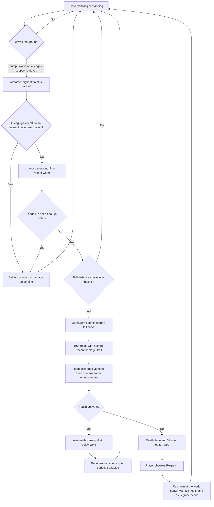
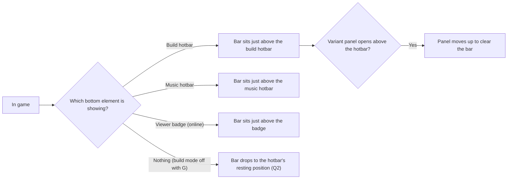
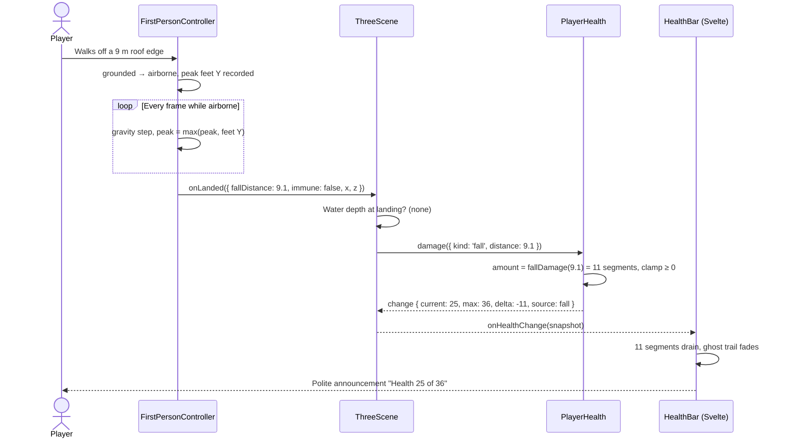

# Forest Drift — Player Health: Brief

**Feature cycle:** 2026-10-30
**Status:** Revision 2. Decisions locked on 2026-10-30 in [`01-questions-and-decisions.md`](01-questions-and-decisions.md). **No implementation until you approve the plan in chat.**
**Related:** [`02-technical-plan.md`](02-technical-plan.md) · [`Forest-Drift-gameplay-research-and-implementation-plan.md`](../../../10-20/Forest-Drift-gameplay-research-and-implementation-plan.md) · [`Forest-Drift-implementation-order.md`](../../../10-22/Forest-Drift-implementation-order.md)

---

## 1. What we are building

1. A **player health system**. It tracks a single health value, takes damage from a source, and handles reaching zero.
2. A **slim health bar** with **36 segments**. It sits just above the hotbar, takes very little vertical space, and shows remaining health as filled segments.
3. **Fall damage** as the first and only damage source. Landing after a long enough drop costs health.
4. A **damage pipeline** built so that other sources (drowning, creatures, lightning, fire and so on) can be added later without touching the bar or the fall code.

## 2. The user problem

Forest Drift has no consequences for movement today. You can jump off a mountain or a three-storey roof and land with no effect. That causes three problems:

- **Height has no meaning.** Cliffs, roofs, stairs and railings have nothing to protect you from. A railing or a staircase is decoration, not a safety feature.
- **There's nothing to build on.** Future gameplay (creatures, weather hazards, expeditions) needs a shared notion of "the player can be hurt". Without one, each future system would invent its own.
- **No feedback on risky movement.** A long fall looks and feels the same as a small step down.

The health system gives falls a cost. The bar tells you, at a glance and without taking screen space from building, how much more you can take.

> **Design tension to settle.** The gameplay research plan (2026-10-20) describes Forest Drift as calm. It lists combat, hunger and destructive hazards as "not prerequisites". Fall damage isn't combat, but it is the game's first punishing mechanic. [Question 1](01-questions-and-decisions.md#question-1-fall-damage-on-by-default-multiple-choice) asks how it should be switched on, so it doesn't quietly change the feel of existing worlds.

## 3. Who it affects

| Player                         | Effect                                                                                               |
| ------------------------------ | ---------------------------------------------------------------------------------------------------- |
| Single-player builder          | Sees the bar above the hotbar. Can be hurt by falling from builds or terrain. Flight still works.    |
| Multiplayer guest / editor     | Same bar and fall damage. Health is held by the server, private to each player, and kept across rejoin (Q20, F1, F2). Flight is already off online. |
| Multiplayer viewer             | Has no hotbar (only the "Viewing only" badge), so the bar sits in the hotbar's place (Q2). Takes fall damage like everyone else. |
| Touch / iPad player            | Same bar. It must not collide with the joystick, the touch dock or the hotbar's variant panel.        |
| Screen-reader / low-vision     | Bar exposed as a meter with a text value. Damage is announced politely. Not signalled by colour alone. |

## 4. Expected user flow

### 4.1 Fall, damage and recovery

### 4.2 Where the bar sits as the HUD changes

### 4.3 Fall damage, step by step

## 5. In scope (v1)

- Health model with a fixed maximum shown as 36 segments.
- Fall damage, with immunity rules for flight, gravity-off, interactions, world load and respawn.
- Slim 36-segment bar above the hotbar, responsive for desktop, small screens, landscape phones and touch.
- Damage feedback: the agreed set from Q17.
- Lethal falls. At zero health: a fade, then a "You fell too far" card with a Respawn button. Respawn is at the world spawn (Q12–Q14).
- Slow regeneration: 1 segment every 3 s after 8 s without damage (Q16).
- A per-world "Fall damage" rule: on for new worlds, off for existing ones, set by the owner online (Q1, Q22).
- Saving health in single-player worlds (Q19).
- **Online:** the server holds each player's health. It's private to that player, kept across leave and rejoin, and built so player-vs-player damage can be added later without rework (Q20, F1, F2). This needs a coordinated release of the Worker and the site (protocol v5).
- Unit and end-to-end tests. See the technical plan.

## 6. Out of scope (v1)

- Any damage source other than falls. The pipeline is built to accept them later.
- Healing items, food, armour, beds or custom spawn points.
- Showing other players' health (it stays private, per Q20), and PvP itself. The server-side health built here is what PvP will use later.
- Changes to movement physics: gravity, jump height or terminal velocity.
- Gamepad rumble. The game has no gamepad support yet.

## 7. Assumptions made while planning

Each one is either confirmed by the code or turned into a question.

| #   | Assumption                                                                                                  | Basis                                                                                                                 | Where it's checked |
| --- | ----------------------------------------------------------------------------------------------------------- | --------------------------------------------------------------------------------------------------------------------- | ------------------ |
| A1  | "The hotbar" means the bottom-centre tool tray (`Hotbar.svelte`).                                            | Only hotbar component in the codebase.                                                                                | Q2                 |
| A2  | The hotbar isn't always visible. It renders only in build mode (toggle **G**) or music mode. Online viewers see a badge instead. | `+page.svelte` around line 2355.                                                                    | Q2                 |
| A3  | Physics are fixed: gravity 18 m/s², jump speed 7 m/s, so a flat jump peaks at ≈1.36 m and lands at 7 m/s. No air drag. | `FirstPersonController.ts` (`GRAVITY`), `TerrainSettings.ts` defaults.                                    | Q7                 |
| A4  | A building storey is 3 m by default.                                                                         | `FoundationTypes.ts` `wallHeight: 3`.                                                                                 | Q7                 |
| A5  | The existing code comment promises that leaving flight mid-air causes no fall damage.                       | `FirstPersonController.setFlying` doc comment.                                                                         | Q10                |
| A6  | Opening the pause menu doesn't stop the player falling. `simulationPaused` only pauses the clock and weather. | `ThreeScene.animate` always calls `controller.update`.                                                               | Q26                |
| A7  | Multiplayer poses carry no health, and the server doesn't check health.                                     | `protocol.ts` and `ThreeScene.animate` multiplayer hook.                                                              | Q20                |
| A8  | Player save state is rebuilt field by field, so a new `health` field must be added to `sanitizePlayerState` or it's silently dropped. | `WorldSerializer.ts` `sanitizePlayerState`.                                         | Q19                |
| A9  | The "36" is a fixed visual segment count, not a value players can upgrade.                                   | Your brief.                                                                                                           | Q6                 |

## 8. Success criteria (summary)

The full list is the Definition of Done in [`02-technical-plan.md`](02-technical-plan.md#18-definition-of-done).

- A drop under the safe height never costs health. A drop over it always costs the documented amount.
- The bar is never covered by, and never covers, the hotbar, its variant panel, the touch controls or the crosshair notice, at all supported viewport sizes.
- No per-frame Svelte updates. The UI changes only when health changes.
- Flight, gravity-off, world load, respawn and interactions never cause damage.
- Saved worlds from before this feature load at full health. Corrupt or hand-edited health values are clamped.
- Online, no other player ever receives your health value, and a client can't raise its own health.
