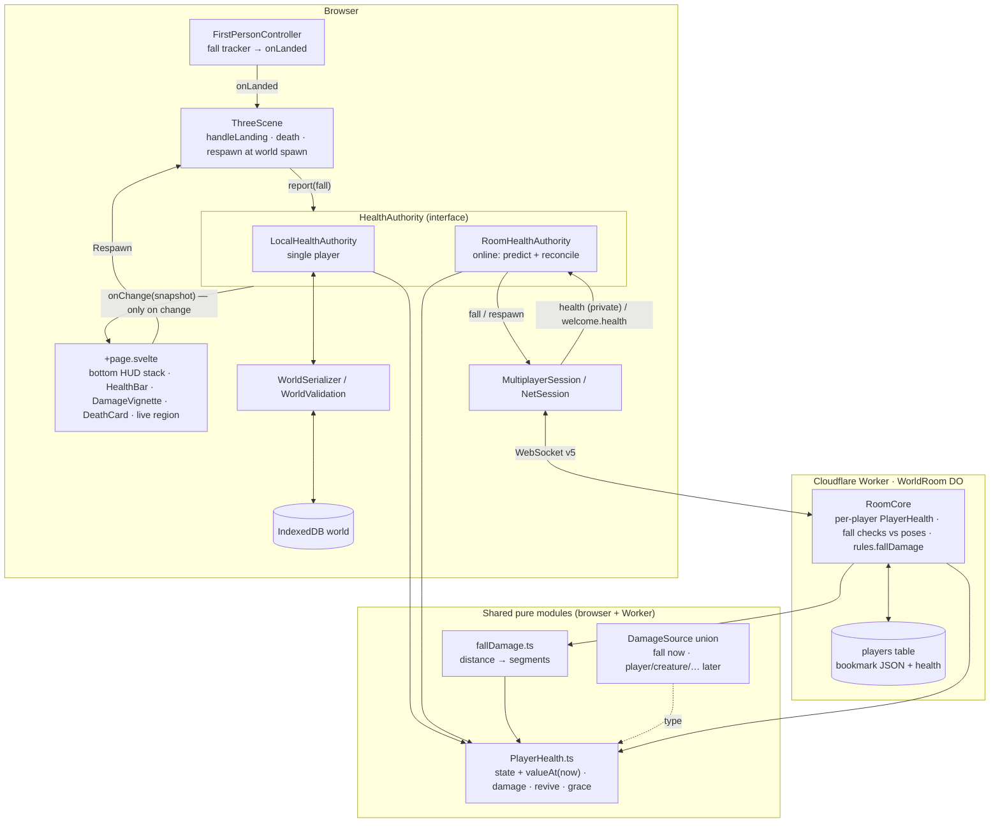
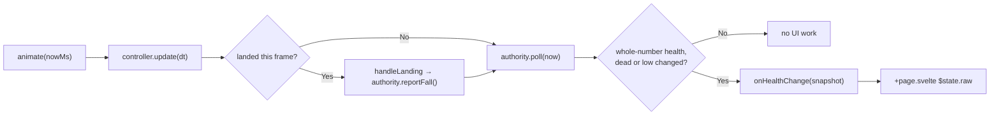
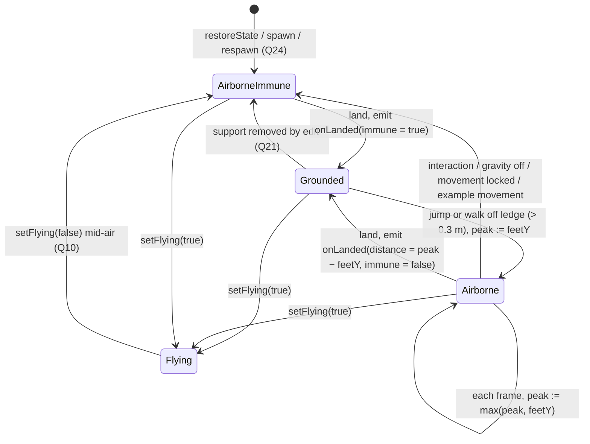
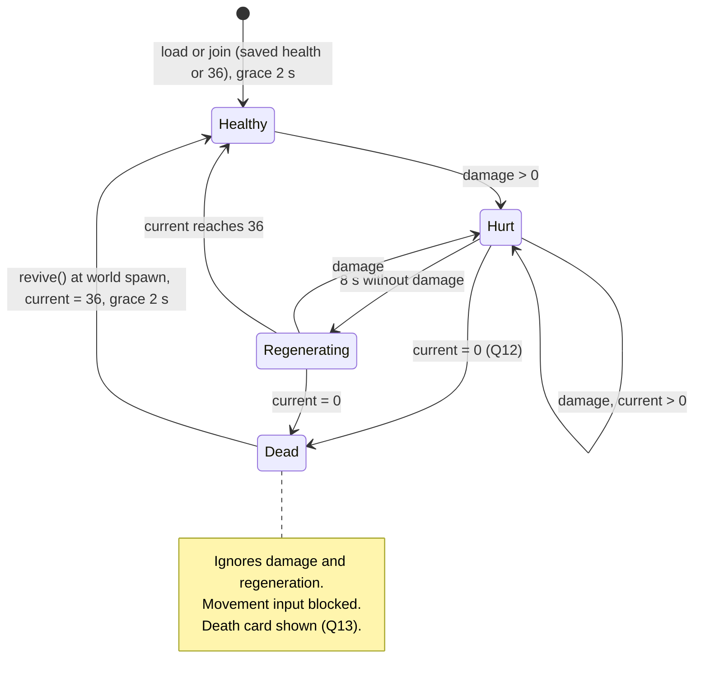
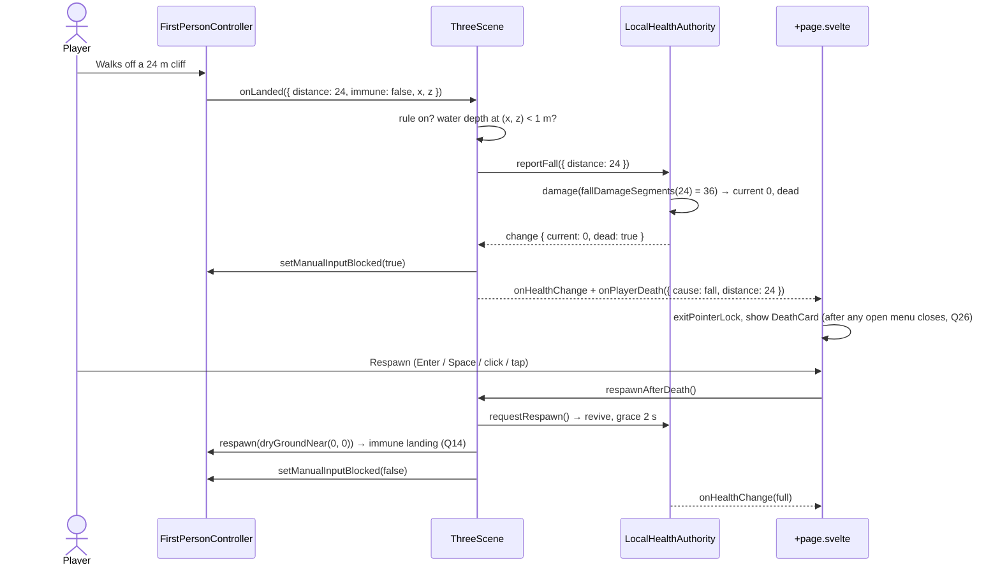
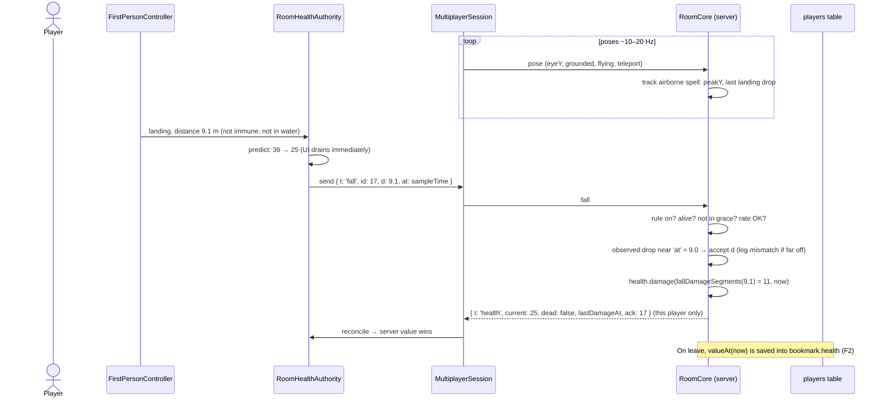
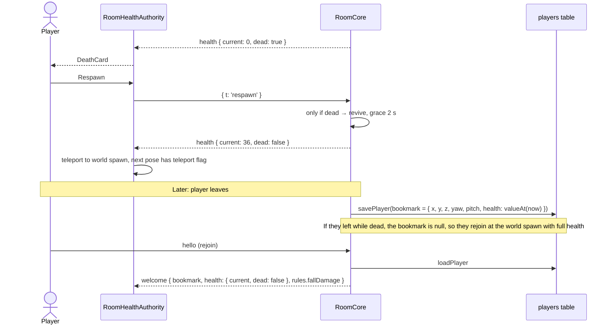
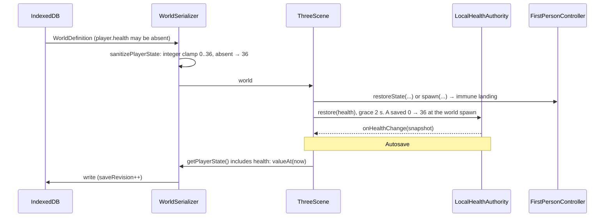
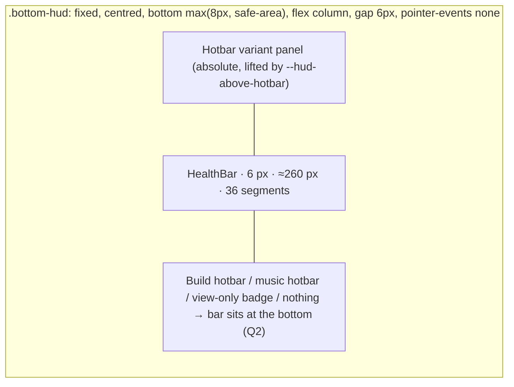

# Forest Drift — Player Health: Technical Plan

**Feature cycle:** 2026-10-30
**Status:** **Revision 2** — updated to match every locked answer in [`01-questions-and-decisions.md`](01-questions-and-decisions.md). **No implementation until you approve it in chat.**
**Related:** [`00-brief.md`](00-brief.md)

Paths below are relative to `pages/Forest-Drift/`.

**Changes from revision 1**

- **Online health is now server-owned and persistent** (Q20 custom, F1 A, F2 A). This adds protocol v5, three new room messages, server-side regeneration, per-player storage in the existing `players` table, and fall-report checks against poses. The new material is in §4.7, §7, §8 and §9.
- **Respawn goes to the world spawn** (Q14 A). The "last safe position" tracker is removed.
- `PlayerHealth` is now **time-injected and dependency-free**, so the same module runs in the browser and inside the Cloudflare Worker.
- Every **(Qn)** tag now refers to a locked decision.

---

## 1. Summary

| Layer            | What changes                                                                                                                                                                                                                         |
| ---------------- | ------------------------------------------------------------------------------------------------------------------------------------------------------------------------------------------------------------------------------------ |
| Physics          | `FirstPersonController` tracks the highest point of each airborne spell and emits a **landing event**. Movement maths are untouched.                                                                                                  |
| Rules (shared)   | New pure modules: `fallDamage.ts` (distance → segments) and `PlayerHealth.ts` (value, damage, regeneration, grace, death). They're time-injected and have no Three.js, DOM or Svelte imports, so **the browser and the Worker run the same code**. |
| Authority        | A `HealthAuthority` interface with two implementations. **Local** is used in single player: health is saved in the world. **Room** is used online: the client predicts, the server decides, and the server's value always wins.        |
| Scene            | `ThreeScene` turns landing events into damage reports (with water and edit immunity applied), drives death and respawn at the world spawn, and pushes snapshots to the UI only when they change.                                     |
| UI               | New `HealthBar.svelte` (36 segments) in a new bottom HUD stack shared with the hotbar. New `DamageVignette.svelte`, `DeathCard.svelte`, a landing thud, and a polite live region.                                                  |
| Persistence      | Single player: optional `SavedPlayerState.health` and `WorldDefinition.rules.fallDamage`, with **no world schema bump**. Online: `health` inside the existing `players.bookmark` JSON, with **no SQL migration**.                    |
| Network / server | **Protocol v4 → v5.** New `fall` and `respawn` client messages, a private `health` server message, a `health` field in `welcome`, and a `rules.fallDamage` flag in the shared environment. `RoomCore` owns each player's health.     |

---

## 2. Codebase review: what exists today

### 2.1 Relevant files

| File | Why it's relevant |
| ---- | ----------------- |
| [`src/lib/game/player/FirstPersonController.ts`](../../../../../src/lib/game/player/FirstPersonController.ts) | All player physics. `GRAVITY = 18`. Has `grounded` and `verticalVelocity`. The landing branch is `if (proposedY <= groundHeight \|\| followingGround)` in `update()`. `GROUND_FOLLOW_DISTANCE = 0.3` keeps small step-downs grounded. Callbacks go through `FirstPersonControllerOptions` (`onFlightChange` is the pattern to copy). `restoreState()` sets `grounded = false`, so a load counts as a fall (Q24). The `setFlying` doc comment already promises "no fall damage" (Q10). |
| [`src/lib/game/player/__tests__/FirstPersonController.spec.ts`](../../../../../src/lib/game/player/__tests__/FirstPersonController.spec.ts) | Headless controller harness (stairs, walk bob, ceiling jumps, example movement), reused for landing tests. |
| [`src/lib/game/terrain/TerrainSettings.ts`](../../../../../src/lib/game/terrain/TerrainSettings.ts) | `PlayerSettings` (`jumpSpeed: 7`, `gravityEnabled`). These are world settings, so gravity can be off per world through the dev settings (Q11). |
| [`src/lib/game/ThreeScene.ts`](../../../../../src/lib/game/ThreeScene.ts) | Builds the controller (around line 1185). `animate()` (around line 3760) clamps delta to 0.1 s and returns early while the dev panel, Mini Build editor or speech preparation is open. `respawn()` and `dryGroundNear()` give the world spawn (Q14). `getPlayerState()` is around line 3125. The world restore path (around line 2060) calls `restoreState` or spawns on a never-played world. `restoreBookmark()` is around line 2304 (online). Also has `hydrology` (`waterColumnDepth`), `setFlightDisabled()`, and the `multiplayer` hooks (`afterControllerUpdate`). `simulationPaused` does **not** stop `controller.update` (Q26). |
| [`src/lib/components/Hotbar.svelte`](../../../../../src/lib/components/Hotbar.svelte) | `position: fixed; bottom: max(8px, env(safe-area-inset-bottom))`, centred, `z-index: 35`. Slot height 52 / 44 / 38 px by breakpoint. The **variant panel** can render `above` the tray at `bottom: calc(100% + 10px)`, which is where the bar goes, so it must move up. |
| [`src/routes/+page.svelte`](../../../../../src/routes/+page.svelte) | Mounts the hotbar conditionally (around line 2355): music hotbar, **or** the online view-only badge, **or** the build hotbar when `hotbar.buildModeActive`. Otherwise nothing (Q2). Wires scene callbacks into `$state`. The pause menu calls `session.scene.respawn()`. `clockBlocked()` decides `simulationPaused`. Exposes `window.__forestSession` and `__forestMultiplayer` for e2e tests. |
| [`src/lib/components/TouchControls.svelte`](../../../../../src/lib/components/TouchControls.svelte) | Joystick cluster (bottom-left), `--touch-dock-height`, landscape media queries. Used for overlap checks (Q25). |
| [`src/lib/components/LocatorBar.svelte`](../../../../../src/lib/components/LocatorBar.svelte) | The nearest existing slim HUD bar (`pointer-events: none`). A style reference. |
| [`src/lib/ui/theme.css`](../../../../../src/lib/ui/theme.css) | `--fd-*` tokens. The new `--fd-health*` tokens go here. |
| [`src/lib/game/world/WorldTypes.ts`](../../../../../src/lib/game/world/WorldTypes.ts) | `SavedPlayerState`, `WorldDefinition`, `CURRENT_WORLD_SCHEMA_VERSION = 9`. Optional fields are the convention (`weather?`). |
| [`src/lib/game/world/WorldSerializer.ts`](../../../../../src/lib/game/world/WorldSerializer.ts) | `sanitizePlayerState()` rebuilds player state **field by field**, so `health` must be added there or it's dropped. |
| [`src/lib/game/world/WorldValidation.ts`](../../../../../src/lib/game/world/WorldValidation.ts) | Import validation for player fields. Add checks for `health` and `rules`. |
| [`src/lib/game/world/DefaultWorld.ts`](../../../../../src/lib/game/world/DefaultWorld.ts) | New-world defaults. `rules.fallDamage = true` goes here (Q1 B). |
| [`src/lib/game/hydrology/HydrologySystem.ts`](../../../../../src/lib/game/hydrology/HydrologySystem.ts) | `waterColumnDepth(x, z)` for water landings (Q9). |
| [`src/lib/game/building/FoundationTypes.ts`](../../../../../src/lib/game/building/FoundationTypes.ts) | `wallHeight: 3` and `maxStepHeight: 0.3`. Used to calibrate the curve (Q7). |
| [`src/lib/game/net/protocol.ts`](../../../../../src/lib/game/net/protocol.ts) | `PROTOCOL_VERSION = 4`. `POSE_FLAGS` (`grounded`, `flying`, `teleport`, `underwater`, `away`). `WelcomeMessage` (with `rules`, `bookmark`), `PlayerBookmark`, `SharedEnvironment`, and the `ClientJsonMessage` / `ServerJsonMessage` unions. **Changed** (§8). |
| [`src/lib/game/net/RoomCore.ts`](../../../../../src/lib/game/net/RoomCore.ts) | The authoritative room logic. It's shared code, bundled into the Worker by `server/src/WorldRoom.ts`. `handlePose` (speed check, teleport bypass), `handleJson` and its rate limits (`MAX_JSON_PER_SECOND = 20`), `handleHello` (rejects a protocol mismatch with "Please refresh the game"), `handleEnv` (owner-only), `removePlayer` (saves the Q18 bookmark), and the per-player `PlayerState`. **Changed**: it owns each player's health (§4.7). |
| [`server/src/WorldRoom.ts`](../../../../../server/src/WorldRoom.ts) | Durable Object host. The `players` table is `(player_id, name, bookmark JSON, last_seen)`, through `savePlayer` and `loadPlayer`. Health is stored **inside the bookmark JSON**, so there's no SQL migration. |
| [`src/lib/game/net/MultiplayerSession.ts`](../../../../../src/lib/game/net/MultiplayerSession.ts), [`NetSession.ts`](../../../../../src/lib/game/net/NetSession.ts), [`ClockSync.ts`](../../../../../src/lib/game/net/ClockSync.ts) | Client side of the room. Message dispatch, `restorePlayer(bookmark)` on first welcome, and the server-clock estimate used to mirror regeneration. **Changed.** |
| [`src/lib/game/net/sharedEnvironment.ts`](../../../../../src/lib/game/net/sharedEnvironment.ts), [`src/lib/components/OnlineOwnerPanel.svelte`](../../../../../src/lib/components/OnlineOwnerPanel.svelte) | Owner-controlled shared state (sky, weather, time). The fall-damage rule goes here (Q22). |
| [`src/lib/game/settings/settingsCatalog.ts`](../../../../../src/lib/game/settings/settingsCatalog.ts) | Where the single-player "Fall damage" world rule toggle goes (Q1 B). |
| [`src/lib/game/audio/AudioPreferences.ts`](../../../../../src/lib/game/audio/AudioPreferences.ts) | Volume preferences for the landing thud (Q17). |
| [`src/lib/game/building/BuildingRemovalManager.ts`](../../../../../src/lib/game/building/BuildingRemovalManager.ts), [`BuildUndoManager.ts`](../../../../../src/lib/game/building/BuildUndoManager.ts), [`src/lib/game/net/WorldReplica.ts`](../../../../../src/lib/game/net/WorldReplica.ts) | Places where support can disappear under the player (Q21). |
| Tests: [`src/lib/game/net/__tests__/RoomCore.spec.ts`](../../../../../src/lib/game/net/__tests__/RoomCore.spec.ts), [`protocol.spec.ts`](../../../../../src/lib/game/net/__tests__/protocol.spec.ts), [`server/tests/worker.spec.ts`](../../../../../server/tests/worker.spec.ts), [`tests/multiplayer.e2e.ts`](../../../../../tests/multiplayer.e2e.ts), [`tests/game.e2e.ts`](../../../../../tests/game.e2e.ts), [`tests/touchControls.e2e.ts`](../../../../../tests/touchControls.e2e.ts) | Existing suites to extend. |

### 2.2 Routes, database tables, APIs and services

- **Routes:** only `/` (`src/routes/+page.svelte`). Lab routes aren't touched.
- **Client database:** IndexedDB through `IndexedDbWorldRepository.ts`. No store changes. The world record gains optional properties.
- **Server database:** Durable Object SQLite, `players` table. **No schema change.** `bookmark` is JSON text and gains an optional `health` key.
- **Server API:** WebSocket room protocol v4 → **v5** (§8). No new HTTP endpoints.
- **External services:** none.

### 2.3 Physics facts the design depends on

| Fact | Value | Consequence |
| ---- | ----- | ----------- |
| Gravity | 18 m/s² | Landing speed = 6·√h. No terminal velocity. |
| Jump speed | 7 m/s | Flat jump apex ≈ 1.36 m. A jump off a ledge is measured from its **peak**, not the take-off point. |
| Frame delta clamp | 0.1 s | Distance-based measurement is unaffected by hitches. |
| Ground follow | 0.3 m | Stairs and small steps never become "airborne". |
| `restoreState()` | `grounded = false` | Every load, bookmark restore or interaction exit "lands" on the next frame. Immune (Q24). |
| Flight | `setFlying(false)` mid-air | Immune until the next landing (Q10). Flight is already off online. |
| Pose stream | ~10–20 Hz, eye Y + `grounded`/`flying`/`teleport` flags | Enough for the server to estimate each airborne spell's drop and check fall reports (§4.7). |

---

## 3. Architecture

### 3.1 Component and module diagram



### 3.2 Data flow for one frame



**Performance rule:** `poll(now)` is a few arithmetic operations: `valueAt(now)` from stored state. Svelte receives a snapshot only when the displayed value changes. That happens at most once every 3 s during regeneration, and never every frame.

### 3.3 Fall-tracking state machine (`FirstPersonController`)



### 3.4 Health state machine (`PlayerHealth`)



**Regeneration formula (Q16), identical on client and server:**
`regained(now) = max(0, floor((now − lastDamageAt − 8000) / 3000))` and
`valueAt(now) = dead ? 0 : min(36, currentAtLastDamage + regained(now))`.
The first segment returns 11 s after the last hit, then one every 3 s. Full from 1 segment takes about 1 min 53 s. Because the value is computed from timestamps, **no timers or regeneration messages are needed**.

### 3.5 Sequence: single-player fall, death and respawn



### 3.6 Sequence: online fall (server-owned health)



### 3.7 Sequence: online death, respawn and rejoin



### 3.8 Sequence: single-player world load and save



### 3.9 Bottom HUD layout



---

## 4. Detailed design

### 4.1 `fallDamage.ts` (new, pure, shared)

- `FALL_SAFE_DISTANCE = 4` and `FALL_SEGMENTS_PER_METRE = 2` (Q7).
- `FALL_WATER_CANCEL_DEPTH = 1.0` (Q9).
- `fallDamageSegments(distance)` returns `0` for non-finite values or `≤ 4 + 1e-6`. Otherwise it returns `ceil((distance − 4) × 2)`, clamped to `[0, 36]`.
- No imports. It must stay dependency-free because the Worker bundles it.

### 4.2 `PlayerHealth.ts` (new, pure, shared)

```text
HEALTH_MAX = 36
REGEN_DELAY_MS = 8000, REGEN_INTERVAL_MS = 3000, GRACE_MS = 2000
type DamageSource = { kind: 'fall'; distance: number }      // later: { kind: 'player'; by: slot } | { kind: 'creature' } | …
interface HealthState { base: number; lastDamageAt: number; graceUntil: number; dead: boolean }
interface HealthSnapshot { current: number; max: 36; dead: boolean; low: boolean; lastDelta: number; lastSource?: DamageSource['kind'] }

valueAt(state, now): number
damage(state, amount, source, now): { state, applied }   // 0 if dead, in grace, or amount ≤ 0
revive(state, now): state                                // current = 36, grace
restore(raw: unknown, now): state                        // clamp, 0 → 36, grace
snapshot(state, now, lastDelta?, lastSource?): HealthSnapshot
```

- Functions over plain state, with no classes holding clocks. The caller passes `now`.
- In the browser, `now` is the scene's accumulated simulation clock (it stops whenever `animate()` returns early) for the local authority, and the `ClockSync` server-time estimate for the room authority. On the server, it's `RoomCore.now()`.
- "Low" means `current ≤ 9` (25%).

### 4.3 `FirstPersonController` changes

- New option: `onLanded?: (e: LandingEvent) => void`, with `LandingEvent = { distance, speed, immune, x, z, feetY }`.
- Private state: `fallPeakFeetY: number | null` and `fallImmune: boolean`.
- When `grounded` goes from true to false, record the peak. Keep updating it while airborne. In the landing branch, capture `speed = −verticalVelocity` before it's zeroed, emit, then reset.
- Set `fallImmune = true` in:
  - `setFlying()` (both directions)
  - `beginInteraction` and `restoreState` (which covers `endInteraction`)
  - `spawn` and `respawn`
  - `setExampleMovement(true)`
  - any frame with `!settings.gravityEnabled`
  - `setMovementLocked(true)`
- New `markSupportRemoved()` (Q21): the next airborne spell starts immune.
- Update the `setFlying` doc comment to describe the immunity rule.
- **No change to positions, velocities or collisions.** The existing controller spec must pass untouched, plus a bit-identical scripted-run snapshot.

### 4.4 `ThreeScene` changes

- Holds `health: HealthAuthority`:
  - `LocalHealthAuthority` for local worlds.
  - It's swapped to `RoomHealthAuthority` when `options.multiplayer` attaches, and back on detach.
- `handleLanding(e)` returns early if:
  - `!PLAYER_HEALTH_ENABLED` (Q27)
  - `e.immune`
  - the fall-damage rule is off (local: `world.rules.fallDamage`; online: the shared env rule)
  - water depth at (e.x, e.z) is at least 1.0 m (Q9)
  - `fallDamageSegments(e.distance) === 0`

  Otherwise it calls `health.reportFall({ distance: e.distance, at })`.
- `animate()` calls `health.poll(now)` after `controller.update`. On the transition to dead, it sets `controller.setManualInputBlocked(true)` and fires `onPlayerDeath`.
- `respawnAfterDeath()` calls `health.requestRespawn()`, then reuses `respawn()` (world spawn, `dryGroundNear(0, 0)`, terrain and tree priming; Q14), then unblocks input. Online, the controller's next pose carries the `teleport` flag so the speed check doesn't reject it.
- `getPlayerState()` adds `health` (local only). World restore calls `health.restore(player.health)`. A saved 0 forces a spawn instead of `restoreState`.
- Removal hooks (`BuildingRemovalManager`, `BuildUndoManager`, remote commits in `WorldReplica`) call `controller.markSupportRemoved()` when a removed object's bounding box contains the player's feet (Q21). This runs on removal events only.
- New `ThreeSceneOptions` callbacks: `onHealthChange(snapshot)`, `onPlayerDamaged({ amount, source })` (for the vignette and thud), and `onPlayerDeath({ cause, distance })`.
- Test helper (dev/test builds, next to the existing `__forestSession` exposure): `debugDropPlayer(metres)` places the player that far above the supporting surface with the tracker armed. E2E tests then go through the real landing path, locally and online.

### 4.5 `HealthAuthority` implementations (new)

```text
interface HealthAuthority {
  readonly snapshot: HealthSnapshot
  reportFall(e: { distance: number; at: number }): void
  requestRespawn(): void
  poll(now: number): void                 // emits onChange only if the snapshot changed
  onChange(cb) / onDeath(cb) → unsubscribe
  dispose(): void
}
```

**`LocalHealthAuthority`**

- Applies `PlayerHealth.damage` directly.
- Reads and writes `SavedPlayerState.health`.
- Marks the world dirty for autosave when the base value changes.

**`RoomHealthAuthority`**

- **Prediction:** applies damage locally right away, so the drain has no latency. It sends `{ t: 'fall', id, d, at }`. Ids are monotonic per connection, used for de-duplication and acknowledgement.
- **Reconcile:** each `health` message replaces local state. If a prediction is still unacknowledged, the server value plus the outstanding predicted damage is shown until the ack arrives (at most one round trip).
- **Death:** shown when the predicted value hits 0. If the server then answers `dead: false` (for example, because the rule was just turned off), the card closes.
- **Offline (connection lost):** fall reports made while disconnected are **not queued**, and the server value wins on reconnect. Q21's 30 s offline grace already pauses building, and forgiving a fall during an outage is the safe failure.
- Uses `ClockSync` server time for `valueAt`, so regeneration matches the server to within clock-sync error (tens of ms). The display never runs ahead by more than one segment.

### 4.6 UI components

**`HealthBar.svelte`** (new)

- `role="meter"`, `aria-label="Health"`, `aria-valuemin=0`, `aria-valuemax=36`, `aria-valuenow`, `aria-valuetext="{n} of 36"`, and `title` for the hover tooltip (Q18).
- 36 `<span class="seg" data-state="full|ghost|empty">` elements, from a static keyed array.
- 6 px tall (5 px at ≤650 px and in landscape phones). ≈260 px wide (≈200 px at ≤650 px). 1 px gaps. Rounded outer ends. A dark translucent backing strip matching the hotbar glass (Q4, Q5).
- Tokens: `--fd-health`, `--fd-health-low`, `--fd-health-ghost`, `--fd-health-empty`.
- The ghost trail fades to empty after 0.6 s. A low-health pulse runs at ≤ 9. Neither runs under `prefers-reduced-motion`, where a static brighter outline is used instead.
- `pointer-events: none` (Q25). `data-testid="health-bar"` and `"health-seg"`.

**Bottom HUD stack** (`+page.svelte`)

- `.bottom-hud` is a fixed flex column containing the bar and whichever of the build hotbar, music hotbar or view-only badge is active.
- `Hotbar.svelte` gets an `embedded` prop that drops its own fixed positioning. The variant panel's `above` offset becomes `calc(100% + 10px + var(--hud-above-hotbar, 0px))`.
- With no hotbar, the stack holds only the bar, so it sits at the hotbar's resting place (Q2 A). A `transform` transition of 160 ms runs, or none with reduced motion.
- The whole stack is omitted when `PLAYER_HEALTH_ENABLED` is false. The hotbar then renders exactly as today.

**`DamageVignette.svelte`** (new): a full-screen radial edge tint with `pointer-events: none` and `aria-hidden`. Opacity is `min(0.35, 0.08 + amount × 0.02)` and fades over 400 ms. With reduced motion it's a 300 ms static tint.

**`DeathCard.svelte`** (new):

- `role="alertdialog"`, `aria-modal`, focus trapped on **Respawn**, which responds to Enter, Space, click and tap. Escape doesn't dismiss it.
- Title: "You fell too far". Subtitle: "from N m".
- Shown only once nothing else in `clockBlocked()` is open (Q26).

**Live region:** a visually hidden `aria-live="polite"` element. It says "Health 25 of 36" on damage (throttled to 1.5 s) and "Health full" when regeneration completes.

### 4.7 Server-owned health (online)

**Where it lives:** `RoomCore.PlayerState` gains `health: HealthState`, `air: { peakY: number; since: number } | null`, `landings: { drop: number; at: number }[]` (the last 3, for 3 s), and `nextFallId`.

**Pose tracking** (in `handlePose`, after acceptance; a few comparisons per pose):

- A pose with `flying` or `teleport` set clears `air`.
- A pose that's not `grounded` and not `flying` starts `air` or raises `peakY`.
- A `grounded` pose with `air` set pushes `{ drop: peakY − y, at: sampleTime }` and clears `air`.

**`fall` handling** (`handleJson`, existing JSON rate limit plus a dedicated max of 4 per second):

1. Ignore the report if:
   - the rule is off (`env.rules?.fallDamage ?? manifest.fallDamage ?? false`)
   - the player is dead or in grace
   - `id` isn't greater than the last processed id
   - `d` isn't finite or is outside 0–2000
2. **Plausibility check:** find an observed landing within ±1.5 s of `at`. If one exists and `d > drop + 1.5 m`, count a `fallMismatch` in diagnostics and use `min(d, drop + 1.5)`. If none exists (poses dropped or rate-limited), accept `d`.
   - **Why this isn't stricter:** a fall report can only *lower the sender's own* health. Over-reporting harms nobody else. Under-reporting can't be detected without server-side terrain and building heights (F1 option B, rejected as too costly). The check bounds nonsense and gives diagnostics, without false-positive punishment from pose sampling.
3. `damage(fallDamageSegments(d))`, then send `health` to **that connection only**, with `ack: id`.

**`respawn` handling:**

- Valid only while dead: revive, set grace, send `health`.
- Otherwise it's ignored. A client can't heal itself.

**Join:**

- `loadPlayer` returns `bookmark.health` if present: `restore()` with grace.
- No bookmark, or no health in it: full health.
- `welcome.health` carries the snapshot.

**Leave** (`removePlayer`):

- Saves `valueAt(now)` into the bookmark (F2).
- If the player is dead, the bookmark is saved as `null`, so they rejoin at the world spawn at full health.
- Reconnects within the existing offline grace keep the in-memory `PlayerState`, health included.

**Privacy:** `health` is never included in `snapshot`, `presence`, `joined`, `names` or any broadcast. Other players can't see it (Q20).

**Rule (Q22):**

- `SharedEnvironment` gains `rules?: { fallDamage?: boolean }`. Only the owner can send `env`, which is already enforced in `handleEnv`.
- Published worlds copy `rules.fallDamage` from the local world at publish time into the manifest, as the initial value. Worlds published before this feature default to **off** (Q1 B).
- When the owner turns the rule off, existing damage stays and regenerates normally.

**Future PvP fit:**

- A `DamageSource` of `{ kind: 'player', by: slot }` would be computed **entirely on the server** (for example, from a validated hit message), using the same `damage()` and the same `health` message.
- No client or UI change is needed beyond feedback.
- The authority path built here is the one PvP will use.

### 4.8 Sound (Q17)

`landingThud.ts`: a WebAudio noise burst through a low-pass filter, with no asset download. Gain scales with damage and is multiplied by the `AudioPreferences` effects/master volume. Played from `onPlayerDamaged` (only for `fall`).

---

## 5. New files likely to be created

| Path | Purpose |
| ---- | ------- |
| `src/lib/game/player/PlayerHealth.ts` | Shared, time-injected health rules and `DamageSource`. |
| `src/lib/game/player/fallDamage.ts` | Shared fall curve. |
| `src/lib/game/player/HealthAuthority.ts` | Interface plus `LocalHealthAuthority`. |
| `src/lib/game/net/RoomHealthAuthority.ts` | Online prediction and reconciliation. |
| `src/lib/game/audio/landingThud.ts` | Synthesised thud. |
| `src/lib/components/HealthBar.svelte` | 36-segment bar. |
| `src/lib/components/DamageVignette.svelte` | Edge flash. |
| `src/lib/components/DeathCard.svelte` | Zero-health card. |
| `src/lib/game/player/__tests__/PlayerHealth.spec.ts` | Unit tests. |
| `src/lib/game/player/__tests__/fallDamage.spec.ts` | Unit tests. |
| `src/lib/game/player/__tests__/FirstPersonLanding.spec.ts` | Controller landing tests. |
| `src/lib/game/player/__tests__/HealthAuthority.spec.ts` | Local authority tests. |
| `src/lib/game/net/__tests__/RoomHealthAuthority.spec.ts` | Prediction and reconcile tests. |
| `src/lib/game/net/__tests__/RoomCoreHealth.spec.ts` | Server health, fall checks, privacy, persistence. |
| `tests/playerHealth.e2e.ts` | Layout, damage, death, persistence, mobile. |

## 6. Existing files likely to be changed

| Path | Change |
| ---- | ------ |
| `src/lib/game/player/FirstPersonController.ts` | Fall tracker, `onLanded`, immunity hooks, `markSupportRemoved()`, doc comment. |
| `src/lib/game/ThreeScene.ts` | Authority swap, landing handling, poll, death and respawn, callbacks, debug helper, save and restore. |
| `src/routes/+page.svelte` | Bottom HUD stack, new components, health `$state.raw`, live region, death-gated pointer lock. |
| `src/lib/components/Hotbar.svelte` | `embedded` prop; variant panel offset. |
| `src/lib/ui/theme.css` | `--fd-health*` tokens. |
| `src/lib/game/world/WorldTypes.ts` | `SavedPlayerState.health?`, `WorldDefinition.rules?`. |
| `src/lib/game/world/WorldSerializer.ts` | Carry and clamp `health`; carry `rules`. |
| `src/lib/game/world/WorldValidation.ts` | Bounds and type checks. |
| `src/lib/game/world/DefaultWorld.ts` | `rules: { fallDamage: true }` for new worlds. |
| `src/lib/game/settings/settingsCatalog.ts` | "Fall damage" world toggle. |
| `src/lib/game/net/protocol.ts` | v5, new messages, `PlayerBookmark.health?`, `WelcomeMessage.health`, `SharedEnvironment.rules?`, manifest `fallDamage?`. |
| `src/lib/game/net/RoomCore.ts` | Per-player health, pose air tracking, `fall` and `respawn` handlers, welcome and leave persistence, diagnostics counter. |
| `src/lib/game/net/MultiplayerSession.ts`, `NetSession.ts` | Dispatch `health`; send `fall` and `respawn`; expose to `RoomHealthAuthority`. |
| `src/lib/game/net/sharedEnvironment.ts`, `src/lib/components/OnlineOwnerPanel.svelte` | Owner rule toggle. |
| `src/lib/game/net/NetDiagnostics.ts` | `fallMismatch` and health counters. |
| Publish path (`src/lib/game/net/worldTransfer.ts` / `server/src/worker.ts` manifest) | Copy `rules.fallDamage` into the manifest. |
| `server/src/WorldRoom.ts` | No SQL change. Passes `fallDamage` from the manifest to `RoomCore`. |
| `src/lib/game/building/BuildingRemovalManager.ts`, `BuildUndoManager.ts`, `src/lib/game/net/WorldReplica.ts` | Support-removed hook (Q21). |
| `src/lib/components/ControlsGuide.svelte` | One line about health and fall damage. |
| Existing tests | Extended: `WorldSerializer.spec.ts`, `WorldValidation.spec.ts`, `protocol.spec.ts`, `RoomCore.spec.ts`, `server/tests/worker.spec.ts`, `multiplayer.e2e.ts`, `game.e2e.ts`, `touchControls.e2e.ts`. `FirstPersonController.spec.ts` stays unchanged and must pass. |

---

## 7. Data model changes

```ts
// WorldTypes.ts (single player; additive, optional; no schema bump)
interface SavedPlayerState { /* … */ health?: number }            // whole points 0…36; absent → 36
interface WorldDefinition  { /* … */ rules?: { fallDamage?: boolean } }

// protocol.ts (online)
interface PlayerBookmark   { /* x, y, z, yaw, pitch */ health?: number }   // stored in players.bookmark JSON
interface SharedEnvironment { /* … */ rules?: { fallDamage?: boolean } }
interface WorldManifest    { /* … */ fallDamage?: boolean }               // initial online value from publish
```

- **No `CURRENT_WORLD_SCHEMA_VERSION` bump and no SQL migration.** All fields are optional, and older readers ignore them.
- **Single-player defaults:**
  - `health` absent → 36. Non-finite or wrong type → rejected on import, clamped on load. `0` → 36 and spawn.
  - `rules` absent → `fallDamage: false` (existing worlds; Q1 B). New worlds → `true`.
- **Online defaults:** `bookmark.health` absent → 36. `env.rules` absent → the manifest's `fallDamage`. Manifest absent → `false`.
- **Online and single-player health are independent.** Publishing a local world doesn't carry the publisher's local health into the online world.

## 8. API changes

**Protocol v4 → v5** (`PROTOCOL_VERSION = 5`). The server already rejects mismatched clients with "Please refresh the game to update it", so **the Worker and the static site must be deployed together**.

| Direction | Message | Shape | Notes |
| --------- | ------- | ----- | ----- |
| C → S | `fall` | `{ t: 'fall', id: number, d: number, at: number }` | Distance in metres; `at` is the landing sample time (wire time). Rate-limited. |
| C → S | `respawn` | `{ t: 'respawn' }` | Only valid while dead. |
| S → C (one player only) | `health` | `{ t: 'health', current, dead, lastDamageAt, graceUntil, ack?, source? }` | Never broadcast. |
| S → C | `welcome` | `+ health: { current, dead, lastDamageAt, graceUntil }` | Joining player only. |
| C ↔ S | `env` | `SharedEnvironment.rules?.fallDamage` | Owner-only, as today. |

**Internal TypeScript API (new):**

- `FirstPersonControllerOptions.onLanded`, `FirstPersonController.markSupportRemoved()`
- `ThreeSceneOptions.onHealthChange`, `onPlayerDamaged`, `onPlayerDeath`
- `ThreeScene.respawnAfterDeath()`, `getHealth()`, `debugDropPlayer()`
- The `HealthAuthority` interface

No HTTP endpoints change.

## 9. Authentication and authorisation

- **Single player:** no auth. Health is local world state.
- **Online:**
  - Health messages are tied to the authenticated WebSocket connection (existing invite-link capability and role).
  - A client can only send `fall` and `respawn` **about itself**. There's no target field, by design.
  - Only the server changes health. It's sent only to its owner's connection.
  - `respawn` can't heal a living player.
  - The rule toggle is **owner-only**, through the existing `handleEnv` role check.
  - Viewers take fall damage like everyone else. It only affects themselves.
- **PvP readiness:** the server already holds the authoritative value. A future player-damage message must be validated server-side (range, line of sight, cooldown) and must never accept a client-supplied damage amount.

## 10. Security and privacy risks

| Risk | Mitigation |
| ---- | ---------- |
| Crafted world file sets `health` to `NaN`, a negative number, `1e9` or a string | Validation rejects it on import. The serializer clamps to an integer 0–36 on load. Unit-tested. |
| Saved `health: 0` causes a death loop | Loads as 36 at the world spawn (local). Online: dead players leave a null bookmark. |
| Client forges a higher health online | Not possible: the client never sends a health value. `respawn` only works when the server says the player is dead. |
| Client spams `fall` to flood the room | Existing JSON rate limit plus a 4-per-second cap. Ids must increase. Distances are bounded to 0–2000. |
| Client under-reports falls to avoid damage | Accepted, and documented in §4.7. It only affects the cheater's own health. Revisit only if a competitive mode appears. |
| Health leaks to other players | Never included in broadcasts or snapshots. A test asserts no `health` key in any broadcast message. |
| Stored bookmark JSON tampered with in the DB | Only the server writes it. Values go through `restore()` clamping on read. |
| Debug helper misuse | Dev/test builds only, mirroring the existing `__forestSession` exposure. Online, it can only make you fall, which the server treats like any fall. |
| Privacy | No personal data. Health isn't logged beyond aggregate diagnostics counters. |

## 11. Performance risks

| Risk | Mitigation / budget |
| ---- | ------------------- |
| Svelte reactivity every frame | Snapshots only on change, `$state.raw`, static keyed segment array. Target: 0 Svelte updates per frame at steady state, verified with a dev counter. |
| Client per-frame cost | `poll(now)` is O(1) arithmetic. The controller adds a few comparisons. Check with the walking frame-pacing benchmark (`docs/2026/10-19/walking-frame-pacing.md`). |
| Server per-pose cost | Three comparisons and an occasional push into a 3-entry ring. Re-run the existing soak and bots tools (`server/tools/soak.ts`, `bots.mjs`) at 20 players and compare CPU against the last baseline (`docs/multiplayer-live-load.json`). |
| Regeneration network chatter | None: regeneration is computed from timestamps on both ends. |
| Durable Object storage writes | Health is written only on leave, as part of the existing bookmark write. No extra writes. |
| `backdrop-filter` on the bar | Tiny area. Fall back to a solid backing if the Retina GPU profile shows a cost. |
| Vignette repaint | Opacity-only, composited, `visibility: hidden` at 0. |

## 12. Edge cases

| # | Case | Expected behaviour |
| - | ---- | ------------------ |
| E1 | Flat-ground jump (1.36 m) | No damage. |
| E2 | Jump off a 3 m ledge (peak ≈ 4.36 m above landing) | 1 segment. Tested as the boundary. |
| E3 | Stairs, slopes, step-downs ≤ 0.3 m | Never airborne. |
| E4 | Bouncing down a steep hillside | Each hop measured separately. No accumulation. |
| E5 | Jumping into a ceiling | Peak capped by the clamp. |
| E6 | Frame hitch mid-fall | Distance-based, so unaffected. |
| E7 | Stop flying at height | Immune landing (Q10). |
| E8 | Start flying mid-fall | Tracker reset. The landing after flight is immune. |
| E9 | Gravity disabled | No events. |
| E10 | World saved mid-air or while flying, then reloaded | Immune first landing plus 2 s grace (Q24). |
| E11 | Exiting a chair or mini-build interaction | Through `restoreState`, so immune. |
| E12 | Tutorial example movement | Immune. |
| E13 | Pause menu opened mid-fall | Damage applies on landing. The death card waits for the menu to close (Q26). |
| E14 | Landing in water ≥ 1 m | No damage (Q9). |
| E15 | Landing on the bank of deep water | Depth sampled at the landing (x, z). Deterministic and unit-tested with a stub. |
| E16 | Removing your own floor while on it | Immune (Q21). |
| E17 | A remote player deletes the floor under you | Immune (Q21). The remote commit triggers `markSupportRemoved`. |
| E18 | Shovel digs a hole you then walk into | Normal rules. Drops are usually below the safe height. |
| E19 | Second landing while dead | Ignored. |
| E20 | Damage within 2 s of respawn, load or join | Ignored. |
| E21 | World spawn is now inside a new wall | `spawn()` already resolves horizontal collisions. `dryGroundNear` avoids deep water. |
| E22 | Rule turned off mid-fall | The rule is checked at landing (client) and at report time (server). No damage. |
| E23 | Rule turned off while hurt | Health stays and regenerates. The bar stays visible (Q3). |
| E24 | **Online:** disconnect mid-fall | Report not sent. The server value wins on reconnect, so the fall is forgiven. |
| E25 | **Online:** leave while hurt, rejoin 1 hour later | Same health. Regeneration timer restarts after grace. Offline time doesn't heal (F2). |
| E26 | **Online:** leave while dead | Null bookmark. Rejoin at the world spawn with full health. |
| E27 | **Online:** reconnect within the offline grace | In-memory state kept, health included. |
| E28 | **Online:** server rejects or caps a report (mismatch) | Client reconciles to the server value. A small visible correction is acceptable. |
| E29 | **Online:** owner toggles the rule while someone is mid-fall | Server rule at report time decides. The client reconciles. |
| E30 | **Online:** two tabs as the same player id | Existing room rules decide which connection is live. Health belongs to the `PlayerState`, not the tab. |
| E31 | **Online:** player is "away" (pause menu) and regenerating | Regeneration continues: the world keeps running online (existing Q12). |
| E32 | Mini Build editor, dev panel or speech preparation open | `animate()` returns early. No physics, and the local clock is frozen. Online, the server clock still runs, so regeneration continues. |
| E33 | Window resized or rotated while the variant panel is open | The CSS variable recomputes the offset. The existing `ResizeObserver` reflows. |
| E34 | Terrain still streaming at spawn | Immune spawn plus grace. |

## 13. Accessibility

- **Semantics:** `role="meter"` with min, max, now and value text. `aria-label="Health"`.
- **Announcements:** polite live region for damage (throttled) and "Health full". The death card is an `alertdialog` with focus on Respawn. Escape doesn't dismiss it.
- **Not colour alone:** filled and empty segments differ in fill and outline. Low health adds a brighter tone **and** a pulse (or a static outline with reduced motion). At least 3:1 non-text contrast (WCAG 1.4.11) against the backing strip. Checked under deuteranopia and protanopia simulation.
- **Reduced motion:** no ghost animation, no pulse, no position animation, a static vignette, and never any camera effects (Q17).
- **Input:** the bar is non-interactive. The death card works with keyboard, mouse and touch.
- **Size:** 6 px is slim by request. If testing shows it's hard to read, a "Larger HUD" personal setting is a follow-up.

## 14. Manual tests

Run on the M4 MacBook Air (Chrome + Safari) and the iPad Pro M4 (Safari, touch, portrait and landscape). Also Chrome DevTools at 375×812 and 812×375. Online tests use the local Worker (`wrangler dev`) with two browsers.

1. **Layout:** in build mode, the bar sits directly above the hotbar. 36 segments. No overlap with the hotbar, crosshair notice, tool hints or FPS counter.
2. Press **G**: the bar drops to the hotbar spot. Press G again: it moves back up smoothly. Instant with "Reduce motion".
3. Narrow window, tool with variants: the variant panel clears the bar.
4. Music mode: the bar sits above the music hotbar.
5. Touch: the joystick, look zone and dock all work, and the bar never intercepts touches.
6. **Falls:** flat jump (0 segments), one-storey roof (0–1), two-storey roof (≈5), cliff over 22 m (death).
7. Feedback: drain and trail, vignette, thud at the set volume, pulse at ≤ 9. Repeat with Reduce motion on.
8. **Water:** cliff into a lake (0). Into a shallow stream (damage).
9. **Flight:** stop flying at 100 m (no damage). Then a ledge jump (damage again).
10. **Death:** card, pointer released, Enter respawns at the **world spawn** (Q14) with full health and no damage for 2 s.
11. Pause menu opened mid-lethal-fall: the card appears when the menu closes.
12. **Persistence (local):** take damage, quit, reopen: same health. A legacy world loads full. Export and import keep health.
13. Save while flying at 80 m, reload: no damage.
14. **Rule:** a new world has fall damage on. An existing world has it off. The settings toggle works.
15. **Online:**
    - Join at full health. A fall damages only you, and the other browser sees no health anywhere.
    - Regeneration matches between the bar and the server's diagnostics.
    - Die: the respawn teleports to the world spawn, and the other browser sees the avatar jump to the spawn.
    - Leave while hurt, then rejoin: same health.
    - Leave while dead, then rejoin: full health at the spawn.
    - A remote player deletes the floor under you: no damage.
    - The owner toggles the rule: it applies to everyone.
    - Kill the network mid-fall, then reconnect: the server value wins.
16. **VoiceOver:** "Health, 25 of 36"; damage is announced; the death dialog is announced with focus on Respawn.
17. `PLAYER_HEALTH_ENABLED = false`: no bar, no damage, and the hotbar looks exactly as before.

## 15. Automated tests

**Unit (Vitest)**

- `fallDamage.spec.ts`:
  - 0, 1.36, 4 and 4.0000001 m → 0.
  - 4.01 → 1, 5 → 2, 10 → 12, 22 → 36, 1000 → 36.
  - NaN, −1 and Infinity → 0.
  - Monotonic property test.
- `PlayerHealth.spec.ts`:
  - Clamping. Grace window. Dead ignores damage.
  - Revive gives 36 plus grace.
  - The regeneration formula at exact boundaries (8 s, 11 s, 14 s…) and full at about 113 s from 1.
  - `restore()` handles bad input, and 0 → 36.
  - Low flag at ≤ 9.
- `FirstPersonLanding.spec.ts`:
  - Flat jump. A 10 m ledge. Ledge jump measured from the peak.
  - Stairs fixtures emit nothing. Ceiling-capped peak.
  - `setFlying(false)` at 50 m is immune. `restoreState` at height is immune.
  - Gravity off. Interaction exit. Example movement.
  - `markSupportRemoved`.
  - Bit-identical positions against the pre-change scripted run.
- `HealthAuthority.spec.ts` (local):
  - Rule off → no damage. Water → no damage.
  - Death event fires once. Respawn. Autosave marked dirty.
- `RoomHealthAuthority.spec.ts`:
  - Immediate prediction. Server snapshot overrides.
  - An unacknowledged prediction is held until the ack.
  - Server `dead: false` closes a predicted death.
  - No reports sent while disconnected.
- `RoomCoreHealth.spec.ts` (fake connections, like the existing `RoomCore.spec.ts`):
  - Pose air tracking records the drop.
  - A `fall` within tolerance is applied. An over-reported fall is capped and counted.
  - Rule off, dead, grace, duplicate id and out-of-range distance are each ignored.
  - Rate limit.
  - `respawn` only works when dead.
  - `health` is sent only to its owner, and **no broadcast contains a `health` key**.
  - Leave saves `bookmark.health`. Leave while dead saves a null bookmark.
  - Rejoin restores health. Reconnect within grace keeps state.
  - Owner-only rule.
- `protocol.spec.ts`: v5 encode and decode for the new messages; old clients rejected.
- `server/tests/worker.spec.ts`: manifest `fallDamage` round-trips through publish.
- `WorldSerializer.spec.ts` / `WorldValidation.spec.ts`: health round-trip, absent / 0 / NaN / string cases, `rules` defaults (legacy off, new on), export and import.

**End-to-end (Playwright, `tests/playerHealth.e2e.ts` plus additions to `multiplayer.e2e.ts`)**

- 36 `health-seg` elements and `aria-valuenow=36`.
- Bounding boxes:
  - The bar's bottom is above the hotbar's top with a gap of at most 10 px, centred to within 2 px.
  - Checked at desktop, 375×812 and 812×375 (touch emulation).
  - No intersection with the touch controls.
- G toggles the bar position (Q2).
- `debugDropPlayer(10)` → `aria-valuenow=24`. `debugDropPlayer(30)` → death card. Enter → 36 and the card is gone.
- Reload keeps the damaged value.
- Reduced-motion emulation: no transitions.
- Online (existing local-Worker harness):
  - A drop on player A lowers A's bar.
  - Player B's page has no health element for A, and no `health` message in B's captured WebSocket frames.
  - A rejoins with the same value.

**Known environment caveats:** e2e is slow under SwiftShader, and `worldPersistence` and `graphics.e2e` already fail on `main`. Record those as the baseline before starting.

## 16. Rollback plan

1. **Client kill switch:**
   - Set `PLAYER_HEALTH_ENABLED = false` and redeploy the static site.
   - No bar, no damage, no reports sent. Stored values are untouched.
   - The server still speaks v5, so no Worker change is needed.
2. **Disable online damage without a client deploy:** the owner turns the rule off in each online world (server-enforced).
3. **Full revert:**
   - Revert the feature commits **and** redeploy the Worker with `wrangler rollback` (or a redeploy of the reverted server) at the same time as the static site. The protocol returns to v4, and a v4/v5 mismatch shows the existing "Please refresh" message, so the two must move together.
   - No data migration to undo:
     - Old code ignores `health` in the world and bookmark JSON.
     - `sanitizePlayerState` drops local `health` on the next save.
     - Old servers rewrite bookmarks without `health` on leave.
     - Unknown `env.rules` are ignored.
4. **Rollback triggers:** unexpected deaths on load or join, HUD overlap on a device, a frame-time regression in the walking benchmark, or a server CPU regression in the soak test.

## 17. Implementation order (after approval)

1. Shared pure modules plus tests: `fallDamage.ts`, `PlayerHealth.ts`.
2. Controller fall tracker and `onLanded`, plus landing tests. Existing controller tests pass untouched.
3. `LocalHealthAuthority` and scene wiring: landing → damage, water, rule, poll, death, respawn at the world spawn, debug helper.
4. UI: HealthBar, bottom HUD stack, Hotbar `embedded` and panel offset, tokens.
5. Feedback: vignette, thud, live region, death card.
6. Single-player persistence and rules: types, serializer, validation, default world, settings toggle.
7. Protocol v5 and `RoomCore` health (air tracking, `fall`, `respawn`, welcome, leave, privacy), plus server tests.
8. `RoomHealthAuthority` and `MultiplayerSession` wiring, the owner rule toggle, and publishing the manifest flag.
9. Edit-immunity hooks (Q21), locally and for remote commits.
10. E2E (local and online), the manual pass on Mac and iPad, frame-pacing and soak checks, `ControlsGuide`, and implementation notes in `docs/2026/10-30/Player-Health/`.
11. Coordinated deploy: Worker (`wrangler deploy`) and static site together.

## 18. Definition of done

- [x] All questions in `01-questions-and-decisions.md` answered, and this plan updated (revision 2).
- [ ] 36-segment bar above the active hotbar. Drops when the hotbar is hidden (Q2). The variant panel clears it. No overlaps at every size in §14.
- [ ] Fall damage matches the locked curve (Q7) with tested boundaries. Immunity cases E1–E34 behave as documented.
- [ ] Lethal falls, the death card, and respawn at the world spawn (Q12–Q14). No death loop on load or join.
- [ ] Regeneration per Q16, identical on client and server (shared formula, tested).
- [ ] Single-player health saves, loads, exports and imports (Q19). Legacy worlds load full and have the rule off (Q1).
- [ ] Online health is server-owned, private to each player, persistent across rejoin, and owner-controlled by rule (Q20, F1, F2, Q22). No broadcast contains health (tested).
- [ ] Accessibility: meter semantics, live announcements, reduced motion, ≥3:1 contrast, keyboard-operable death card, VoiceOver pass.
- [ ] No per-frame Svelte updates. No regression in the walking frame-pacing benchmark or the 20-player soak.
- [ ] `npm run check`, `npm run lint`, `npm run test:unit` and `npm run check:server` pass, plus server tests. New e2e passes. No new e2e failures against the recorded baseline.
- [ ] `PLAYER_HEALTH_ENABLED = false` verified to fully disable the client feature.
- [ ] Worker and static site deployed together. Rollback steps rehearsed locally.
- [ ] Controls guide updated and implementation notes written.
- [ ] Manual pass on the M4 MacBook Air and the iPad Pro M4.
