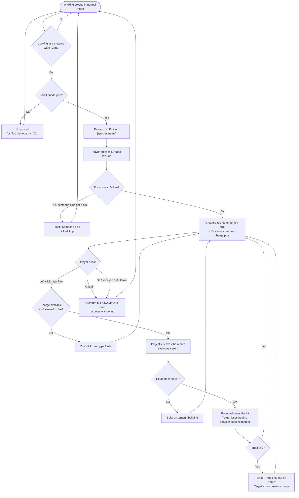
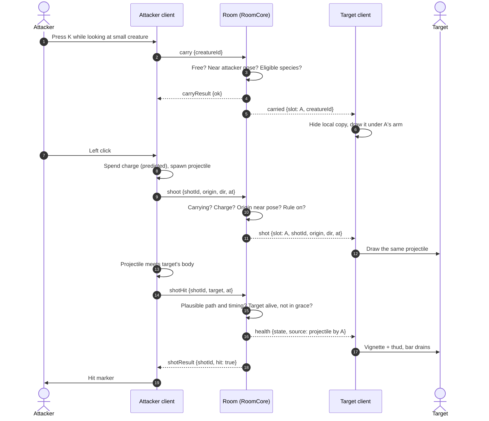
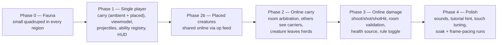

# Forest Drift — Creature Ranged Weapons: Brief

**Feature cycle:** 2026-11-04
**Status:** **Decisions locked (2026-11-04); waiting for your approval of the technical plan (revision 2).** No code is written yet.
**Related:** [`01-questions-and-decisions.md`](01-questions-and-decisions.md) · [`02-technical-plan.md`](02-technical-plan.md)
**Builds on:** [Player Health (2026-10-30)](../../../10-30/Player-Health/implementation.md) · [Multiplayer plan Q9](../../../10-15/Multiplayer/feature-plan/01-questions-and-decisions.md) · [`docs/creature-system.md`](../../../../creature-system.md)

Paths are relative to `pages/Forest-Drift/`.

---

## 1. The idea in one paragraph

Small four-legged creatures can be **picked up** and carried **under the player's arm**. While carrying one, the player can **fire projectiles from the creature's mouth**. In an online world, those projectiles **damage other players** through the health system that already handles falls and punches. This is the first creature **ability**. The design leaves room for other species to get different abilities later, but only this one is built now.

## 2. The user problem

| Today                                                                                                                                                            | Why it's a problem                                                                                                                                | What this feature changes                                                                                               |
| ---------------------------------------------------------------------------------------------------------------------------------------------------------------- | ------------------------------------------------------------------------------------------------------------------------------------------------- | ----------------------------------------------------------------------------------------------------------------------- |
| The only way to hurt another player is a **punch**, with 2.5 m of reach (`src/lib/game/player/punch.ts`).                                                        | Playing against someone online means running into them. There's nothing to do at a distance, and no reason to move around carefully or use cover. | Adds a ranged option with a visible projectile that players can dodge. Punching stays as it is.                         |
| Creatures are **scenery**. They wander, flee and look around, but players can't interact with them (`docs/creature-system.md`: "no … taming, breeding, combat"). | The fauna system is elaborate, yet it has no effect on play. The multiplayer plan (Q9) treated it as "harmless" for exactly that reason.          | Creatures get their first job. Players have a reason to look for particular animals ("I need a small four-legged one"). |
| There's no way to **hold** anything in the world.                                                                                                                | Later ideas, such as creature friendships, gifts and carrying materials, will need a carry/hold mechanic.                                         | Builds a reusable carry pipeline and a small ability registry that later creature features can share.                   |

**Who it's for:** players in online worlds who want a light, playful contest with friends. In single player, carrying and firing work as play and practice, but there's nobody to damage (see Q5).

## 3. Goals

1. Pick up an eligible small creature with one contextual key (and one touch button), and put it down again.
2. While carrying, fire a visible projectile from the creature's mouth toward the crosshair.
3. Online: a hit takes health from another player through the existing `DamageSource` → `HealthAuthority` → room pipeline, with the same vignette, sound and death card a punch uses.
4. Everyone in the room sees **who is carrying which creature** and **every shot fired**.
5. A creature can't be in two places at once: when one player picks it up, it leaves every other player's ambient herd.
6. The room makes every decision that affects health. A modified client can't hit from across the map, fire faster than allowed, or carry a creature it isn't near.
7. No measurable frame-time regression when nobody is carrying anything. Bounded cost while people are.

## 4. Non-goals (v1)

- Abilities for any other body plan or size. The registry gets added, but only `mouth-projectile` is filled in.
- Creature health, killing creatures, taming, feeding or ownership.
- Throwing the creature itself.
- Shared simulation of ambient creature behaviour (Multiplayer Q9-A stands). Only _who is carrying what_ is shared.
- Teams, scores, kill feeds, or a match/arena mode.
- Server-side line-of-sight against walls (see Q14 and the security section of the technical plan).
- Saving a carried ambient creature across reloads. (Placed creatures do keep the spot they were put down at, Q4.)

## 5. Expected user flow

### 5.1 Happy path (online)

### 5.2 Sequence: pick up, fire, hit (online)

### 5.3 Single-player flow

The same flow up to the projectile. Shots splat on terrain and buildings, and nobody takes damage. Projectiles pass through creatures (Q6). Carrying itself isn't saved: reloading puts an ambient creature back with its herd, and a Lab-placed creature at the last place it was put down (Q4).

## 6. Assumptions, now decided

Each assumption from the first draft has been answered. Four answers (Q3, Q4, Q6, Q16) differ from the original assumptions; those rows are marked **Changed**.

| #   | Assumption                                                                                                                                                                                          | Question |
| --- | --------------------------------------------------------------------------------------------------------------------------------------------------------------------------------------------------- | -------- |
| A1  | "Small quadruped" means `bodyPlan.id === 'quadruped'` and standing height ≤ 0.9 m. That's the smallest population band, 0.55–0.8 m, plus a margin for Lab-placed creatures.                         | Q2       |
| A2  | **Changed:** every region is forced to have a small quadruped. This changes the smallest species in existing worlds, which you accepted (F1).                                                       | Q3, F1   |
| A3  | **Changed:** ambient and Lab-placed creatures can both be carried. A placed creature's new spot is saved, and online it goes through the op feed, so placed creatures become shared online content. | Q4, F2   |
| A4  | Projectiles are a soft, non-violent visual (seed pellets in the creature's accent colour), to fit the game's relaxed tone.                                                                          | Q1       |
| A5  | Health numbers stay at 36 points max, with a 2 s grace period and regeneration. Damage per hit is on top of that.                                                                                   | Q9       |
| A6  | The shooter's browser decides what it hit, and the room checks it's plausible, the same model as punching.                                                                                          | Q13      |
| A7  | Walls are not checked by the room. A modified client could shoot through them.                                                                                                                      | Q14      |
| A8  | `K`, the existing interact key, picks up and puts down. Left click fires while carrying, and punching is unavailable until the creature is put down.                                                | Q7, Q8   |
| A9  | Protocol v6. The Worker and the site must deploy together, as they did for v5.                                                                                                                      | Q27      |
| A10 | **Changed:** viewers can also carry (ambient creatures) and fire. Projectiles don't affect creatures.                                                                                               | Q16, Q6  |

## 7. Success measures

- In a two-browser test, every hit reported by the shooter's client and accepted by the room changes the target's bar within one round trip. Zero health changes happen without a `shotResult {hit: true}`.
- The room rejects every scripted cheat case in `RoomCoreRanged.spec.ts`: cross-map hits, overspent charges, unearned carries, firing while not carrying, and hitting someone in grace.
- When nobody is carrying anything, walking frame-pacing (`docs/2026/10-19/walking-frame-pacing.md`) and the 20-player soak are within noise of the baseline. With 4 carriers firing continuously, p95 frame time rises by no more than 0.5 ms on the MEDIUM preset.
- Keyboard, mouse and touch can all do every step. Screen readers hear pick-up, put-down, hit and knock-out.

## 8. Scope by phase (proposed, see Q28)

## 9. Top risks (details in the technical plan)

1. **Creatures are local on each client.** The same creature can be in different places on different clients. Carrying needs a shared idea of "this creature is with player X", even though the herd itself stays unshared.
2. **Client-side hit detection plus a room with no world geometry** means the room can't detect wall-hacks. That's acceptable for friends-only rooms (A7), but it should be decided on purpose.
3. **Tone.** The research plan steers Forest Drift away from combat. This feature is the "separately justified feature proposal" that plan asks for. Q1 decides how it looks and feels.
4. **The extra skinned meshes and particles** while people carry and fire need to stay within the creature and particle budgets.
5. **Scope grew with the answers.** Forcing a quadruped per region changes existing worlds' fauna (shipped in its own revertible commit). Making placed creatures shared online is a new entity kind in the op feed, roughly a phase of its own.
6. **Viewers can fire,** so harassment risk is higher than with punching. The owner's rule is the main control.
