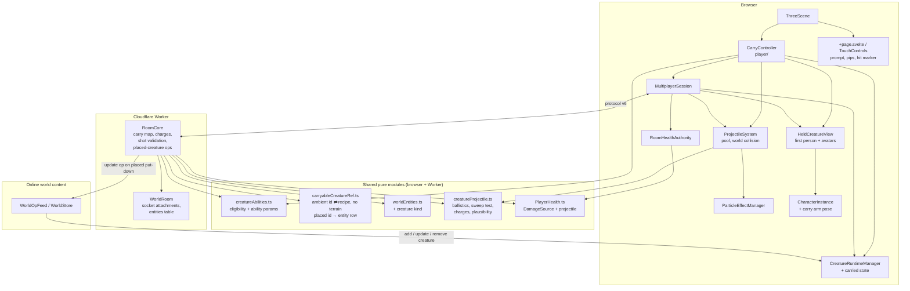
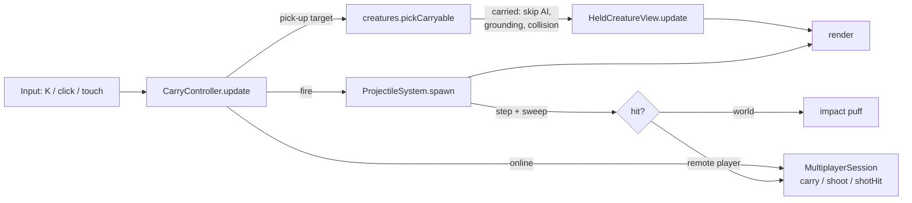
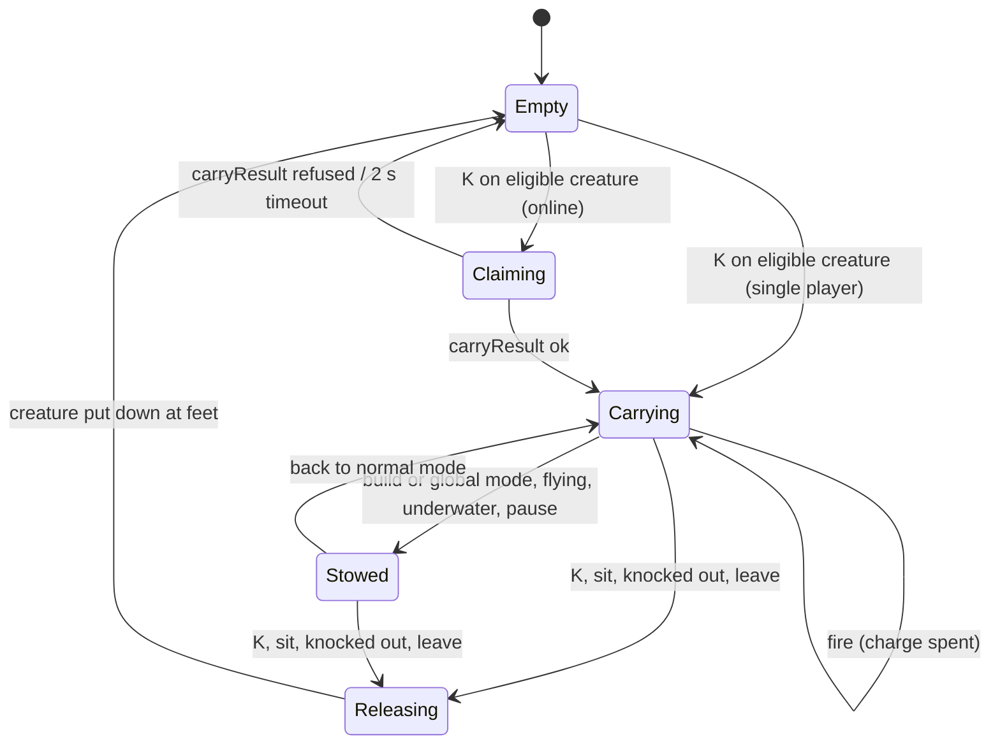
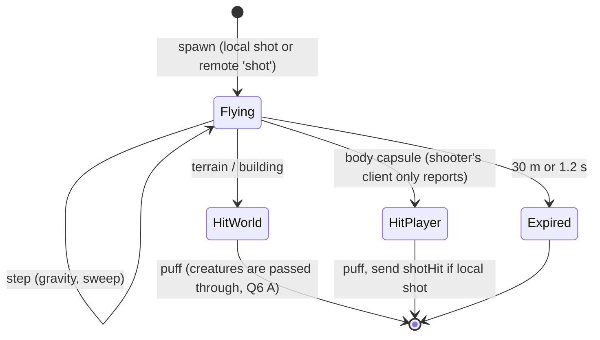
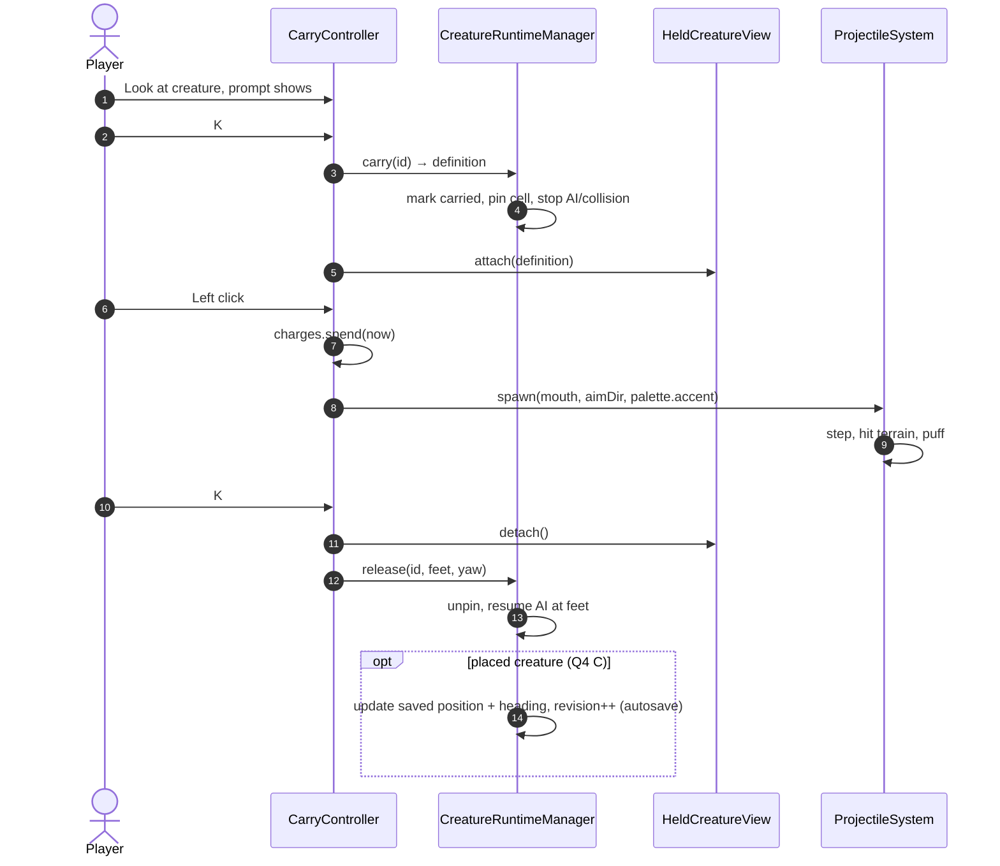
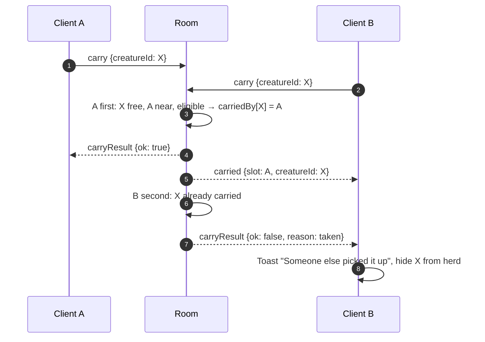
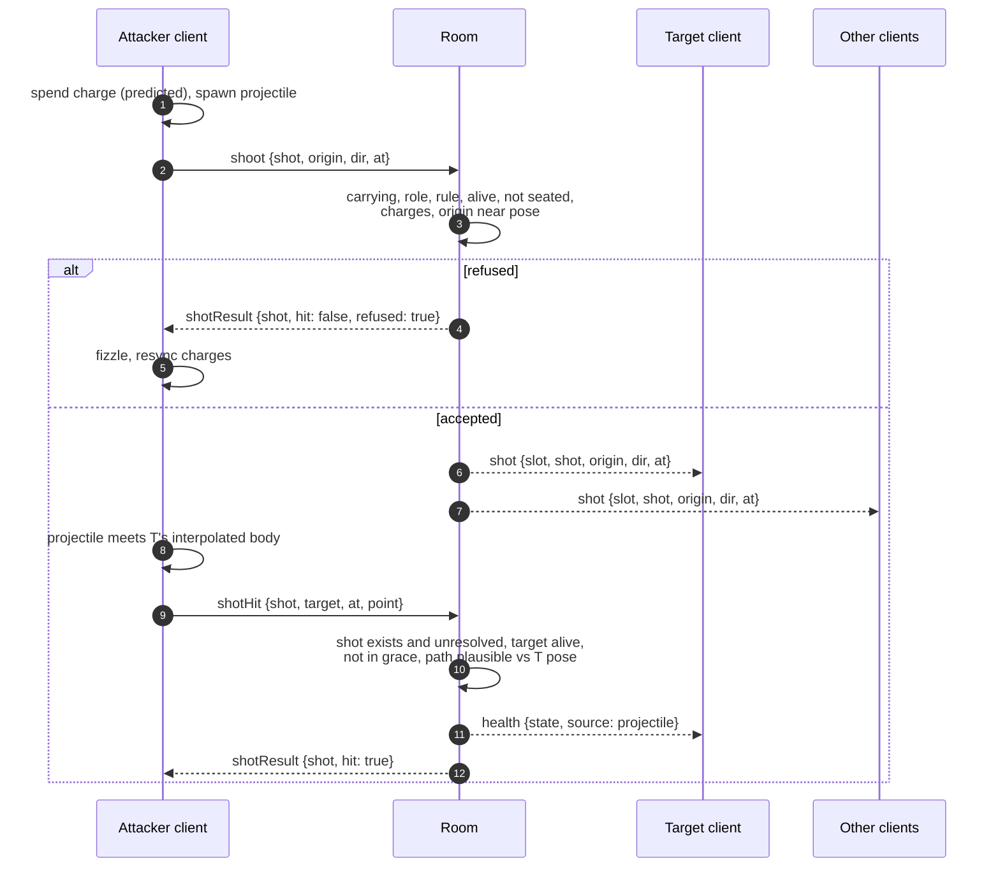
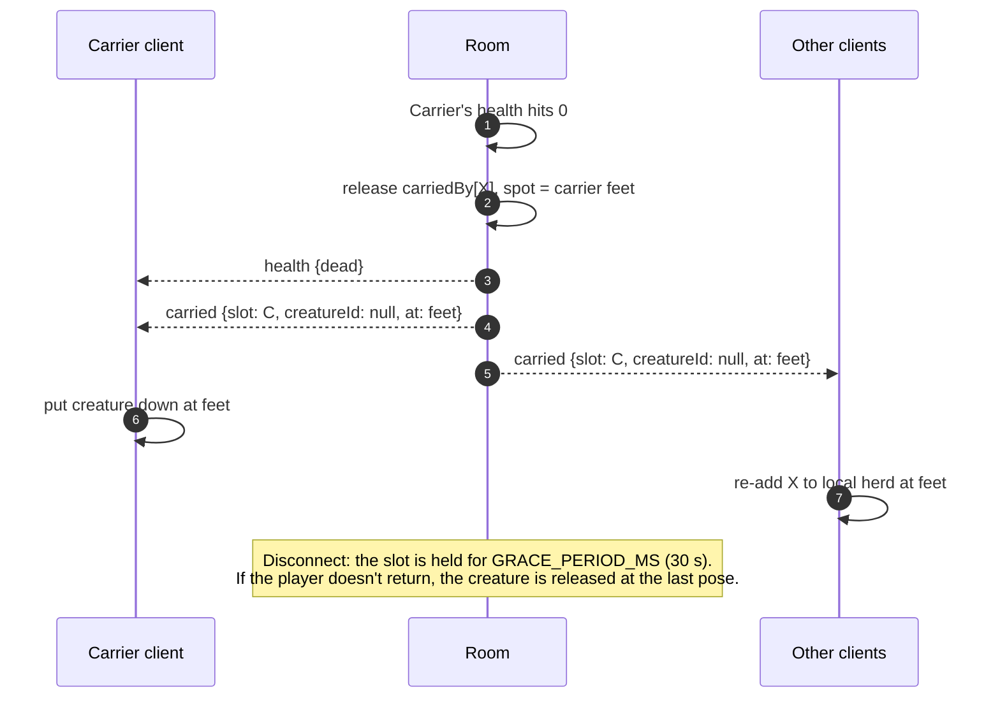
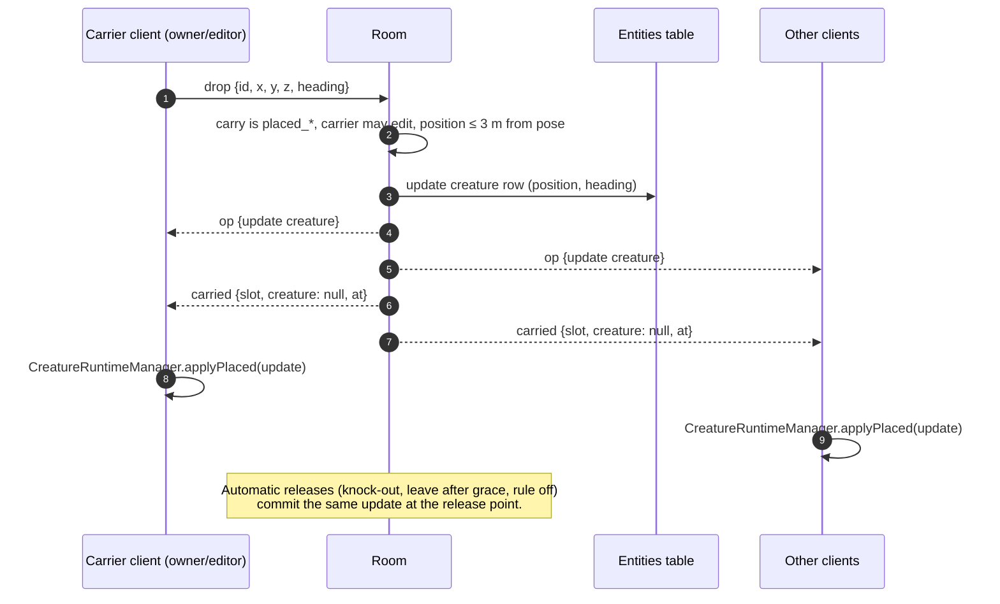
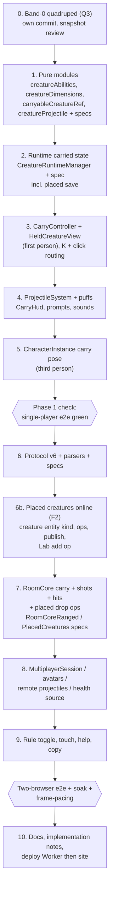

# Forest Drift — Creature Ranged Weapons: Technical Plan

**Feature cycle:** 2026-11-04
**Revision:** 2 (2026-11-04). Matches the **locked answers** in [`01-questions-and-decisions.md`](01-questions-and-decisions.md). Four answers differ from revision 1's defaults: **Q3** (force a small quadruped per region), **Q4 + F2** (placed creatures carryable, moves saved, shared online through the op feed), **Q6** (projectiles don't affect creatures) and **Q16** (viewers can carry and fire).
**Status:** **Waiting for your approval. No implementation code is written.**
**Related:** [`00-brief.md`](00-brief.md) · [`01-questions-and-decisions.md`](01-questions-and-decisions.md)

Paths are relative to `pages/Forest-Drift/`.

---

## 1. Summary

Three new pieces and four existing pipelines:

1. **A creature ability registry** (`creatureAbilities.ts`, pure, shared with the Worker). It answers "can this creature be carried, and what does it do?" for any `CreatureDefinition`. v1 has one ability: `mouth-projectile`, for quadrupeds ≤ 0.9 m _(Q2, Q29)_.
2. **Carrying.** A `CarryController` on the player side, a `carried` state in `CreatureRuntimeManager` that takes the creature out of simulation, collision and culling, and a `HeldCreatureView` that draws it in the lower-left of the first-person view and under the character's left arm in third person and on remote avatars.
3. **Projectiles.** Pure ballistics and hit tests in `creatureProjectile.ts` (shared with the room), and a pooled `ProjectileSystem` renderer that collides with terrain and buildings in the browser.
4. **Existing pipelines it plugs into:** `DamageSource` / `HealthAuthority` (new `projectile` kind), `RoomCore` validation (modelled on `handlePunch`), protocol v6 messages, and the owner's `rules` in `SharedEnvironment`.
5. **Two content changes the answers require:**
   - **Every region gets a small quadruped** _(Q3 C, F1)_: `regionSpecies` forces the smallest band's body plan to `quadruped`. This changes the smallest species in existing worlds where it wasn't one already.
   - **Placed (Lab) creatures become shared online content** _(Q4 C, F2)_: a new `creature` entity kind in the world op feed. Putting one down is saved as an edit (single player: the world save; online: an `update` op).

Online, the room arbitrates **who carries which creature** and **whether a hit lands**. Ambient creature _behaviour_ stays local to each client (Multiplayer Q9-A).

## 2. Codebase review: what exists today

### 2.1 Relevant files

| Area                      | File                                                                                                                                                                                                                                         | What matters for this feature                                                                                                                                                                                                                                                                                                                                                                                                                               |
| ------------------------- | -------------------------------------------------------------------------------------------------------------------------------------------------------------------------------------------------------------------------------------------- | ----------------------------------------------------------------------------------------------------------------------------------------------------------------------------------------------------------------------------------------------------------------------------------------------------------------------------------------------------------------------------------------------------------------------------------------------------------- |
| Creature types            | `src/lib/game/creatures/CreatureTypes.ts`                                                                                                                                                                                                    | `SpeciesGenome` (`name`, `bodyPlan.id`, `proportions`, `appearance.palette.accent`), `IndividualGenome.sizeFactor`, `CreatureSpawnDefinition.persistent`, `CreatureRuntimeDefinition.state` (`IDLE`…`FLEE`), `JointSemantic` includes `head`, feature kind `muzzle`.                                                                                                                                                                                        |
| Population                | `src/lib/game/creatures/CreaturePopulationSystem.ts`                                                                                                                                                                                         | `REGION_HEIGHT_BANDS` (smallest 0.55–0.8 m), `regionSpecies(seed, rx, rz)` and the individual seed `hashStringToUint32(groupId:member)` are **pure**. `generatePopulationCell` also needs terrain (`access.surface/blocked`). Ids: `group:{seed}:{cellX}:{cellZ}:{slot}:{member}`. `creatureDimensions()` gives height/radius. `regionSpecies` draws each band's plan from `['quadruped','quadruped','hexapod','biped','serpentine']`: the Q3 change point. |
| Persistence               | `src/lib/game/creatures/CreaturePersistence.ts`, `CreatureRuntimeManager.place/serialize`                                                                                                                                                    | Placed creatures: `PersistentCreatureDefinition { id: 'placed_…', species, individual, position, heading, state }`, validated (cap 1,000), saved in the world file.                                                                                                                                                                                                                                                                                         |
| Online world content      | `src/lib/game/net/worldEntities.ts`, `WorldOpFeed.ts`, `WorldStore.ts`, `worldTransfer.ts`, `ThreeScene.captureAuthoredContent/sharedWorldPort`                                                                                              | `AuthoredContent` and entity rows **exclude creatures today**. Ops are `add` / `update` / `remove` per `EntityKind`. F2 adds a `creature` kind.                                                                                                                                                                                                                                                                                                             |
| Runtime                   | `src/lib/game/creatures/CreatureRuntimeManager.ts`                                                                                                                                                                                           | `logical` / `live` maps, per-cell load/unload (`scan`, `unload`), `update()` (behaviour, grounding, animation, LOD, active cap), `resolvePlayer()` (pushes the player out of creature bodies), `serialize()` (only persistent creatures are saved).                                                                                                                                                                                                         |
| Behaviour                 | `CreatureBehaviourSystem.ts`                                                                                                                                                                                                                 | `decideCreature` / `advanceCreature`. Unchanged: projectiles don't affect creatures _(Q6 A)_.                                                                                                                                                                                                                                                                                                                                                               |
| Compile / animate         | `CreatureCompiler.ts`, `CreatureAnimationSystem.ts`, `CreatureGrounding.ts`                                                                                                                                                                  | `compileCreature()` → `CompiledCreature { object, skeleton, bonesById, compilation.collision }`. At most one compile per frame. Grounding has to be skipped while carried.                                                                                                                                                                                                                                                                                  |
| Player                    | `src/lib/game/player/FirstPersonController.ts`                                                                                                                                                                                               | Pointer lock, `worldPosition` (eye), `getYaw/getPitch`, `isFlying`, `interactionPose`, `thirdPerson`, `teleports`. No first-person body.                                                                                                                                                                                                                                                                                                                    |
| Local body                | `src/lib/game/player/PlayerInteractionView.ts`, `src/lib/game/characters/CharacterInstance.ts`                                                                                                                                               | `CharacterInstance` draws the character in third person or during interactions, with the arm IK (`twoBoneIK.ts`) and the `reach` pose. A **carry** arm pose belongs here.                                                                                                                                                                                                                                                                                   |
| Interaction               | `src/lib/game/player/PlayerInteractionController.ts`, `src/lib/game/miniBuild/MiniBuildInteractionRuntime.ts`                                                                                                                                | `K` key listener (capture phase), `chooseInteraction` (nearest to the crosshair), `InteractionOccupancyManager` (claim/release pattern).                                                                                                                                                                                                                                                                                                                    |
| Health                    | `src/lib/game/player/PlayerHealth.ts`, `HealthAuthority.ts`, `src/lib/game/net/RoomHealthAuthority.ts`                                                                                                                                       | `DamageSource` union, `damageHealth()`, grace, regeneration, `HealthNotifier`. `RoomHealthAuthority.applyServer(state, source)` already reports damage from others.                                                                                                                                                                                                                                                                                         |
| Punch (the model to copy) | `src/lib/game/player/punch.ts`, `ThreeScene.canPunch/punch`, `MultiplayerSession.punch`, `RoomCore.handlePunch`                                                                                                                              | Client picks the target, room checks `punchPlausible`, cooldown, role, rule, alive, not seated. `punchResult` goes to the attacker only. Target gets a private `health` with `source`.                                                                                                                                                                                                                                                                      |
| Scene                     | `src/lib/game/ThreeScene.ts`                                                                                                                                                                                                                 | Wires everything: `creatures`, `controller`, `health`, `multiplayer`, `buildToolManager.isNormalMode()`, `handlePunchMouseDown`, `afterControllerUpdate` (pose), `getCreatureColliders`, `sharedWorldPort` (creatures excluded).                                                                                                                                                                                                                            |
| Protocol                  | `src/lib/game/net/protocol.ts`                                                                                                                                                                                                               | `PROTOCOL_VERSION = 5`. Binary pose with `POSE_FLAGS`: **all 8 bits used**. JSON messages for everything else. `PresenceMessage.down`. `SharedEnvironment.rules { fallDamage, playerDamage }`. `GRACE_PERIOD_MS = 30 000`.                                                                                                                                                                                                                                  |
| Room                      | `src/lib/game/net/RoomCore.ts`, `server/src/WorldRoom.ts`                                                                                                                                                                                    | Per-player state, `interactions` map, socket attachments (survive hibernation), SQL tables incl. `player_health`, stats counters. **No terrain or building geometry.**                                                                                                                                                                                                                                                                                      |
| Session                   | `src/lib/game/net/MultiplayerSession.ts`, `NetSession.ts`, `RemoteAvatarRenderer.ts`, `RemoteMotion.ts`                                                                                                                                      | Message routing, remote frames used to aim punches, avatar drawing via `CharacterInstance`.                                                                                                                                                                                                                                                                                                                                                                 |
| Particles / audio         | `src/lib/game/particles/ParticleEffectManager.ts` (`register`, `emitBurst`), `src/lib/game/audio/soundEffects.ts` (`SOUND_EFFECTS`, `playSoundEffect`)                                                                                       | Impact puffs and muzzle puffs. Sound registry.                                                                                                                                                                                                                                                                                                                                                                                                              |
| UI                        | `src/routes/+page.svelte` (hit marker, prompts, live region, help), `src/lib/components/TouchControls.svelte` (contextual door button, Punch button), `ControlsGuide.svelte`, `HealthBar.svelte`, `DeathCard.svelte`, `src/lib/ui/theme.css` | Prompt / button / HUD patterns to reuse.                                                                                                                                                                                                                                                                                                                                                                                                                    |
| Settings                  | `src/lib/game/settings/settingsCatalog.ts`                                                                                                                                                                                                   | `rules-health` group, `OWNER_CATEGORY_IDS` has `rules`.                                                                                                                                                                                                                                                                                                                                                                                                     |
| Tests                     | `tests/playerHealth.e2e.ts`, `tests/multiplayer.e2e.ts`, `tests/creatures.e2e.ts`, `src/lib/game/net/__tests__/RoomCoreHealth.spec.ts`, `src/lib/game/player/__tests__/punch.spec.ts`, `src/lib/game/creatures/CreatureRuntime.spec.ts`      | Patterns and harnesses (fake connections, two-browser flows) to extend.                                                                                                                                                                                                                                                                                                                                                                                     |

### 2.2 Routes, database tables, APIs and services

- **Routes:** only `/` (`src/routes/+page.svelte`). The `/creatures/` Lab route is unchanged. No new routes.
- **Browser storage (IndexedDB world saves):** no schema change. The carry itself is never saved _(brief §4)_, but putting a **placed** creature down updates its saved `position`/`heading` in `CreatureWorldState.individuals` _(Q4 C)_. Single player needs no rule _(Q5)_.
- **Durable Object SQL (`WorldRoom.ts`):** no new tables. Placed creatures are stored as rows of a new `creature` kind in the existing `entities` table, written by the existing op path _(F2)_. Carry state lives in memory plus the **socket attachment** (the same trick the resting pose uses to survive hibernation). Charges are timestamps derived on demand, like health regeneration.
- **WebSocket protocol:** new messages, v5 → v6 (§8).
- **HTTP API (`server/src/http.ts`, `worker.ts`):** unchanged. The manifest may expose `creatureProjectiles` next to `fallDamage` if the join dialog should show it (optional).
- **External services:** none. Cloudflare usage rises slightly with message volume (§11).

### 2.3 Facts the design depends on

1. **Creatures are local (Q9-A).** Each client runs its own behaviour, so positions differ between clients. Only _spawn_ positions and _recipes_ are deterministic.
2. **Ambient recipes can be rebuilt from the id without terrain.** `regionSpecies` + the cell's tier shuffle + `generateIndividual(species, hash(groupId:member))` only need the world seed. So the room and remote clients can resolve `creatureId → CreatureDefinition` cheaply and deterministically. _(To verify during Phase 1: `showcaseRegion` and `SpeciesGenerator` import nothing from Three.js or DOM, so they can be bundled into the Worker.)_
3. **The room has poses, not geometry.** It can check distance, direction and timing, but not walls (Q14).
4. **The pose flags byte is full.** Carrying can't be a pose bit. It travels as a reliable JSON message and in `welcome`.
5. **`resolvePlayer` pushes the player out of every live creature's collision cylinder.** A carried creature has to be excluded, or it would shove its carrier around every frame.
6. **Cells unload behind the player.** A carried creature has to be pinned so the creature in your arm doesn't vanish when its home cell unloads.
7. **Punching's room-side validation already handles** hibernation (resting pose in the attachment), wake-without-grace, and teleport flags. Ranged validation reuses the same pose data.
8. **Placed creatures don't exist in online worlds today.** They're left out of `AuthoredContent`, entity rows, publishing and the op feed. F2 needs this fixed first (Phase 2b).
9. **The species draw order is world identity.** Q3 C changes it on purpose. To keep the change as small as possible, the smallest band still _consumes_ its `rng()` plan draw (so every later draw is unchanged), and only the result is overridden to `quadruped`.

## 3. Architecture

### 3.1 Module diagram



### 3.2 Data flow for one frame (carrier's browser)



### 3.3 Carry state machine (`CarryController`)



Online, `Carrying` begins only on the room's `carryResult { ok: true }`, never on prediction, so two players can't both see themselves holding the same creature. The 1-RTT wait shows a short "lifting" arm blend so it doesn't feel laggy.

### 3.4 Projectile lifecycle



Remote clients simulate the same projectile for visuals only. They never report hits for shots they didn't fire.

### 3.5 Sequence: single-player pick-up, fire, put down



### 3.6 Sequence: online claim race



### 3.7 Sequence: online shot and hit



### 3.8 Sequence: knocked out while carrying, and disconnect



### 3.9 Late joiner

`welcome` gains `carries: { slot, creatureId }[]`. The new client hides those ids from its herd as the cells load, and draws them under the right avatars. Placed creatures arrive with the rest of the world content (entity rows), so a carried placed creature is hidden the same way.

### 3.10 Sequence: online put-down of a placed creature (F2)



## 4. Detailed design

### 4.1 `creatureAbilities.ts` (new, pure, shared)

```text
type CreatureAbilityId = 'mouth-projectile'
interface CreatureAbility { id; carry: { side: 'left'; scale }; projectile: ProjectileParams }
abilityFor(definition: CreatureDefinition): CreatureAbility | null
  quadruped && creatureDimensions(species, sizeFactor).height <= 0.9      (Q2)
CARRY_REACH = 2.0 m (eye to creature body)
```

- Pure, no Three.js. Imported by `CarryController`, `HeldCreatureView`, `RoomCore`.
- `creatureDimensions` is currently in `CreaturePopulationSystem.ts`, which pulls in more code. Move it, or re-export it from a small `creatureDimensions.ts`, so the Worker bundle stays lean.

### 4.2 `carryableCreatureRef.ts` (new, pure, shared)

- `resolveCarryableCreature(worldSeed, id, placedLookup) → { definition, placed: boolean } | null`: dispatches on the id prefix. `group:` ids go to the ambient path below. `placed_` ids are looked up in the world's creature entity rows (online) or `CreatureWorldState.individuals` (single player) _(Q4 C)_.
- `parseAmbientCreatureId(id) → { seed, cellX, cellZ, slot, member } | null`: strict format check, safe integers, bounded slot/member.
- `resolveAmbientCreature(worldSeed, id) → CreatureDefinition | null`: rebuilds the species via `regionSpecies` and the cell's tier shuffle (pure) and the individual via `generateIndividual`. Returns null when the id's seed isn't this world's, or the slot is out of range.
- The id embeds the world seed. Everyone in the room already has the seed (they generate the terrain), so sending it isn't a leak, but ids are never logged by the room (§10).
- Memoised per `(region)` in the room so repeated claims cost nothing.
- **Determinism test:** for 500 random cells, the definition rebuilt from the id equals the one `generatePopulationCell` produced (deep-equal).

### 4.2a Small quadruped in every region (`CreaturePopulationSystem.regionSpecies`, Q3 C / F1)

```text
const drawn = plans[Math.floor(rng() * plans.length)]   // draw still consumed: later draws unchanged
const plan  = index === 0 ? 'quadruped' : drawn         // smallest band (0.55–0.8 m) is always a quadruped
```

- Only band 0 can change, and only where it wasn't already a quadruped (about 3 regions in 5). Larger species, herd positions, colours of other species and every later draw stay identical.
- No `generatorVersion` bump: you chose to change existing worlds (F1). All players in a room run the same code because protocol v6 forces a refresh.
- `CreatureFingerprints` / ecology snapshots that cover band 0 are regenerated, and the diff is reviewed so only band-0 species changed.
- `showcaseRegion` runs after the override, so check it doesn't re-assign band 0's plan.

### 4.2b Placed creatures as shared online content (F2)

- `worldEntities.ts`: new `TopEntityKind` `creature`, with row `data` = `PersistentCreatureDefinition` minus runtime fields. `AuthoredContent` gains `creatures`.
- `ThreeScene.captureAuthoredContent` includes placed creatures. `sharedWorldPort.contentRevision` includes a **placed-only** revision (ambient churn must stay excluded, the reason they were left out).
- `CreatureRuntimeManager.applyPlaced(op)`: add / update / remove from the feed, using the existing low-level paths (no undo history, no cascades).
- Creature Lab "Place in world" online sends an `add` op (owner/editor only), instead of writing locally.
- Publishing (`worldTransfer.ts`, the Worker's publish path) carries the rows. Old published worlds simply have none.
- Validation in the room: the same caps and checks as `validateCreatureWorldState` (≤ 1,000 placed creatures, no runtime fields, finite positions).

### 4.3 `CreatureRuntimeManager` changes

| Change                                                                             | Why                                                                                                                                                                                                                                                             |
| ---------------------------------------------------------------------------------- | --------------------------------------------------------------------------------------------------------------------------------------------------------------------------------------------------------------------------------------------------------------- |
| `carried: Map<string, { by: 'local' \| slot; pinned: CreatureRuntimeDefinition }>` | One source of truth for "not in the herd".                                                                                                                                                                                                                      |
| `pickCarryable(eye, dir, reach) → { id, definition } \| null`                      | Ray vs live creatures' collision cylinders; nearest to the crosshair; `abilityFor` must be non-null.                                                                                                                                                            |
| `carry(id)`                                                                        | Removes the creature from `spatial`, behaviour, grounding and `selectVisibleCreatures`. Its `live` mesh moves to `HeldCreatureView` (no recompile), or gets compiled from the definition if it's not live.                                                      |
| `release(id, position, heading)`                                                   | Re-inserts it at `position` with state `IDLE` _(Q18 A)_. Ambient: its home cell keeps the original spawn, so a later cell reload regenerates it at home as usual. Placed: also updates its saved position and heading and bumps `revision` (autosave) _(Q4 C)_. |
| `applyPlaced(op)`                                                                  | Online add / update / remove of placed creatures from the op feed (§4.2b).                                                                                                                                                                                      |
| `hideRemoteCarried(ids)`                                                           | For creatures carried by others. When a cell (re)loads, carried ids are skipped.                                                                                                                                                                                |
| `resolvePlayer`, `getCreatureColliders`                                            | Skip carried ids (§2.3 fact 5).                                                                                                                                                                                                                                 |
| `unload(id)` / `scan`                                                              | Never unload carried ids. Cell unload skips them.                                                                                                                                                                                                               |
| `serialize()`                                                                      | A placed creature that's currently carried is saved at its **last put-down position** (not under the arm), so a save mid-carry never loses it. Ambient creatures are never saved.                                                                               |

### 4.4 `CarryController` (new, `src/lib/game/player/CarryController.ts`)

- Owns the state machine in §3.3, the local `ChargeState` (from `creatureProjectile.ts`), and the input bindings.
- **Input precedence on `K`** (registered beside `MiniBuildInteractionRuntime`'s capture listener): if carrying → put down. Else, choose between the seat/door target and the creature target by distance to the crosshair (`chooseInteraction` rule) _(Q7)_.
- **Fire gate (`canFire`)** mirrors `canPunch()`: feature on, rule on (online), normal mode, no mini-build interaction, not flying, not dead, head not underwater, debug panel closed, and Carrying (not Stowed). `ThreeScene.handlePunchMouseDown` sends left click to `fire()` while carrying, and to `punch()` otherwise _(Q8)_. Holding the button fires again whenever `charges.canSpend(now)`.
- **Aim:** the hit test runs along the **camera ray** from the eye. The visual projectile starts at the creature's mouth (the muzzle tip in `HeldCreatureView`) and curves toward the camera ray's convergence point at 20 m, so first-person aim matches the crosshair. Third-person aim uses the same camera ray.
- **Prompts:** `onPrompt({ label: 'Pick up {species.name}' | 'Put down' | 'Too big to carry' })` feeds the existing prompt slot in `+page.svelte`.

### 4.5 `HeldCreatureView` (new, `src/lib/game/creatures/HeldCreatureView.ts`)

- **First person** _(Q22 A)_: the creature's `CompiledCreature.object`, re-parented to a group that follows the camera, scaled so its body fills ~22% of the screen height, lower-left, head toward the crosshair. LOD1. `castShadow = false`. `frustumCulled = false`. Drawn with a near clip offset so it doesn't poke into walls. Hidden when the third-person boom collapses or the camera is within 0.3 m of a wall.
- **Third person, and remote avatars:** attached to the `CharacterInstance`'s left forearm or hip with a fixed offset per `abilityFor().carry`. `CharacterInstance` gets a `carry` arm pose: left arm two-bone IK, elbow bent ~90°, hand under the belly. It blends like `reach`.
- **Animation** _(Q23)_: breathing (torso scale ±1.5% at 0.3 Hz), tail sway via existing chain bones, head look toward aim, and an 80 ms head recoil per shot (off with reduced motion).
- **Remote carriers:** the definition comes from `resolveCarryableCreature`, compiled through the runtime's one-per-frame queue (priority over ambient). Until it's ready, the arm pose shows empty.

### 4.6 Projectiles

**`creatureProjectile.ts` (new, pure, shared):**

```text
PROJECTILE_SPEED = 35 m/s, GRAVITY = 4 m/s², RADIUS = 0.12 m          (Q11)
MAX_RANGE = 30 m, MAX_LIFETIME_MS = 1200                               (Q12)
DAMAGE = 3                                                              (Q9)
CHARGES_MAX = 5, CHARGE_REGEN_MS = 1500, MIN_SHOT_GAP_MS = 350          (Q10)
positionAt(origin, dir, tMs)            // closed form, no integration drift
sweepCapsule(origin, dir, t0, t1, capsule) → tHit | null
chargesAt(state, now), spendCharge(state, now) → state | null           // timestamp-derived like healthAt
shotOriginPlausible(pose, origin)       // ≤ 1.5 m from pose eye + 1 m lag slack
shotHitPlausible(shot, targetPose, hitAt) // path point at hitAt within 3 m + body radius of target feet capsule,
                                         // hitAt − firedAt within [0, MAX_LIFETIME_MS + 250]
```

**`ProjectileSystem.ts` (new, `src/lib/game/particles/` or `src/lib/game/combat/`):**

- A pool of at most 64 projectiles. One `InstancedMesh` (low-poly icosphere, per-instance colour = species palette accent) _(Q1 A)_. No per-shot allocation.
- Per step: the closed-form position, then a sweep against (a) terrain via `WorldSurfaceSampler` height checks along the segment, (b) building colliders via the existing wall collision rects and solid meshes (`ThirdPersonCamera` obstacles are reused), and (c) **remote player capsules** (only for local shots), using the same interpolated frames `MultiplayerSession.punch` aims at.
- On impact: `ParticleEffectManager.emitBurst('creature-pellet-puff', …)` and a sound. Creatures aren't tested, so pellets pass through them _(Q6 A)_.

### 4.7 Health integration

- `DamageSource` += `{ kind: 'projectile'; by: number; species: string }` _(Q25)_. Shared with the Worker.
- `RoomHealthAuthority.applyServer` already reports damage for `source.kind === 'player'`. Widen it to any source with `by`.
- `+page.svelte`: play `punchHit` for `projectile` too. The death card reads "You were knocked out by {Name}'s {species}".
- `LocalHealthAuthority`: unchanged (no projectile damage in single player, _Q5_).

### 4.8 Protocol v6 (`protocol.ts`)

Client → room:

| Message   | Fields                                                                                  | Notes                                                                                                                          |
| --------- | --------------------------------------------------------------------------------------- | ------------------------------------------------------------------------------------------------------------------------------ |
| `carry`   | `id: number`, `creature: string` (≤ 128 chars)                                          | Claim.                                                                                                                         |
| `drop`    | `id`, `x, y, z, heading`                                                                | Put down voluntarily. Position clamped to ≤ 3 m from pose. For a placed creature the room also commits an `update` op (§3.10). |
| `shoot`   | `shot: number` (monotonic), `origin: [x,y,z]`, `dir: [x,y,z]` (unit), `at` (room clock) | Fire.                                                                                                                          |
| `shotHit` | `shot`, `target: slot`, `at`, `point: [x,y,z]`                                          | Only for the sender's own shots.                                                                                               |

Room → clients:

| Message       | To                          | Fields                                                                                 |
| ------------- | --------------------------- | -------------------------------------------------------------------------------------- |
| `carryResult` | sender                      | `id`, `ok`, `reason?: 'taken' \| 'far' \| 'ineligible' \| 'rule' \| 'role' \| 'state'` |
| `carried`     | everyone                    | `slot`, `creature: string \| null`, `at?: [x,y,z,heading]` (on release)                |
| `shot`        | everyone except the shooter | `slot`, `shot`, `origin`, `dir`, `at`, `species` (for the colour)                      |
| `shotResult`  | shooter                     | `shot`, `hit`, `refused?`, `charges` (authoritative count, so the client can resync)   |
| `welcome`     | joiner                      | `+ carries: { slot, creature }[]`, `+ rules.creatureProjectiles`                       |
| `health`      | target                      | existing message, with `source.kind: 'projectile'`                                     |

- `SharedEnvironment.rules` gains `creatureProjectiles?: boolean` (undefined = on, _Q15 A_).
- Parsers validate every number with `Number.isFinite`, every vector's magnitude, string lengths and the id format, the same as `punch`.
- World ops and `welcome` content gain the `creature` entity kind (§4.2b).
- `PROTOCOL_VERSION = 6`. Version mismatch shows the existing "refresh" message. v6 also gates the Q3 fauna change, so no room mixes the old and new species.

### 4.9 `RoomCore` changes

- **State:** `carriedBy: Map<creatureId, slot>`, and per player `carry: { creature, charges: ChargeState, shots: Map<shot, {origin, dir, at, resolved}> (last 16) } | null`, `lastShotId`.
- **`handleCarry`:** rule on, alive, not seated, no current carry, `resolveCarryableCreature` ok, `abilityFor(definition)` non-null, free in `carriedBy`. Any role may carry **ambient** creatures, viewers included _(Q16)_. Then, by kind:
  - **Ambient:** the seed matches, and the creature's **cell centre** is within 64 m + 3 m of the carrier's pose. The room can't know the creature's live position (it's local), so the check is at cell level.
  - **Placed:** the carrier may edit (owner/editor; viewers get `role`), and the creature's **saved position** is within 3 m + 2 m lag slack of the carrier's pose. That's a precise check, because placed positions are shared content.
  - On success, broadcast `carried`.
- **`handleShoot`:** has a carry, not dead or seated, rule on, `shot > lastShotId`, `spendCharge` ok, `shotOriginPlausible`, `dir` unit-length ±1%, `at` within ±500 ms of room time. Record the shot and broadcast `shot`.
- **`handleShotHit`:** the shot exists, isn't resolved, belongs to the sender. The target exists, is connected, isn't the sender, is alive and not in grace. `shotHitPlausible` against the target's latest pose, with the speed check reusing the existing teleport handling. `damageHealth(…, DAMAGE)` → `setHealth(target, state, …, { kind: 'projectile', by, species })`. Mark the shot resolved. `shotResult` goes to the shooter.
- **Releases:** on death (`setHealth` reaching dead), interaction start, leave after grace, rule switched off (releases all carries), explicit `drop`. A placed creature's release always commits an `update` op at the release point (§3.10). If the placed creature is removed by an edit while carried, the carry is cleared and `carried null` is broadcast.
- **Hibernation:** store `{ creature }` in the socket attachment (it changes only on carry or drop). Charges reset to full on wake (generous, and no write traffic). `carriedBy` is rebuilt from attachments on wake.
- **Stats:** `carriesGranted`, `carriesRefused`, `shotsFired`, `shotsRefused`, `shotHitsAccepted`, `shotHitsRejected`, shown in `MultiplayerUsage` and diagnostics.

### 4.10 UI

- **Prompt:** "[K] Pick up {species}" / "[K] Put down", in the existing prompt slot.
- **Carry HUD:** a small chip above the right end of the health row: the creature's colour dot, its species name, and 5 charge pips (`--fd-ammo*` tokens in `theme.css`). It's an `aria-hidden` visual. The text equivalent goes through the live region.
- **Hit marker:** reuse `.hit-marker` (punch).
- **Touch:** the contextual button (beside the door button) "Pick up" / "Put down". While carrying, the Punch button becomes **Fire** (`data-testid="touch-fire-btn"`), with press-and-hold for repeat fire.
- **Help overlay and `ControlsGuide.svelte`:** two rows: "K — Pick up / put down a small creature" and "Left click (carrying) — Fire".
- **Toasts:** "Someone else picked it up", "Too far away", "Creature projectiles are off in this world".

### 4.11 Settings and kill switch

- `settingsCatalog.ts`: `rules.creatureProjectiles` in `rules-health`, owner-only online, hidden in single player.
- `RANGED_WEAPONS_ENABLED` in `creatureAbilities.ts`: false hides prompts, buttons and HUD, and makes `abilityFor` return null on the client. The room keeps working, so old and new clients don't diverge.

### 4.12 Sound _(Q24 C)_

`soundEffects.ts` gains synthesised `pelletFire`, `pelletPuff` and `creaturePickUp` (WebAudio, the same approach as `landingThud.ts`). Player hits reuse `punchHit`.

## 5. New files likely to be created

| File                                               | Purpose                                                                                                                                                                                                                                                                                                                                                 |
| -------------------------------------------------- | ------------------------------------------------------------------------------------------------------------------------------------------------------------------------------------------------------------------------------------------------------------------------------------------------------------------------------------------------------- |
| `src/lib/game/creatures/creatureAbilities.ts`      | Ability registry, eligibility, carry constants, kill switch.                                                                                                                                                                                                                                                                                            |
| `src/lib/game/creatures/creatureDimensions.ts`     | `creatureDimensions` moved out of the population system (Worker-safe).                                                                                                                                                                                                                                                                                  |
| `src/lib/game/creatures/carryableCreatureRef.ts`   | Id parsing, terrain-free ambient recipe resolution, placed-creature lookup.                                                                                                                                                                                                                                                                             |
| `src/lib/game/creatures/HeldCreatureView.ts`       | First-person and third-person/avatar presentation of a carried creature.                                                                                                                                                                                                                                                                                |
| `src/lib/game/player/CarryController.ts`           | Carry state machine, input, fire gate, prompts.                                                                                                                                                                                                                                                                                                         |
| `src/lib/game/player/creatureProjectile.ts`        | Pure ballistics, sweep, charges, plausibility (shared with the room).                                                                                                                                                                                                                                                                                   |
| `src/lib/game/particles/ProjectileSystem.ts`       | Pooled instanced projectiles and world collision.                                                                                                                                                                                                                                                                                                       |
| `src/lib/game/particles/effects/creaturePellet.ts` | Muzzle and impact puff effect definitions.                                                                                                                                                                                                                                                                                                              |
| `src/lib/components/CarryHud.svelte`               | Species chip and charge pips.                                                                                                                                                                                                                                                                                                                           |
| Tests                                              | `creatureAbilities.spec.ts`, `carryableCreatureRef.spec.ts`, `regionSpeciesQuadruped.spec.ts`, `creatureProjectile.spec.ts`, `CarryController.spec.ts`, `CreatureCarry.spec.ts` (runtime), `RoomCoreRanged.spec.ts`, `RoomCorePlacedCreatures.spec.ts`, `protocolRanged.spec.ts`, `tests/rangedWeapons.e2e.ts`, `tests/rangedWeaponsMultiplayer.e2e.ts` |

## 6. Existing files likely to be changed

| File                                                                                                | Change                                                                                                                                                                                                                                                                                                                                                                            |
| --------------------------------------------------------------------------------------------------- | --------------------------------------------------------------------------------------------------------------------------------------------------------------------------------------------------------------------------------------------------------------------------------------------------------------------------------------------------------------------------------- |
| `src/lib/game/creatures/CreatureRuntimeManager.ts`                                                  | Carried state, pin, skip AI/grounding/collision/cap, `pickCarryable`, `release` (saves placed positions), `hideRemoteCarried`, `applyPlaced`.                                                                                                                                                                                                                                     |
| `src/lib/game/creatures/CreaturePopulationSystem.ts`                                                | Band 0 forced to `quadruped` _(Q3 C)_. Import `creatureDimensions` from its new file. Expose the tier shuffle as a pure helper for `carryableCreatureRef`.                                                                                                                                                                                                                        |
| `src/lib/game/creatures/__snapshots__/*`, `CreatureFingerprints.spec.ts`, `CreatureEcology.spec.ts` | Regenerate and review snapshots affected by the band-0 change.                                                                                                                                                                                                                                                                                                                    |
| `src/lib/components/CreatureLabModal.svelte`, `ThreeScene.placeCreature`                            | Online placement sends an `add` op (F2).                                                                                                                                                                                                                                                                                                                                          |
| `src/lib/game/net/worldEntities.ts`, `WorldOpFeed.ts`, `WorldStore.ts`, `worldTransfer.ts`          | `creature` entity kind, rows, ops and publish (F2).                                                                                                                                                                                                                                                                                                                               |
| `src/lib/game/characters/CharacterInstance.ts`, `CharacterAnimationState.ts`                        | `carry` arm pose and attachment socket.                                                                                                                                                                                                                                                                                                                                           |
| `src/lib/game/player/PlayerInteractionView.ts`                                                      | Pass carry state to the local third-person character.                                                                                                                                                                                                                                                                                                                             |
| `src/lib/game/player/PlayerHealth.ts`                                                               | `DamageSource` adds `projectile`.                                                                                                                                                                                                                                                                                                                                                 |
| `src/lib/game/net/RoomHealthAuthority.ts`                                                           | Report damage for any source with `by`.                                                                                                                                                                                                                                                                                                                                           |
| `src/lib/game/ThreeScene.ts`                                                                        | Construct and update `CarryController`, `ProjectileSystem`, `HeldCreatureView`. Click routing. Stow and auto-release hooks (knock-out, interaction, mode changes). Public `carryState()`, `fire()`, `toggleCarry()` for the UI and tests. Exclude carried creatures from colliders. `captureAuthoredContent` / `sharedWorldPort` include placed creatures (placed-only revision). |
| `src/lib/game/net/protocol.ts`                                                                      | v6 messages, parsers, `rules.creatureProjectiles`, `welcome.carries`.                                                                                                                                                                                                                                                                                                             |
| `src/lib/game/net/MultiplayerSession.ts`, `NetSession.ts`                                           | Send/receive carry, shot and hit messages. Expose remote frames to `ProjectileSystem`. Callbacks `onCarryResult`, `onCarried`, `onShot`, `onShotResult`.                                                                                                                                                                                                                          |
| `src/lib/game/net/RemoteAvatarRenderer.ts`                                                          | Draw carried creatures on avatars (via `HeldCreatureView`).                                                                                                                                                                                                                                                                                                                       |
| `src/lib/game/net/RoomCore.ts`                                                                      | §4.9.                                                                                                                                                                                                                                                                                                                                                                             |
| `server/src/WorldRoom.ts`                                                                           | Attachment type gains `creature?`. Pass the world seed to `RoomCore` if it isn't there already.                                                                                                                                                                                                                                                                                   |
| `src/lib/game/net/sharedEnvironment.ts`                                                             | Default and merge for the new rule.                                                                                                                                                                                                                                                                                                                                               |
| `src/lib/game/settings/settingsCatalog.ts`                                                          | Rule row.                                                                                                                                                                                                                                                                                                                                                                         |
| `src/lib/game/audio/soundEffects.ts`                                                                | New synthesised cues.                                                                                                                                                                                                                                                                                                                                                             |
| `src/routes/+page.svelte`                                                                           | Prompts, CarryHud, toasts, live-region messages, death-card copy, help rows.                                                                                                                                                                                                                                                                                                      |
| `src/lib/components/TouchControls.svelte`                                                           | Pick up / Put down and Fire buttons.                                                                                                                                                                                                                                                                                                                                              |
| `src/lib/components/ControlsGuide.svelte`, `DeathCard.svelte`                                       | Copy.                                                                                                                                                                                                                                                                                                                                                                             |
| `src/lib/ui/theme.css`                                                                              | `--fd-ammo*` tokens.                                                                                                                                                                                                                                                                                                                                                              |
| `docs/creature-system.md`, `docs/multiplayer-player-guide.md`, `README.md`                          | Document controls, the rule and limits.                                                                                                                                                                                                                                                                                                                                           |

## 7. Data model changes

| Where                                                          | Change                                                                                                                               | Migration                                                                                                |
| -------------------------------------------------------------- | ------------------------------------------------------------------------------------------------------------------------------------ | -------------------------------------------------------------------------------------------------------- |
| World save (IndexedDB, `WorldTypes.ts`)                        | **No schema change.** Carry state isn't saved. Placed creatures' existing `position`/`heading` fields update when put down _(Q4 C)_. | None. No schema bump.                                                                                    |
| Ambient fauna (generated, not stored)                          | Smallest species forced to quadruped _(Q3 C)_. Changes what existing worlds look like, but nothing stored.                           | None possible or needed; accepted in F1.                                                                 |
| `SharedEnvironment.rules` (online, stored with the room's env) | `creatureProjectiles?: boolean`                                                                                                      | Missing means on (Q15 A). Old rooms keep working.                                                        |
| Durable Object SQL                                             | No new tables. New `creature` kind rows in the existing `entities` table _(F2)_.                                                     | Existing rooms have none. Single-player worlds published after this ship include their placed creatures. |
| Socket attachment (`PlayerAttachment`)                         | `+ creature?: string`                                                                                                                | Missing means not carrying.                                                                              |
| In-memory room state                                           | `carriedBy`, per-player `carry`, `lastShotId`, stats                                                                                 | Rebuilt on wake.                                                                                         |
| Shared types                                                   | `DamageSource` `projectile` variant                                                                                                  | Exhaustive switches updated (TS will flag them).                                                         |

## 8. API changes

- **WebSocket protocol v5 → v6**: the messages in §4.8. No changes to binary pose/snapshot.
- **HTTP**: none required. Optional `creatureProjectiles` in the world manifest for the join dialog.
- **Internal TS APIs** (public on `ThreeScene`, used by the UI and e2e tests): `getCarryState()`, `toggleCarry()`, `fireCarried()`, `debugSpawnCarryableCreature()` (dev/test only, like `debugDropPlayer`).

## 9. Authentication and authorisation

- Joining a room uses the existing auth and roles. Nothing changes there.
- **Carry and fire:** every role, **including viewers**, can carry ambient creatures and fire _(Q16)_.
- **Placed creatures:** carrying one moves saved world content, so it needs edit rights (owner/editor). Viewers see no prompt for them, and the room refuses with `role` _(F2)_. Placing, moving and removing placed creatures online follows the existing op-feed permission checks.
- **Rule:** only the owner can change `rules.creatureProjectiles` (the `rules` category is already in `OWNER_CATEGORY_IDS`, and the room already rejects non-owner `env` writes).
- **Per-message ownership:** a client can only `drop` its own carry, and `shotHit` only its own shots (the room keys shots per player).
- **Health stays private:** the shooter gets `shotResult.hit` only, never the target's value, the same as punching.

## 10. Security and privacy risks

| Risk                                             | Mitigation                                                                                                                            | Remaining                                                                                                                                                    |
| ------------------------------------------------ | ------------------------------------------------------------------------------------------------------------------------------------- | ------------------------------------------------------------------------------------------------------------------------------------------------------------ |
| Hits from across the map or with impossible aim  | `shotOriginPlausible` + `shotHitPlausible` against room poses. Shot timing window. The shot must exist and be unresolved.             | Within ~3 m of slack, a cheat can auto-aim. Same class as punching.                                                                                          |
| Firing faster than allowed                       | Room-side charges and minimum gap. Monotonic `shot` ids.                                                                              | None.                                                                                                                                                        |
| **Shooting through walls**                       | Browser-only line of sight _(Q14 A)_. `shotHitsAccepted` per attacker in stats. The owner can turn the rule off or remove the player. | **Accepted risk.** Documented as a known limit.                                                                                                              |
| Claiming a creature you aren't near              | Cell-level distance check, eligibility from the id, seed match.                                                                       | A player can claim a creature anywhere within ~67 m that they can't see. Low impact.                                                                         |
| Hoarding creatures (one player claims many)      | One carry per player _(Q20)_.                                                                                                         | None.                                                                                                                                                        |
| Message flooding                                 | Existing per-connection rate limits. Shot messages are refused once charges run out. Parsers cap sizes.                               | Broadcast fan-out of up to ~3 shots/s per carrier.                                                                                                           |
| Malformed ids or vectors crashing the room       | Strict parsers (`Number.isFinite`, length caps, safe-integer cells, unit vectors). Unit tests with fuzzed input.                      | None.                                                                                                                                                        |
| Privacy: creature ids contain the world seed     | Only sent to players already in the world (who have the seed). The room doesn't log ids. Diagnostics show counts only.                | None.                                                                                                                                                        |
| Harassment (repeatedly knocking out one player)  | The existing 2 s respawn grace, owner rule, and owner tools (remove a player).                                                        | **Higher than for punching**, because viewers can fire too _(Q16)_. Optional follow-up: a longer grace after repeated knock-outs, or a viewer-specific rule. |
| Griefing placed creatures (moving them far away) | Edit rights required _(F2)_; moves are ops, so restore points cover them.                                                             | Same trust level as editing buildings.                                                                                                                       |

## 11. Performance risks

| Risk                                                | Budget / mitigation                                                                                                                                                                                                                            |
| --------------------------------------------------- | ---------------------------------------------------------------------------------------------------------------------------------------------------------------------------------------------------------------------------------------------- |
| Extra skinned creature per carrier (local + remote) | LOD1 for avatars beyond 10 m, LOD2 beyond 30 m. Counts against `CREATURE_GRAPHICS_BUDGETS` (carried creatures take priority over ambient). Compile queue stays one per frame.                                                                  |
| First-person view model                             | One extra skinned draw, no shadow, LOD1.                                                                                                                                                                                                       |
| Projectiles                                         | ≤ 64 pooled, one `InstancedMesh` draw. Closed-form motion. Terrain sweep in 0.5 m steps (≤ 60 samples per projectile over its life). Player capsule test only for local shots.                                                                 |
| Particle puffs                                      | Reuse `ParticleEffectManager` quality profiles. Puffs are skipped on LOW beyond 25 m.                                                                                                                                                          |
| Network                                             | `shot` ≈ 120 bytes JSON × (players − 1). At 20 players and 4 carriers firing 3/s, that's ≈ 27 KB/s from the room, comparable to pose snapshots. Watch Cloudflare usage (`CloudflareUsage.ts`).                                                 |
| Room CPU                                            | `resolveAmbientCreature` is memoised per region. Plausibility math is O(1).                                                                                                                                                                    |
| Worker bundle size                                  | Species and individual generators added. Measure before and after (`wrangler deploy --dry-run`). If it exceeds +150 KB, fall back to validating id format and distance only, and drop the eligibility check (decision recorded at that point). |
| Regression when idle                                | No per-frame work unless something is carried or a projectile is in flight. Re-run the walking frame-pacing benchmark and the 20-player soak (`server/tools/soak.ts`).                                                                         |

## 12. Edge cases

1. Two players claim the same creature in the same tick → first message processed wins; the second gets `taken` (§3.6).
2. The carrier walks far from the creature's home cell → the creature stays pinned; on release it's re-added where it's put down.
3. Its home cell unloads and reloads on another client while it's carried → the id is in `hideRemoteCarried`, so it doesn't spawn.
4. A remote client hasn't loaded the cell at all → it rebuilds the recipe from the id and draws it on the avatar; there's no herd copy to hide.
5. Released far from home, then the cell reloads → the creature appears back home (existing ambient behaviour). Accepted.
6. Carrier knocked out mid-flight of their own projectile → the projectile continues; a `shotHit` for it is still accepted if valid.
7. Target respawns while a projectile is in the air → the hit is refused (grace).
8. Target disconnects → refused (`!target.conn`).
9. Shot at a player in a sit/lie interaction → allowed (they aren't immune today to punches either). Seated _carriers_ can't fire.
10. Shooter changes to build mode with charges spent → charges keep regenerating while stowed.
11. Owner turns the rule off while people carry → the room releases all carries and broadcasts `carried null`, and clients show a toast.
12. Room hibernates with carriers connected → carry restored from attachments, charges reset to full.
13. Carrier reconnects within 30 s → the carry is kept (the attachment survives); after that it's released.
14. Pointer lock lost while holding fire → repeat fire stops (`mouseup` and the blur handler).
15. Head underwater or flying → stowed; firing is refused at the room too (pose flags `underwater` and `flying`).
16. Self-hit → impossible (the sender is excluded as a target, and the local capsule isn't tested).
17. The creature is a demo fixture (`showDemo`) → demo ids are neither ambient nor placed ids, so they aren't carryable.
18. World seed changed (`setSeed`) or world switched → the carry is cleared locally, and `drop` is sent if online.
19. Hit a player standing inside a building from outside through a window → allowed if the browser ray passes through the opening (window cut-outs are already in the collision rects).
20. Very low frame rate (≤ 15 fps) → the closed-form sweep covers the whole step, so there's no tunnelling.
21. A remote client hasn't received `welcome.carries` yet when cells load → it hides on receipt; at worst there's a brief one-frame duplicate.
22. The species has no muzzle (`muzzleLength: 0`) → the projectile starts at the head front point.
23. A placed creature is carried while an editor removes it → the room clears the carry, broadcasts `carried null`, and the creature disappears from the arm.
24. Single player: save or autosave while carrying a placed creature → saved at its last put-down position. Reload → not carrying; the creature is at that spot.
25. Placed creature put down where a building is later placed → no change from today's placed-creature behaviour (it stays; terrain/foundation height is used on load).
26. Players exploring an existing world after the update → in about 3 regions in 5, the smallest species looks different (F1). Existing saves still load and validate, because nothing stored changed.
27. A Lab-placed creature larger than 0.9 m, or not a quadruped → not carryable, the same rule as ambient creatures (Q2).

## 13. Accessibility

- **Keyboard-only:** `K` and the left mouse button. Fire can also be bound to `Enter` while carrying (pointer lock not required for testing). Holding the button repeats, so no rapid clicking is needed _(Q8 A)_.
- **Touch:** contextual Pick up / Put down; Fire replaces Punch, with press-and-hold. Hit areas are at least 44 × 44 px, matching the existing buttons. Tested at 375 × 812.
- **Screen readers:** the existing live region announces "Picked up {species}", "Put down {species}", "Hit {Name}", "You were hit by {Name}'s {species}", and the knock-out. The CarryHud pips are `aria-hidden`, and the charge count goes through `aria-label` on the chip ("4 of 5 shots ready").
- **Reduced motion:** no head recoil or viewmodel sway; the muzzle and impact puffs are shown without motion trails.
- **Colour:** projectile colour comes from the creature, so readability doesn't depend on it. Projectiles get a light rim so they show against any terrain. Charge pips use shape plus fill (filled vs outlined), not colour alone.
- **Audio:** every cue has a visual equivalent (hit marker, vignette, puffs). No information is audio-only.
- **Photosensitivity:** no full-screen flashes. The vignette reuses the health one.

## 14. Manual tests

1. Single player: find a small quadruped, see "[K] Pick up {name}", press K → it's under the left arm in first person (lower-left) and third person (V).
2. A larger creature or a hexapod shows no prompt (or "Too big to carry", per Q2).
3. Fire 5 times quickly → 5 pellets, then a dry click. Wait 1.5 s → 1 pip back.
4. Pellet hits terrain and a wall → puff. A pellet fired through a herd passes through without effect _(Q6 A)_.
5. K → creature put down at your feet, then wanders back toward its group.
6. Sit on a chair while carrying → creature put down automatically. Build mode → stowed, can't fire, pips keep refilling.
7. Walk 300 m carrying → creature stays; put down → it's there.
8. Save and reload while carrying → not carrying; creature back with its herd.
9. Two browsers online: A picks up → B sees it vanish from the herd and appear under A's arm.
10. Both press K on the same creature at once → exactly one gets it; the other sees the toast.
11. A fires at B from 10 m → B sees the pellet, the bar drops 3, vignette and thud; A sees the hit marker.
12. A fires at B from 35 m → pellet expires before reaching; no damage.
13. B knocked out by pellets → death card "knocked out by A's {species}"; B's own carried creature dropped.
14. B stands behind a wall → A's pellet splats on the wall; no damage.
15. Owner turns off Creature projectiles → all carriers drop, prompts disappear, toast shown.
16. Viewer role → can pick up an ambient creature and fire; no prompt on a placed creature.
17. Place a small quadruped in the Lab (single player), carry it 50 m, put it down, reload → it's at the new spot.
18. Online: owner places a creature from the Lab → appears for everyone; an editor carries it and puts it down → new spot for everyone and after the room restarts.
19. Visit 10 regions in a fresh world → each has a small quadruped. Open an existing world from before the update → only the smallest species may have changed.
20. Carrier closes the tab → the creature stays on the avatar during the 30 s grace, then is released at the last position.
21. Touch (iPad and 375 × 812 emulation): Pick up, hold Fire, Put down; no overlap with health bar, hotbar or joystick.
22. VoiceOver: announcements in §13 are heard.
23. Reduced motion on: no recoil or sway.
24. Graphics LOW: feature works; frame time with 4 carriers firing is acceptable.

## 15. Automated tests

| Suite                                   | Covers                                                                                                                                                                                                                                                                    |
| --------------------------------------- | ------------------------------------------------------------------------------------------------------------------------------------------------------------------------------------------------------------------------------------------------------------------------- |
| `creatureAbilities.spec.ts`             | Eligibility by plan and height for 400 species; boundary at 0.9 m; kill switch.                                                                                                                                                                                           |
| `carryableCreatureRef.spec.ts`          | Id parse (valid, malformed, huge numbers, wrong seed); resolved definition deep-equals `generatePopulationCell` output for 500 cells; placed lookup; no Three.js import (import-graph check).                                                                             |
| `regionSpeciesQuadruped.spec.ts`        | Band 0 is a quadruped in 1,000 regions; bands 1–5 deep-equal the pre-change output (frozen copy) for the same regions.                                                                                                                                                    |
| `worldEntities.spec.ts` (+ creature)    | `creature` rows round-trip through `AuthoredContent`; ops add/update/remove; validation caps.                                                                                                                                                                             |
| `RoomCorePlacedCreatures.spec.ts`       | Viewer refused on placed; editor carry + drop commits `update`; auto-release commits; removal during carry clears it.                                                                                                                                                     |
| `creatureProjectile.spec.ts`            | Closed-form motion; sweep vs capsule incl. tangent and tunnelling at 15 fps; charge spend/regen at boundaries; origin/hit plausibility accept/reject tables.                                                                                                              |
| `CreatureCarry.spec.ts` (runtime)       | Carried creature excluded from `resolvePlayer`, colliders, culling and cell unload; release re-inserts; placed release updates saved position; remote-carried ids skipped on cell load.                                                                                   |
| `CarryController.spec.ts`               | State machine (§3.3) incl. claim timeout, stow/unstow, auto-release triggers, K precedence vs seats/doors, hold-to-repeat.                                                                                                                                                |
| `protocol.spec.ts` (+ `protocolRanged`) | Round-trip and rejection of every new message; v6 mismatch.                                                                                                                                                                                                               |
| `RoomCoreRanged.spec.ts`                | Claim race; viewer may carry ambient and fire; rule off; charges overspend; shot id replay; far origin; cross-map hit; hit after target respawn (grace); hit by non-owner of shot; death releases carry; leave after grace releases; hibernation restore; stats counters. |
| `RoomHealthAuthority.spec.ts`           | `projectile` source triggers `damaged`.                                                                                                                                                                                                                                   |
| `PlayerHealth.spec.ts`                  | `DamageSource` variant handled.                                                                                                                                                                                                                                           |
| `tests/rangedWeapons.e2e.ts`            | Single player: spawn a carryable creature (debug hook), pick up, HUD pips, fire 5 → dry, put down, reload not carrying, touch layout 375 × 812, reduced motion.                                                                                                           |
| `tests/rangedWeaponsMultiplayer.e2e.ts` | Two pages against `wrangler dev`: carry visibility, claim race, hit lowers the target's room health, knock-out card text, rule toggle releases.                                                                                                                           |
| Regression                              | Full `npx vitest run`, `tests/playerHealth.e2e.ts`, `tests/multiplayer.e2e.ts`, `tests/creatures.e2e.ts`, `npm run check`, `npm run check:server`, lint.                                                                                                                  |
| Performance                             | Walking frame-pacing script and `server/tools/soak.ts` with bots carrying and firing (extend `server/tools/bots.mjs`).                                                                                                                                                    |

## 16. Rollback plan

1. **Fastest (client only):** set `RANGED_WEAPONS_ENABLED = false` and deploy the site. Prompts, buttons and HUD disappear. The room stays on v6, so nothing breaks.
2. **Per world:** the owner turns off **Rules → Creature projectiles**. The room releases all carries and refuses shots.
3. **Full revert:** revert the Worker and site together to the v5 commit. The protocol drops back to v5, and clients on v6 get the "refresh" message until the site reverts too. Two things to know:
   - **Fauna (Q3):** reverting `regionSpecies` restores the old smallest species. The kill switch does **not** undo the fauna change, so ship it in its own commit so it can be reverted alone.
   - **Placed creatures online (F2):** `creature` rows stay in rooms' `entities` tables. Before reverting, confirm (with a test) that v5 code skips unknown entity kinds. If it doesn't, keep a one-line parser hotfix that ignores them. Single-player saves are unaffected (no schema change).
4. **Partial:** if only the online part misbehaves, ship a client build where `canFire`/`carry` are disabled when `multiplayer` is set. Single player keeps working.

## 17. Implementation order (after approval)



## 18. Definition of done

- [x] Every question in `01-questions-and-decisions.md` is answered and this plan is revised to match (revision 2).
- [ ] Single player: eligible creatures (ambient and placed) can be picked up, carried (first and third person), fired from and put down; ineligible ones can't. A placed creature's new spot survives reload.
- [ ] Every region has a small quadruped; bands 1–5 are unchanged from before (test against a frozen copy).
- [ ] Online: placed creatures are shared content (place, carry, put down, publish, room restart).
- [ ] Online: carries are exclusive and visible to everyone including late joiners; shots are visible to everyone; hits change health only through the room; projectile knock-outs show the right death card.
- [ ] Every room rejection case in §15 has a passing test; no client-only path can change another player's health.
- [ ] Auto-release and stow rules (Q19) behave as specified, including knock-out, sit, leave, rule off and hibernation.
- [ ] Owner rule works and is owner-only; viewers can carry ambient creatures and fire, but can't carry placed ones.
- [ ] Keyboard, mouse and touch all work; screen-reader announcements and reduced motion verified.
- [ ] `npx vitest run`, the new and existing e2e suites, `npm run check`, `npm run check:server` and lint all pass.
- [ ] Walking frame-pacing and the 20-player soak are within budget (§11), with numbers recorded in the implementation notes.
- [ ] Worker bundle size increase measured and recorded.
- [ ] `README.md`, `docs/creature-system.md` and `docs/multiplayer-player-guide.md` updated; `implementation.md` written in this feature folder listing what differs from the plan and what wasn't verified.
- [ ] Worker and site deployed together; kill switch confirmed working.
