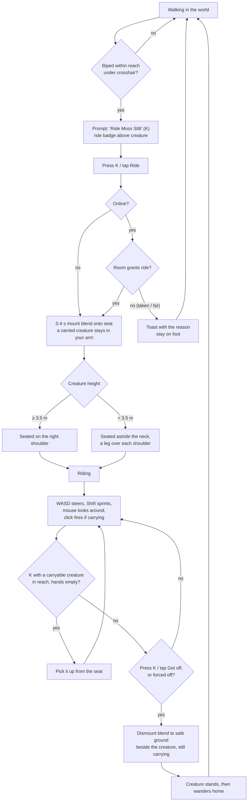
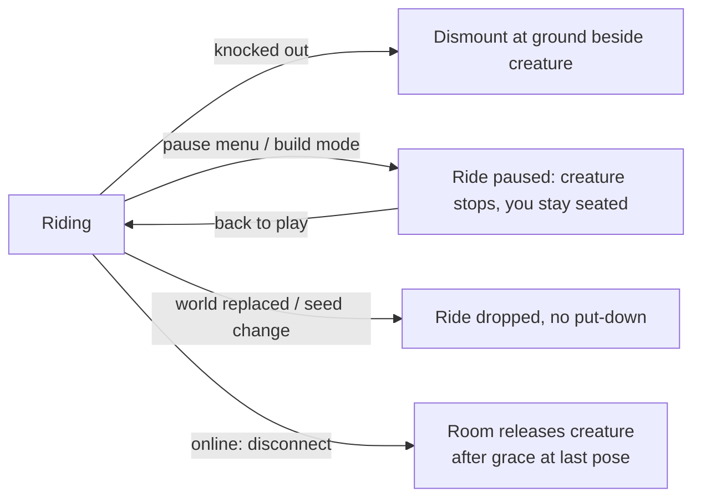
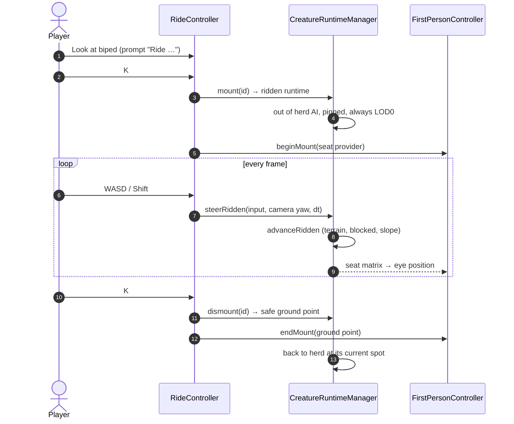
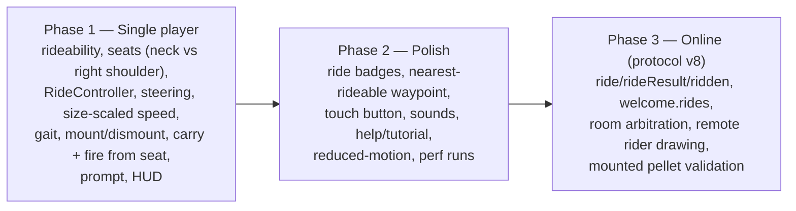

# Forest Drift — Riding Bipedal Creatures: Brief

**Feature cycle:** 2026-11-07
**Status:** **Decisions locked (2026-11-07). Waiting for your approval of the technical plan (revision 2).** No code is written.
**Related:** [`01-questions-and-decisions.md`](01-questions-and-decisions.md) · [`02-technical-plan.md`](02-technical-plan.md)
**Builds on:** [Ranged weapons / carrying (2026-11-04)](../../../11-04/range-weapons/feature-plan/02-technical-plan.md) · [Carry pose (2026-11-06)](../../../11-06/carry-pose/implementation.md) · [`docs/creature-system.md`](../../../../creature-system.md) · Mini Build seats (`PlayerInteractionController`)

Paths are relative to `pages/Forest-Drift/`. (The other feature plans for this game live under `pages/Forest-Drift/docs/2026/…`, so this one does too.)

---

## 1. The idea in one paragraph

Any **two-legged (biped) creature, of any size**, can be ridden. Look at it and press **`K`**. On a **large** biped (3.5 m and over) you sit on its **right shoulder**. On a **small** biped you sit **astride its neck, a leg over each shoulder** (a "shoulder ride"). While you're up there you steer with WASD and the creature runs for you, **faster than you can run yourself**, and bigger creatures are faster. You can bring a small carried creature along and fire pellets from the seat. Press `K` again to get off. This is the second creature ability, after carrying small quadrupeds (ranged weapons). It follows the quadruped carry system's architecture, adapted for the sit-on-top pose and fast movement (Q1).

## 2. The user problem

| Today | Why it's a problem | What this feature changes |
| --- | --- | --- |
| On foot you walk at 6 m/s and run at 12 m/s (`TerrainSettings.ts` player defaults). The terrain is infinite. | Long trips are slow and repetitive: you hold Shift and W for minutes. | Riding a biped is faster than running: about 12–18 m/s depending on its size, faster when sprinting (Q3 B). |
| **Flight is turned off in online worlds** (Multiplayer F3-C; `RoomCore` sends `rules.flight: false`). | Online, running is the fastest way to get anywhere. Meeting up with friends across the map takes a long time. | Riding gives online players a quick way to travel that still keeps them on the ground, with a speed the room can check. |
| Bipeds are the only body plan players can't do anything with. Small quadrupeds can be carried (Nov 4), but bipeds from 1.2 m up to 26 m giants only wander around. | Giants are landmarks you can only look at. | Every biped becomes something you can ride, including the giants. Climbing onto a 20 m giant's shoulder becomes a goal in its own right. |
| `K` already sits you on Mini Build seats, opens doors and picks up small creatures. | — | It also gets you on and off creatures, with the same prompt, touch button and accessibility patterns. |

**Who it's for:** everyone. Explorers in single player, and online groups who want to travel together faster than running without breaking the room's no-flight rule.

## 3. Goals

1. Look at any biped creature within reach, press `K` (or the touch button), and smoothly get onto the right seat: astride the neck under 3.5 m, the right shoulder at 3.5 m and over.
2. While riding, the creature moves faster than the player's run speed (sprint 1.2× run for the smallest, up to 1.5× for giants), follows the terrain, and animates with a speed-scaled run gait.
3. The player steers with WASD relative to the camera and sprints with Shift, and can look around freely.
4. A small carried creature can come along, and pellets can be fired from the seat (Q12 C, F1, F2).
5. Get off with `K` and land safely on the ground beside the creature. Then the creature goes back to its normal behaviour. A placed creature's new spot is saved.
6. Ride badges and an optional "nearest rideable" waypoint show where creatures you can ride are (Q20 B).
7. Online: the room decides who rides which creature, everyone else sees the rider on the creature, and the creature disappears from everyone else's herd while it's being ridden, the same way a carried creature does. Riding is always allowed (no owner rule, Q15 B).
8. No measurable frame-time cost when nobody is riding. Riding costs at most one always-active creature per rider.

## 4. Non-goals (v1)

- Two riders on one creature (Q17). Seats are designed so this can be added later.
- Riding quadrupeds, hexapods or serpents.
- Stamina, feeding, taming, ownership or saddles (Q27).
- Ridden creatures swimming, climbing cliffs, or walking through buildings (Q18).
- Punching from a mount (Q13). Pellets are allowed (Q12).
- An owner rule to switch riding off (Q15 B).
- Changing which regions have bipeds (Q7).
- Saving an active ride across reloads (Q25).
- Shared simulation of ambient herds (Multiplayer Q9-A stands). Only _who is riding what_, plus the rider's normal pose stream, is shared.

## 5. User flow

### 5.1 Happy path

### 5.2 Forced dismounts

### 5.3 Sequence (single player)

## 6. Key decisions (full list in `01`)

| # | Decision | Question |
| --- | --- | --- |
| D1 | Follow the quadruped carry system's architecture, adapted for the biped sit-on-top pose and fast movement. | Q1 |
| D2 | The **player steers** with WASD relative to the camera, and Shift sprints. | Q2 |
| D3 | **Bigger is faster:** sprint goes from 1.2× run (1.2 m) to 1.5× run (26 m), and cruise is about 85% of sprint. The smallest bipeds cruise only just faster than running (1.02×). | Q3 |
| D4 | Under 3.5 m you sit astride the neck. At 3.5 m and over you sit on the **right** shoulder. Every size can be ridden. | Q4, Q5, Q6 |
| D5 | Getting off puts you on safe ground beside the creature, with no fall damage. | Q9 |
| D6 | **You can carry and fire while riding.** `K` while riding and carrying gets you off and you keep the creature. You can climb on while carrying, or pick one up from the seat. | Q12, F1, F2 |
| D7 | One rider per creature. Online it works like carrying (the room arbitrates, viewers may ride wild creatures), with **no owner rule**. | Q15, Q16, Q17 |
| D8 | Ride badges **and** a "nearest rideable" waypoint. | Q20 |

## 7. Success measures

- Sprinting covers ground at least **1.2× the world's run speed** on flat terrain for the smallest bipeds and 1.5× for giants, and cruising is always faster than running (unit test plus e2e distance check).
- Pellets fired from a moving mount are accepted by the room just as reliably as pellets fired on foot (no extra `shotsRefused` in the two-browser test).
- Online, the room never rejects a rider's pose for speed in a 5-minute two-browser ride, and there are zero cases of two players riding the same creature (scripted race test).
- Mounting and dismounting both work with keyboard, touch and screen reader announcements.
- When nobody is riding, walking frame pacing (`docs/2026/10-19/walking-frame-pacing.md`) is within noise of the baseline. While riding at sprint on MEDIUM, p95 frame time rises by no more than 0.5 ms.

## 8. Scope by phase (Q26 A)

## 9. Top risks (details in the technical plan)

1. **The creature system assumes nobody controls creatures.** Movement is leashed to a herd's home (`advanceCreature` stops a creature at about `wanderRadius × 1.02` from home). A ridden creature needs its own movement path that keeps the terrain and obstacle rules but drops the leash.
2. **Speed versus anti-cheat.** The room rejects poses faster than `run × 1.5 + 4` m/s. A giant sprinting at 1.5× run leaves exactly 4 m/s of headroom. The Phase 3 soak test checks for rejected poses, and if any appear a rider allowance would be proposed then.3. **Scale extremes.** On a 26 m giant, the camera is about 20 m up, its head may clip the camera, and dismounting has to avoid a lethal fall. On a 1.2 m biped, the rider's legs nearly touch the ground.
4. **Motion comfort.** A camera carried by a big, swaying creature at 15+ m/s can cause motion sickness. Keep camera sway low by default and respect reduced motion.
5. **`K` is overloaded** (doors, seats, carry, and now ride, including carrying while riding). The order of precedence (table in `01`) must be clear and tested.
6. **Online, the rider's client is authoritative** for where the ridden creature is. That's the same trust level as the player's own pose, so it's no new cheat surface, but it needs the same claim checks as carrying.
7. **Firing from a moving mount** (Q12 C). The room checks that a pellet left from within 3.5 m of the shooter's last pose, and at sprint a rider moves about 1.2 m between poses plus lag. Shots could be refused, so the room may need to extrapolate the rider's pose. The carry hold also has to fit next to the mount's neck on the right-shoulder seat.
