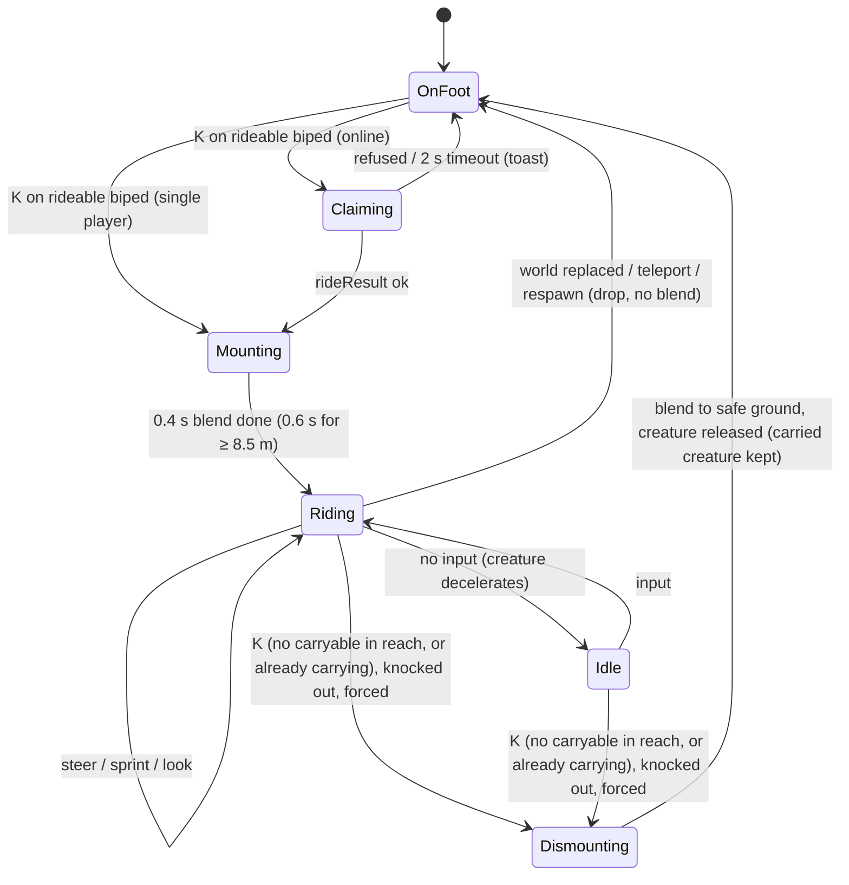
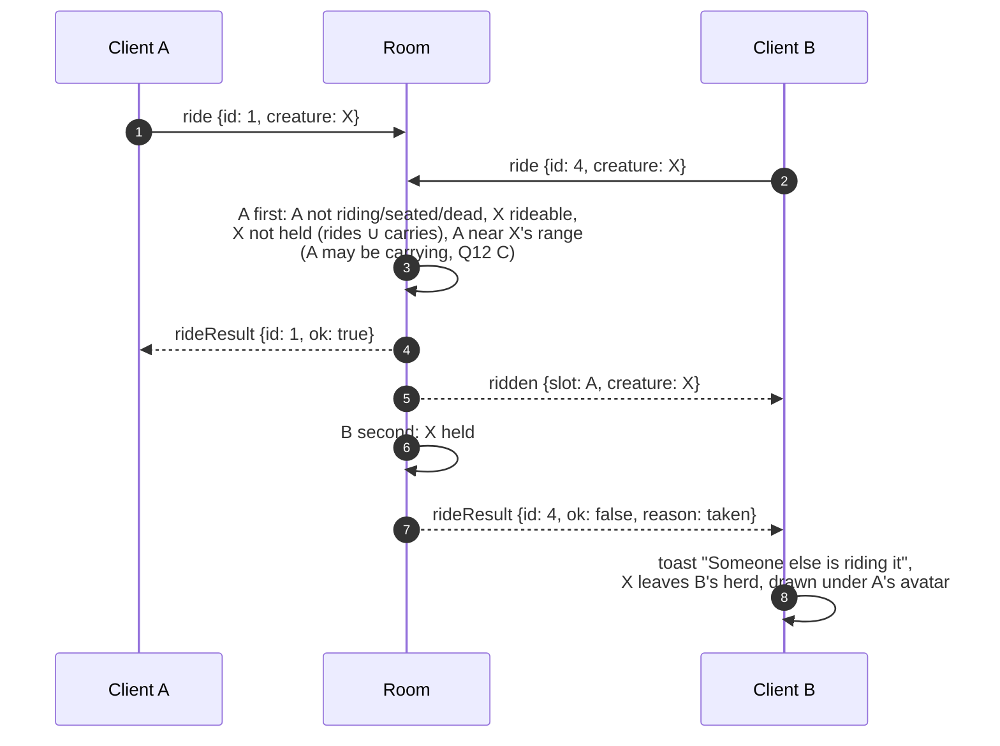
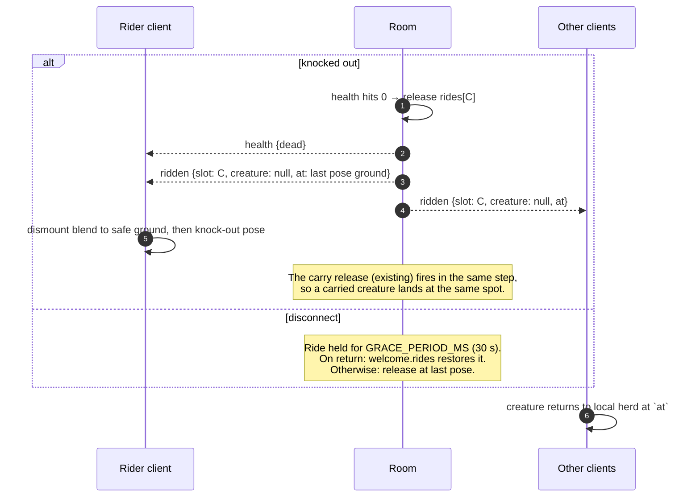

# Forest Drift — Riding Bipedal Creatures: Technical Plan

**Feature cycle:** 2026-11-07
**Revision:** 2 (2026-11-07). Matches the **locked answers** in [`01-questions-and-decisions.md`](01-questions-and-decisions.md). Four answers differ from revision 1's defaults: **Q3 B** (bigger is faster), **Q12 C + F1/F2** (carry and fire while riding), **Q15 B** (no owner rule) and **Q20 B** (plus a "nearest rideable" waypoint).
**Status:** **Waiting for your approval. No implementation code is written.**
**Related:** [`00-brief.md`](00-brief.md) · [`01-questions-and-decisions.md`](01-questions-and-decisions.md)

Paths are relative to `pages/Forest-Drift/`.

---

## 1. Summary

Riding is a second **creature ability** next to carrying. Following Q1, it uses the quadruped carry system's architecture (look, then `K`, then the room arbitrates, then the creature leaves every herd), adapted for a sit-on-top pose and fast movement. It adds four new pieces:

1. **Rideability rules** (`creatureRiding.ts`, pure, shared with the Worker): any biped can be ridden. Its seat is `neck` (both shoulders) under 3.5 m and `right-shoulder` at 3.5 m and over _(Q4, Q5, Q6)_. **Bigger is faster** _(Q3 B)_: sprint goes from 1.2× the world's run speed at 1.2 m to 1.5× at 26 m, and cruise is 85% of sprint.
2. **Ridden-creature motion** (`CreatureRideMotion.ts`, pure): moves the creature from the rider's input. It follows the terrain and obeys the slope, deep-water, building and other-creature rules, but has **no herd leash** _(Q2, Q18, Q24)_.
3. **A mount mode in `FirstPersonController`**: the eye follows a seat on the creature every frame. Mouse look stays free, while WASD and Shift go to the creature instead of the player's feet, and gravity and fall tracking pause _(Q10, Q11)_.
4. **`RideController`**: the state machine, `K` precedence, prompts, choosing the dismount point, and online claims. It's modelled on `CarryController`, and the **two controllers run together**: you can carry and fire pellets while riding, `K` while riding gets you off and you keep the carried creature, and you can climb on while carrying or pick one up from the seat _(Q12 C, F1, F2)_.

Online (Phase 3, protocol v8): `ride` / `rideResult` / `ridden` / `dismount` messages and `welcome.rides`. Remote clients draw the ridden creature **under the rider's existing pose stream**, so no per-frame creature data is sent. **There's no owner rule** _(Q15 B)_. The kill switch `CREATURE_RIDING_ENABLED` is the only off switch. Mounted pellets follow the existing "Creature projectiles" rule, and the room's shot-origin check accounts for rider speed (§6).

Hints: ride badges plus a **"nearest rideable" waypoint** _(Q20 B)_.

## 2. Codebase review: what exists today

### 2.1 Relevant files

| Area | File | What matters for this feature |
| --- | --- | --- |
| Creature types | `src/lib/game/creatures/CreatureTypes.ts` | `BodyPlanId = 'quadruped' \| 'biped' \| 'hexapod' \| 'serpentine'`. `CreatureRuntimeDefinition` (`position`, `heading`, `intent.velocity/gait/lookTarget`, `state`). `CreatureWorldAccess { surface, blocked, standable? }`. |
| Population | `src/lib/game/creatures/CreaturePopulationSystem.ts` | `REGION_HEIGHT_BANDS`: 0.55–0.8, 1.2–1.65, 2.3–3.1, 4.4–6, 8.5–12 and 16–26 m. `regionSpecies` draws plans from `['quadruped','quadruped','hexapod','biped','serpentine']`, with band 0 forced to `quadruped`. So **bipeds exist only in bands 1–5, and about 67% of regions have one** _(Q7)_. `stature()` sets `wanderSpeed = min(2.5, √h·0.45)` and `fleeSpeed = 2.8×`, so wild bipeds move at most about 7 m/s. `wanderRadius = max(6, 4h)`. `creatureSurface()` is the walkability test. |
| Biped rig | `src/lib/game/creatures/AdditionalSkeletons.ts` (`buildBiped`) | Upright torso: `pelvis → spine → chest`. **Limb pair 1 is arms hosted on `chest`** (`massKind: 'shoulder'`, `t: 0.84`), and the neck and head are hosted on `chest`. These are the anchors for both seat types. |
| Dimensions | `src/lib/game/creatures/creatureDimensions.ts` | Pure `{ radius, height }`, already shared with the Worker. |
| Abilities | `src/lib/game/creatures/creatureAbilities.ts` | `RANGED_WEAPONS_ENABLED`, `abilityFor()` (quadrupeds ≤ 0.9 m), `CARRY_REACH = 2`. This is where ride eligibility gets added. |
| Behaviour | `src/lib/game/creatures/CreatureBehaviourSystem.ts` | `decideCreature` (2–5 Hz AI), `turnCreature` / `maxYawRate` (gentle arcs), and `advanceCreature`, which **refuses to move further than `wanderRadius × 1.02` from the herd's home**. That's why a ridden creature needs its own motion function. Substeps by `radius × 0.35`. |
| Runtime | `src/lib/game/creatures/CreatureRuntimeManager.ts` | `logical` / `live` maps, `scan` (0.8 s), `selectVisibleCreatures` active cap, LOD selection, one compile per frame, `carried` map with `takeFromHerd` / `holdRemote` / `release` / `forget`, `pickCarryable` (ray vs collision cylinder), `resolvePlayer` (pushes the player out of creature cylinders), and `serialize`. |
| Animation | `src/lib/game/creatures/CreatureAnimationSystem.ts`, `CreatureGrounding.ts` | Gait `walkFrequency` / `runFrequency` from height, and stride capped by limb reach (`strideLength × 1.4` when running). Foot IK grounding. Cadence needs to scale for ride speeds _(Q21)_. |
| Carry (model to copy) | `src/lib/game/player/CarryController.ts`, `src/lib/game/creatures/HeldCreatureView.ts`, `CarryHints.ts`, `carryableCreatureRef.ts` | A host-interface controller with no Three.js, a claim promise online, prompts at 10 Hz, a forced release, and paw badges (pooled sprites, depth-tested). `resolveAmbientCreature(seed, id)` rebuilds any ambient recipe from its id. |
| Player | `src/lib/game/player/FirstPersonController.ts` | `interactionPose` (a **static** seat: eye lerps once, then stays put), `beginInteraction` / `endInteraction`, `onInteractionExit` (moving the touch joystick **exits** the interaction, which is wrong for riding), `restoreState`, `teleports`, `resetFallTracking`, `setFlying`, `walkSpeed` 6 and `runSpeed` 12 (`TerrainSettings.ts`), and `usesThirdPerson`. |
| Seats | `src/lib/game/player/PlayerInteractionController.ts`, `PlayerInteractionPoseResolver.ts`, `src/lib/game/miniBuild/MiniBuildInteractionRuntime.ts` | Sit/lie prompts, `InteractionOccupancyManager` (the claim/release pattern), and a `K` listener. The sit pose maths (`PLAYER_BODY` pelvis/eye offsets) gets reused for the ride seat. |
| Character | `src/lib/game/characters/CharacterInstance.ts`, `PlayerInteractionView.ts`, `twoBoneIK.ts` | `poseInteraction(pose)` (sit pose), the `carrying` arm pose and `carryAnchor`. New ride poses go here: **straddle** (neck seat) and **side-sit** (shoulder seat). |
| Camera | `src/lib/game/player/ThirdPersonCamera.ts` | The boom collides with `CameraObstacles`. The ridden creature must not count as an obstacle. |
| Scene | `src/lib/game/ThreeScene.ts` | `handleCarryKey` (`K`, capture), `handlePunchMouseDown`, `naturalGroundBlocked` (the creature `blocked` test: ceilings, walls, stairs and foundations as boxes), creature access (`standable`: water depth ≤ `DEEP_WATER_DEPTH`), the per-frame update order, prompts, and world save capture. |
| Network | `src/lib/game/net/protocol.ts` | `PROTOCOL_VERSION = 7`. `POSE_FLAGS` uses **all 8 bits**, so riding can't be a pose bit. `carry` / `drop` / `carryResult` / `carried` and `welcome.carries` are the templates. |
| Room | `src/lib/game/net/RoomCore.ts`, `server/src/WorldRoom.ts` | `handleCarry` (rule, state, eligibility, role, taken, `near(home, radius)`, `releasedAt`), `carries` map, `persistSessionState`, `interactions` (seated players can't punch or shoot), and **the pose speed check `maxSpeedForRunSpeed(run) = run × 1.5 + 4`**. `trackAir` (fall plausibility) uses the `grounded` flag. |
| Session / avatars | `MultiplayerSession.ts`, `NetSession.ts`, `RemoteAvatarRenderer.ts` (`interactionPose`, `carriedBy` callbacks), `RemoteMotion.ts` | Remote seats draw the avatar at the anchor with `poseInteraction`. Remote carries draw a `HeldCreatureView`. Riding adds a third case: avatar plus creature. |
| Rules / settings | `src/lib/game/net/sharedEnvironment.ts`, `src/lib/game/settings/settingsCatalog.ts` | `rules { fallDamage, playerDamage, creatureProjectiles }`. **Unchanged** (no riding rule, Q15 B). `creatureProjectiles` still controls firing from a mount. |
| Waypoints | `src/lib/game/waypoints/WaypointSystem.ts` | The `nearestCarryable` toggle (a saved per-player preference) and `host.nearestCarryable(from)`. The template for `nearestRideable` (Q20 B). |
| Pellets | `src/lib/game/player/creatureProjectile.ts` | `shotOriginPlausible` (within 3.5 m of the shooter's eye from their last pose, plus slack). Has to hold for a rider at sprint (Q12 C). |
| UI | `src/routes/+page.svelte`, `TouchControls.svelte` (carry button slot, run toggle, jump), `CarryHud.svelte`, `ControlsGuide.svelte`, `TutorialOverlay.svelte` | Prompt slot, live region, contextual touch button, help text. |
| Audio | `src/lib/game/audio/soundEffects.ts`, `creatureSounds.ts` | Synthesised effects registry and creature footfalls. |
| Tests | `CreatureCarry.spec.ts`, `CarryableCreatureRef.spec.ts`, `HeldCreatureView.spec.ts`, `src/lib/game/player/__tests__/*`, `src/lib/game/net/__tests__/RoomCore*.spec.ts`, `tests/rangedWeapons.e2e.ts`, `tests/rangedWeaponsMultiplayer.e2e.ts`, `tests/thirdPerson.e2e.ts`, `tests/touchControls.e2e.ts` | Harnesses to extend: fake connections, two-browser flows, test hooks on `window`. |

### 2.2 Routes, database tables, APIs and services

- **Routes:** only `/` (`src/routes/+page.svelte`). `/creatures/` (Lab) is unchanged. A "Ride preview" could be added to the Lab later, but it's not in scope. **No new routes.**
- **Browser storage (IndexedDB world saves):** **no schema change.** Rides aren't saved _(Q25)_. A placed creature's existing `position` / `heading` fields are updated when you get off it _(Q14 A)_.
- **Durable Object SQL (`WorldRoom.ts`):** **no new tables.** Ride state lives in memory, in the session JSON (`persistSessionState`) and in the socket attachment, exactly like `carries`. A placed creature's moves use the existing `entities` rows (`creature` kind).
- **WebSocket protocol:** new messages, v7 → v8 (§6).
- **HTTP API (`server/src/http.ts`, `worker.ts`):** unchanged.
- **External services:** none. Cloudflare usage rises a little (one claim and one release message per ride, with no extra per-frame traffic).

### 2.3 Facts the design depends on

1. **No creature is player-controlled today.** `advanceCreature`'s leash, `decideCreature`'s AI and the active-cap culling would all fight a rider. A ridden creature has to leave the herd simulation, the way a carried creature does (`takeFromHerd`), while **staying in the world**: drawn, grounded, animated and moving.
2. **The pose speed check** is `run × 1.5 + 4` (22 m/s by default). Under Q3 B, a giant sprints at **exactly `1.5 × run`**, which leaves **4 m/s of headroom** at every run-speed setting (smaller bipeds have more). **No room speed change is planned.** The Phase 3 soak measures `posesRejected` for sprinting giant riders. If jitter eats the headroom, a rider allowance (`+3 m/s` while the room shows the player riding) is the fallback, and I'll raise it with you before adding it.
3. **Terrain streaming is already proven at 24 m/s** (flight defaults to 2 × run), so riding at about 17 m/s is within what terrain, vegetation and creature cells already handle.
4. **The rider's pose stream already carries everything remote clients need:** the position (the seat), the look yaw and pitch, and `moving` / `running`. The creature's heading can be **derived from the direction of travel** (ridden creatures only turn while moving, which matches `turnCreature`'s "standing still does not swivel" rule). That's enough for v1.
5. **Bipeds and carryable creatures never overlap** (carrying needs a quadruped), so the same `K` press can't be ambiguous for one creature. It can only be ambiguous between two creatures on the same look ray, where the nearer one wins. Carrying and riding **can be active at the same time** (Q12 C), so `K` routing depends on both states (§4.6).
9. **The carry pipeline doesn't care whether the player is on foot.** `CarryController` reads the eye, aim and feet from its host, and `HeldCreatureView` hangs off the character's arm. While riding, "feet" (for putting down) isn't used (F1: you can't put down while riding), and the eye and aim come from the mount-mode camera, so firing works unchanged in single player.
6. **`resolvePlayer` would shove the rider out of their own mount,** so the ridden creature must be excluded, as carried ones already are.
7. **Wild creatures react to the player's position.** A rider moving at 15 m/s will make fearful herds scatter, which is believable. Nothing needs to change.
8. **Online, the room has no terrain.** It can check claims, distances and speeds, but not whether a ridden creature walked through a wall. That's the same trust model as the player's own pose.

## 3. Architecture

### 3.1 Module diagram

```mermaid
flowchart TB
    subgraph Shared["Shared pure modules (browser + Worker)"]
        RR[creatureRiding.ts<br/>rideFor, seat kind,<br/>speeds, reach, claim radius]
        AB[creatureAbilities.ts<br/>carry + ride registry]
        CR[carryableCreatureRef.ts<br/>id ⇄ recipe]
        DIM[creatureDimensions.ts]
    end

    subgraph Browser
        TS[ThreeScene<br/>K routing, update order]
        RCt[RideController<br/>player/]
        CC[CarryController]
        RDP[rideDismount.ts<br/>safe ground point]
        FPC[FirstPersonController<br/>+ mount mode]
        CRM[CreatureRuntimeManager<br/>+ ridden state]
        RM[CreatureRideMotion.ts<br/>steer + advance, no leash]
        SEAT[RideSeat.ts<br/>seat matrix from bones]
        ANIM[CreatureAnimationSystem<br/>speed-scaled cadence]
        CI[CharacterInstance<br/>+ straddle / side-sit poses]
        HINT[CarryHints<br/>+ ride badge]
        WP[WaypointSystem<br/>+ nearest rideable]
        MS[MultiplayerSession / NetSession]
        RAR[RemoteAvatarRenderer<br/>+ remote ridden creature]
        UI["+page.svelte / TouchControls /<br/>RideHud / ControlsGuide"]
    end

    subgraph Worker["Cloudflare Worker"]
        ROOM[RoomCore<br/>rides map, handleRide,<br/>handleDismount, releases]
        WR[WorldRoom<br/>attachments, entities]
    end

    TS --> RCt
    TS --> CC
    RCt --> RR
    RCt --> CRM
    RCt --> FPC
    RCt --> RDP
    RCt --> MS
    CRM --> RM
    CRM --> SEAT
    CRM --> ANIM
    SEAT --> FPC
    FPC --> CI
    RR --> AB
    RR --> DIM
    TS --> HINT
    TS --> WP
    WP --> CRM
    RCt <-->|"K routing,<br/>carry kept on mount"| CC
    TS --> UI
    MS <-->|protocol v8| ROOM
    ROOM --> RR
    ROOM --> CR
    ROOM --> WR
    MS --> RAR
    RAR --> CR
    RAR --> SEAT
    RAR --> CI
```



### 3.2 Per-frame data flow (rider's browser)

```mermaid
flowchart LR
    IN["Input: WASD / Shift /<br/>joystick / run toggle"] --> FPC1[FirstPersonController<br/>mount mode: reads input,<br/>does not move feet]
    FPC1 -->|"input vector, camera yaw"| RC[RideController.update]
    RC --> STEER[CreatureRuntimeManager.steerRidden]
    STEER --> MOT["CreatureRideMotion.advance<br/>(heading, speed ramp,<br/>creatureSurface, standable,<br/>other creatures)"]
    MOT --> GR[Grounding + animation<br/>gait = run, cadence ∝ speed]
    GR --> SEAT[RideSeat.worldMatrix<br/>from chest / shoulder bones]
    SEAT --> FPC2[FirstPersonController<br/>eye = seat ⊕ eye offset,<br/>+ ≤2 cm bob (Q22)]
    FPC2 --> CAM[Camera / third-person boom<br/>ridden creature not an obstacle]
    FPC2 --> POSE[PoseSender<br/>normal pose stream]
    CAM --> R[render]
```

**Update order matters.** The creature has to advance and be posed before the camera reads the seat, or the camera lags one frame behind (visible jitter at 17 m/s, about 28 cm per frame at 60 fps). `ThreeScene` runs `ride.update`, then `creatures.updateRidden`, then `controller.update`, then the camera and pose.

### 3.3 Ride state machine (`RideController`)



The carry state machine (ranged weapons §3.3) runs alongside it, unchanged except for two things. "Stowed" isn't triggered by riding (you can fire from the seat), and `putDown` isn't offered while riding (F1).

### 3.4 Sequence: single-player mount, ride and dismount

```mermaid
sequenceDiagram
    autonumber
    actor P as Player
    participant TS as ThreeScene (K router)
    participant RC as RideController
    participant CRM as CreatureRuntimeManager
    participant FPC as FirstPersonController
    participant CI as CharacterInstance

    P->>TS: K
    TS->>RC: toggle() (before carry & seats)
    RC->>CRM: pickRideable(eye, aim, RIDE_REACH)
    CRM-->>RC: { id, definition, distance }
    RC->>CRM: mount(id) → seat kind
    CRM->>CRM: out of AI, cap and resolvePlayer;<br/>pinned; keep live mesh (no recompile)
    RC->>FPC: beginMount(seatProvider)
    FPC->>CI: ride pose (straddle | side-sit)
    loop each frame
        FPC-->>RC: input (x, z, sprint), camera yaw
        RC->>CRM: steerRidden(id, input, yaw, dt)
        CRM-->>FPC: seat world matrix
    end
    P->>TS: K
    TS->>RC: toggle()
    RC->>RC: rideDismount.choose(seat side, creature, access)
    RC->>FPC: endMount(groundPoint) (immune landing)
    RC->>CRM: dismount(id, its current spot, heading)
    opt placed creature (Q14 A)
        CRM->>CRM: update saved position + heading, revision++
    end
```

### 3.5 Sequence: online claim race



### 3.6 Sequence: what other players see

```mermaid
sequenceDiagram
    autonumber
    participant A as Rider client
    participant R as Room
    participant O as Observer client

    A->>R: pose (binary, ~15 Hz): seat position, yaw, moving/running
    R->>O: snapshot (includes A's pose)
    O->>O: RemoteMotion interpolates A
    O->>O: heading = smoothed travel direction<br/>(held when speed < 0.3 m/s)
    O->>O: creature root = A's seat − seatOffset(heading)
    O->>O: gait = run, cadence from A's speed;<br/>avatar posed straddle / side-sit
    Note over O: Recipe from resolveCarryableCreature(seed, X),<br/>compiled in the one-per-frame queue (priority).<br/>Until ready: avatar in ride pose only.
```

### 3.7 Sequence: forced release (knock-out, disconnect)



### 3.8 Choosing where you land (`rideDismount.ts`, Q9 A)

```mermaid
flowchart TD
    S[Dismount requested] --> A["Candidate 1: seat side,<br/>radius + 0.6 m from creature centre"]
    A --> T{standable, not blocked,<br/>slope OK, not deep water,<br/>not inside another creature?}
    T -- yes --> OK[Blend eye to ground point<br/>+ eye height; resetFallTracking(immune)]
    T -- no --> B[Try: other side → front → back →<br/>8 directions at 1.5× radius]
    B --> T2{any valid?}
    T2 -- yes --> OK
    T2 -- no --> C["Fallback: player's last on-foot spot<br/>before mounting (always valid)"]
    C --> OK
```

## 4. Detailed design

### 4.1 `creatureRiding.ts` (new, pure, shared)

```text
CREATURE_RIDING_ENABLED = true                    // kill switch (like RANGED_WEAPONS_ENABLED)
RIDE_SHOULDER_HEIGHT = 3.5                        // m; ≥ → 'right-shoulder', < → 'neck'   (Q4, Q5)
RIDE_REACH = 3                                     // m from eye to the collision cylinder
RIDE_SPRINT_MIN = 1.2, RIDE_SPRINT_MAX = 1.5      // × world runSpeed, at 1.2 m and 26 m   (Q3 B)
RIDE_CRUISE_FRACTION = 0.85                        // cruise = 0.85 × sprint
RIDE_MIN_SPEED = 3 m/s                             // floor for very slow world run speeds
RIDE_ACCEL = 10 m/s², RIDE_BRAKE = 14 m/s²
type RideSeatKind = 'neck' | 'right-shoulder'     // 'left-shoulder' reserved for Q17 B
rideSprintMultiplier(height) = lerp(MIN, MAX, clamp01((ln h − ln 1.2) / (ln 26 − ln 1.2)))
    // log scale, so each height band gets a visible step:
    // 1.2 m → 1.20×, 2.7 m → 1.28×, 5 m → 1.34×, 10 m → 1.41×, 20 m → 1.47×, 26 m → 1.50×
    // cruise: 1.02× … 1.275× run (the smallest bipeds cruise only just faster than running)
rideFor(definition) → { seat, cruise, sprint, turnRate } | null
    biped only; any height (Q6); null when the kill switch is off
rideTurnRate(height) → 2.6 rad/s at 1.2 m … 1.0 rad/s at 26 m   (faster than wild maxYawRate)
rideClaimRadius(definition) → CREATURE_CELL_SIZE·√2/2 + max(6, 4h) + 8   (room: ambient home range)
```

- No Three.js or DOM, so the room can import it. `creatureAbilities.ts` gains `CreatureAbilityId = 'mouth-projectile' | 'ride'` and re-exports `rideFor`, so there's one registry of "what a creature can do".

### 4.2 `CreatureRideMotion.ts` (new, pure)

```text
advanceRidden(state, input {x, z, sprint}, cameraYaw, runSpeed, dt, access, others) → void
  desired heading = cameraYaw + atan2(input.x, input.z)          (Q2 A, camera-relative)
  target speed    = max(MIN_SPEED, |input| · (sprint ? sprintMul(h) : 0.85 · sprintMul(h)) · runSpeed)
  speed ramps by ACCEL/BRAKE; heading turns ≤ rideTurnRate·dt (shortest arc)
  substeps = ceil(speed·dt / max(0.1, radius·0.35))              (as advanceCreature)
  per substep: y = creatureSurface(access, x, z, radius, height, slope)
               reject if y undefined, !standable (deep water, Q18 A), or inside another creature
               on reject: try sliding along ±tangent (0.65, 1.2 rad), else stop
  NO home leash; state.intent.gait = speed > 0.2 ? 'run' : 'idle'
```

- Pure and deterministic, so unit tests can drive it with a fake `CreatureWorldAccess`.
- `dt` is capped at 0.25 s, the same as `advanceCreature`, so a frame hitch can't tunnel through a wall.

### 4.3 `CreatureRuntimeManager` changes

| Change | Why |
| --- | --- |
| `ridden: Map<id, { by: 'local' \| slot; runtime; live }>` | Like `carried`, but the creature **stays drawn and in the world**. |
| `pickRideable(eye, dir, reach)` | The same ray-vs-cylinder test as `pickCarryable`, filtered by `rideFor`. Returns the distance so `ThreeScene` can compare it with the carry candidate (fact 5). |
| `mount(id, by)` / `dismount(id, at, heading)` | Mounting takes the creature out of `spatial`, `decideCreature` and `selectVisibleCreatures`, pins its cell (never unloaded), and keeps its live mesh at **LOD0**. Dismounting re-enters the herd in the cell it's in now, as `release()` does today, and saves the new spot for placed creatures (Q14 A). |
| `steerRidden(id, input, yaw, runSpeed, dt)` | Calls `advanceRidden`, then grounding and animation. `lookTarget` follows the rider's aim (the head looks where you look). |
| `seatMatrix(id, out)` | Delegates to `RideSeat`. |
| `holdRemoteRider(id, slot, definition)` | Online: leaves the herd and is drawn by `RemoteAvatarRenderer` (§4.8). |
| `nearestRideable(from, maxDistance)` | For the "nearest rideable" waypoint (Q20 B). Mirrors `nearestCarryable`, with a cached rideability per spawn, skipping creatures already ridden or carried. |
| `resolvePlayer`, `getCreatureColliders`, camera obstacles | Skip the local rider's mount. Other players' mounts still push the local player (a giant is solid). |
| `serialize()` | A ridden placed creature is saved at its **current** spot. Ambient creatures are never saved. |

### 4.4 `RideSeat.ts` (new, Three.js)

- **`neck` seat (small bipeds):** the pelvis sits on top of the `chest` joint, between the two pair-1 `limb-root` (shoulder) joints, raised by the torso volume's top radius. You face the creature's forward direction. The eye is at the pelvis plus `PLAYER_BODY.eyeHeight − pelvisHeight` (the same maths as `resolvePlayerInteractionPose('sit')`).
- **`right-shoulder` seat (large bipeds):** the pelvis sits on the right pair-1 `limb-root`, raised by the shoulder mass radius (`form.shoulderMass`) and pushed out by 0.15 × shoulder width so the rider's body clears the neck volume. You face forward. **While carrying** (Q12 C), the carried creature sits under your left arm, between you and the mount's neck, so the seat moves further out by the carried body's half-width (`carryBody.x`) plus 5 cm.
- The offsets are computed **once at mount** from the bone rest positions and the volumes. Each frame reads `chest.matrixWorld` × the cached local offset, so there's no per-frame allocation.
- **First-person head clearance:** if the creature's head bone is within 0.5 m of the eye (common on neck seats), the seat rises until it clears. The near plane is never violated.

### 4.5 `FirstPersonController` mount mode

```text
beginMount(seat: () => { eye: Vec3; yaw: number }, blendSeconds)
endMount(groundEye: Vec3)                 // resetFallTracking(immune), countTeleport skipped
rideInput(): { x, z, sprint }             // WASD/Shift/touch, no longer moves the feet
get mounted: boolean
```

- Kept separate from `interactionPose` because seats are static, and touch movement or jump **exits** a seat (`setTouchMovement` → `onInteractionExit`), which must not happen while riding.
- While mounted: `flying` is forced off and the fly toggle shows "Get off to fly". Gravity, step-up and jump are skipped. The `grounded` flag reads true and `running` equals sprint (so `trackAir` never sees a 20 m "fall"). Mouse and touch look work as usual, world-relative (Q11 A).
- `localAvatarVisible` treats the mount like an interaction (the body is visible in third person).
- Camera bob: ≤ 2 cm vertical, from the creature's step phase, low-pass filtered, and 0 with reduced motion (Q22 A).

### 4.6 `RideController` (new, `src/lib/game/player/RideController.ts`)

- Built like `CarryController`, with a `RideHost` interface: `pick`, `claim?`, `mount`, `dismount`, `beginMount`, `endMount`, `chooseDismount`, `inputAllowed`, `mustDismount` (knocked out, teleporting, world replaced), `blockedBy` (carrying, seated, flying).
- **`K` routing in `ThreeScene.handleCarryKey`** (Q8 A, Q12 C, F1, F2). One pure function, `routeCreatureKey(state) → 'pickUp' | 'putDown' | 'mount' | 'dismount' | 'seatOrDoor' | null`, so every case is unit-testable:

  ```text
  riding && !carrying && carry.candidate (≤ CARRY_REACH)  → pickUp        (F2: from the seat)
  riding                                                   → dismount      (F1: carry is kept)
  !riding && carrying && ride.candidate                    → mount         (F2: climb on while carrying)
  !riding && carrying                                      → putDown       (unchanged)
  !riding && seatOrDoorTargeted                            → seatOrDoor    (unchanged)
  !riding && (ride.candidate || carry.candidate)           → nearest one on the look ray
  ```

  While riding, seat and door prompts are suppressed.
- **Prompts:** "Ride {name}", "Climbing on…", "Get off", and "Pick up {name}" when a carryable is in reach from the seat (Q28). They feed the same prompt slot and live region as carrying. The carry HUD (charges) and the ride HUD chip both show when both are active.
- **No input:** the creature brakes to a stop, and you stay seated. Pause or lost pointer lock means no input. Build mode doesn't affect riding (WASD still steers).
- **Left click** fires pellets if you're carrying (Q12 C, the same `CarryController.setTrigger` path). Otherwise it does nothing, because you can't punch while riding (Q13 A), and the hint "Get off to punch" shows.
- **Carry host while riding:** `stowed()` doesn't count riding as a reason to stow. `mustRelease()` doesn't count it as being seated. `feet()` returns the chosen dismount point (used only if the world forces a put-down).

### 4.7 Character poses

- `CharacterInstance.poseRide(kind, blend)`:
  - **Straddle:** hips spread about 35°, knees bent so the shins hang in front of the creature's shoulders, and both hands resting on the head (IK targets from `RideSeat`).
  - **Side-sit:** both legs together hanging forward off the shoulder, with the left hand on the neck (IK) and the right hand on the knee.
- **Carrying while riding** (Q12 C): the existing left-arm carry pose (`carrying`, `carryHold`, `carryAnchor`) layers on top of the ride pose. The left arm then holds the carried creature, and the free hand moves to the **right** (straddle: right hand on the head; side-sit: right hand on the shoulder you're sitting on). The first-person view still shows the carried creature's head in the lower-left (`HeldCreatureView`, unchanged).
- Reuses `poseInteraction`'s rest-reset and the IK helpers. The remote avatar uses the same pose.

### 4.8 Remote riders (Phase 3)

- `RemoteAvatarRenderer` gains a `riddenBy(playerId)` callback (next to `carriedBy`). When a player is riding, it gets or compiles the creature (priority in the compile queue). It sets the creature's heading from the smoothed travel direction of `RemoteMotion` (fact 4), places the root so its seat matches the avatar's seat, drives the gait from the interpolated speed, and runs local foot grounding against this client's terrain.
- The ridden creature counts against the creature budget at top priority. Beyond `populationRadius` it uses LOD2 (giants are visible from far away, and an avatar floating 20 m up looks broken).

### 4.9 Other changes

- **`CreatureAnimationSystem`:** a ridden creature's cadence is `clamp(speed / strideLength, runFrequency, runFrequency × 2.2)`, and its stride is up to `min(reach, strideLength × 1.8)` (Q21).
- **`CarryHints`:** a second badge texture (a boot or saddle shape, not just a different colour) for rideable bipeds, under the same "creature hints" preference. Pool size and range are unchanged. Giants' badges sit just above their head height.
- **`WaypointSystem`** (Q20 B): a `nearestRideable` toggle beside `nearestCarryable` (a saved per-player preference, default off), backed by `host.nearestRideable(from)` and following the creature as it moves. The followed creature gets the larger badge. It hides while you're riding.
- **Sounds:** `mount` (soft rustle, thump) and `dismount`, plus heavier footfalls at speed, scaled by creature height (`creatureSounds.ts`).
- **Save capture:** while riding, the saved player position is `rideDismount.choose(...)` (Q25).
- **Docs:** `README.md` controls, `docs/creature-system.md` (abilities), `docs/multiplayer-player-guide.md`, and the `ControlsGuide` and tutorial hint.

## 5. Data model changes

| Store | Change |
| --- | --- |
| World save (IndexedDB) | **None.** Placed creatures' existing `position` / `heading` are updated on dismount (Q14 A). |
| Player save | None. The position saved mid-ride is the dismount point. |
| Room memory / session JSON / socket attachment | `rides: { playerId, creature }[]` next to `carries`. Older code ignores unknown session keys (to check during Phase 3; see Rollback). |
| `SharedEnvironment.rules` | **None** (no riding rule, Q15 B). |
| Entities table | No new kind. Placed creature updates use the existing `creature` rows. |
| Player preferences (waypoint state) | `+ nearestRideable: boolean`, next to `nearestCarryable`. Missing means `false`. The ride badge follows the existing hint toggle. |

## 6. API changes (WebSocket protocol v7 → v8)

```text
client → room
  { t: 'ride',     id: number, creature: string }            // claim
  { t: 'dismount', id: number, at: CarryPlacement }           // where the creature now stands
room → sender
  { t: 'rideResult', id, ok: boolean, reason?: RideRefusal }  // 'taken'|'far'|'ineligible'|'role'|'state'
room → everyone else (and sender on forced release)
  { t: 'ridden', slot, creature: string | null, at?: CarryPlacement }
welcome
  + rides: { slot, creature }[]
```

- `parseClientMessage` validates: `creature` uses the same strict id grammar as `carry` (`parseAmbientCreatureId` or `placed_…`, length capped), and `at` must be finite numbers.
- The binary pose format is **unchanged** (the flags byte is full, fact 4).
- HTTP is unchanged.

**Room rules (`handleRide` / `handleDismount`):**

1. Ignore stale ids (`id ≤ lastRideId`).
2. Refuse with `state` if the player is already riding, seated, dead or has no pose (**carrying is allowed**, Q12 C); with `ineligible` if `rideFor(definition)` is null; with `role` if the creature is placed and the player is a viewer; with `taken` if it's in `rides ∪ carries`; and with `far` if the player is outside `rideClaimRadius` of its home (or of its last `releasedAt`). There's no `rule` refusal (Q15 B).
3. While a player is riding, `handlePunch` refuses with `state` (Q13 A). `handleCarry` and `handleShoot` are **allowed** (Q12 C, F2), with the usual carry claim radius measured from the rider's pose and the usual "Creature projectiles" rule. The `interaction` (seat) message ends the ride first.
4. **Shot origin while riding (Q12 C):** `shotOriginPlausible` compares the pellet origin with the shooter's pose **extrapolated to the shot's `at`** using the last two poses' velocity, capped at `maxSpeed × 0.3 s`. That's at most about 6.6 m of lead at 22 m/s, never more than the time since the last pose justifies. It applies only while the room shows the player riding, and walking shooters are checked exactly as today. `RoomCoreRide.spec.ts` covers a sprinting giant rider firing every 350 ms with 150 ms of jitter.
5. `handleDismount`: `at` must be within `radius + 6 m` of the rider's last pose horizontally. Store `releasedAt[creature] = at`. Placed creatures get an `update` op. A carried creature stays carried.
6. Automatic release happens on knock-out and on leaving after the grace period. Carry releases on knock-out work as today and happen in the same step.
7. New stats: `ridesGranted`, `ridesRefused`, `ridesReleased`, `mountedShots`.

## 7. Authentication and authorisation

- No new auth. Roles come from the existing invite-token capabilities (`capability.ts`).
- **Viewers** can ride **ambient** creatures. **Placed** creatures need `editor` or `owner`, because getting off one is a world edit (Q14, Q16).
- There's **no owner rule** for riding (Q15 B), so riding is always available online. The owner's existing "Creature projectiles" rule still decides whether anyone (on foot or mounted) can fire.
- Single player has no roles, and everything is allowed.

## 8. Security and privacy risks

| Risk | Mitigation |
| --- | --- |
| A speed hack disguised as riding | The pose speed check is unchanged. Ride speeds are designed to stay under it (fact 2). The room doesn't trust a "riding" claim to raise any limit. |
| Claiming a creature across the map, or griefing by "holding" every biped | `far` check against `rideClaimRadius`. One ride per player. A ride is released on leave or grace. Message rate limits are the existing per-connection limits. |
| Moving someone's Lab creature | Needs edit rights. Every move goes through the op feed, where it can be undone and audited. |
| Mounted fire from height and speed (Q12 C) | Accepted by design: the same 30 m range, 3 damage, charges and hit plausibility. The wider origin check (§6 rule 4) applies **only** while the room shows the player riding, and its lead is capped by the room's own speed limit, so it can't be used to fire from far away. |
| Owners can't stop fast travel (Q15 B) | Accepted. If griefing appears, the kill switch is the immediate lever, and a rule can be added later without a protocol bump (a new `rules` key). |
| Forged `ridden` state for others | Only the room sends `ridden`. Clients ignore `ridden` for their own slot unless it releases. |
| Riding through walls with a modified client | Same as walking through walls today: the room has no geometry (fact 8). Accepted, as in the Nov 4 Q14. |
| Malformed ids or placements | Strict parsing, finite checks and a length cap, the same as `carry`. |
| Privacy | No new personal data. Ride state only reveals position, which the pose stream already shares. Creature ids embed the world seed, which everyone in the room already has. The room never logs ids. |

## 9. Performance risks

| Risk | Budget / plan |
| --- | --- |
| One extra always-active creature per local rider (LOD0, grounding every frame, more substeps at speed) | Reuse the live mesh, so there's no compile at mount. Target p95 +0.5 ms on MEDIUM while sprinting. Measure with the frame-pacing harness. |
| Up to 19 remote ridden creatures on an observer's client | They count in the existing active cap at priority, with LOD by distance, at most one compile per frame, and giants at LOD2 far away. Soak test with 4 riders. |
| Faster streaming of terrain, vegetation and creature cells | Within flight's proven 24 m/s (fact 3). Check that creature `scan` (0.8 s) keeps up at 17 m/s (about 14 m per scan, well under the 64 m cell). |
| Speed-scaled gait thrashing the animation | Cadence is capped, and nothing is allocated per frame. |
| Third-person camera boom raycasts at a giant's height | Exclude the mount from obstacles. Clamp the boom distance. |
| No cost when nobody's riding | Every new path is gated on `ridden.size > 0` and `CREATURE_RIDING_ENABLED`. Ride badges reuse the carry hint pool and update at 10 Hz. The `nearestRideable` scan runs only when its waypoint is on, at the same rate as `nearestCarryable`. |
| Speed headroom for sprinting giants (Q3 B) | 4 m/s under the room limit. Measure `posesRejected` in the soak, and fall back to a rider allowance (raised with you first) if needed. |
| Riding and carrying together | One more skinned creature (the carried one) on the rider, already budgeted by ranged weapons. Pellets from a moving origin use the same pooled `ProjectileSystem`. |

## 10. Edge cases

1. **Mounting a fleeing creature.** The claim and blend use its position at the moment you press `K`. Its AI stops immediately, so it can't run out from under the blend.
2. **A biped inside or next to a building.** The mount blend path may pass through a wall. Allowed, because it's a 0.4 s blend. The dismount search avoids blocked cells (§3.8).
3. **A giant's shoulder is 20 m up.** The dismount is always a blend to the ground with an immune landing. A forced knock-out still lands you on the ground first.
4. **A ridden creature's home cell unloads behind you.** It's pinned, so it isn't unloaded. After you get off, it belongs to its current cell (the existing `release` behaviour).
5. **Steering into deep water, a cliff or a wall.** It stops and slides if the angle allows. The prompt can say "Can't go that way". The rider is never moved off the creature.
6. **Steering into another creature.** It slides around it. A tiny creature might trap it in a corner, in which case it stops.
7. **A seed change, a creature-settings change, or creatures turned off.** The ride drops without a blend, and you're placed at the last valid ground point.
8. **Respawning, teleporting, a waypoint jump or a world load.** These are forced drops.
9. **Pause or lost pointer lock mid-sprint.** No input, so the creature brakes. No running away unattended.
10. **Online: the room refuses after a 2 s timeout.** The "Climbing on…" prompt clears and a toast appears.
11. **Online: another client still has the creature in its herd, or it wandered away locally.** `holdRemoteRider` removes it and the recipe comes from the id (`resolveCarryableCreature`), the same as remote carries.
12. **Online: the rider's pose is dropped for a moment.** Remote motion extrapolates, and the creature follows the avatar, so they never separate.
13. **A late joiner** gets `welcome.rides` and hides those creatures from its herd as cells load.
14. **The rider gets disconnected.** The 30 s grace keeps the ride, and returning restores it in place. If they don't return, the creature is released at the last pose.
15. **Two players press `K` on the same biped.** The room's ordering decides (§3.5).
16. **A rider is the target of a pellet.** The hit capsule uses the rider's pose, which is the seat. It works unchanged (Q13 A).
17. **The rider on a 1.2 m biped.** Their feet nearly touch the ground and may clip into terrain on slopes. The straddle pose lifts the knees, and some clipping on steep ground is accepted (Q6).
18. **Third-person view on a giant.** The boom starts from the seat and doesn't collide with the mount.
19. **Very slow world run speed (1 m/s).** The size multiplier still applies, and the minimum ride speed is 3 m/s so it never looks frozen.
20. **The touch joystick while riding.** It steers and doesn't exit (unlike seats).
21. **Carrying when you press `K` on a biped.** You climb on and keep carrying (F2).
22. **Riding and carrying, `K` pressed.** You get off and keep carrying. To put the creature down, press `K` again on foot (F1).
23. **Riding empty-handed with a carryable creature within 2 m** (small mounts only in practice). `K` picks it up rather than getting you off. The prompt says "Pick up {name}", so the change is visible before you press (F2).
24. **Firing straight down from a giant.** Pellets hit the terrain normally, and the muzzle and crosshair converge as on foot.
25. **Knocked out while riding and carrying.** You dismount to the ground, and the carried creature is put down at the same spot (the existing carry release).
26. **The carried creature on the right-shoulder seat clips the mount's neck.** The seat moves out while carrying (§4.4). Screenshot-checked for the five size bands.
27. **"Nearest rideable" waypoint with no biped in loaded cells.** The waypoint hides, as "nearest carryable" does today.
28. **The ride kill switch is off.** No prompts, no badges, no waypoint toggle, and old saves are unaffected.

## 11. Accessibility

- **Keyboard:** the whole flow is `K`, WASD, Shift and the mouse. No timing-critical inputs. Mounting isn't hold-to-ride (Q8 A).
- **Touch:** a contextual Ride / Get off button (44 px minimum, same slot as Pick up), the joystick steers, the run toggle sprints, and Jump is hidden while riding (Q23).
- **Screen readers:** the live region announces "Riding {name}. Press K to get off.", "Got off {name}.", the refusal reasons, and "Can't go that way" (debounced to one every 3 s). The touch button has an `aria-label` matching the prompt.
- **Motion:** almost no camera bob, none with `prefers-reduced-motion` or the game's reduced-motion setting, smoothed turning, and no forced camera mode changes (Q10 A, Q22 A).
- **Visual:** ride badges differ in **shape** from carry badges, not only in colour. A small HUD chip ("Riding {name}, K to get off") uses the existing theme tokens and contrast.
- **Help:** the `ControlsGuide` and the help overlay list riding. A one-time tutorial hint appears the first time a rideable biped is in reach.

## 12. Files

### 12.1 New files (likely)

| File | Purpose |
| --- | --- |
| `src/lib/game/creatures/creatureRiding.ts` | Pure eligibility, seat kind, speeds, reach, claim radius |
| `src/lib/game/creatures/CreatureRideMotion.ts` | Pure ridden-creature steering and movement |
| `src/lib/game/creatures/RideSeat.ts` | Seat offsets and world matrix from the biped rig |
| `src/lib/game/player/RideController.ts` | State machine, prompts, claims, input routing |
| `src/lib/game/player/creatureKeyRouting.ts` | Pure `routeCreatureKey` (the `K` table in §4.6) |
| `src/lib/game/player/__tests__/creatureKeyRouting.spec.ts` | Every row of the `K` table |
| `src/lib/game/player/rideDismount.ts` | Pure safe-ground selection |
| `src/lib/components/RideHud.svelte` | "Riding {name}" chip and live text |
| `src/lib/game/creatures/creatureRiding.spec.ts` | Eligibility, seat threshold, speeds vs the room limit |
| `src/lib/game/creatures/CreatureRideMotion.spec.ts` | Motion rules |
| `src/lib/game/creatures/RideSeat.spec.ts` | Seat placement across sizes and species |
| `src/lib/game/player/__tests__/RideController.spec.ts` | State machine and `K` precedence |
| `src/lib/game/player/__tests__/rideDismount.spec.ts` | Landing choice |
| `src/lib/game/player/__tests__/FirstPersonMount.spec.ts` | Mount mode |
| `src/lib/game/net/__tests__/RoomCoreRide.spec.ts` | Room arbitration and validation |
| `tests/creatureRiding.e2e.ts` | Single-player browser flow |
| `tests/creatureRidingMultiplayer.e2e.ts` | Two-browser flow |
| `docs/2026/11-07/bipedal-speed-creature/implementation.md` | Implementation notes (written during the build) |

### 12.2 Existing files likely to change

`creatureAbilities.ts`, `CreatureRuntimeManager.ts`, `CreatureAnimationSystem.ts`, `CreatureGrounding.ts` (substep sampling at speed, if needed), `CarryHints.ts`, `carryableCreatureRef.ts` (generic naming, if needed), `CarryController.ts` (host rules while riding: not stowed, no put-down), `creatureProjectile.ts` (rider-aware origin check), `FirstPersonController.ts`, `ThirdPersonCamera.ts` (exclude the mount), `CharacterInstance.ts` (ride poses plus carry layering), `PlayerInteractionView.ts`, `HeldCreatureView.ts` (verify on a mount), `ThreeScene.ts`, `WaypointSystem.ts` (+ `nearestRideable`), `protocol.ts`, `RoomCore.ts`, `server/src/WorldRoom.ts` (attachment shape), `MultiplayerSession.ts`, `NetSession.ts`, `RemoteAvatarRenderer.ts`, `RemoteMotion.ts` (expose the smoothed velocity), `soundEffects.ts`, `creatureSounds.ts`, `src/routes/+page.svelte`, `TouchControls.svelte`, `ControlsGuide.svelte`, the waypoint settings UI, `TutorialOverlay.svelte` / tutorials, `README.md`, `docs/creature-system.md`, `docs/multiplayer-player-guide.md`. **Not changed:** `sharedEnvironment.ts` and `settingsCatalog.ts` (no rule, Q15 B).

## 13. Testing

### 13.1 Automated tests

**Unit (Vitest):**

- `creatureRiding.spec.ts`: every biped from band 1 to band 5 (1,000 regions × 3 seeds) is rideable, and no other plan is. Seat is `neck` below 3.5 m and `right-shoulder` at 3.5 m and over. The sprint multiplier is 1.2× at 1.2 m and 1.5× at 26 m, rises steadily with height, and is clamped outside that range. Cruise is always above 1.0× run. Sprint is ≤ `maxSpeedForRunSpeed(run) − 4` for every run speed from 1 to 30 m/s. The kill switch works.
- `CreatureRideMotion.spec.ts`: on flat ground, 3 s of sprint covers ≥ sprintMul(h) × run × 3 − the ramp for a 1.2 m and a 26 m biped, and the giant is faster. No leash (it travels 500 m from home). It stops at `blocked` boxes, at deep water (`standable` false), and on slopes over the species limit. It slides along a wall at 45°. There's no tunnelling with `dt = 0.25`. The turn rate is respected. It's deterministic given the same inputs.
- `RideSeat.spec.ts`: for 50 generated bipeds of each band, the seat lies above the torso volume and outside the head/neck volumes, the eye clears the head by ≥ 0.5 m, and the right-shoulder seat is to the creature's right.
- `RideController.spec.ts`: single-player mount and dismount; online claim ok, refused and timed out; mount while carrying keeps the carry; dismount while carrying keeps the carry; forced release on knock-out releases both; brakes with no input; prompts change at 10 Hz without spam.
- `creatureKeyRouting.spec.ts`: every row of the §4.6 table, plus "seat and creature both targeted on foot" and "door targeted while riding".
- `CarryController` spec extended: firing works while riding (not stowed), there's no put-down while riding, and the charges carry across mount and dismount.
- `WaypointSystem` spec extended: the `nearestRideable` toggle saves and loads, follows the creature, hides while riding, and hides when none is loaded.
- `rideDismount.spec.ts`: preferred side; falls back in order; last-resort spot; never inside a creature or in water.
- `FirstPersonMount.spec.ts`: WASD doesn't move the feet; look works; no fall damage after dismounting from 20 m; the joystick doesn't exit; flying is blocked; `grounded` flag stays true.
- `CreatureRuntime` / `CreatureCarry` specs extended: a ridden creature is excluded from `resolvePlayer`, the active cap and cell unload; it rejoins its herd on dismount; a placed creature's position is saved.
- `RoomCoreRide.spec.ts`: the claim race, `far` / `ineligible` / `taken` (including carry vs ride) / `role` / `state`; ride granted while carrying; carry granted while riding; punch refused while riding; shots from a sprinting rider accepted with jitter (§6 rule 4), and the same out-of-range origin from a **walking** player still refused; release on knock-out (ride and carry together) and on leaving after grace; `welcome.rides`; restore after hibernation; a giant rider's poses at full sprint are **never** rejected by the speed check; dismount `at` too far is clamped or refused.
- `protocol` parse tests for the four new messages and malformed input.

**End-to-end (Playwright):**

- `creatureRiding.e2e.ts`: a test hook spawns a deterministic small and large biped next to the player. Look and press `K`, check the prompt and HUD, hold W and Shift for 3 s, and check the distance is ≥ the expected sprint multiple of the run distance (the giant goes further). Check the third-person screenshot of each seat. Press `K` and check you're on the ground, health is unchanged, and the creature is back in the herd. Then pick up a carryable creature, climb on, fire three pellets from the seat, press `K`, and check you're on foot still carrying. Turn on the "nearest rideable" waypoint and check it points at a biped. Run the touch-emulation variant with the Ride button and joystick.
- `creatureRidingMultiplayer.e2e.ts`: two browsers. A rides, and B sees the creature under A's avatar and no longer in its own herd. B's `K` on the same creature gets "Someone else is riding it". A, carrying and riding, fires at B while sprinting, and the hits land (no `shotsRefused`). A gets off, and B sees the mount back at `at` with A still carrying.
- Re-run `rangedWeapons*.e2e.ts`, `miniBuildInteractions.e2e.ts`, `thirdPerson.e2e.ts` and `touchControls.e2e.ts` for `K` and touch regressions.
- Performance: the frame-pacing harness for walking (baseline) and riding at sprint on MEDIUM. A 4-rider soak on the multiplayer load harness.

### 13.2 Manual tests

1. Find a small biped (under 3.5 m): ride it, and confirm you're astride the neck in both views.
2. Find a large biped (4.4 m+, ideally a 16–26 m giant): ride it, and confirm you're on the right shoulder and the camera isn't clipped by its head.
3. Compare: run 10 s on foot vs ride 10 s on a small and on a giant biped. Riding is faster, sprint is faster than cruise, and the giant is clearly the fastest. Check whether the small biped's cruise (about 1.02× run) feels too close to running.
3a. Carry a small creature, climb on, and fire while sprinting. Get off and still be carrying. On a small mount, pick up a creature from the seat.
3b. Turn on the "nearest rideable" waypoint and follow it to a biped.
4. Steer around trees, along a lake shore, up a steep hill (it stops), and into a house wall (it stops or slides).
5. Get off a giant: you land beside it with no damage, and the creature goes back to its herd.
6. Try `K` near a seat, a door and a creature at once: the order of precedence feels right.
7. Pause mid-sprint: the creature stops. Resume and keep riding.
8. Toggle third person, look backwards while riding, and switch reduced motion on and off.
9. Phone or tablet: Ride button, joystick steering, run toggle, Get off.
10. Screen reader (VoiceOver): hear the mount, dismount and refusal announcements.
11. Online, two devices: the other player's view of a ride looks right (the creature faces where it's going), and late-join while someone's riding works.
12. Online: get knocked out while riding (and while riding and carrying), and disconnect while riding (rejoin within 30 s and after).
13. Lab-placed biped: ride and get off, reload, and it stays at the new spot (and as a viewer online it's refused).
14. Save and reload mid-ride: you load on the ground beside where the creature was.

## 14. Rollback plan

- **Each phase is its own commit** (Q26 A), so any phase can be reverted with `git revert`.
- **Kill switch:** `CREATURE_RIDING_ENABLED = false` removes prompts, badges and HUD and makes nothing rideable, while everything else stays the same. It's the fastest rollback for single player and the site.
- **Online:** there's no per-world rule (Q15 B), so turning riding off online means shipping the kill switch (site only; the room then never receives `ride`). A full rollback of Phase 3 needs **the Worker and the site deployed together** (v8 → v7), as for previous protocol bumps. The rider-aware shot-origin check is gated on "riding", so with the kill switch on it's inert. Before relying on this, check that v7 `RoomCore` ignores an unknown `rides` key in a session JSON saved by v8, or clear the session state on downgrade.
- **Data:** nothing needs migrating. Placed creatures moved by riding stay at valid positions (the same field as dragging them in the Lab). Old saves never contain ride state.

## 15. Definition of done

- [x] All answers in `01-questions-and-decisions.md` are locked (2026-11-07) and this plan is revised to match (revision 2).
- [ ] You've approved this plan.
- [ ] Any biped can be ridden with `K` or touch. The seat matches its size (neck under 3.5 m, right shoulder at 3.5 m and over).
- [ ] Riding is measurably faster than running, and bigger bipeds are faster (1.2× to 1.5× sprint), within the room's speed limit (unit and e2e).
- [ ] You can carry and fire from the seat. `K` follows the §4.6 table in every case. Mounted pellets are accepted online.
- [ ] Ride badges and the "nearest rideable" waypoint work.
- [ ] Getting off always lands safely on valid ground with no fall damage. The creature rejoins its herd. Placed creatures keep their new spot (if Q14 A).
- [ ] Terrain, slope, water and building rules hold. No tunnelling in tests.
- [ ] Online: room arbitration, the remote rider and creature rendering, late join, grace and knock-out all work. `RoomCoreRide.spec.ts` covers every refusal path. No pose rejections for sprinting giant riders in the soak.
- [ ] Accessibility: keyboard, touch, screen reader announcements and reduced motion are all verified.
- [ ] Performance: walking frame pacing is within noise of the baseline. Riding is ≤ +0.5 ms p95 on MEDIUM. The 4-rider soak passes.
- [ ] `npx vitest run`, ESLint, Prettier, `tsc` and the relevant Playwright suites all pass. No new console errors.
- [ ] README controls, `ControlsGuide`, help, `docs/creature-system.md`, the multiplayer guide, and `docs/2026/11-07/bipedal-speed-creature/implementation.md` (with screenshots of both seat types) are updated.
- [ ] The kill switch path is tested, and the rollback steps are written in the implementation notes.
