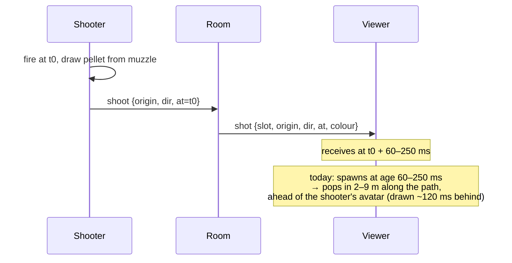
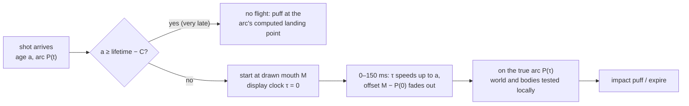

# Plan: other players' pellets, visible and efficient

**Status (2026-11-09):** Phase 1a (§0, the reason other players saw no pellet) is **built**. Everything else is still a plan.

**Goal:** in multiplayer, everyone clearly sees each pellet another player fires. It leaves the shooter's creature, flies its arc, and stops where it lands. The network sends **one message per shot** and never streams a pellet's position.

---

## 0. Found: why other players see no pellet at all

**The bug:** on every other player's screen, the pellet stops against the shooter's own body on its first frame.

- Other players' pellets stop wherever they meet a player's body (`ProjectileSystem.update` sweeps `bodies`). This is visual only, so a target sees the pellet land on them.
- `ThreeScene` builds `bodies` from `multiplayer.shotTargets()`, which lists **every other player, including the shooter**.
- A remote pellet starts at the shooter's muzzle. That's 0.2–0.7 m in front of their eye (`HeldCreatureView`, `VIEW_DEPTH_MIN/MAX`), slightly left and down.
- A body's hit zone is 0.45 + 0.12 = **0.57 m** around the feet, from the ground up to 1.8 m. So when the shooter is standing still or moving slowly, the pellet starts **inside the shooter's own body** as viewers draw it.
- The first sweep (`sweepBody` from 0 ms) returns a hit at once. The pellet is removed with a tiny puff at the shooter's chest before it's ever drawn.
- The shooter's own client tests its pellets against `targets` (other players only), so **the shooter sees their pellet and nobody else does**.

**Why tests missed it:** `rangedWeaponsMultiplayer.e2e.ts` only checks that the watcher's `projectiles.launched` went up, and a pellet counts as launched even if it stops on frame one. Phase 3's own notes say no screenshot ever caught a remote pellet in flight.

**The fix (client only, no protocol change, no Worker deploy, no extra traffic):**
- Pass the shooter's `slot` with each remote pellet (`MultiplayerSession.onShot` → `ThreeScene.remoteShot` → `ProjectileSystem.spawn`), and skip that slot when sweeping `bodies`.
- A pellet can never hit its own shooter anyway: the room refuses self-hits.
- Add an e2e check that the watcher actually **draws** the pellet for several frames (`activeCount > 0`, then a mid-flight screenshot), not just that it was launched.

This is the first thing to build (§5, Phase 1a). §2's smaller issues only matter once pellets show at all.

**Built (2026-11-09):**
- `ProjectileSystem.spawnRemote(origin, dir, colour, nowMs, shooter)` records the shooter's slot, and `update` skips that slot's body.
- `MultiplayerSession.onShot` passes `message.slot` through `remoteShot`.
- A new diagnostic, `ProjectileSystem.remoteDrawn`, counts other players' pellets drawn on at least one frame.
- **Tests:**
  - New unit test: a remote pellet starting 0.4 m in front of its shooter flies out of their body and lands on the other player 10 m away.
  - The two-browser e2e now requires the watcher's `remoteDrawn ≥ 1`. Without the fix it fails (0 drawn); with it, it passes.
- Client only: no protocol change, no Worker deploy, and still one message per shot.

## 1. Where things stand today

Most of the efficient design is already in place (ranged weapons Phase 3, `docs/2026/11-04/range-weapons/implementation.md`):

| Step                 | What happens now                                                                                                                                                                                                            |
| -------------------- | --------------------------------------------------------------------------------------------------------------------------------------------------------------------------------------------------------------------------- |
| Shooter fires        | `ThreeScene` launches the local pellet and `MultiplayerSession.fireShot` sends **one** `shoot { shot, origin, dir, at }` (`at` is the room clock).                                                                            |
| Room                 | `RoomCore.handleShoot` validates the shot (carrying, rule on, alive, origin near the pose, a charge to spend), then broadcasts **one** `shot { slot, shot, origin, dir, at, colour }` to everyone else. Refused shots aren't broadcast. |
| Everyone else        | `MultiplayerSession.onShot` → `ThreeScene.remoteShot` → `ProjectileSystem.spawn(origin, dir, colour, now − age)`. The arc is the closed-form `projectilePositionAt` (`origin + dir·v·t − ½gt²`, v = 35 m/s, g = 4, 30 m range, about 0.86 s). The world is tested locally each frame. |
| After that           | No more messages for that pellet. A hit is reported once, by the shooter (`shotHit`), and only the shooter and target hear the result.                                                                                      |

So "send the start once, then just draw it from that" is how it already works, and the plan keeps it. **The problem is what other players actually see.** Phase 3's own notes say no screenshot has ever caught a remote pellet in flight. The e2e test only checks that the watcher's `projectiles.launched` went up, which is also true for a pellet that expired the moment it was spawned.

## 2. Smaller issues, once pellets show (to confirm by measuring)

These are working hypotheses, to be confirmed by measuring first (§5, Phase 0).

1. **Latency fast-forward.** A remote pellet is spawned already `age` ms old: shooter → room → viewer, plus clock error, typically 60–250 ms. At 35 m/s that skips **2–9 m of a 30 m flight**, so it appears in mid-air instead of from the creature.
2. **The shooter is drawn in the past.** The viewer draws other players about `interpolationDelayMs` behind (about 100–150 ms, `RemoteMotion`), but draws the pellet in the present. The pellet can be **6–14 m ahead of the shooter's drawn creature** when it first appears.
3. **Late shots vanish.** If `age` reaches the lifetime (about 857 ms), the pellet is spawned already expired and never drawn. That can come from a lag spike, a clock re-sync, or a tab that was in the background. It still counts in `launched`.
4. **It comes from the wrong place.** `origin` is the shooter's *first-person* muzzle, in front of their camera. Viewers see the creature held under the avatar's arm (`HeldCreatureView`), so even with no lag the start point doesn't match what they see.
5. **Too small and fast to read.** The pellet is a 9 cm ball at 35 m/s with no trail. At 15–20 m it's a pixel or two for well under a second.

## 3. Design principles

1. **One message per shot, nothing after.** Each shot is fully described by `origin`, `dir`, `at`, speed ("power") and colour. Everything else (position, collisions, landing) is computed from those by every client.
2. **One shared arc.** All clients use the same pure `projectilePositionAt`, so the pellet lands in the same place for everyone. The world is deterministic per seed and the same on every client, so world collisions agree too.
3. **Show the whole flight.** A viewer sees the pellet leave the creature they can see, even if the message arrived late. The display catches up to the true arc smoothly, never with a jump.
4. **The authority doesn't change.** The shooter detects hits and the room validates them, exactly as now. Remote pellets stay visual only.

## 4. The design

### 4.1 Message: already as cheap as it can sensibly be

**Each shot costs one small message, and nothing after it.** The shooter sends one `shoot` (start point, direction, time; about 100 bytes) to the room. The room passes one `shot` on to each other player. From then on, every client draws the whole flight, collisions and landing from that one message. Speed and gravity are fixed constants, so start point plus direction is enough. Nothing contacts the server again for that pellet.

A relay through the room is the one cost that can't be removed: other players have no other way to learn a shot happened (there are no direct player-to-player connections). Ways to make that one message smaller, none of which change how it looks:

| Option                                                                                                | Saving                                    | Worth it?                                                                                                                                                                         |
| ----------------------------------------------------------------------------------------------------- | ----------------------------------------- | --------------------------------------------------------------------------------------------------------------------------------------------------------------------------------- |
| Leave out `colour` (every client already knows each player's carried creature) and round the numbers | about 150 → about 70 bytes per shot      | Only if bumping the protocol anyway.                                                                                                                                              |
| Carry the shot inside the next pose message (sent 10 times a second anyway)                           | no extra message at all                   | No. It delays each shot by up to 100 ms unless the pose is sent early, and the room would have to treat shots inside poses specially. Poses already cost about 15× more than shots. |

For scale: a player can fire at most about 3 shots a second in a burst and fewer than 1 a second sustained (5 charges, one back every 1.5 s). Position updates already send 10 messages a second per player whether anyone fires or not. So shots add only a small fraction to a room's traffic, and **the current one-message design is the right, cheap one.**

The optional extras (Phase 3):

`shoot` and `shot` stay as they are. Two optional changes for later (Phase 3):

| Field             | Change                                                                                                                                                                                         |
| ----------------- | ---------------------------------------------------------------------------------------------------------------------------------------------------------------------------------------------- |
| `speed` (power)   | Optional m/s, defaulting to `PROJECTILE_SPEED`. Only needed if shots ever get variable power (charged shots, different species). The room clamps it to an allowed range, and the arc function takes it as a parameter. |
| `colour`          | Could be dropped, since every client already knows which creature each player carries (`carried`) and so its accent colour. It saves about 20 bytes per shot. Not worth a protocol bump alone. |

### 4.2 Showing a remote pellet: "start from what you see, catch up to the truth"

When a `shot` arrives, the viewer knows the true arc `P(t)` and the true age `a = serverNow − at`. It also knows the drawn start point `M`: the mouth of the shooter's held creature as drawn on this client (`HeldCreatureView.muzzleWorld`, held per avatar in `RemoteAvatarRenderer`). If the shooter's avatar isn't drawn (out of range or hidden), `M = P(0)`.

The pellet is drawn on its own **display clock** `τ`, starting at 0 when the message arrives:

- **Catch-up time:** `τ` runs faster than real time until it meets the true age, over a fixed window `C` (proposed 150 ms). In real time `r` after arrival, `τ(r) = r + a·ease(r / C)`, and from `C` on it's simply `a + r`. `ease` is smoothstep, so the speed-up starts and ends gently.
- **Start offset:** the drawn position is `P(τ) + (M − P(0))·(1 − ease(r / C))`. It starts exactly at the creature's mouth, and the offset fades out as it catches up.
- **After `C`:** it's exactly on the true arc, so it lands where it lands for everyone, at the same moment as for the shooter.

**Why this rather than the alternatives:**

| Option                                                   | Verdict                                                                                                                                                                                             |
| -------------------------------------------------------- | --------------------------------------------------------------------------------------------------------------------------------------------------------------------------------------------------- |
| Spawn at the true age (today)                            | Simple, but skips the start of the flight and pops in ahead of the shooter (§2).                                                                                                                    |
| Draw in the shooter's past (`age − interpolationDelay`) | Matches the avatar exactly, but every pellet lands about 120 ms after it really did, so the target's vignette fires before they see the pellet arrive.                                                |
| **Catch-up from the drawn mouth (chosen)**               | Every flight is shown from the creature people can see, and it lands on time at the true point. The cost is a pellet that moves up to about 2× speed for its first 150 ms, which is hard to notice at 35 m/s. |
| Stream positions                                         | Exactly what we want to avoid.                                                                                                                                                                      |

**Collisions while catching up:** sweep the true arc from 0 to `τ` as `τ` advances, as `ProjectileSystem.update` already does with `checkedMs`. A wall the true pellet hit in the skipped part still stops it, at the true point. The start offset is drawing only and is never tested against the world.

**Very late arrivals** (`a ≥ lifetime − C`): don't spawn a flight. Compute where the arc ends (first world hit or the end of range) and play just the impact puff there. Nothing silently disappears.

### 4.3 Readability (local and remote pellets)

- **A short streak:** a second instanced mesh, a thin quad stretched along the velocity, about 0.8 m long (about 25 ms of flight), fading back to front. It's in the pellet's colour, emissive, and drawn with the pellet in one extra draw call for all 64.
- **A minimum on-screen size:** scale each instance by distance so it's never under about 3 px. That uses the same per-instance matrix that's already written each frame.
- **A launch puff on remote shots:** the existing `puff` at `M` (the drawn mouth), not at `origin`.
- Respect reduced motion: keep the streak but skip the scaling flicker.

### 4.4 Making the start point match what viewers see

The shooter's `origin` stays the first-person muzzle: that's what the room validates against the pose, and what the shooter sees. Viewers start from their drawn mouth `M` and blend in (§4.2). No protocol change is needed. `RemoteAvatarRenderer` gains a `muzzleOf(slot, out)` read-out from that avatar's `HeldCreatureView`. For riders, the held creature is drawn on the mount, so `M` follows the mount.

### 4.5 Interest management (Phase 3, optional)

The room knows every player's last pose. It can skip sending `shot` to players more than about 90 m from the shot's origin (30 m of range plus a 60 m viewing margin). That saves fan-out in large spread-out rooms. It's a small `RoomCore` change with no client change. It's only worth doing if the 20-player soak (range weapons plan §11) shows the broadcast mattering.

## 5. Phases

### Phase 0: measure (client only, no deploy)

- Add counters to `ProjectileSystem` / `MultiplayerSession` and show them in the `NetDiagnostics` overlay:
  - `remoteShotsReceived` and `remoteShotsDrawn` (at least one frame visible)
  - `remoteShotsExpiredOnArrival`
  - mean and max `ageMs`
  - mean gap between `origin` and the drawn shooter's mouth
- Run two browsers against `wrangler dev` and the live Worker. Note how often pellets expire on arrival, typical ages, and the start gap. That confirms or rules out each cause in §2.
- **Done when:** we have real numbers for §2 and a mid-flight screenshot (or proof there can't be one).

### Phase 1a: fix "other players see nothing" (client only, no protocol change, no Worker deploy)

| Task                                                                                                                         | Files                                                                    |
| ---------------------------------------------------------------------------------------------------------------------------- | ------------------------------------------------------------------------ |
| Pass the shooter's `slot` with remote shots                                                                                   | `net/MultiplayerSession.ts` (`onShot`), `ThreeScene.ts` (`remoteShot`) |
| `spawn` stores the shooter's slot; `update` skips it in `bodies`                                                              | `particles/ProjectileSystem.ts`                                          |
| Unit: a remote pellet starting inside its shooter's body flies on, and still stops at anyone else's body                     | `ProjectileSystem.spec.ts`                                               |
| E2E: the watcher draws the pellet in flight (several frames with `activeCount > 0`), with a mid-flight screenshot             | `tests/rangedWeaponsMultiplayer.e2e.ts`                                  |

### Phase 1b: show the whole flight from the creature (client only)

| Task                                                                                                                                              | Files                                                          |
| ------------------------------------------------------------------------------------------------------------------------------------------------- | -------------------------------------------------------------- |
| Pure catch-up maths: `remotePelletDisplay(a, r, C)` → `{ τ, offsetWeight }`, plus `arcLanding(origin, dir, world)` for very late arrivals | new `player/remotePellet.ts` (+ spec)                         |
| `spawnRemote(origin, dir, colour, ageMs, drawnMouth)`: stores the start offset and arrival time; `update` advances `τ` and draws `P(τ)` plus the fading offset; collisions sweep the true arc | `particles/ProjectileSystem.ts`                               |
| Very late arrivals → puff at the landing point                                                                                                    | `ProjectileSystem.ts`                                          |
| Drawn mouth per remote slot                                                                                                                       | `net/RemoteAvatarRenderer.ts` (`muzzleOf`), `ThreeScene.remoteShot` |
| `remoteShot` passes the shooter's slot so the scene can look up `M`                                                                               | `net/MultiplayerSession.ts`, `ThreeScene.ts`                   |

### Phase 2: readability (client only)

| Task                                                   | Files                                                    |
| ------------------------------------------------------ | -------------------------------------------------------- |
| Instanced streaks, one extra draw call, pooled with pellets | `particles/ProjectileSystem.ts`                          |
| Minimum on-screen size from camera distance            | `ProjectileSystem.update` (takes the camera position)    |
| Reduced-motion handling                                | `ProjectileSystem.ts`, wired from the existing preference |

### Phase 3: optional protocol extras (Worker and site deployed together, protocol v9)

- An optional `speed` on `shoot` / `shot`, clamped by the room. `projectilePositionAt` and `shotHitPlausible` take the speed as a parameter.
- Interest-managed `shot` broadcast (§4.5).
- Optionally drop `colour` (§4.1).

## 6. Testing

**Unit**
- `ProjectileSystem.spec.ts` (Phase 1a): a remote pellet that starts inside its own shooter's body isn't stopped by it, but still stops at another player's body.
- `remotePellet.spec.ts`:
  - At `r = 0` the drawn point is `M`.
  - At `r ≥ C` it's exactly `P(a + r)`.
  - `τ` only ever increases and never jumps between frames.
  - For any `a` and frame rate, the landing point and time equal the true arc's.
  - Arrivals later than `lifetime − C` give only a landing puff.
- `ProjectileSystem.spec.ts`:
  - A remote pellet whose skipped part crossed a wall stops at the true wall point and is never drawn past it.
  - Remote pellets still never report hits.
  - Streaks and pellets stay within one pool of 64.

**E2E** (`tests/rangedWeaponsMultiplayer.e2e.ts`, two browsers against `wrangler dev`)
- When the owner fires, the watcher's first drawn frame of that pellet is within 0.5 m of the owner's held creature's mouth as the watcher draws it.
- The pellet is visible on at least 70% of the frames during its flight.
- A screenshot is taken mid-flight.
- Add a dev-only, query-string delay on the WebSocket (e.g. `?netDelay=200`, ignored in production builds) and repeat with 200 ms of added latency. The start-point and visibility checks must still pass, and `remoteShotsExpiredOnArrival` stays 0.

**Performance**
- The frame-pacing benchmark with 8 players firing continuously: no measurable change in frame time from the streaks.
- `server/tools/bots.mjs` learns to fire pellets, for the 20-player soak listed as not run in Phase 3.

## 7. Risks and decisions to confirm

| Risk / decision                                                                     | Proposal                                                                                                    |
| ----------------------------------------------------------------------------------- | ----------------------------------------------------------------------------------------------------------- |
| The catch-up's 2× speed for 150 ms reads as a glitch                                | Tune `C` (100–250 ms) by eye in Phase 1. Smoothstep keeps the speed change gentle.                          |
| The target is hurt before their pellet visibly arrives                              | Catch-up lands on the true arc on time. If damage still arrives first, finish the target's in-flight pellet into their body when the health update lands (visual only). |
| Different terrain on two clients changes where a pellet stops                        | The world is deterministic per seed. Unsynced building edits are short-lived and only visual for remote pellets. Accept it. |
| Someone fakes `origin` / `dir` to draw misleading pellets                           | The room already validates the origin and charges, and remote pellets do no damage. No change.               |
| Variable power later                                                                | Phase 3's `speed` field. Everything else already treats the arc as a pure function of the first message.     |

## 8. Rollback

Phases 1 and 2 are client only. A const `REMOTE_PELLET_CATCH_UP = false` in `remotePellet.ts` falls back to today's spawn-at-age behaviour, and the streaks have their own const. Phase 3 needs the Worker and site deployed together. Rooms ignore an unknown `speed` field, and an older client ignores it in `shot`.
