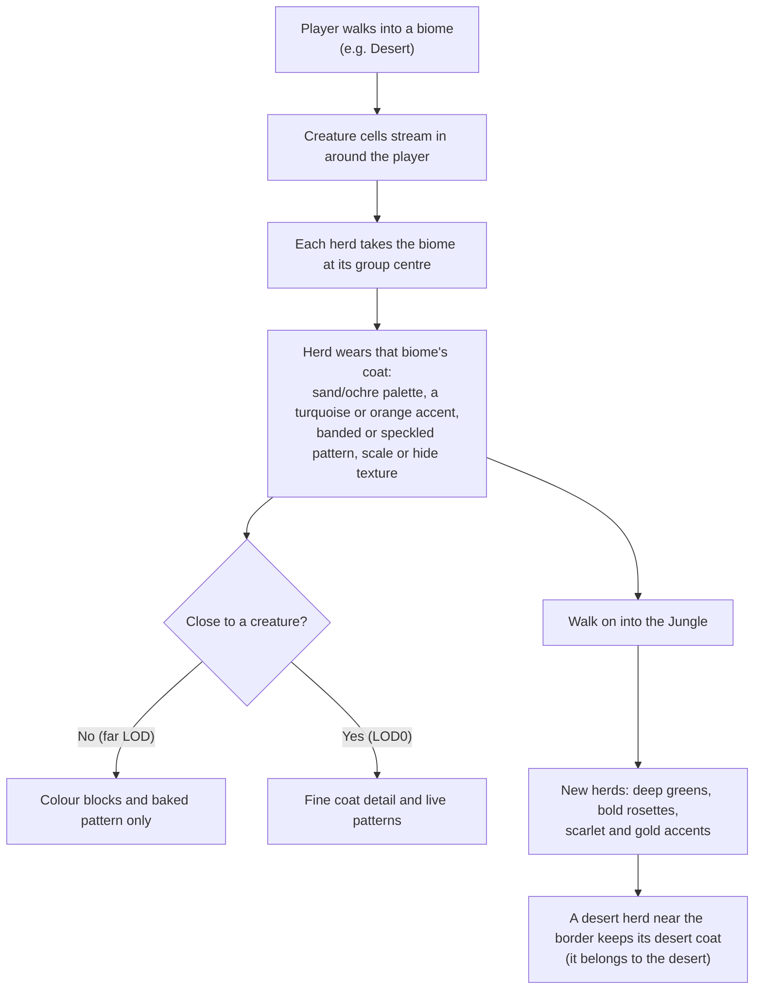
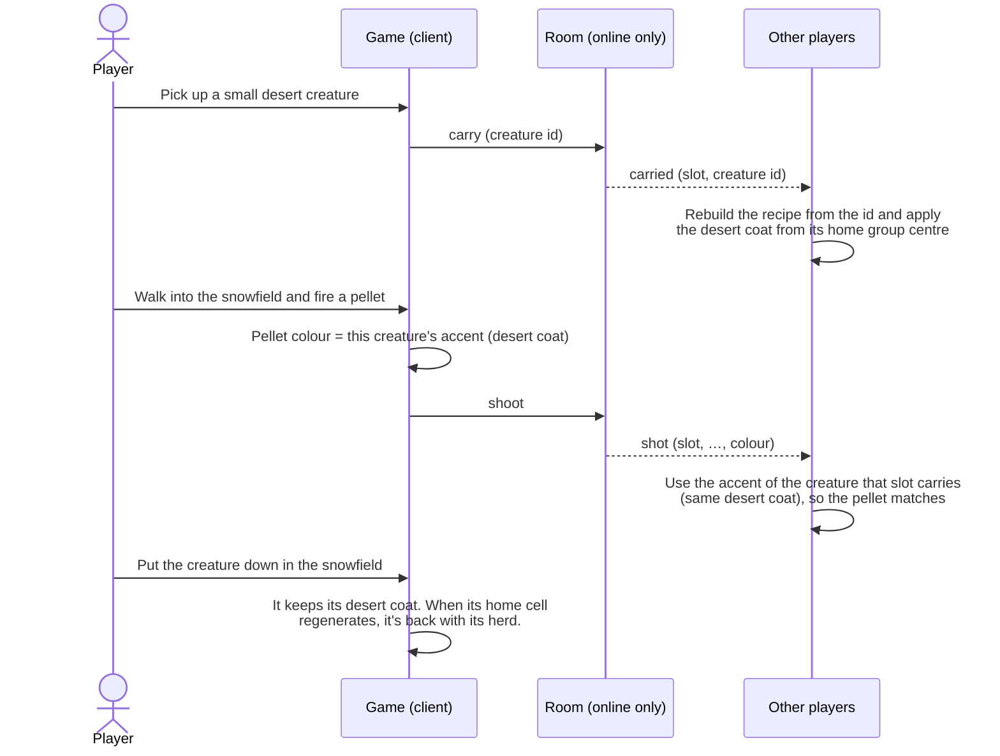
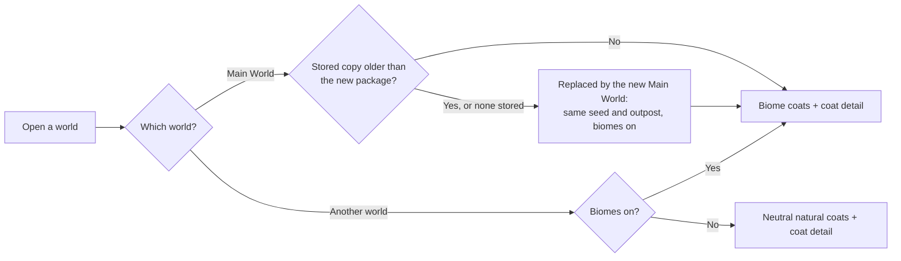
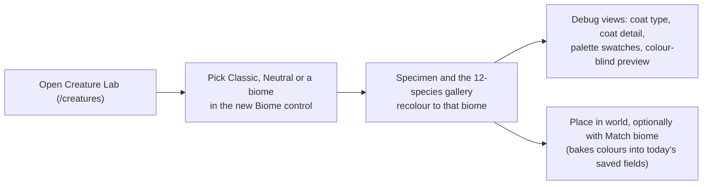

# Forest Drift — Biome-Specific Creatures: Brief

**Feature cycle:** 2026-11-12 (written 2026-11-13)
**Status:** **Decisions locked (2026-11-13)** in [`01-questions-and-decisions.md`](01-questions-and-decisions.md). The technical plan is at revision 2. **No implementation code until you approve the plan in chat.**
**Related:** [`01-questions-and-decisions.md`](01-questions-and-decisions.md) · [`02-technical-plan.md`](02-technical-plan.md) · builds on [Biomes and Environments](../../Biomes-and-Enviroments/feature-plan/02-technical-plan.md) and [`docs/creature-system.md`](../../../../creature-system.md)

Paths are relative to `pages/Forest-Drift/`.

---

## 1. The idea in one paragraph

Creatures should look as if they belong where they live. A herd in the Snowy Taiga should wear pale, cold coats. Desert creatures should be sand and ochre, jungle animals deep green with bold markings, and swamp creatures dark, mottled and wet-looking. Today every region's six species are deliberately spread around the whole colour wheel, so you see bright purple, pink and blue animals in any biome. This feature gives each biome its own natural creature colour range and pattern style, with one brighter accent per species. It also improves the procedural surface itself: fine fur, hide, scale, chitin or skin texture, new natural patterns, and colour on horns, ears and fins. It all stays procedural, deterministic and shared online, and nothing is added to saves. The Main World is replaced by a biome version, so players see the result straight away.

## 2. The user problem

| Today                                                                                                                                                                                                                | Why it's a problem                                                                                                                                                          |
| -------------------------------------------------------------------------------------------------------------------------------------------------------------------------------------------------------------------- | --------------------------------------------------------------------------------------------------------------------------------------------------------------------------- |
| `showcaseRegion` (`CreaturePopulationSystem.ts`) gives a region's six species hues spaced evenly around the colour wheel (`baseHue + index × 60°`), at 58–76% saturation. The palette ignores where the creature is. | Biomes now give each place a strong identity, and creatures ignore it. Candy-coloured animals in a snowfield or desert break the mood more than anything else in the scene. |
| The species' own hue is a free 0–360° draw (`SpeciesGenerator`), then overwritten by the showcase.                                                                                                                   | There's no notion of a natural colour, so "fixing" one species by hand doesn't help the next seed.                                                                          |
| Surfaces are flat vertex colour plus a per-pixel pattern (spots, stripes, bands…). There's no fine surface detail, so at close range every creature reads as smooth plastic.                                         | Up close, especially riding or carrying, creatures look unfinished next to the textured terrain, trees and plants.                                                          |
| Small features (horns, fins, spikes, tail tips) get flat colour only.                                                                                                                                                | Silhouettes read well, but details look flat.                                                                                                                               |
| The Main World, which Play opens, was made before biomes and has them off.                                                                                                                                           | Most players never see biomes, or biome creatures, unless they create a new world.                                                                                          |

The review gallery (`docs/creature-review/surface-galleries.png`) shows the current look: magenta quadrupeds, lilac bipeds and lime hexapods.

## 3. Goals

1. **Every biome has its own creature palette.** Creatures in one biome share a natural colour family with one brighter accent per species, so you could guess the biome from a creature's coat [Q2, Q13].
2. **Species stay distinguishable inside a biome.** Each of the six regional species has its own lightness step, pattern and accent [Q3].
3. **Better procedural surfaces.** Fine coat detail (fur, hide, scales, chitin, skin), five new natural patterns (rosettes, reticulated, patches, speckle, saddle) and colour on small features, with no image textures [Q9, Q10].
4. **One natural look everywhere.** Worlds with biomes off use a neutral temperate profile in the same style [Q6].
5. **The Main World shows it off.** It's replaced by the same seed and outpost with biomes on [Q6].
6. **The same creature for everyone.** Colours are a pure function of the world seed, the biome and the creature's id. Every player online sees the same herd, and the pellet colour matches the creature that fired it [Q16].
7. **No new performance cost that matters.** Still one shader program and one draw call per creature, with no new image textures, and fine detail only up close [Q22].

## 4. Non-goals (v1)

- New body plans, anatomy, sizes or behaviour per biome, or a different species mix per biome [Q1]. Carrying and riding rules don't change.
- Crease shading, biome extremities (dusty, wet or pale legs and tips) and rim light [Q9].
- A guaranteed contrast against the ground, or a "Vivid" colour setting. Camouflage is intended [Q8].
- Coats reacting to weather (snow dusting, wet sheen in rain) [Q12].
- Biome-flavoured species names [Q15].
- Real fur geometry (shells, cards or strands), image textures or texture painting.
- Changing the world save format [Q18], the network protocol or the generator version [Q17].

## 5. Expected user flow

### 5.1 Exploring a biome world

### 5.2 Carrying or riding a creature across a biome border

### 5.3 Opening a world

### 5.4 Developer: Creature Lab

## 6. What "done" looks like for the player

- Pressing Play opens the Main World with biomes on, around the same outpost, and its creatures fit each biome.
- Standing in any of the 26 biomes, the creatures around you share a natural colour family that fits the place, each species with its own brighter accent. The next biome over looks different.
- Six species in one area are still easy to tell apart, by size and shape as today, and by lightness, pattern and accent colour.
- Creatures can blend into their surroundings, as real animals do.
- Up close, a creature has visible fur, hide, scale, chitin or skin texture, and banded horns, tipped ears or spotted fins. At a distance, nothing shimmers or swims.
- Online, everyone sees the same colours on the same herd, and pellets match the creature that fired them.

## 7. Delivery shape [Q21]

| Phase | What                                                                                                                                               |
| ----- | -------------------------------------------------------------------------------------------------------------------------------------------------- |
| 0     | Natural palette model, 26 biome profiles + neutral, pure coat function, species separation, Lab biome preview.                                     |
| 1     | Coats in the world: population, recipe resolution on every client, carried/ridden/remote views, pellet colour, determinism golden. New Main World. |
| 2     | Coat micro-texture: fur, hide, scales, chitin, skin.                                                                                               |
| 3     | New patterns (rosettes, reticulated, patches, speckle, saddle), colour on small features, rare colour morphs (about 1 in 60) [Q14].                |
| 4     | Performance pass, docs (`creature-system.md`, `biomes.md`), screenshots, release.                                                                  |

Each phase ends with screenshots for your review.

## 8. Key risks (details in the technical plan)

- **Online mismatch.** The room rebuilds creatures from their id without terrain, so it can't know the biome. The plan keeps the room biome-free and has clients agree through pure functions [Q16].
- **Shader cost.** Per-pixel coat detail runs on every creature pixel. It's LOD0 only and fades by LOD1, against a budget of ≤ 10% creature fragment cost.
- **Pattern repetition and swimming.** New patterns follow the existing rule: evaluated in bind space, from the shared 32³ noise volume.
- **Main World replacement.** Biome forests around the outpost must not grow through buildings. Players' edits to the old stored Main World are dropped, by decision [Q6].
- **Camouflage.** Some creatures will be hard to spot. That's intended [Q8], recorded so it isn't later treated as a bug.
