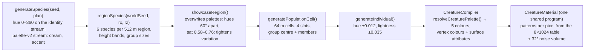
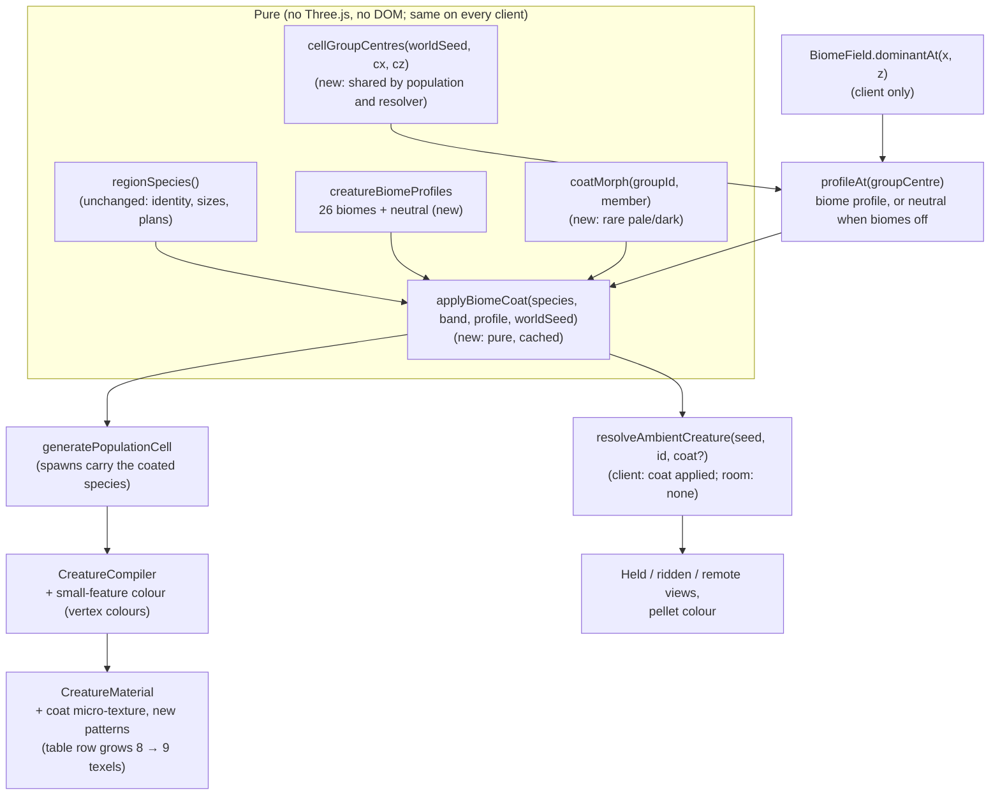
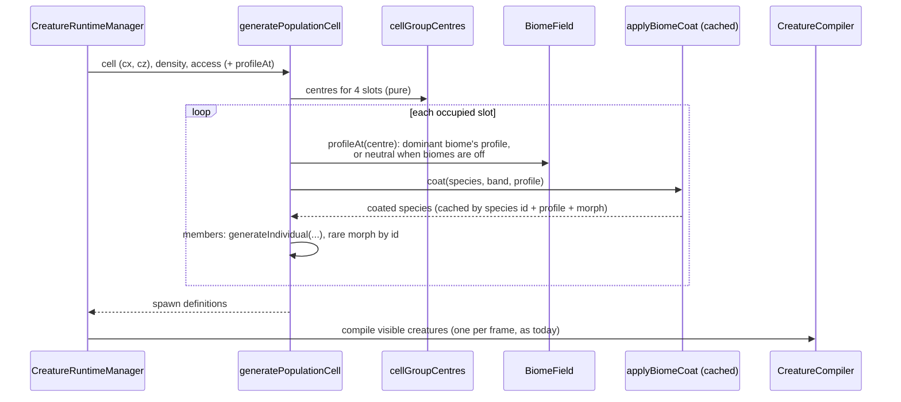
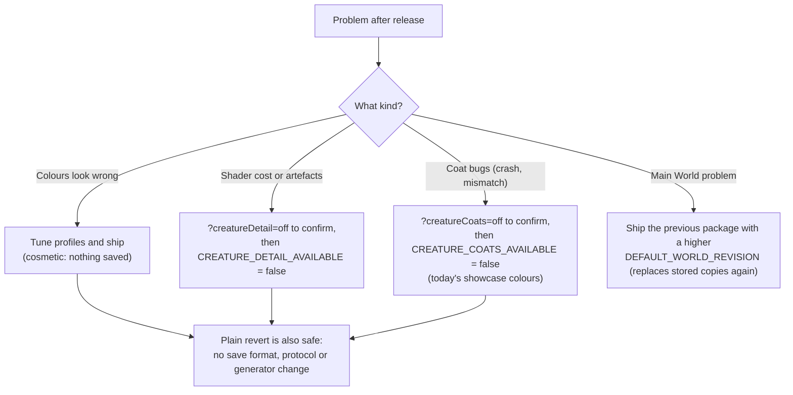
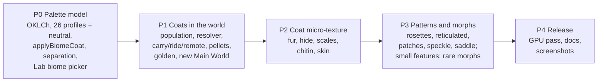

# Forest Drift — Biome-Specific Creatures: Technical Plan

**Feature cycle:** 2026-11-12 (written 2026-11-13)
**Status:** **Revision 4: Phases 0–1 built (2026-11-13).** Decisions are locked in [`01-questions-and-decisions.md`](01-questions-and-decisions.md). §0 lists what changed from revision 1 and while building. Phase records: [Phase 0](../phase-0/implementation.md), [Phase 1](../phase-1/implementation.md).
**Related:** [`00-brief.md`](00-brief.md) · [`01-questions-and-decisions.md`](01-questions-and-decisions.md) · [Biomes plan](../../Biomes-and-Enviroments/feature-plan/02-technical-plan.md) · [`docs/creature-system.md`](../../../../creature-system.md) · [`docs/biomes.md`](../../../../biomes.md)

Paths are relative to `pages/Forest-Drift/`.

---

## 0. Changes from revision 1 (your answers)

1. **Natural colours in every world [Q6].** Existing saved worlds don't need protecting. Biomes-off worlds use a **neutral temperate profile** instead of today's showcase colours, so there's no parity rule for creature colours. The `?creatureCoats=off` switch still gives the classic colours, for comparison and rollback.
2. **The Main World is replaced [Q6].** It keeps the same seed (`soft-lowlands-431`) and the outpost, with biomes on. Saved copies of the old Main World are replaced too (§7.5).
3. **Real camouflage [Q8].** There's no contrast rule against the ground and no Vivid setting. Species are still kept apart from each other (Q3).
4. **Texture scope [Q9]:** coat micro-texture, new patterns, and colour on small features. **Out of scope:** crease shading, biome extremities (dusty or wet legs, pale tips) and rim light. The surface table grows by one texel, not two.

**Phase 0 (2026-11-13):**

5. **The coat function colours a whole region at once** (`coatRegionSpecies`), because the separation rules (Q3) need every species of the region. It's cached per world seed, region and profile.
6. **Patterns:** each profile has one weighted list, and a shared `PLAN_PATTERN_LEAN` table adjusts it per body plan, in place of a table per plan in every profile.
7. **`appearance.coat` is a runtime marker** that switches `resolveCreaturePalette` to natural clamps (near-grey and snow-pale bodies, white or black accents). Species without it keep the original clamps exactly.
8. **Pale coats lose chroma above L 0.6**, so pale savanna and plains bodies read tawny, not peach.
9. **Planned patterns** (rosettes, reticulated, patches, speckle, saddle) are chosen from Phase 0 and render as the nearest existing pattern until Phase 3.

**Phase 1 (2026-11-13):**

10. **`cellGroupCentres` is the one source for where a herd stands**, used by both the population and `resolveAmbientCreature`, so a creature resolved from its id gets exactly the coat its herd spawned with.
11. **`CreatureWorldAccess.profileAt` returns `undefined` when coats are off**, rather than being left out, because the URL switch is read after the scene's fields are created.
12. **`CreatureRuntimeManager.regenerateAmbient()`** respawns only ambient herds on biome changes. `settingsChanged()` would also drop carried and ridden creatures.
13. **The Main World turns biomes on when its bundled package is decoded**, with no new binary package. The revision marker is a `localStorage` key, `forest-drift.main-world-revision`, because the world validator would strip an unknown field. If storage can't be read, the stored copy counts as current.
14. **`biomeCreatures` was added to the golden without a generator bump** (Q17): the existing sections are unchanged.

## 1. Summary

- A pure **coat function** turns a regional species plus the biome at its herd's group centre into a recoloured copy of the species: palette, pattern choice and coat parameters. With biomes off, the **neutral** temperate profile is used [Q6].
- **26 biome profiles plus one neutral profile** (`creatureBiomeProfiles.ts`), built from shared families like the other biome profile tables. They set palette ranges, accent sets, pattern weights and coat thickness [Q13].
- **Species stay distinct** within a biome through a lightness step per regional species, different patterns and separate accents, enforced by rule and tested [Q3]. Creatures **may blend into** their biome's ground; that's intended [Q8].
- **Surface improvements:** per-pixel coat micro-texture (fur, hide, scales, chitin, skin), five new pattern types, and colour on small features [Q9, Q10]. Still one shader program, one draw per creature and no image textures.
- **Online:** the room stays biome-free. Creature identity, carrying and riding don't change. Every client applies the same coat, and works out the pellet colour from the creature id [Q16]. No generator or protocol bump [Q17], and no save-format change [Q18].
- **The Main World** ships as a biome world, so most players see the feature straight away.

## 2. Existing system: relevant code, routes, storage and APIs

### 2.1 How a creature gets its colours today



- `surface/CreaturePaletteGenerator.ts` turns the species palette into primary, pattern, underbelly, accent and eye colours, with clamps against neon, mud, inverted bellies and invisible patterns (`paletteIssues`).
- `surface/CreaturePatternGenerator.ts` holds the pattern vocabulary (`PATTERN_TYPES`: solid, spots, mottled, stripes, bands, back-stripe, limb-bands, dorsal-spots, gradient, underbelly), `deriveSurfaceGenome`, `patternMask` (the CPU mirror of the GLSL) and `validateSurfaceGenome`. The validator rejects unknown pattern types and any surface version other than 1.
- `CreatureMaterial.ts` has the GLSL hook. Roughness is per vertex, patterns are evaluated in bind space, and there's no normal perturbation or micro-detail.
- `surface/CreatureSurfaceTable.ts` gives one 8-texel row of a float texture per live creature (1,023 rows), so the material doesn't need per-creature uniforms.
- `world/DefaultWorld.ts` embeds the Main World as a base64 world package (seed `soft-lowlands-431`, created 2026-09-13, so biomes off). `WorldManager.resetDefaultWorld()` already writes the pristine package over the stored copy.

### 2.2 Relevant files

| Area                     | File                                                                                                                                                                                                                                                                                          | Role in this feature                                                                                                                       |
| ------------------------ | --------------------------------------------------------------------------------------------------------------------------------------------------------------------------------------------------------------------------------------------------------------------------------------------- | ------------------------------------------------------------------------------------------------------------------------------------------ |
| Regional species         | `src/lib/game/creatures/CreaturePopulationSystem.ts`                                                                                                                                                                                                                                          | `regionSpecies`, `showcaseRegion`, `cellSpeciesOrder`, `generatePopulationCell` (group centre `cx, cz`, always drawn whatever the density) |
| Species                  | `src/lib/game/creatures/SpeciesGenerator.ts`, `IndividualGenerator.ts`, `CreatureForm.ts`, `CreatureTypes.ts`                                                                                                                                                                                 | Genome types, palette and surface recipe, individual variation                                                                             |
| Surface                  | `src/lib/game/creatures/surface/*` (`CreaturePaletteGenerator`, `CreaturePatternGenerator`, `CreatureSurfaceClassifier`, `CreatureSurfaceNoise`, `CreatureSurfaceTable`)                                                                                                                      | Palette rules, patterns, region masks, noise volume, per-creature table                                                                    |
| Compile and render       | `src/lib/game/creatures/CreatureCompiler.ts`, `CreatureMaterial.ts`, `CreatureRuntimeManager.ts`                                                                                                                                                                                              | Vertex colours and attributes, shader, live creatures and cells                                                                            |
| Identity without terrain | `src/lib/game/creatures/carryableCreatureRef.ts`                                                                                                                                                                                                                                              | `resolveAmbientCreature(worldSeed, id)`: used by the room (`RoomCore.ts`) and the client (`ThreeScene.creatureRecipes`)                    |
| Carry, ride, pellets     | `src/lib/game/player/CarryController.ts` (pellet colour = `palette.accent`), `HeldCreatureView.ts`, `RiddenCreatureView.ts`, `net/RemoteAvatarRenderer.ts`, `net/MultiplayerSession.ts` (`onShot` uses `message.colour`)                                                                      | Where a creature's colours appear away from its herd                                                                                       |
| Room                     | `src/lib/game/net/RoomCore.ts` (`shot.colour = species.appearance.palette.accent`), `server/src/WorldRoom.ts`                                                                                                                                                                                 | Stays biome-free [Q16]                                                                                                                     |
| Biomes                   | `src/lib/game/biomes/BiomeField.ts` (`dominantAt`, `isEnabled`), `BiomeTypes.ts` (`BIOME_IDS`, `createDefaultBiomeSettings`), `biomeDefinitions.ts` (groups), `biomeKillSwitch.ts`                                                                                                            | Biome at the group centre; biome settings for the new Main World                                                                           |
| Scene                    | `src/lib/game/ThreeScene.ts`                                                                                                                                                                                                                                                                  | Creature world access, `creatureRecipes`, `regenerateBiomes()`                                                                             |
| Main World               | `src/lib/game/world/DefaultWorld.ts`, `world/WorldManager.ts`                                                                                                                                                                                                                                 | Embedded package, stored copy, `resetDefaultWorld()`                                                                                       |
| Lab                      | `src/lib/game/creatures/CreatureLab.ts`, route `src/routes/creatures/+page.svelte`                                                                                                                                                                                                            | Biome picker, debug views, galleries                                                                                                       |
| Saves                    | `src/lib/game/creatures/CreaturePersistence.ts`, `CreatureValidation.ts`, `world/WorldTypes.ts` (schema 10)                                                                                                                                                                                   | Lab-placed creatures save the full recipe; unchanged [Q18]                                                                                 |
| Determinism              | `src/lib/game/world/determinismReport.ts`, `world/__tests__/determinism-golden.json`, route `src/routes/determinism`, `tests/determinism.e2e.ts`                                                                                                                                              | New `biomeCreatures` section                                                                                                               |
| Tests                    | `creatures/*.spec.ts` (`RegionSpeciesQuadruped`, `CreatureEcology`, `CreatureFingerprints`, `surface/CreatureSurface.spec.ts`), `tests/creatures.e2e.ts`, `tests/creatureQuality.e2e.ts`, `tests/creatureRiding.e2e.ts`, `tests/rangedWeaponsMultiplayer.e2e.ts`, `tests/defaultWorld.e2e.ts` | Fingerprints and browser checks                                                                                                            |
| Docs                     | `docs/creature-system.md`, `docs/biomes.md`, README                                                                                                                                                                                                                                           | Updated at release                                                                                                                         |

### 2.3 Routes, storage and APIs

- **Routes:** `/` (game), `/creatures/` (Creature Lab), `/determinism` (golden report). No new routes.
- **Storage:** IndexedDB worlds (schema 10). Ambient creatures are never saved. Lab-placed creatures are saved as `PersistentCreatureDefinition` (species, individual, position, heading, state). The Main World is stored under `DEFAULT_WORLD_ID` once the player has opened it.
- **Network:** Cloudflare Worker + `WorldRoom` Durable Object. Creature messages are `carry`, `drop`, `carried`, `shoot`, `shot`, `ride`, `dismount`, `ridden`, and `welcome.carries/rides` (protocol 8). The room resolves ambient ids with `resolveAmbientCreature`.
- **No database tables or HTTP APIs change.**

## 3. Architecture and data flow

### 3.1 New data flow



### 3.2 Generating a cell



With `?creatureCoats=off`, `profileAt` isn't provided, and spawns are exactly today's showcase-coloured ones.

### 3.3 Online: carried creature and pellet colour [Q16]

```mermaid
sequenceDiagram
    participant A as Player A (client)
    participant R as Room (Worker)
    participant B as Player B (client)
    A->>R: carry {creature: "group:seed:12:-4:2:0"}
    R->>R: resolveAmbientCreature(seed, id): no coat;<br/>checks carryable (plan, size band): unchanged
    R-->>B: carried {slot A, creature id}
    B->>B: resolve id + coat (profile at group centre via its own BiomeField)
    A->>R: shoot
    R-->>B: shot {slot A, …, colour: showcase accent (fallback)}
    B->>B: colour = accent of the creature slot A carries (coated);<br/>fall back to message.colour if it can't resolve
```

## 4. Palette model

### 4.1 From a profile to a species palette

Each profile gives ranges in **OKLCh** (perceptual lightness, chroma, hue), converted to sRGB hex with pure math, so it can run anywhere and gives the same result in every engine. Per regional species (band index 0–5):

1. **Body hue**: a weighted pick from the profile's body hue anchors (for example Desert: sand 80°, ochre 65°, rust 40°), plus jitter within ±6°.
2. **Lightness step** [Q3]: the profile's lightness range is split into six steps. Bands get them in a seeded shuffled order, so the smallest species isn't always the palest. Adjacent steps are at least ΔL 0.06 apart.
3. **Chroma**: from the profile's range. Bodies stay low to moderate; only the accent may go higher [Q2].
4. **Underside**: lighter and lower chroma than the body (the existing rule), with a hue pulled toward the profile's underside anchor (cream, sand, grey).
5. **Accent**: dealt from the profile's accent set (at least three) by lightness step, so species that share an accent are three steps apart (for example Jungle: scarlet, gold, teal).
6. **Pattern**: a weighted pick from the profile's pattern weights per body plan. No two species of a region share both pattern type and lightness step. Pattern tone and contrast come from the profile (bold in jungle, subtle in snow).
7. **Coat numbers**: roughness, gloss, and coat thickness and length come from the profile, with small seeded variation.

The draws come from a dedicated stream, `creature-coat-v1:<worldSeed>:<speciesId>:<profileId>`, so nothing in species identity changes. `resolveCreaturePalette` and `paletteIssues` still run on the result, and the existing clamps still apply.

### 4.2 Individuals and rare morphs [Q14]

Individuals keep today's small hue and lightness drift. About 1 in 60 individuals (`hash(groupId:member) % 60 === 0`) gets a **pale** (leucistic: L +0.2, chroma ×0.4, accent kept) or **dark** (melanistic: L −0.18, chroma ×0.6) coat. It's a separate cached coated species (key: species id + profile + morph), so no genome type changes.

### 4.3 Camouflage [Q8]

There's no contrast rule against the ground. Snow creatures can be pale, and desert creatures sand-coloured. Visibility comes from movement, size, the bright accent per species [Q2] and patterns. Species are still kept apart from one another by the lightness-step and pattern rules (§4.1).

## 5. Biome creature palettes [Q5]

Locked as proposed. Hues are descriptive; exact values are tuned in the Lab, with screenshots per phase.

| Family / biome               | Body colours                            | Underside    | Accents                           | Patterns (most likely first)        | Coat                       |
| ---------------------------- | --------------------------------------- | ------------ | --------------------------------- | ----------------------------------- | -------------------------- |
| **Neutral** (biomes off)     | Fawn, chestnut, moss brown, grey        | Cream        | Russet, ochre, slate blue         | Spots, back-stripe, mottled, bands  | Medium fur                 |
| **Temperate forest**: Forest | Moss green-brown, chestnut, bark grey   | Warm cream   | Russet, ochre                     | Dappled spots, back-stripe, mottled | Medium fur                 |
| Flower Forest                | Fawn, soft olive                        | Cream        | Petal pink, violet, butter yellow | Speckle, spots                      | Medium fur                 |
| Birch Forest                 | Pale grey, ash, light fawn              | White-cream  | Charcoal, black                   | Bands (birch-like), speckle         | Short fur                  |
| Old Growth Birch Forest      | Silver-grey, pale brown                 | Ivory        | Charcoal, moss                    | Bands, patches                      | Longer fur                 |
| Dark Forest                  | Deep umber, blackish green              | Dun          | Amber, pale gold                  | Mottled, dorsal spots               | Thick fur                  |
| Silverwood                   | Ash, lichen grey-green                  | Pale grey    | Silver-blue, frost white          | Reticulated, mottled                | Fine fur                   |
| Sunlit Wood                  | Golden fawn, light chestnut             | Cream        | Leaf green, honey                 | Dappled spots, saddle               | Short fur                  |
| **Open temperate**: Meadow   | Wheat, light brown, sage                | Cream        | Cornflower blue, poppy red        | Speckle, gradient                   | Short fur                  |
| Cherry Grove                 | Warm grey, soft rose-brown              | Blush cream  | Blossom pink, white               | Patches, speckle                    | Short fur                  |
| Plains                       | Straw, tan, dun                         | Cream        | Rust, black                       | Back-stripe, saddle, limb bands     | Short fur                  |
| Sunflower Plains             | Golden tan, warm brown                  | Cream        | Sunflower yellow, deep brown      | Saddle, bands                       | Short fur                  |
| **Cold**: Taiga              | Spruce brown, slate, dark grey          | Buff         | Rust, white                       | Mottled, back-stripe                | Thick fur                  |
| Snowy Taiga                  | Grey-brown, smoky, snow white           | Pale grey    | White, ice blue                   | Patches, dorsal spots               | Thick long fur             |
| Snowy Plains                 | Snow white, stone grey, dark brown      | Light grey   | White, black                      | Patches, gradient                   | Thick long fur             |
| Grove                        | Dark slate, spruce brown                | Buff         | White, rust                       | Mottled, speckle                    | Thick fur                  |
| Snowy Slopes                 | Snow white, charcoal, dark brown        | Grey         | White, ice blue                   | Patches, saddle                     | Thick long fur             |
| Windswept Hills              | Heather grey, peat brown                | Oat          | Rust, moss                        | Mottled, back-stripe                | Shaggy fur                 |
| **Tropical**: Jungle         | Deep green, black-green, chestnut       | Yellow-cream | Scarlet, gold, teal               | Rosettes, stripes, reticulated      | Short fur or smooth skin   |
| Sparse Jungle                | Olive, tawny                            | Cream        | Orange, teal                      | Rosettes, spots                     | Short fur                  |
| Bamboo Jungle                | Bamboo green, black and white contrasts | White        | Jade, gold                        | Patches (bold piebald), bands       | Medium fur                 |
| **Warm, dry**: Desert        | Sand, pale ochre, rust                  | Bone         | Turquoise, burnt orange           | Bands, speckle, saddle              | Scales or bare hide        |
| Savanna                      | Tawny gold, ochre, red-brown            | Cream        | Black, ochre red                  | Spots, stripes, reticulated         | Short fur                  |
| Savanna Plateau              | Red-brown, terracotta                   | Buff         | Black, cream                      | Bands, saddle                       | Short fur                  |
| Shrub Savanna                | Dusty grey-brown, khaki                 | Sand         | Rust, black                       | Speckle, back-stripe                | Short coarse fur           |
| Tropical Dry Grassland       | Golden straw, warm tan                  | Cream        | Burnt orange, black               | Stripes, limb bands                 | Short fur                  |
| **Wet**: Swamp               | Murky olive, peat brown, slate green    | Muddy cream  | Sulphur yellow, red               | Mottled, dorsal spots, reticulated  | Wet skin or scales, glossy |

Body plans lean their own way inside these ranges: hexapods can be a little more saturated (beetle-like sheen), and serpents favour bands and dorsal spots, as today.

## 6. Surface improvements [Q9, Q10, Q11]

### 6.1 Coat micro-texture (per pixel, LOD0, fading by LOD1)

| Coat   | Default for                           | Height function (bind space)                                                                                                | Albedo and shading                           |
| ------ | ------------------------------------- | --------------------------------------------------------------------------------------------------------------------------- | -------------------------------------------- |
| Fur    | Quadrupeds, bipeds                    | High-frequency noise stretched along the body (longitudinal coordinate ×1, radial ×6), two octaves; strength by coat length | ±4% albedo grain, rougher                    |
| Hide   | Large or desert quadrupeds and bipeds | Low-amplitude wrinkle noise, stronger at joint masses                                                                       | ±2% albedo                                   |
| Scales | Serpents; desert and swamp options    | Hex cells on (longitudinal, ring angle), cell-edge groove                                                                   | Darker edges, slight gloss on cell centres   |
| Chitin | Hexapods                              | Smooth plates with seams at body segments (longitudinal bands)                                                              | Glossier, sharper highlights, seam darkening |
| Skin   | Swamp, small smooth species           | Fine pore noise                                                                                                             | Wet gloss in swamp profiles                  |

- **How:** a bump map without a texture. Evaluate a height `h` from the existing 32³ noise volume and cheap analytic cells, then perturb the normal with screen-space derivatives (the same technique as three.js's `perturbNormalArb`). All inputs are pre-skinning bind position and semantic coordinates, so detail rides the skin and never swims.
- **Scale:** in metres, clamped to an on-screen size range, so giants don't get huge grain and tiny creatures don't get sub-pixel noise. It fades out with `fwidth` (anti-aliasing) and over the LOD0→LOD1 distance band [Q11]. At LOD2 there's no detail and the branch is skipped.
- **Coat choice** [Q10]: allowed coats per body plan. The species seed picks one, and the profile sets thickness and length (thick in snow, bare in the desert, wet in the swamp).
- **Every world** [Q7]: the detail also applies with biomes off and under `?creatureCoats=off`.

### 6.2 New patterns

Patterns are appended to `PATTERN_TYPES`, so existing codes keep their meaning. Each is implemented in GLSL and mirrored in `patternMask`:

| Pattern     | Algorithm                                                                                                         |
| ----------- | ----------------------------------------------------------------------------------------------------------------- |
| rosettes    | A ring band of the noise field: on where \|n − t\| < w, with a darker centre fill at lower contrast               |
| reticulated | The noise ridge 1 − \|2n − 1\| thresholded thin, so pale lines form a network over a darker base (or the reverse) |
| patches     | One low-frequency octave, high coverage, sharp edge (piebald)                                                     |
| speckle     | High-frequency noise, small threshold, low contrast                                                               |
| saddle      | A dorsal band over the mid-torso (radial × longitudinal window), soft edge                                        |

They appear in coats made by `applyBiomeCoat` (every world) and in the Lab. Saved species can't contain them [Q18], so `SURFACE_GENERATOR_VERSION` and the validator stay as they are for saved recipes. The Lab maps a new pattern to the nearest existing type when it saves.

### 6.3 Colour on small features

Horns, ears, fins, spikes, plates, antennae and tail tips get a base-to-tip vertex gradient (existing) plus ring bands on horns and antennae, darker tips on ears, and spots on fins, using the feature's own parameter along its length. Baked into vertex colours at compile time, so it shows at every LOD and in every world.

### 6.4 Shader data

- The surface table row grows from **8 to 9 texels**: coat type, coat strength, coat scale (from thickness and length), and gloss boost. That's 144 KB in place of 128 KB, still one texture.
- **No new vertex attributes.** Feature colour is in vertex colours, and coat region masks reuse the `surface` region id (no detail on eyes, claws or horns).
- One program: coat branches are switches on table values, not new programs. The `creature-surface-v2` hook key becomes `v3`.

## 7. Integration per system

### 7.1 Population and resolution

- **`cellGroupCentres(worldSeed, cellX, cellZ)`** (new, pure) replays the cell stream (`cellSpeciesOrder`, then the presence and centre draws per slot) and returns `[{ slot, cx, cz, present(density) }]`. `generatePopulationCell` uses it. A test proves it matches today's inline draws exactly.
- **`CreatureWorldAccess.profileAt?(x, z): CreatureBiomeProfileId`** (new, optional) returns the dominant biome's profile at the point, or `'neutral'` when biomes are off or the biome kill switch is on. `ThreeScene` provides it from `BiomeField`. It's left out under `?creatureCoats=off`.
- **`resolveAmbientCreature(worldSeed, id, coat?)`** gets an optional coat callback. The client passes one (profile at the group centre, then `applyBiomeCoat`). The room passes none, so it behaves exactly as today.
- **Coat cache:** an LRU of 512 coated species, keyed by species id, profile and morph. Coated species are shallow copies that share proportions, anatomy, locomotion and behaviour objects with the original, so they cost little memory.

### 7.2 Carrying, riding, pellets [Q16, Q19]

- `CarryController` already takes the pellet colour from the carried definition's accent, so it's correct once the definition is coated.
- `MultiplayerSession.onShot`: prefer the accent of the creature that `slot` carries (known from `carried` and `welcome.carries`, resolved through `ThreeScene.creatureRecipes` with the coat), and fall back to `message.colour`.
- A creature keeps its home coat wherever it's carried or ridden. When it's put down, it becomes ambient again in its home cell, as today.

### 7.3 Settings, regeneration, kill switches

- `ThreeScene.regenerateBiomes()` (toggle, size, warmth and the other biome settings) also clears the coat cache and regenerates creature cells. Herds switch between biome and neutral coats. Carried and ridden creatures keep their current coat until they're put down.
- `?biomes=off` (and `BIOMES_AVAILABLE`) turns biomes off, so creatures take the neutral profile.
- `CREATURE_COATS_AVAILABLE` (build constant) and `?creatureCoats=off` turn off coats entirely, giving today's showcase colours. `CREATURE_DETAIL_AVAILABLE` and `?creatureDetail=off` turn off the coat micro-texture only (§19).

### 7.4 Creature Lab [Q20]

- **Biome picker:** "Classic" (no coat), "Neutral" or any of the 26. It recolours the specimen and the 12-species gallery.
- **"Regional six" gallery:** one region's six species in the chosen biome.
- **Palette swatches.**
- **Debug views:** coat type, coat detail height, and a colour-blind preview (deuteranopia and protanopia simulation).
- **Place in world:** in a biome world, a **Match biome** checkbox bakes the coat's colours into the saved palette and maps any new pattern to the nearest existing type [Q18].

### 7.5 Replacing the Main World [Q6]

- **New package.** Regenerate `DEFAULT_WORLD_PACKAGE_BASE64` from the current Main World with `environment.biomes = createDefaultBiomeSettings()` (enabled, normal size). The seed (`soft-lowlands-431`), outpost builds, waypoints and other content stay the same. Refresh the thumbnail from a new screenshot.
- **Replace saved copies.** Add `DEFAULT_WORLD_REVISION` to `DefaultWorld.ts`, recorded on the stored copy, for example in its metadata. On start, if the stored Main World is missing the marker or has an older revision, `WorldManager` calls the existing `resetDefaultWorld()`, with no prompt. Existing worlds don't need protecting.
- **Spawn and outpost.** Biomes keep spawn temperate (`spawnTemperate`). Biome forests are denser than the old forest mask, so Phase 1 checks that no trees grow through the outpost. I haven't yet confirmed whether tree placement avoids builds; if it doesn't, add clearance around the outpost in Phase 1.
- **Online.** A Main World already published online keeps its stored base (biomes off) until republished. That's acceptable because nobody uses existing worlds.

## 8. New files likely to be created

| File                                                                 | Purpose                                                                              |
| -------------------------------------------------------------------- | ------------------------------------------------------------------------------------ |
| `src/lib/game/creatures/biome/creatureBiomeProfiles.ts`              | 26 biome profiles + neutral, from shared families (palette, accents, patterns, coat) |
| `src/lib/game/creatures/biome/CreatureBiomeCoat.ts`                  | `applyBiomeCoat`, lightness steps, separation rule, morphs, cache                    |
| `src/lib/game/creatures/biome/oklch.ts`                              | Pure OKLCh ↔ sRGB hex                                                                |
| `src/lib/game/creatures/biome/creatureCoatSwitches.ts`               | `CREATURE_COATS_AVAILABLE`, `CREATURE_DETAIL_AVAILABLE`, URL switches                |
| `src/lib/game/creatures/surface/CreatureCoatDetail.ts`               | Coat type choice and CPU mirrors of the coat height functions (tests, LOD)           |
| `src/lib/game/creatures/surface/featureColour.ts`                    | Small-feature colour ramps (bands, tips, spots)                                      |
| `src/lib/game/creatures/biome/__tests__/*.spec.ts`                   | Profiles, coat, separation, morphs, classic parity under the switch                  |
| `tests/creatureBiomes.e2e.ts`                                        | Biome world herds, Lab biome picker, screenshots                                     |
| `tests/creatureSurfacePerformance.e2e.ts`                            | Opt-in GPU A/B (`CREATURE_BENCH=1`)                                                  |
| `docs/2026/11-12/Biomes-Specfic-Creatures/phase-*/implementation.md` | Per-phase records and screenshots                                                    |

## 9. Existing files likely to be changed

| File                                                                    | Change                                                                                                     |
| ----------------------------------------------------------------------- | ---------------------------------------------------------------------------------------------------------- |
| `creatures/CreaturePopulationSystem.ts`                                 | `cellGroupCentres`; coat applied when `access.profileAt` is present                                        |
| `creatures/CreatureTypes.ts`                                            | `CreatureWorldAccess.profileAt?`; new pattern type names; runtime-only coat fields on the resolved surface |
| `creatures/carryableCreatureRef.ts`                                     | Optional coat callback                                                                                     |
| `creatures/surface/CreaturePatternGenerator.ts`                         | New pattern types and `patternMask` mirrors; save-time mapping to existing types                           |
| `creatures/surface/CreaturePaletteGenerator.ts`                         | Accept coat-supplied tone and contrast; keep `paletteIssues`                                               |
| `creatures/surface/CreatureSurfaceTable.ts`                             | Row width 9; coat values                                                                                   |
| `creatures/CreatureMaterial.ts`                                         | Coat micro-texture, new patterns, LOD fade; hook key v3                                                    |
| `creatures/CreatureCompiler.ts`, `surface/CreatureSurfaceClassifier.ts` | Small-feature vertex colours                                                                               |
| `creatures/CreatureRuntimeManager.ts`                                   | Clear cells and the coat cache on biome change; pass LOD fade                                              |
| `creatures/CreatureLab.ts`, `src/routes/creatures/+page.svelte`         | Biome picker, galleries, debug views, Match biome                                                          |
| `ThreeScene.ts`                                                         | `profileAt` in creature access; coat callback in `creatureRecipes`; `regenerateBiomes` hook                |
| `net/MultiplayerSession.ts`                                             | Pellet colour from the locally resolved carried creature                                                   |
| `world/DefaultWorld.ts`, `world/WorldManager.ts`                        | New Main World package with biomes on; revision marker; replace older stored copies                        |
| `world/determinismReport.ts`, `world/__tests__/determinism-golden.json` | `biomeCreatures` section                                                                                   |
| `docs/creature-system.md`, `docs/biomes.md`, README                     | Documentation                                                                                              |

Not changed: `RoomCore.ts`, `server/*`, `protocol.ts`, `WorldTypes.ts` (schema), `CreatureValidation.ts`, `SpeciesGenerator.ts`. Species identity is untouched.

## 10. Data model changes

- **Saves: none** [Q18]. Ambient creatures stay regenerated. Lab-placed creatures save today's recipe shape; with Match biome, the colours are written into the existing palette fields. The Main World package changes content (biomes on), not format.
- **Runtime types (not saved):**

```ts
// creatures/biome/creatureBiomeProfiles.ts
type CreatureBiomeProfileId = BiomeId | 'neutral';
interface CreatureBiomeProfile {
	family: 'neutral' | 'temperateForest' | 'openTemperate' | 'cold' | 'tropical' | 'warmDry' | 'wet';
	bodyHues: readonly { hue: number; weight: number }[]; // OKLCh hue, degrees
	lightness: readonly [number, number]; // OKLab L range split into 6 steps
	chroma: readonly [number, number];
	underside: { hue: number; chroma: number; lift: number };
	accents: readonly { hue: number; chroma: number; lightness: number }[];
	patterns: Readonly<Record<BodyPlanId, readonly [CreaturePatternType, number][]>>;
	patternContrast: number;
	coat: { thickness: number; length: number; gloss: number };
}
// CreatureWorldAccess gains: profileAt?(x: number, z: number): CreatureBiomeProfileId
```

## 11. API and protocol changes

- **None.** Protocol stays 8 and `GENERATOR_VERSION` stays 4 [Q17]. The room resolves creatures as today. `shot.colour` stays in the message as a fallback.
- **Mixed versions:** a client without this feature sees showcase colours on the same creatures. Identity, positions and abilities agree, so nothing else differs.

## 12. Authentication and authorization

No change. Coats are computed locally from public data (seed, settings, creature id). Lab "Place in world" uses the existing world-edit rules unchanged.

## 13. Security and privacy risks

| Risk                                     | Mitigation                                                                                                            |
| ---------------------------------------- | --------------------------------------------------------------------------------------------------------------------- |
| Crafted creature ids in network messages | Unchanged: `parseAmbientCreatureId` limits length and ranges. The coat callback only runs on ids that already parsed. |
| Crafted saved recipes (imported worlds)  | Unchanged validator; no new saved fields.                                                                             |
| Colour values in the DOM (Lab swatches)  | Swatches are generated hex values set as style properties; never HTML from data.                                      |
| Replacing the stored Main World          | Only the record under `DEFAULT_WORLD_ID` is overwritten, using the existing reset path. Other worlds aren't touched.  |
| Privacy                                  | No new data collected or sent.                                                                                        |
| Supply chain                             | No new dependencies.                                                                                                  |

## 14. Performance

### 14.1 Budgets [Q22]

| Metric                                      | Budget                           | How measured                                                               |
| ------------------------------------------- | -------------------------------- | -------------------------------------------------------------------------- |
| Shader programs for creatures               | 1                                | `renderer.info.programs` in `creatureQuality.e2e.ts`                       |
| Draw calls                                  | Unchanged (1 per creature)       | Same                                                                       |
| Creature fragment cost at LOD0, full screen | ≤ +10%                           | `creatureSurfacePerformance.e2e.ts`: detail on/off A/B, 1 and 25 creatures |
| Compile time per creature                   | ≤ +10%                           | Lab GENERATE 100                                                           |
| Coat function                               | ≤ 0.2 ms per new species; cached | Unit timing                                                                |
| Per-frame allocations                       | 0 new                            | Hot-path tests                                                             |
| Coat cache + table                          | < 1 MB extra                     | Cache cap test                                                             |

### 14.2 Cost model

- The coat is computed once per (species, profile, morph) and cached. A region needs at most 6 × (profiles in the region), roughly 6–18.
- `profileAt` is one `dominantAt` per group centre (four per cell), on the same field the terrain already filled.
- Per pixel at LOD0: 2–4 extra noise fetches and derivatives. Zero at LOD2, and skipped where the coat strength is 0 (eyes, claws, horns).

### 14.3 Risks

| Risk                                   | Mitigation                                                                        |
| -------------------------------------- | --------------------------------------------------------------------------------- |
| Big creature close up fills the screen | Detail scale clamps; A/B at full screen; fall back to one octave on `low` quality |
| Aliasing (shimmer) on fine fur         | `fwidth` fade, LOD fade, frequency clamp                                          |
| Cache churn while flying fast          | LRU of 512; the coat is cheap to recompute                                        |
| Table texture growth                   | +16 KB, still one upload per change                                               |

## 15. Edge cases

| #   | Case                                                                    | Behaviour                                                                                                                |
| --- | ----------------------------------------------------------------------- | ------------------------------------------------------------------------------------------------------------------------ |
| E1  | Group centre on a biome border                                          | Dominant biome at the centre for the whole herd [Q4]. Ties resolve by `dominantAt`'s fixed order.                        |
| E2  | Group centre over water or an unstandable spot                          | The group doesn't spawn (as today). The resolver can still colour it if an id names it.                                  |
| E3  | Biomes switched on or off, or biome settings changed, mid-session       | Coat cache cleared, cells regenerated (biome ↔ neutral coats). Carried or ridden creature keeps its coat until put down. |
| E4  | Kill switches                                                           | `?biomes=off`: neutral coats. `?creatureCoats=off`: today's showcase colours. `?creatureDetail=off`: no micro-texture.   |
| E5  | Carried creature taken to another biome                                 | Keeps its home coat [Q19]; pellets match it.                                                                             |
| E6  | Remote player carries a creature from a cell this client never streamed | Resolver computes the group centre and profile on demand (the field fills that tile).                                    |
| E7  | Older client in the same room                                           | Sees showcase colours; everything else agrees [Q17].                                                                     |
| E8  | Snow creature on snow, desert creature on sand                          | May be hard to see; intended camouflage [Q8].                                                                            |
| E9  | Six species where the biome allows few patterns                         | Lightness steps and accents still separate them. The separation test covers each profile's pattern list.                 |
| E10 | Lab-placed creature                                                     | Keeps saved colours; Match biome bakes the coat on placement [Q18].                                                      |
| E11 | Standalone Lab (no world)                                               | Biome picker uses profiles directly; "Classic" shows today's colours.                                                    |
| E12 | Giant (25 m) and tiny (0.12 m) creatures                                | Detail scale in metres, clamped by on-screen size.                                                                       |
| E13 | Rare morph that is the herd's only member (landmark giants)             | Allowed; it's just a rare individual.                                                                                    |
| E14 | More than 1,023 live creatures                                          | Unchanged table limit; active caps stay far below.                                                                       |
| E15 | Density setting changed                                                 | Group centres are drawn whatever the density, so a herd's coat doesn't depend on density.                                |
| E16 | Player has the old Main World stored, with edits                        | Replaced by the new package on next start [Q6]; their edits are lost by decision.                                        |
| E17 | Main World already open in another tab during the update                | The replacement runs on start; the open tab keeps its in-memory world until reload.                                      |

## 16. Accessibility

- Colour is never the only cue. Species also differ by size band, silhouette, lightness step and pattern [Q3], and each has a bright accent [Q2].
- Camouflage is intentional [Q8]. Creatures can be harder to spot in matching biomes. That's a design choice, recorded here so it isn't later treated as a bug.
- The Lab's colour-blind preview checks that species stay distinguishable under deuteranopia and protanopia simulation, as part of each phase's review.
- No flashing or animated colour; coat detail is static shading.
- Player-facing text is unchanged (names [Q15], prompts). Lab controls are labelled and keyboard reachable, like the existing Lab panels.

## 17. Manual tests

1. New biome world: visit Forest, Desert, Snowy Taiga, Jungle and Swamp. Herds fit each biome, and the six species are easy to tell apart in each.
2. Stand on a biome border: each herd is one colour family, and no herd is split.
3. Pick up a small desert creature, walk into the snowfield and fire. The pellet colour matches the creature. Put it down; it keeps its coat.
4. Online with two browsers: both see the same colours on the same herd. The second player sees the first's carried creature and pellets in its coat colours.
5. Toggle biomes off and on in World settings: creatures switch between neutral and biome coats after confirmation.
6. Main World: open it fresh and with an old stored copy. Both open with biomes on, the outpost intact, no trees through buildings, and biome creatures nearby.
7. Close up on fur, hide, scales, chitin and skin creatures, at high and low quality: detail visible, no shimmer while walking past, nothing swims as they walk.
8. Small features: banded horns, tipped ears, spotted fins visible up close and at mid distance.
9. Lab: each option in the picker (Classic, Neutral, 26 biomes), the regional-six gallery, debug views, the colour-blind preview, Place in world with and without Match biome, then save and reload.
10. `?creatureCoats=off`, `?creatureDetail=off` and `?biomes=off` each do what they say.

## 18. Automated tests

| Level         | Test                                                                                                                                                                          |
| ------------- | ----------------------------------------------------------------------------------------------------------------------------------------------------------------------------- |
| Unit          | Every biome and neutral has a profile; profile values in range; OKLCh conversion round-trips; `paletteIssues` is empty for every coat (27 profiles × 6 bands × 50 seeds)      |
| Unit          | Separation: no two species of a region share pattern and lightness step; ΔL between steps ≥ 0.06                                                                              |
| Unit          | Biomes off gives neutral coats; `?creatureCoats=off` (no `profileAt`) gives spawns deep-equal to today's `generatePopulationCell`; `cellGroupCentres` equals the inline draws |
| Unit          | The resolver with the coat callback equals the population output for the same id; without it, it equals today's (room parity)                                                 |
| Unit          | Morph rate 1/60 ± tolerance over 10,000 ids; deterministic                                                                                                                    |
| Unit          | New patterns: `patternMask` CPU values in range and matching GLSL samples (existing harness); LOD2 bake equals the average                                                    |
| Unit          | Coat detail fade: zero at LOD2, monotonic in distance; feature colour ramps bounded                                                                                           |
| Unit          | Lab Match biome: saved recipe passes `CreatureValidation` with today's pattern types                                                                                          |
| Unit          | Main World: package has biomes on, the same seed and the same build counts; a stored copy with an older revision is replaced, other worlds untouched                          |
| Golden        | `biomeCreatures` in the determinism report (group centres, profiles, palette hexes, patterns, morph flags for a fixed biome world) in Chromium, WebKit and Firefox            |
| E2E           | `creatureBiomes.e2e.ts`: herds in five biomes have their profile's family; Lab biome picker works; screenshots per biome                                                      |
| E2E           | `rangedWeaponsMultiplayer.e2e.ts` extended: the remote pellet colour equals the coated accent                                                                                 |
| E2E           | `defaultWorld.e2e.ts` extended: the Main World opens with biomes on and its builds in place                                                                                   |
| E2E           | Existing `creatures`, `creatureQuality`, `creatureRiding` and `determinism` suites pass                                                                                       |
| Perf (opt-in) | `creatureSurfacePerformance.e2e.ts`: detail on/off A/B, programs = 1, draws unchanged                                                                                         |

## 19. Rollback plan



Nothing is saved or sent that depends on this feature [Q17, Q18], so any phase can be reverted on its own. The one exception is the Main World replacement: reverting it means shipping a package again with a higher revision.

## 20. Delivery phases [Q21]



Each phase ends with an implementation record and screenshots in `docs/2026/11-12/Biomes-Specfic-Creatures/phase-N/`.

## 21. Definition of done

- [ ] All 26 biomes and the neutral profile exist. Herds take the dominant biome at their group centre, and the six regional species are separated by lightness, pattern and accent (tested).
- [ ] Every coat passes `paletteIssues` (tested over all profiles, bands and a seed sample).
- [ ] Biomes-off worlds use neutral coats; `?creatureCoats=off` gives exactly today's colours. Saved creatures are unchanged.
- [ ] The Main World ships with biomes on (same seed and outpost); older stored copies are replaced.
- [ ] Coat micro-texture is in for all five coat types. Still 1 program and 1 draw per creature, with fragment and compile cost within budget.
- [ ] New patterns and small-feature colour are in, with CPU/GPU mirror tests. Rare morphs are about 1 in 60.
- [ ] Online: the same colours for everyone; remote pellet colours match; no protocol, generator or save change.
- [ ] Determinism golden `biomeCreatures` passes in Chromium, WebKit and Firefox. Existing creature e2e suites pass.
- [ ] Lab biome tools are done; the per-biome screenshot gallery is reviewed and approved by you.
- [ ] `docs/creature-system.md`, `docs/biomes.md` and the README are updated. Phase records are written.

## 22. Assumptions (to confirm when you approve)

1. **The feature folder is `Biomes-Specfic-Creatures`**, spelt as you gave it.
2. **Creature identity doesn't change.** Species ids, body plans, sizes, group sizes and the smallest-band-is-a-quadruped rule stay as they are, which is what lets the room stay biome-free (Q1 B).
3. **"Existing worlds don't matter"** covers the stored Main World copy, which gets replaced. Other saved worlds keep working as they do today: they aren't deleted, they just get the new natural creature colours.
4. **"Improve the procedural textures" means the surface itself** (coat detail, patterns, feature colour), not anatomy or silhouette.
