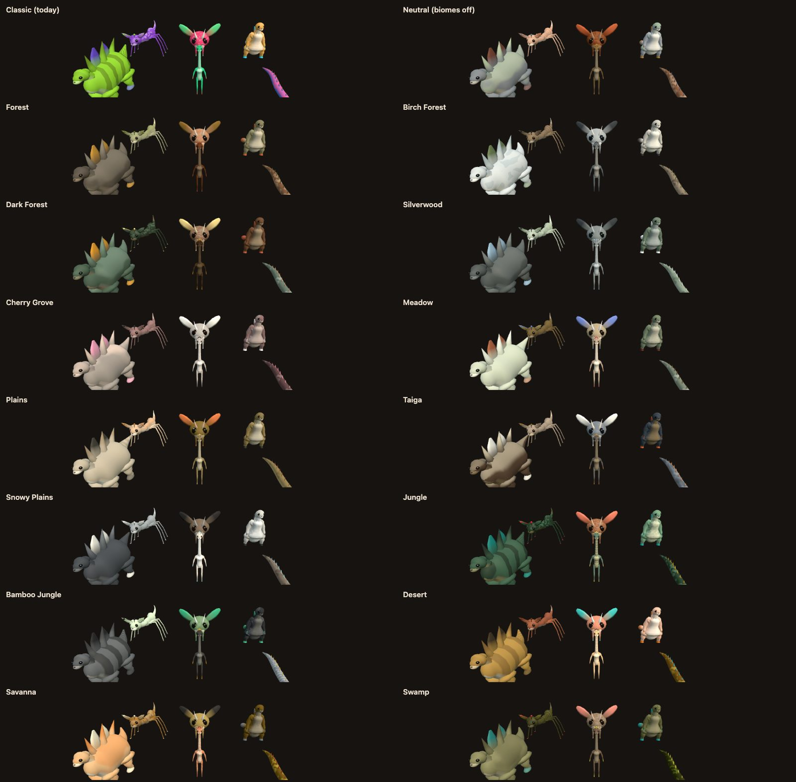
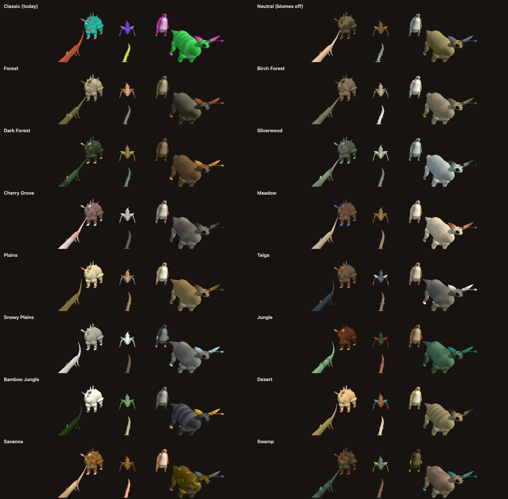

# Forest Drift — Biome-Specific Creatures Phase 0: Implementation Record

**Date:** 2026-11-13
**Plan:** [`../feature-plan/02-technical-plan.md`](../feature-plan/02-technical-plan.md) (revision 3) · decisions: [`../feature-plan/01-questions-and-decisions.md`](../feature-plan/01-questions-and-decisions.md)
**Status:** Phase 0 complete. Not committed. Creatures in the world are unchanged until Phase 1 wires the coats in.

Phase 0 builds the colour model and shows it in the Creature Lab: biome profiles, a pure coat function, and the Lab tools to review them.

## What you can see now

In the Creature Lab (`/creatures/?dev`), a new **Biome coat** panel offers:

- a **Biome** picker: Classic (generator colours), Neutral (biomes off), or any of the 26 biomes. It recolours the specimen and the galleries.
- **Gallery: regional six**: one world region's six species, coloured exactly as the world will colour them.
- **Gallery: 12 species**: coloured in groups of six, like regions.
- **Palette swatches** (body, underside, accent) for the specimen.
- A **colour-blind preview** (deuteranopia, protanopia) on the viewport.

The same region in each biome (sizes normalised; Classic is today's look):

| Region A                              | Region B                              |
| ------------------------------------- | ------------------------------------- |
|  |  |

What changes between biomes:

- Snowy Plains and Taiga go grey, white and slate.
- The desert goes sand, ochre and rust, with turquoise accents.
- The jungle goes deep green and chestnut, with scarlet and teal accents.
- Cherry Grove gets rose-grey bodies with blossom-pink accents.
- Bamboo Jungle gets black-and-white contrasts.

Within each biome, the six species stay apart by lightness, pattern and accent.

## How it works

| Piece                                        | File                                                                                       |
| -------------------------------------------- | ------------------------------------------------------------------------------------------ |
| OKLCh ↔ sRGB (pure, gamut-mapped by chroma)  | `src/lib/game/creatures/biome/oklch.ts`                                                    |
| 26 biome profiles + neutral, from 6 families | `src/lib/game/creatures/biome/creatureBiomeProfiles.ts`                                    |
| Region coat, separation rules, cache         | `src/lib/game/creatures/biome/CreatureBiomeCoat.ts`                                        |
| Natural clamps for coated palettes           | `surface/CreaturePaletteGenerator.ts` (`resolveCreaturePalette`)                           |
| Coat marker type                             | `CreatureTypes.ts` (`CreatureCoatInfo`, `SpeciesAppearance.coat`)                          |
| Lab                                          | `CreatureLab.ts` (`biome`, `prepared`, `showRegion`), `components/CreatureLabModal.svelte` |

`coatRegionSpecies(species, profile, worldSeed, regionKey)` colours a whole region at once:

1. **Lightness steps.** A seeded shuffle gives each species its own step of the profile's lightness range. Steps are at least 0.06 apart in OKLab L.
2. **Patterns.** Picked from the profile's weights, leaned per body plan (serpents toward bands, insects toward segment bands). Species one step apart never share a pattern; if a profile runs out, a common pattern is used.
3. **Accents.** Dealt by step, so species with the same accent are three steps apart.
4. **Colours.** Body hue and chroma come from the profile's body colours. Chroma tapers on pale coats, so a pale savanna animal is tawny rather than peach. The underside sits above the body, and the eye is dark.

Only `appearance` changes, in a copy. Id, anatomy, sizes and behaviour are the same objects, so carrying, riding and the online room are unaffected. Results are deterministic (`creature-coat-v1` streams) and cached per region and profile (LRU of 96).

**Natural clamps.** When a species has `appearance.coat`, `resolveCreaturePalette` allows what natural coats need:

- near-grey bodies (saturation down to 0.02);
- pale bodies (lightness up to 0.88);
- white or black accents.

It also pushes a grey accent away from a grey body. Species without a coat keep the original clamps exactly.

**Planned patterns.** Rosettes, reticulated, patches, speckle and saddle are already chosen by the profiles. Until Phase 3 draws them, they render as the nearest existing pattern with adjusted parameters (`PLANNED_PATTERN_FALLBACK`). The coat records the planned pattern, so Phase 3 can switch over without changing any choices.

## Changes from the plan

- **Patterns per body plan.** Profiles hold one weighted list, and a shared `PLAN_PATTERN_LEAN` table adjusts it per body plan, rather than a full table per plan in each profile. It's smaller and does the same job.
- **The coat function works on a region, not one species.** The separation rules (Q3) need the whole region.
- **A runtime marker, `appearance.coat`,** switches palette resolution to the natural clamps. The validator ignores unknown appearance fields, so it's harmless if a Lab-placed creature ever saves it.
- **Chroma tapers above L 0.6.** Added after the first screenshots showed peach-orange savanna bodies.

## Verification

- `npx vitest run`: **270 files, 3,041 tests pass**. New `biome/__tests__/CreatureBiomeCoat.spec.ts` (11 tests) covers:
  - OKLCh round trip and gamut mapping;
  - every profile present, natural, with six steps of room and at least three accents;
  - appearance-only copies that still pass `validateSpecies`, with the input untouched;
  - unique lightness steps, at least 0.06 apart, in all 27 profiles over 24 regions;
  - no shared pattern between neighbouring steps, and spread-out accents;
  - `paletteIssues` empty for every coated individual;
  - biome character (snow pale-capable and grey, jungle dark and mostly green);
  - determinism and caching;
  - classic palettes unchanged.
- `npm run check`: 0 errors. ESLint and Prettier clean on all changed files.
- E2E (Chromium): `creatures.e2e.ts` and `creatureQuality.e2e.ts`, 5/5 pass.
- Screenshots: the two contact sheets above, from the standalone Lab (headless Chromium).

## Next: Phase 1

- Wire coats into the world: `profileAt` in creature access, `cellGroupCentres`, and the coat callback in `resolveAmbientCreature`.
- Carried, ridden and remote views, and the pellet colour.
- Biome changes regenerating cells; kill switches.
- The `biomeCreatures` determinism golden.
- The new Main World (same seed and outpost, biomes on).
