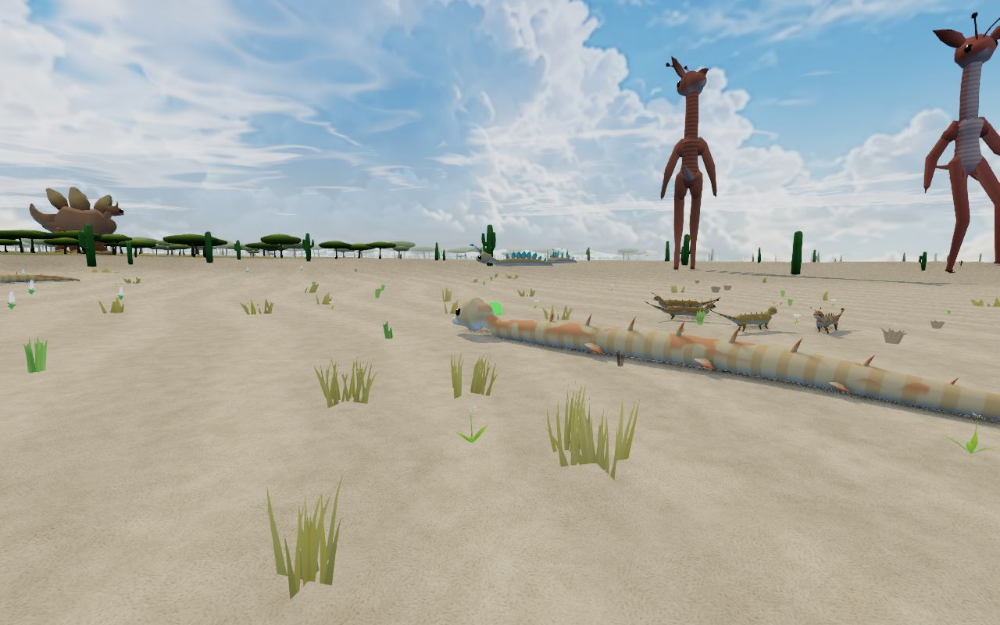
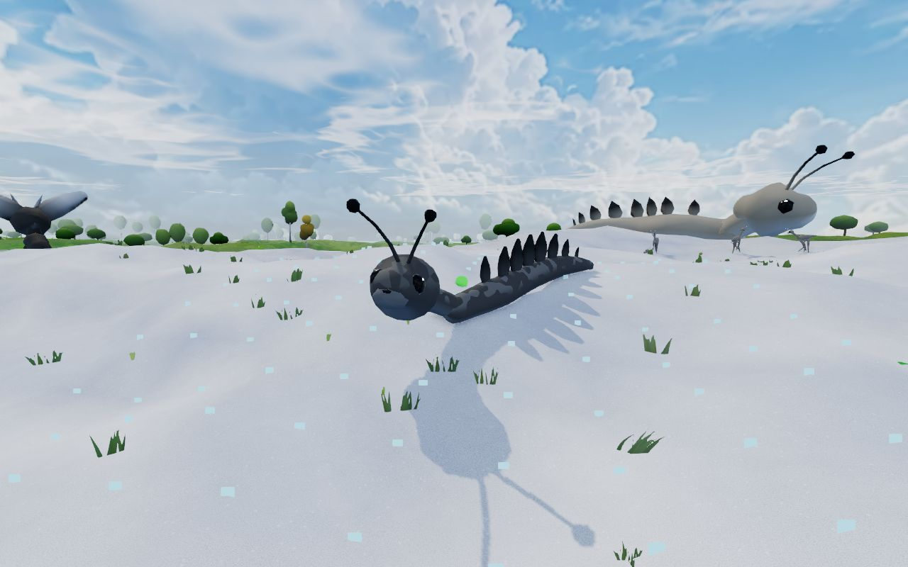
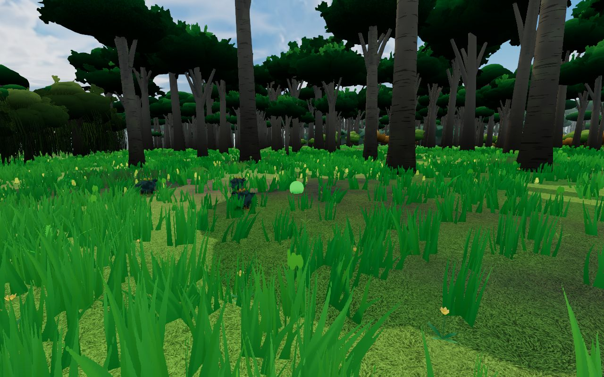
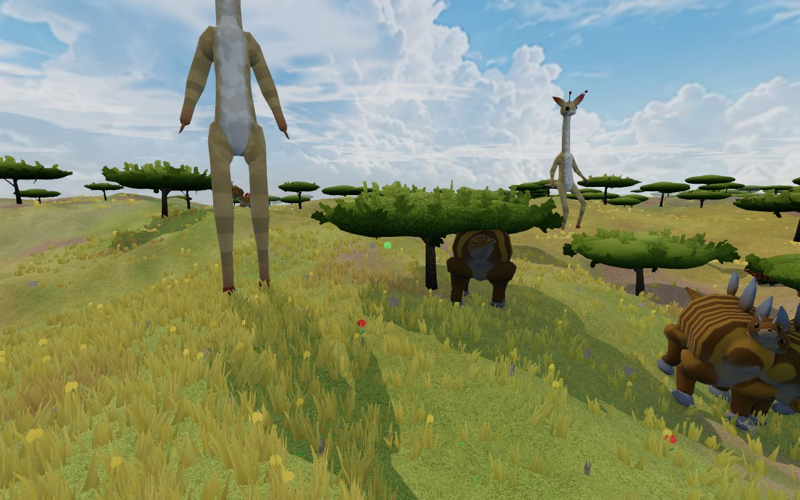
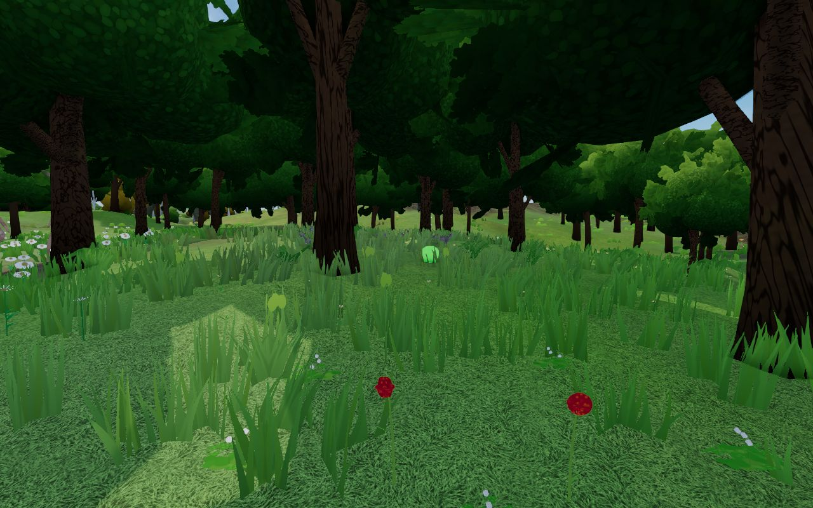
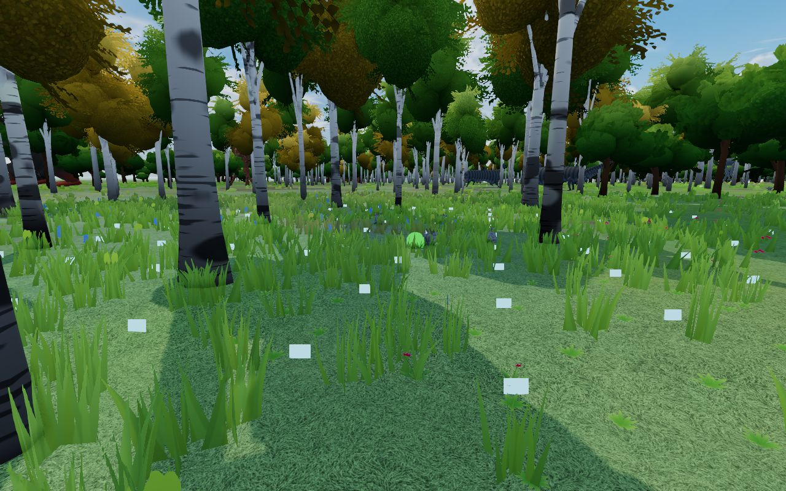
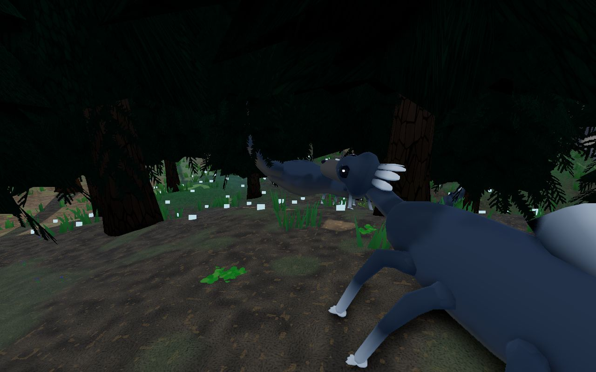
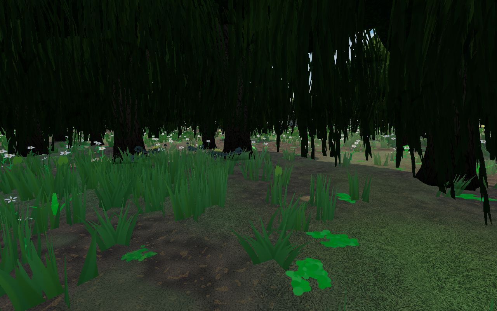

# Forest Drift — Biome-Specific Creatures Phase 1: Implementation Record

**Date:** 2026-11-13
**Plan:** [`../feature-plan/02-technical-plan.md`](../feature-plan/02-technical-plan.md) (revision 4) · earlier: [Phase 0](../phase-0/implementation.md)
**Status:** Phase 1 complete. Not committed.

Herds in the world now wear their biome's coat, the same for every player, and the Main World opens with biomes on.

## What players get

- **Every herd wears the biome at its group centre** (Q4). A desert herd is sand, ochre and rust; a snowfield herd is slate, grey and white. One herd is always one colour family, even on a border.
- **Worlds with biomes off** get the neutral natural coats (Q6). `?creatureCoats=off` brings back today's showcase colours for one session.
- **Changing biome settings** (on or off, size, warmth and the others) respawns the ambient herds in their new coats. A creature you're carrying or riding keeps its coat until you put it down (Q19).
- **Online**, every player sees the same coats. A pellet from another player's carried creature takes that creature's accent, as this client sees it (Q16). There's no protocol change: the room still sends its colour as a fallback.
- **The Main World** keeps the same seed (`soft-lowlands-431`) and outpost, now with biomes on (Q6). A copy stored by an older version is replaced once. The world card has a new picture.

| Desert               | Snowy Plains              | Jungle               | Savanna               |
| -------------------- | ------------------------- | -------------------- | --------------------- |
|  |  |  |  |
| **Forest**           | **Birch Forest**          | **Taiga**            | **Swamp**             |
|  |  |   |    |

The jungle herd (two small dark creatures, centre left) all but disappears in the tall grass. That's the real camouflage chosen in Q8. The Main World at spawn, biomes on: [`main-world.jpg`](main-world.jpg).

## How it works

| Piece                                                   | File                                                                                      |
| ------------------------------------------------------- | ----------------------------------------------------------------------------------------- |
| Group centres (pure, shared by population and resolver) | `creatures/CreaturePopulationSystem.ts` (`cellGroupCentres`, `coatedRegionSpecies`)       |
| Coats in the population                                 | `generatePopulationCell` reads `access.profileAt(centre)`                                 |
| Coats when resolving an id                              | `creatures/carryableCreatureRef.ts` (`resolveAmbientCreature(seed, id, profileAt?)`)      |
| Biome at a point, switches                              | `ThreeScene.creatureProfileAt`, `creatures/biome/creatureCoatSwitches.ts`                 |
| Respawning herds on biome changes                       | `CreatureRuntimeManager.regenerateAmbient()`, called from `ThreeScene.regenerateBiomes()` |
| Remote pellet colour                                    | `net/MultiplayerSession.ts` (`onShot`)                                                    |
| Main World revision                                     | `world/DefaultWorld.ts` (`DEFAULT_WORLD_REVISION`, biomes on), `world/WorldManager.ts`    |
| Determinism                                             | `world/determinismReport.ts` (`biomeCreatures`), golden, `tests/determinism.e2e.ts`       |

- **One source for where a herd stands.** `cellGroupCentres` replays the cell's random stream (shuffle, then presence and centre per slot). The population and the id resolver both use it, so a creature resolved from its id (carried by another player, ridden, put back) gets exactly the coat its herd spawned with. A test checks this for every spawn in a block of cells.
- **The room is untouched.** `RoomCore` still calls `resolveAmbientCreature(seed, id)` without `profileAt`. It gets the coat-free recipe, with the same id, body plan and proportions, so carry and ride checks are unchanged.
- **`profileAt` is always present** and returns `undefined` when coats are switched off. The URL switch is read in the scene constructor, after class fields are created, so checking it on each call is what makes `?creatureCoats=off` work.
- **`regenerateAmbient()`** drops ambient herds and cells, but keeps placed, carried and ridden creatures. `settingsChanged()` would also drop the carried and ridden creatures, which a biome change shouldn't.
- **Main World.** The bundled package is still the 2026-09 one. `getDefaultWorldDefinition()` turns biomes on after decoding, so no binary package had to be regenerated. A `localStorage` key, `forest-drift.main-world-revision`, records the revision. `openWorld` replaces a stored copy below revision 2 once, then keeps the player's own changes, including switching biomes off. If storage can't be read, the stored copy counts as current, so a blocked store never resets the world. The thumbnail was captured with the game's own `captureThumbnail()` at spawn.
- **Determinism.** `biomeCreatures` covers 1,024 groups over about 8 km per seed: centre, biome, species id, palette, pattern and lightness step. It adds about 0.15 s per seed to the report. The existing golden sections are unchanged, so there's no generator bump (Q17).

## Placing a coated creature (Q18)

Placing a copy of a herd creature (the Creature Lab, or `placeCreature`) now bakes its coat in with `recipeForSave`:

- the colours and the (existing) pattern stay in today's fields;
- the runtime `coat` marker is dropped, so the save format is unchanged;
- the species id gains the profile (`…_desert`), so copies of one species placed from different biomes don't conflict. The individual's `speciesId` follows.

The e2e suite caught this: saves accept only generator-shaped fields, and the `coat` marker made placing a herd copy fail with "recipes only, not runtime data". One consequence: a placed coat is resolved with the classic palette clamps on reload, so very pale or very grey coats come back slightly less pale and slightly tinted. The Lab's biome picker already does what the plan's "Match biome" checkbox would have, so no checkbox was added.

## Changes from the plan

- **Main World:** the biome settings are switched on when the package is decoded, rather than by shipping a new package. The revision marker lives in `localStorage` rather than in the world record, which the validator would strip.
- **`defaultWorld.e2e.ts`:** the timeout is raised to 150 s, and the return to the worlds screen gets 60 s. With biomes on, Quit takes about 11.7 s headless against 6.7 s with biomes off; it's the same with coats on or off. This is the same software-rendering slowness the biomes e2e tests already allow for.
- **Rare morphs** stay in Phase 3, as the phase table says.

## Verification

- `npx vitest run`: **272 files, 3,049 tests pass**. New tests:
  - `biome/__tests__/biomeCoatsInWorld.spec.ts`:
    - shared centres;
    - herds coated by their centre's biome, with ids, positions and individuals unchanged;
    - one species object per herd;
    - density-independent;
    - the resolver equals the population on clients and is coat-free for the room;
    - coats off equals today exactly.
  - `world/__tests__/mainWorldRevision.spec.ts`:
    - an older copy is replaced once;
    - other worlds are untouched;
    - the player's later changes are kept;
    - blocked storage counts as current.
  - `biomeSchema.spec.ts`: the Main World now ships with biomes on and the same seed.
  - The determinism golden gains `biomeCreatures`.
- `npm run check`, `npm run check:server`: 0 errors. ESLint is clean on everything changed. The one error it reports, `no-useless-assignment` in `CreatureGrounding.ts:1065`, is in a file this phase didn't touch. Prettier is clean.
- New unit test: placing a coated creature saves a recipe in today's format that passes `validateCreatureWorldState`. Total: **3,050 tests pass**.
- E2E:
  - `determinism.e2e.ts` and `multiplayer.e2e.ts` in Chromium, WebKit and Firefox: **18/18**, with the new `biomeCreatures` golden.
  - Chromium:
    - `creatureBiomes.e2e.ts` (new, 3/3);
    - `defaultWorld.e2e.ts` (2/2);
    - `creatures.e2e.ts`;
    - `biomes.e2e.ts`;
    - `rangedWeaponsMultiplayer.e2e.ts`, all passing after the placement fix;
    - `creatureRiding.e2e.ts`, which passed on re-run. "Carry a small creature onto a mount" failed once in the first run: the test retries because a mount can step out of the crosshair, and it doesn't depend on colours.
