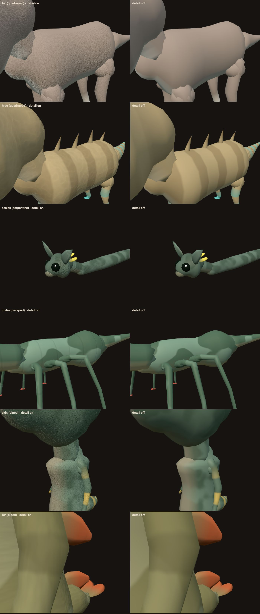

# Forest Drift — Biome-Specific Creatures Phase 2: Implementation Record

**Date:** 2026-11-13
**Plan:** [`../feature-plan/02-technical-plan.md`](../feature-plan/02-technical-plan.md) (revision 5) · earlier: [Phase 0](../phase-0/implementation.md), [Phase 1](../phase-1/implementation.md)
**Status:** Phase 2 complete. Not committed.

Creatures now have a fine coat texture up close: fur, hide, scales, chitin or skin. It's drawn per pixel by the shared creature shader, with no image textures.

## What players get

| Coat   | Who wears it                                                 | What it looks like                                  |
| ------ | ------------------------------------------------------------ | --------------------------------------------------- |
| Fur    | Quadrupeds and bipeds; thicker in cold biomes, finer in warm | Fine grain running along the body and down the legs |
| Hide   | Bare-coated furred species, mainly in dry biomes             | Soft folds                                          |
| Scales | Serpents; some bare species in dry biomes                    | Offset rows of rounded scales                       |
| Chitin | Hexapods                                                     | Smooth plates with seams between body segments      |
| Skin   | Bare-coated species in the swamp                             | Fine pores                                          |

The same creatures with detail on (left) and off (right), from the Creature Lab:

- **Every world** gets it (Q7), including biomes-off worlds and creatures in classic colours.
- **No detail on eyes, noses or horns, spikes, plates and antennae.** Feet and hands get less, and ears, fins and tail tips some.
- **Up close only** (Q11). Detail fades as its features get smaller than a few pixels, so it never shimmers. It's faint at LOD1 and absent at LOD2.
- **Switches:** `?creatureDetail=off` turns it off for a session, in the game and in the Lab. `CREATURE_DETAIL_AVAILABLE` turns it off for everyone.

## How it works

| Piece                                        | File                                                                              |
| -------------------------------------------- | --------------------------------------------------------------------------------- |
| Coat choice, frequency, LOD and region rules | `src/lib/game/creatures/surface/CreatureCoatDetail.ts`                            |
| Coat on the resolved surface                 | `surface/CreaturePatternGenerator.ts` (`CreatureSurfaceDefinition.coat`)          |
| Per-creature values                          | `surface/CreatureSurfaceTable.ts`, texel 7: coat type, strength, cycles per metre |
| Height, grain, bump normal, fade             | `CreatureMaterial.ts` (hook `creature-surface-v3`)                                |
| Lab debug view "coatDetail"                  | `CreatureLab.ts`, `components/CreatureLabModal.svelte`                            |

- **Coat type (Q10).** It comes from the body plan: serpents get scales, hexapods chitin, quadrupeds and bipeds fur. Where the biome coat marks a furred species as bare, it gets hide or scales in dry biomes (seeded half and half), skin in the swamp, and hide elsewhere. Fur strength follows the biome's thickness, and its grain the length.
- **Size.** Features are set per body length and clamped to 4 mm–6 cm, so a 25 m giant doesn't get 50 cm grain and a 12 cm creature doesn't get sub-pixel noise.
- **Height.** Noise-based coats (fur, hide, skin) sample the shared 32³ noise volume at the coat frequency × 12, because the volume has about one blob per 12 texels. Scales and chitin are analytic cells. Everything is in bind space and rides the skin.
- **Shading.** The height adds a faint albedo grain (±11%) and bends the normal with screen-space derivatives, the same technique as three.js's bump mapping. The derivatives are taken outside any per-pixel branch, where they'd otherwise be undefined.
- **Fade.** Features per pixel along the screen's steeper direction: soft coats fade from 0.26 to 0.52, chitin from 0.18 and scales from 0.13. The multiplier is ×0.35 at LOD1 and 0 at LOD2, where the branch is skipped.

## Performance

`tests/creatureSurfacePerformance.e2e.ts` (opt-in, `CREATURE_BENCH=1`). Chromium on Metal, 1512×945 at 2×, vsync off. Numbers in [`coat-detail-performance.json`](coat-detail-performance.json).

| Scene                                   | Detail on                     | Detail off                    |
| --------------------------------------- | ----------------------------- | ----------------------------- |
| Full-screen close-ups (five coat types) | median 2.0–2.1 ms, p95 2.4 ms | median 2.0–2.1 ms, p95 2.4 ms |
| Lab stress scene, 25 creatures          | 20.3 ms                       | 21.0 ms                       |

No measurable cost: the difference is within run-to-run noise, against a budget of ≤ +10% fragment cost. It's still one creature shader program and one draw per creature. The surface table didn't need to grow, because the coat uses texel 7's three spare values.

## Changes from the plan

- **The surface table stays 8 texels wide**, not 9: texel 7 had three unused values.
- **Noise coats scale by the noise volume's feature spacing (×12)** and fade on features per pixel, measured along each screen direction. The first version used raw coordinates and summed derivatives, which made the grain 12× too coarse and faded it out almost everywhere. The Lab debug view caught it.
- **Hard-edged coats fade earlier** than soft ones. Scales showed a moiré pattern at about three pixels per cell.
- **The Creature Lab now reads `?creatureDetail=off` and `?creatureCoats=off`**, for A/B review.

## Verification

- `npx vitest run`: **273 files, 3,056 tests pass**. New: `surface/__tests__/CreatureCoatDetail.spec.ts` (6 tests) covers:
  - coat by body plan;
  - bare biome coats becoming hide, scales or skin;
  - thicker fur in the cold;
  - feature size clamped at every creature size;
  - the LOD fade and region mask;
  - values written to the table row;
  - `?creatureDetail=off`.
- `npm run check`: 0 errors. ESLint and Prettier clean on the changed files.
- E2E (Chromium), **10/10 pass**:
  - `creatures.e2e.ts`;
  - `creatureQuality.e2e.ts`, which compiles the new shader across all four body plans and every LOD;
  - `creatureBiomes.e2e.ts`;
  - `creatureRiding.e2e.ts`.
- GPU A/B as above. Screenshots from the Lab, with the GPU in headless Chromium.

## Next: Phase 3

- New patterns: rosettes, reticulated, patches, speckle and saddle, drawn by the shader instead of their Phase 0 fallbacks.
- Colour on small features: banded horns, tipped ears, spotted fins.
- Rare pale and dark morphs, about 1 in 60.
