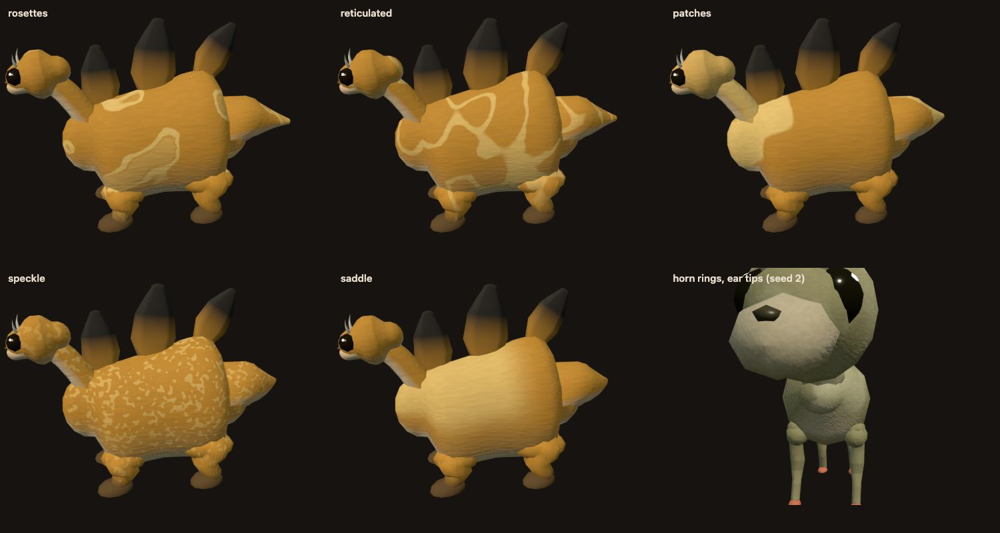
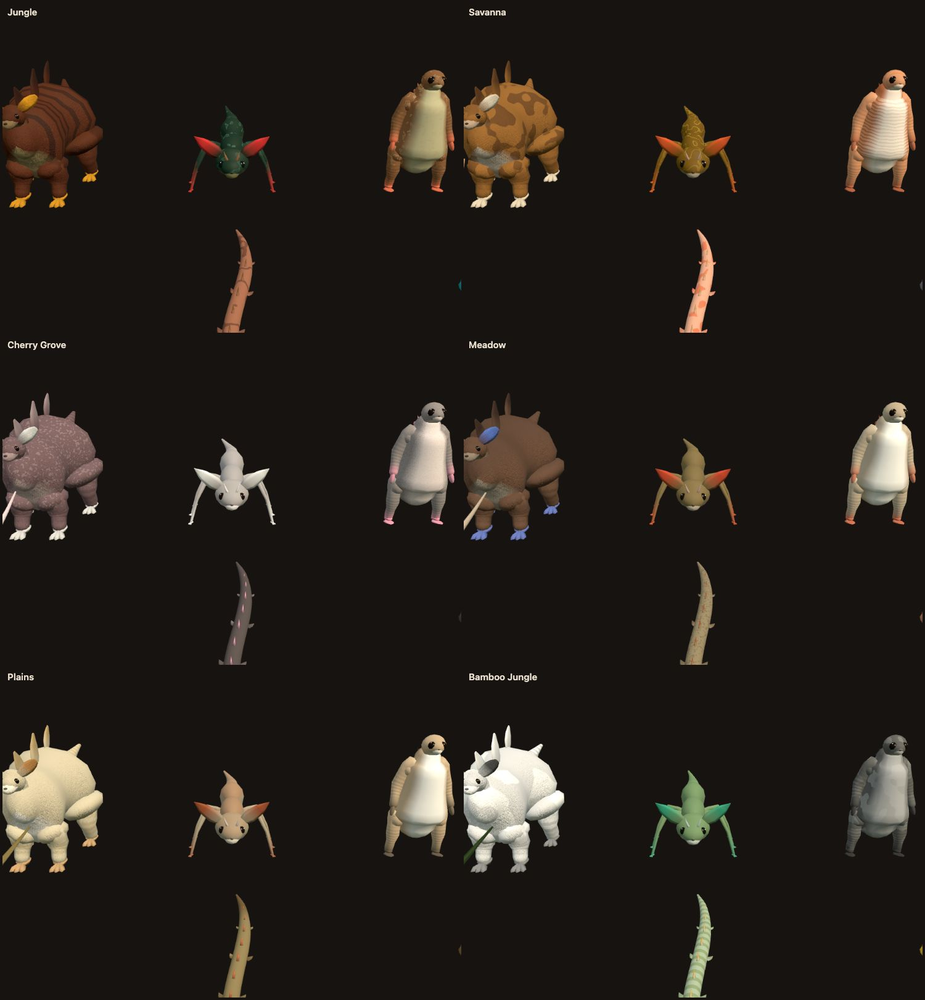

# Forest Drift — Biome-Specific Creatures Phase 3: Implementation Record

**Date:** 2026-11-13
**Plan:** [`../feature-plan/02-technical-plan.md`](../feature-plan/02-technical-plan.md) (revision 6) · earlier: [Phase 0](../phase-0/implementation.md), [1](../phase-1/implementation.md), [2](../phase-2/implementation.md)
**Status:** Phase 3 complete. Not committed.

Biome coats now draw five new natural patterns, small features get their own colour, and about one creature in 60 is a rare pale or dark morph.

## What players get

**Five new patterns**, chosen by the biome profiles since Phase 0 and now drawn as themselves rather than their Phase 0 fallbacks:

| Pattern     | Look                                        | Where it's most likely                            |
| ----------- | ------------------------------------------- | ------------------------------------------------- |
| Rosettes    | Rings around spots, with a fainter centre   | Jungle, Sparse Jungle                             |
| Reticulated | A network of lines around irregular patches | Savanna, Silverwood, Swamp                        |
| Patches     | Large piebald areas                         | Bamboo Jungle, Cherry Grove, snow biomes          |
| Speckle     | Fine flecks                                 | Flower Forest, Meadow, Desert, Shrub Savanna      |
| Saddle      | A band over the middle of the back          | Plains, Sunflower Plains, Desert, Savanna Plateau |

The same specimen in savanna colours, with each new pattern, plus feature colour (bottom right):

One region's six species in biomes that favour them:

- **Colour on small features**, in every world:
  - growth rings on horns;
  - bands on antennae;
  - darker ear tips;
  - spots on fins.

  These are baked into vertex colours, so they show at every LOD.

- **Rare morphs** (Q14). About 1 in 60 herd members is pale (leucistic: much lighter, nearly colourless) or dark (melanistic). The species accent is kept, so a morph still reads as its species. The choice comes from the creature's id, so every player sees the same individuals. Morphs appear only with biome coats on, not in classic colours.

## How it works

| Piece                                 | File                                                                                                                                       |
| ------------------------------------- | ------------------------------------------------------------------------------------------------------------------------------------------ |
| Pattern types (appended, codes 10–14) | `CreatureTypes.ts`, `surface/CreaturePatternGenerator.ts` (`PATTERN_TYPES`, `patternFor`, `patternMask`)                                   |
| Shader                                | `CreatureMaterial.ts` (`creaturePatternMask` types 10–14)                                                                                  |
| Far-LOD bake, saddle region rule      | `surface/CreatureSurfaceClassifier.ts`                                                                                                     |
| Feature colour                        | `surface/CreatureSurfaceClassifier.ts` (`feature` case)                                                                                    |
| Morphs                                | `biome/CreatureBiomeCoat.ts` (`coatMorph`, `morphSpecies`, `memberSpecies`), used by `generatePopulationCell` and `resolveAmbientCreature` |
| Saves keep the original ten patterns  | `SAVED_PATTERN_TYPES`, `validateSurfaceGenome`, `recipeForSave` / `savedPattern`                                                           |

- **Shader codes.** The new patterns are appended to `PATTERN_TYPES`, so codes 0–9 mean what they always did. Each has GLSL and a CPU mirror in `patternMask`, which tests check for bounded, visible masks.
- **Far LODs** bake rosettes, reticulated, patches and speckle as their average tint, like spots. The saddle is baked exactly, like the back stripe, and appears only on the torso, with joint masses at half strength.
- **Saves don't change** (Q18). The save validator accepts only the original ten pattern types (`SAVED_PATTERN_TYPES`), so older builds can read every save. `recipeForSave` maps a new pattern to its nearest original when a creature is placed, whether or not it has a coat, so a Lab-tuned species with a new pattern still saves. A placed morph gets its own id (`…_forest_pale`).
- **Morphs** are cached per coated species and keep its id, so carrying, riding and the room are unaffected. The resolver applies them by member id, exactly as the population does.

## Changes from the plan

- **Rosettes** ring the noise's isolated peaks, with a threshold of 1 − density × 0.45, not the pattern threshold. At the pattern threshold, the blobs joined up and the rings read as a network. **Patches** sample noise at the pattern scale, not half of it: at half, one patch was bigger than the whole body.
- **A shader variable was named `half`**, which is reserved in GLSL ES. The shader failed to compile and every creature vanished, with nothing in the console. The Lab screenshots caught it, and it's renamed.
- **Changed snapshots, regenerated:**
  - **The creature fingerprint snapshots** (8 seeds) and the compiler's inline snapshot. Only the combined geometry hash changed, and it includes vertex colours, which feature colour changes.
  - **The `biomeCreatures` golden.** The new patterns use their own parameters, which shifts the coat's random draws. The other golden sections are unchanged, so there's no generator bump (Q17).

## Verification

- `npx vitest run`: **274 files, 3,063 tests pass**. New: `biome/__tests__/phase3Surface.spec.ts` (7 tests) covers:
  - codes appended;
  - bounded, visible masks for all five patterns;
  - the saddle on the back of the mid-torso;
  - saves mapping to the original ten, with the validator rejecting new types;
  - morph rate about 1 in 60 and deterministic;
  - pale lighter, dark darker, accent and id kept;
  - horns ringed.
- Updated tests: coated species are validated in their saved form, and a herd shares one species apart from its morphs.
- `npm run check`: 0 errors. ESLint and Prettier clean on the changed files.
- E2E:
  - `determinism.e2e.ts` in Chromium, WebKit and Firefox: **3/3**, with the regenerated `biomeCreatures` golden.
  - Chromium, 10 of 11 in the first run:
    - `creatures.e2e.ts`;
    - `creatureQuality.e2e.ts`, which compiles the new shader for every body plan and LOD;
    - `creatureBiomes.e2e.ts`;
    - `rangedWeaponsMultiplayer.e2e.ts`. In the first run, "everyone else sees a pellet fly through the air, even 200 ms behind" saw one sampled pellet position instead of the expected two. It's a timing sample under load: it passed twice in a row on re-run, and pellet flight doesn't depend on colours.
