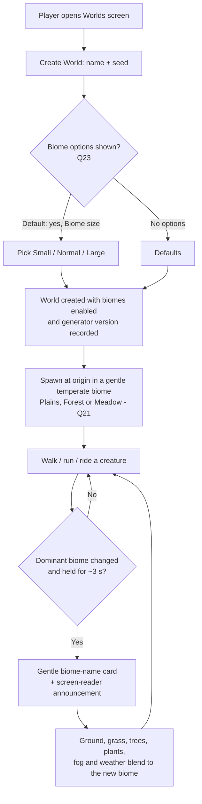
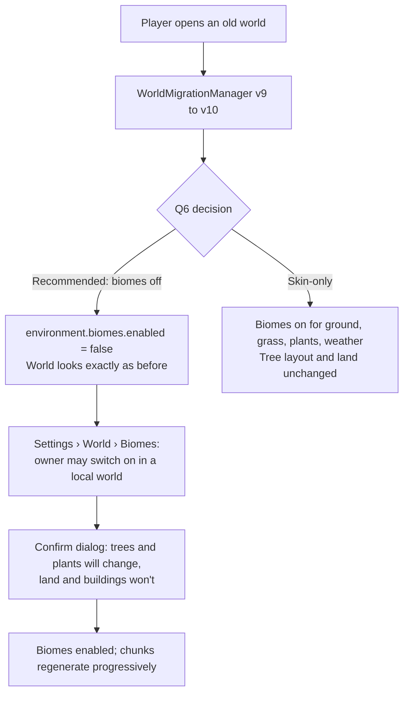
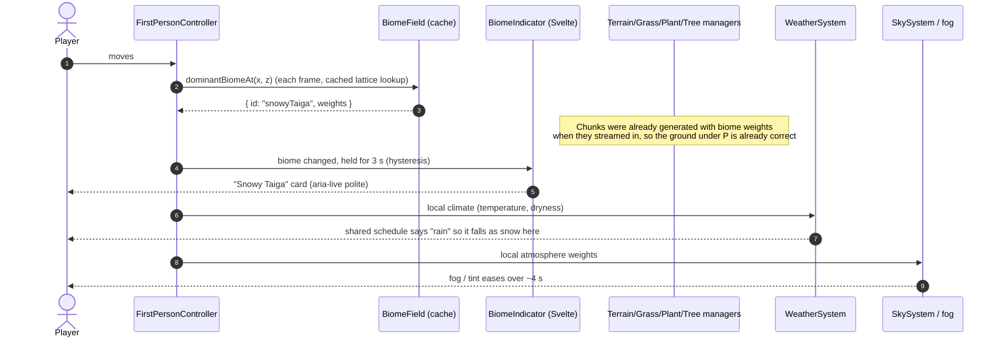

# Forest Drift — Biomes and Environments: Brief

**Feature cycle:** 2026-11-12
**Status:** **Decisions locked (2026-11-12): all recommended defaults accepted. Waiting for your approval of the technical plan (revision 2).** No code is written yet.
**Related:** [`01-questions-and-decisions.md`](01-questions-and-decisions.md) · [`02-technical-plan.md`](02-technical-plan.md)
**Builds on:** [README "Terrain regions"](../../../../../README.md) · [River ponds (2026-11-09)](../../../11-09/river-ponds.md) · [Implementation order FD "additional biomes"](../../../10-22/Forest-Drift-implementation-order.md) · [Gameplay research §26](../../../10-20/Forest-Drift-gameplay-research-and-implementation-plan.md)

Paths are relative to `pages/Forest-Drift/`.

---

## 1. The idea in one paragraph

Forest Drift's world becomes a patchwork of **recognisable biomes**: snowy taiga, deserts, jungles, savannas, swamps, cherry-blossom highlands, dark forests and more. Each one changes the ground, grass, trees, flowers, weather and atmosphere. The land keeps the shape it has today (plains, rolling hills, highlands, mountains). Biomes sit on top of that shape and are chosen by a new, seeded **climate** (temperature and moisture), so cold biomes border cool ones, deserts border savannas, and you never step from snow straight into jungle. Like everything else in the world, biomes come from the seed and settings. Nothing per tree or per tile is saved, and every player in an online world sees the same biome at the same place.

## 2. The user problem

| Today (what the code does)                                                                                                                                                                          | Why it's a problem                                                                                                                                                                         | What this feature changes                                                                                                                      |
| --------------------------------------------------------------------------------------------------------------------------------------------------------------------------------------------------- | ------------------------------------------------------------------------------------------------------------------------------------------------------------------------------------------ | ---------------------------------------------------------------------------------------------------------------------------------------------- |
| The only "biomes" are four **landform** recipes (`plains / hills / highlands / mountains`) in `src/lib/game/terrain/TerrainHeightSampler.ts`. They change height, not character.                    | Every part of the world is the same green temperate countryside. After the first 10 minutes there's nothing new to find, and that undercuts the exploration loop the game is built around. | 26 distinct biomes with their own look, plants and weather, so exploring finds new places.                                                     |
| Ground colour comes from **elevation and slope only** (`src/lib/game/terrain/terrainColor.ts`: low green → mid green → grey high ground → rock on steep slopes).                                    | There's no sand, snow, red earth, dry savanna grass, mud or forest-floor litter anywhere.                                                                                                  | Per-biome ground palettes, including permanent snow ground, desert sand, savanna gold and swamp mud.                                           |
| Forest coverage is **deliberately independent** of the land (`VegetationRegionSampler.ts` says "Nothing in here reads a terrain biome weight").                                                     | That was right when there were no biomes, but it means a forest can be anywhere and a plain can be anywhere. Neither tells you where you are.                                              | Each biome sets a forest-density band. Today's forest mask still adds clearings and edges inside that band.                                    |
| There are **8 tree species** (oak, pine, cypress, ornamental, spruce, birch, Scots pine, willow), mixed by a conifer/broadleaf map plus elevation (`TreeSpeciesSelector.ts`).                       | There's no jungle tree, acacia, bamboo, cactus, cherry blossom, dark broadleaf or pale tree, so most of the requested biomes can't be built from today's trees.                            | New species and tint variants, chosen per biome.                                                                                               |
| Flowers and ground plants come from **random regional pools** (`plantEcology.ts`, 192 m regions, 4 × 4 super-region pools). Habitat only knows `forest`, `openness`, `wet` and `height`.            | A desert could grow ferns and a snowfield could grow orchids. No region has a botanical identity beyond "a random set of flowers".                                                         | Plant habitat gains a biome input, and some biomes get signature plants (sunflowers, cacti/succulents, dead shrubs, ferns, big flower fields). |
| Weather is **one global state** for the whole world (`WeatherTypes.ts`: `clear / rain / thunderstorm / snow`, with `temperature` "informational for now" and `allowSnow` "no climate/seasons yet"). | Snow can fall on the desert, and it can rain on a snowfield.                                                                                                                               | The weather schedule stays global and shared, but what falls (rain, snow or nothing) and how much now depends on the local biome's climate.    |
| Creatures are chosen per 512 m region with no idea of the land (`CreaturePopulationSystem.ts`).                                                                                                     | They don't belong to a place. That's acceptable for now, and only matters if you want desert creatures to look like desert creatures.                                                      | Optional (see Q22): no change in v1, or a biome-biased colour palette.                                                                         |

**Who it's for:** every player, in single-player and online worlds. It matters most to explorers and builders who want a reason to travel and a distinctive place to build.

## 3. Requested biomes (scope as given)

You listed 26 biomes. The numbering in the request has gaps (10, 15–17, 23–24, 28 and 32–47 are missing), and two entries reuse the numbers 11 and 12. I've taken **the 26 named biomes as the scope**. I haven't silently added any of the missing numbers back. Q1 asks you to confirm this.

| Group (as requested)            | Biomes                                                                                                                                                                                                                           |
| ------------------------------- | -------------------------------------------------------------------------------------------------------------------------------------------------------------------------------------------------------------------------------- |
| Forests and jungles (12)        | Forest · Flower Forest · Birch Forest · Old Growth Birch Forest · Dark Forest · Silverwood (requested as Pale Garden) · Sunlit Wood (requested as Dappled Forest) · Taiga · Snowy Taiga · Jungle · Sparse Jungle · Bamboo Jungle |
| Mountains and highlands (5)     | Meadow · Cherry Grove · Grove · Snowy Slopes · Windswept Hills                                                                                                                                                                   |
| Plains, snow and ice (3)        | Plains · Sunflower Plains · Snowy Plains                                                                                                                                                                                         |
| Deserts, savannas, badlands (3) | Desert · Savanna · Savanna Plateau                                                                                                                                                                                               |
| Others listed at the end (3)    | Swamp · Shrub Savanna · Tropical Dry Grassland                                                                                                                                                                                   |

**Locked decisions that shape this list:** Q1 confirmed the 26 named biomes as the full scope. Q3 defines "Dappled Forest" as a sunlit mixed broadleaf woodland with an open canopy and a flowery floor. Q4 makes "Pale Garden" a calm, silvery, misty variant of the Dark Forest. Q2 keeps the generic names but gives Forest Drift its own look, and renames those two in game to **Sunlit Wood** and **Silverwood**, so the world doesn't read as a recreation of another game whose biome list shares many of these names.

## 4. Goals

1. **26 biomes**, each recognisable within a few seconds of arriving, from at least three of: ground, grass, trees, plants, weather and atmosphere.
2. **Believable layout.** Biomes follow a continuous climate, so neighbours make sense (snowy → cool → temperate → warm → hot, and dry ↔ wet). Mountains, highlands and plains each get suitable biomes.
3. **The land keeps its shape.** Existing terrain heights, rivers and lakes don't move, so buildings in existing worlds never float or get buried (see Q6 and Q7).
4. **Smooth borders.** Biomes blend over tens of metres. There are no hard lines and no chunk-shaped seams.
5. **Deterministic and multiplayer-safe.** The same seed and settings give the same biomes in Chromium, WebKit and Firefox, checked by the existing determinism golden report.
6. **Bounded cost.** Within the frame-time and chunk-generation budgets in [`02-technical-plan.md` §13](02-technical-plan.md). Nothing per biome is saved.
7. **You know where you are.** A small, accessible "you've entered the Snowy Taiga" indication, plus a biome map debug view (Q28, Q29).
8. **A biome is data, not code.** Adding the 27th biome means adding a definition (and maybe a tree species), not another branch in five systems.

## 5. Non-goals (v1)

- **Changing terrain height per biome** (dunes, mesas, flattened swamps). Proposed as a later, opt-in phase for new worlds only (Q7).
- **Frozen or walkable ice** on lakes and rivers (Q15). Water stays liquid in v1.
- **Seasons** or climate that changes over time.
- **New creatures per biome.** Fauna stays as it is, apart from an optional palette bias (Q22).
- **Gameplay resources** (wood types, crafting, temperature survival). Biomes are about exploring and atmosphere.
- Biomes that need new world features: caves, oceans, beaches on oceans, badlands mesas with strata, mushroom islands. These weren't requested, and most need terrain changes.
- Letting players **paint biomes** onto land by hand.

## 6. Expected user flow

### 6.1 Creating and exploring a new world

### 6.2 Opening a world saved before biomes existed

### 6.3 What happens when a player crosses a biome border

## 7. What "done" looks like for the player

- Walking in a straight line from spawn for 10 minutes crosses several biomes, and you can tell each one apart.
- Snowy biomes have white ground and frosted conifers, and the shared weather falls as snow there. Deserts are sand-coloured with cacti and no rain. Jungles are dense, tall and humid-looking. Swamps are dark, wet and misty.
- Existing worlds open looking **exactly** as they did, with buildings in place, until the owner chooses otherwise (subject to Q6).
- An online world looks the same for every player.
- Frame time and chunk streaming stay inside the budgets in the technical plan, on the `low` preset too.

Full acceptance criteria are in [`02-technical-plan.md` §20 Definition of done](02-technical-plan.md).

## 8. Delivery shape (proposed, see Q31)

| Phase | Name                         | Player-visible result                                                                                   |
| ----- | ---------------------------- | ------------------------------------------------------------------------------------------------------- |
| 0     | Climate and biome foundation | Biome Map debug view only. Biomes classified, nothing else changes yet.                                 |
| 1     | Ground and grass             | Snow, sand, savanna gold, mud and forest-floor ground, plus grass per biome, and the biome-name card.   |
| 2     | Forests from existing trees  | Forest, Birch, Taiga, Snowy Taiga, Plains, Meadow and Windswept Hills using today's species with tints. |
| 3     | New tree species             | Dark broadleaf, tall birch, jungle, bamboo, acacia, cherry, pale tree, swamp tree, cactus.              |
| 4     | Signature plants             | Sunflowers, flower-forest carpets, succulents, dead shrubs, ferns, swamp reeds.                         |
| 5     | Climate and atmosphere       | Local snow/rain/dry weather, fog tint, swamp water tint, optional ambient sound.                        |
| 6     | Online and release           | Generator version 4, publish/migration, performance pass, docs and help.                                |

## 9. Key risks (details in the technical plan)

| Risk                                                               | Mitigation                                                                                                       |
| ------------------------------------------------------------------ | ---------------------------------------------------------------------------------------------------------------- |
| Biomes move terrain under existing buildings                       | Biomes **never** change `sampleBase` height in v1. Old worlds migrate with biomes off (Q6).                      |
| Tree layout changes in old worlds and fills a garden or fence line | Off by default for old worlds. Opt-in is behind a confirmation. Tree ids stay cell-based, so cut trees stay cut. |
| Online clients disagree about biomes                               | Generator version 4, gated publish, determinism golden extended with a `biomes` section.                         |
| Chunk generation gets slower                                       | One coarse 8 m biome lattice per chunk, shared by terrain colour, grass, plants and trees, with budget tests.    |
| 26 biomes is a lot of art                                          | Phased. Several biomes reuse existing species with tints. Signature content is limited to what each biome needs. |
| The world reads as a copy of another game                          | Forest Drift's own art style, palette and definitions, and possibly its own names (Q2).                          |
