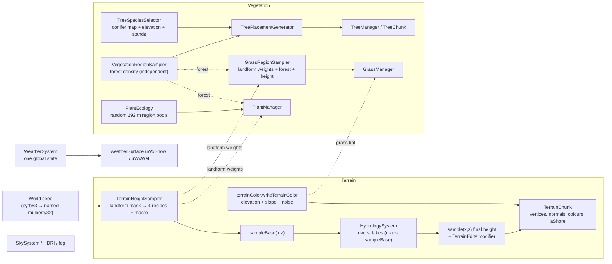
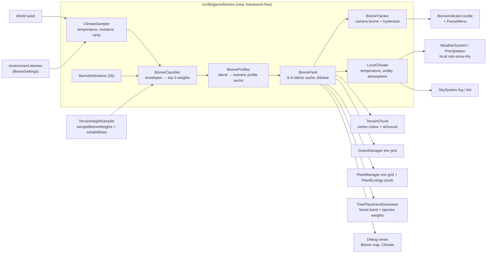
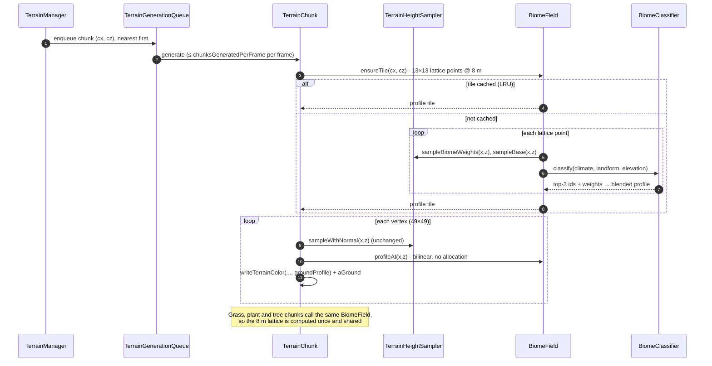
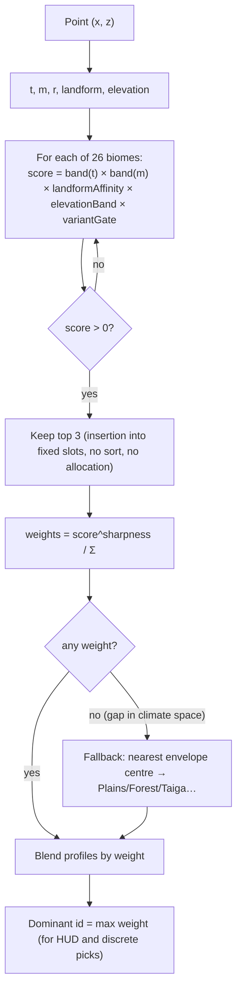
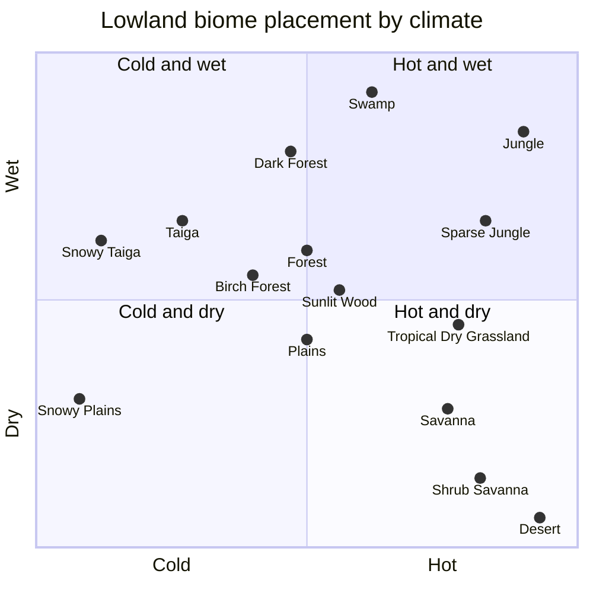
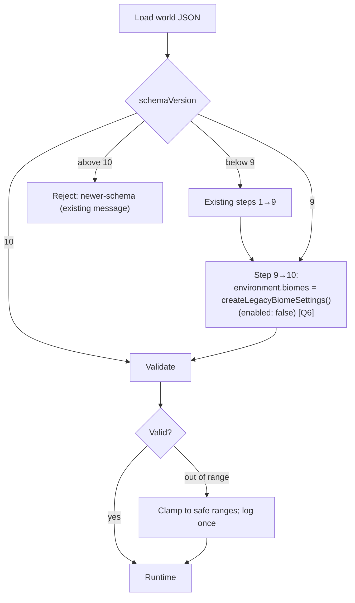
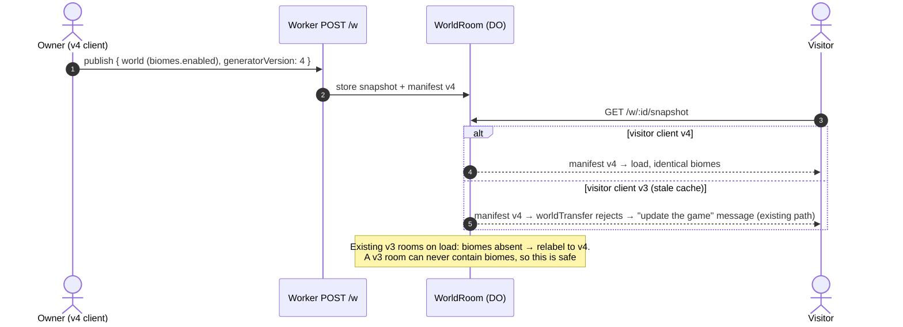
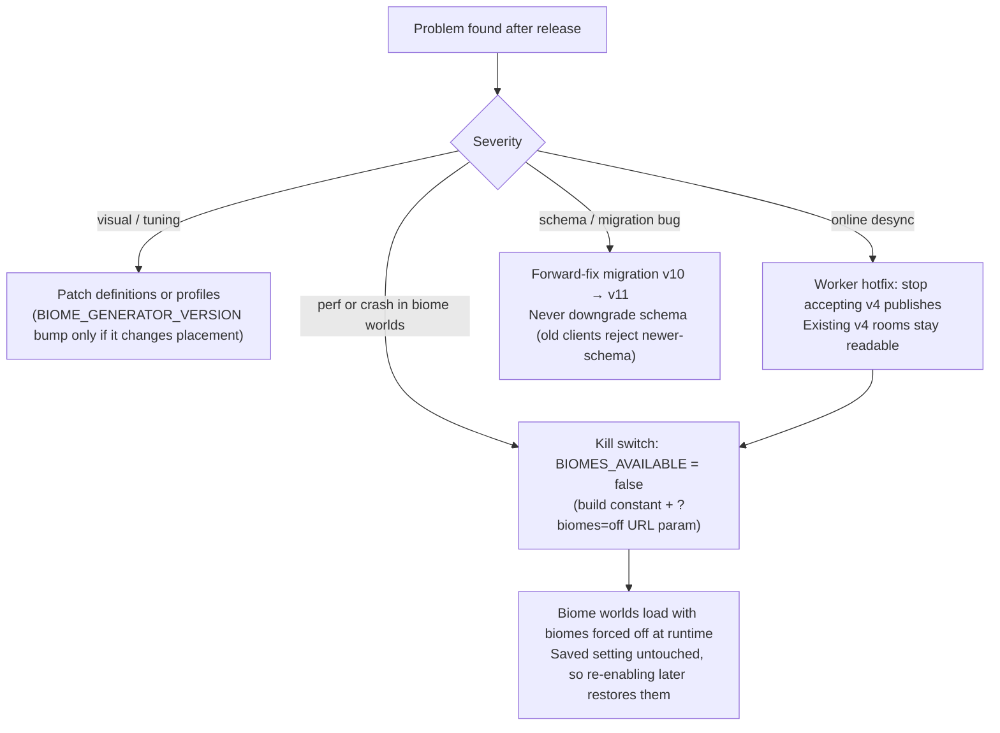
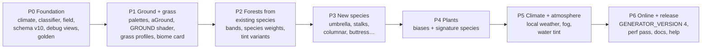

# Forest Drift — Biomes and Environments: Technical Plan

**Feature cycle:** 2026-11-12
**Status:** **Revision 8: Phases 0–6 built (2026-11-13).** Decisions are locked: you accepted every recommended default in [`01-questions-and-decisions.md`](01-questions-and-decisions.md). Building changed a few things in this plan. They're all listed in [§0](#0-changes-made-while-building-phase-0) and recorded in [`../phase-0/implementation.md`](../phase-0/implementation.md), [`../phase-1/implementation.md`](../phase-1/implementation.md), [`../phase-2-3/implementation.md`](../phase-2-3/implementation.md), [`../phase-4/implementation.md`](../phase-4/implementation.md), [`../phase-5/implementation.md`](../phase-5/implementation.md) and [`../phase-6/implementation.md`](../phase-6/implementation.md). The player and developer guide is [`docs/biomes.md`](../../../../biomes.md).
**Related:** [`00-brief.md`](00-brief.md) · [`01-questions-and-decisions.md`](01-questions-and-decisions.md)

Paths are relative to `pages/Forest-Drift/`.

---

## 0. Changes made while building Phase 0

1. **Online worlds published before biomes must keep opening.** `fetchOnlineWorld` required a published world's schema to equal the current one exactly, so bumping the save format to v10 would have locked players out of every world already published (as v9). It now accepts an explicit list, `ONLINE_COMPATIBLE_SCHEMA_VERSIONS = [9, 10]` in `WorldTypes.ts`. That's safe because 9 → 10 only adds biomes switched off, so a v9 and a v10 player generate the same world. The room still compares the schema the client sends from the published manifest, which is unchanged. Each future bump needs its own review before it's added.
2. **Uplands come from macro elevation, not the terrain's highlands landform.** Measured in Phase 0: the terrain's landform mask peaks every ~900 m, so its "highlands" are 300–400 m bumps, and its "mountains" weight covers flat ground wherever the mountain range mask adds no height. Classifying biomes from those weights scattered upland biomes across the map as spots. Biomes now use three classes (`landformClasses` in `BiomeClassifier.ts`): **upland** = raised plateaus from `sampleMacroElevation` (roughly the highest 15%), **mountain** = mountain weight × range mask (real ranges only), and **lowland** = the rest. Real mountain cores are 0.14 colder. `TerrainHeightSampler.sampleMacroElevation` and `sampleMountainRegionMask` became public, with no behaviour change.
3. **Real terrain is low, so altitude cooling starts at 6 m.** 99% of base terrain is under 15 m. Cooling that started at 20 m (this plan's first draft) almost never applied. It now starts at 6 m at 0.004 per metre, on top of the mountain cooling above.

**Phase 1 (2026-11-12):**

4. **The biome lattice is 16 m, not 8 m.** Classifying new lattice tiles is the costly part of a terrain chunk build. At 8 m a fresh chunk cost up to +25%; at 16 m (borders are 60–90 m wide, so interpolation stays smooth) it's +13% with a warm cache and +17% at worst. Single-biome cells skip interpolation entirely.
5. **No grass or plant generator version bumps.** Biome effects apply only when a world's biomes are on, and old worlds have them off, so pre-biome worlds generate exactly as before without touching `GRASS_GENERATOR_VERSION`.
6. **"Turn biomes on/off…" is a button with a confirmation dialog**, not a toggle: a checkbox would show the new state before the player confirmed. "Show biome names" lives in Graphics next to "Show locator bar", stored per browser the same way.

**Phases 2–3 (2026-11-12):**

7. **Biome forests replace the forest mask's on/off threshold.** Each biome has a density band (Plains 0–12%, Forest 55–85%, Dark Forest 85–100% …). Today's mask only picks a spot within the band (`getForestVariation`), and its clearings still cut glades. Overall tree count is slightly lower than without biomes (32.7% vs 36.4% of cells).
8. **Tint variants are separate, appended species ids** (`frostedSpruce`, `frostedPine`, `warmOak`), as §21 assumption 3 proposed. **Acacia uses the existing rounded-crown builder** (wide, squashed crown), so there's no `umbrella` kind. **No buttress option**: jungle giants use the existing root flare on a thicker trunk. The only new crown kinds are `stalks` (bamboo) and `columnar` (cactus).
9. **The determinism report gains `biomeTrees`** (tree cells in a biome world), checked in all three engines, ahead of Phase 6's generator-version bump.

**Phase 4 (2026-11-12):**

10. **Plants follow biomes at two levels.** Per 192 m region, the biome at its centre scales species counts, restricts pool families and adds signature plants. Per point, a blended density factor (new `ENV_DENSITY` plant-environment channel, exactly 1 without biomes) scales cover. Pool seeds are salted by biome only when biomes are on, so pre-biome worlds draw identical species, and no `PLANT_GENERATOR_VERSION` bump is needed.
11. **Signature plants are generated species with pinned overrides** (`plantSignatureSpecies.ts`: sunflower, reed, fern, dead shrub, pale bloom), not hand-built meshes, so every plant system works on them unchanged.

**Phase 5 (2026-11-12):**

12. **Weather is localised once, inside `WeatherSystem`.** The scheduled environment passes through `localizeWeather` (temperature → rain or snow, biome × precipitation), and particles, sound, wetness, snow cover and the sky look all read that one result. Forced weather is not localised (E14 confirmed as built). The protocol and saves are unchanged.
13. **Biome air is applied after the weather look** (`applyBiomeAtmosphere`), tinting horizon, haze and fog colours at constant brightness (≤ 30%) and dividing fog distances (≤ 1.7×). It's re-applied only while `LocalClimate` is still easing.
14. **Water tint is a per-vertex `aTint`** filled when river and lake meshes are built (white without biomes), not a world-space texture.

**Phase 6 (2026-11-13):**

15. **The Worker relabels pre-biome worlds only when their stored base has biomes off** (`baseHasBiomes`), checked when the room loads its manifest, so the first snapshot is already at generator 4. A v1–3 world with biomes on (which can only come from a mismatched client) keeps its old version.
16. **The kill switch is `BiomeField.isEnabled()`**: `BIOMES_AVAILABLE` (build constant) and `?biomes=off` (one session) in `biomeKillSwitch.ts`. Every biome system already asks the field, so one check covers them all, and the saved setting is never written.
17. **Dense biome species share one prototype from LOD2** (`sharedVariantsFromLod` on jungle giant and dark broadleaf; bamboo from LOD1). It's render-only: placement, saves and the determinism golden are unchanged, and pre-biome species still share only at LOD3. Added for the §13.1 draw-call budget in Bamboo Jungle.

Climate scales and box edges were tuned against the Q10 and Q14 targets. Results are in §4 and in [`../phase-0/implementation.md`](../phase-0/implementation.md).

## 1. Summary

- A new framework-free module, **`src/lib/game/biomes/`**, classifies every world point into a **blend of up to 3 biomes** from:
  - two new seeded **climate fields** (temperature and moisture) plus a **rarity field** for variants;
  - the **existing landform weights** (`TerrainHeightSampler.sampleBiomeWeights`: plains / hills / highlands / mountains);
  - **pre-water base elevation** (`sampleBase`). Higher is colder.
- Biomes are **data** (`BiomeDefinition`, 26 entries). Each one resolves into a numeric **profile** (ground palette, grass, forest band, tree-species weights, plant biases, climate, atmosphere) that is blended across borders.
- A shared **`BiomeField`** caches profiles on a world-aligned **8 m lattice**. Terrain colour, grass, plants and trees all read from it, so classification runs once per lattice point, not once per system.
- **Terrain height never changes** [Q7]. Rivers, lakes and buildings don't move. Old worlds migrate with biomes **off** [Q6].
- Weather keeps **one shared schedule**. Each client turns it into local rain, snow or dry from the climate under the camera [Q24].
- Online: **`GENERATOR_VERSION` 3 → 4**. v3 worlds are safe to relabel because biomes are off in them [Q30].

---

## 2. Existing system: relevant code, routes, storage and APIs

### 2.1 How the world is generated today



### 2.2 Relevant files

| Area             | File                                                                                                                                                                                                                                | Why it matters                                                                                                                            |
| ---------------- | ----------------------------------------------------------------------------------------------------------------------------------------------------------------------------------------------------------------------------------- | ----------------------------------------------------------------------------------------------------------------------------------------- |
| Landforms        | `src/lib/game/terrain/TerrainHeightSampler.ts`                                                                                                                                                                                      | `sampleBiomeWeights`, `sampleBase`, `sample`. The classifier reads these and **never** changes them.                                      |
| Terrain settings | `src/lib/game/terrain/TerrainSettings.ts`                                                                                                                                                                                           | `TerrainDebugView` union (adds `biomeMap`, `climate`). `BiomeSettings` here is the **landform** mask (the naming clash is handled in §9). |
| Chunk colour     | `src/lib/game/terrain/TerrainChunk.ts`, `terrainColor.ts`                                                                                                                                                                           | Per-vertex colour and the `aShore` attribute. Gains the biome ground palette and an `aGround` attribute.                                  |
| Terrain shader   | `src/lib/game/materials/shader/surfaceShader.ts` (`COVER`, `SHORE`), `buildingSurfaceStyles.ts` (`TERRAIN_SURFACE_STYLE`)                                                                                                           | Per-pixel ground layers. Gains a `GROUND` layer (snow, sand, soil/mud, litter).                                                           |
| Weather surface  | `src/lib/game/materials/shader/weatherSurface.ts`                                                                                                                                                                                   | Global `uWxSnow` / `uWxWet`. Local values come from the climate at the camera.                                                            |
| Forest density   | `src/lib/game/vegetation/VegetationRegionSampler.ts`, `VegetationTypes.ts`                                                                                                                                                          | Becomes variation _inside_ a biome's forest band.                                                                                         |
| Tree placement   | `src/lib/game/vegetation/TreePlacementGenerator.ts`                                                                                                                                                                                 | Calls `getForestDensity` per candidate. Gains biome band and species weights.                                                             |
| Tree species     | `trees/TreeSpeciesTypes.ts` (`TREE_SPECIES_IDS`, **append-only**), `treeSpecies.ts`, `TreeSpeciesSelector.ts`, `treePrototypeGenerator.ts`, `treeMeshKit.ts`, `treeCardAtlas.ts`                                                    | New species and canopy kinds.                                                                                                             |
| Grass            | `vegetation/grass/GrassRegionSampler.ts`, `GrassManager.ts` (env grid ~l.690), `grassPlacement.ts` (uses `writeTerrainColor` for tint), `GrassTypes.ts` (`GRASS_GENERATOR_VERSION`)                                                 | Grass profile per biome.                                                                                                                  |
| Plants           | `vegetation/plants/plantEcology.ts`, `plantPlacement.ts`, `PlantManager.ts` (8 m env grid ~l.778), `plantSpecies.ts`, `PlantTypes.ts` (`PLANT_GENERATOR_VERSION`)                                                                   | Biome-biased pools and signature species.                                                                                                 |
| Hydrology        | `hydrology/HydrologyTypes.ts`, `BaseTerrainSampler.ts`, `WaterRenderer.ts`, `WaterMaterial.ts`                                                                                                                                      | Unchanged geography. Water tint per biome comes later (phase 5).                                                                          |
| Weather          | `weather/WeatherTypes.ts`, `WeatherSystem.ts`, `PrecipitationController.ts`, `WeatherEnvironmentController.ts`, `WeatherAudio.ts`                                                                                                   | Local precipitation type and amount.                                                                                                      |
| Sky / fog        | `sky/SkySystem.ts`, `SkyTypes.ts`, `atmosphereMath.ts`                                                                                                                                                                              | Per-biome fog and tint offsets.                                                                                                           |
| Creatures        | `creatures/CreaturePopulationSystem.ts`                                                                                                                                                                                             | **Unchanged** in v1 [Q22].                                                                                                                |
| World save       | `world/WorldTypes.ts` (`CURRENT_WORLD_SCHEMA_VERSION = 9`, `WorldEnvironmentDefinition`), `WorldMigrationManager.ts`, `WorldValidation.ts`, `WorldSerializer.ts`, `WorldImportExport.ts`, `DefaultWorld.ts`                         | Schema v10 adds `environment.biomes`.                                                                                                     |
| Determinism      | `world/determinismReport.ts`, `world/__tests__/determinism-golden.json`, `tests/determinism.e2e.ts`                                                                                                                                 | Gains a `biomes` section.                                                                                                                 |
| Online           | `net/protocol.ts` (`GENERATOR_VERSION = 3`, `PROTOCOL_VERSION = 8`), `net/worldTransfer.ts`, `net/NetSession.ts`, `net/sharedEnvironment.ts`, `server/src/generatorMigration.ts`, `server/src/WorldRoom.ts`, `server/src/worker.ts` | Generator version 4.                                                                                                                      |
| Settings UI      | `settings/settingsCatalog.ts` (land settings locked online via `lockOnlineSettings`), `GameSettingsHost.ts`, `components/SettingsMenu.svelte`                                                                                       | New "Biomes" group and debug views.                                                                                                       |
| World creation   | `components/WorldsScreen.svelte` (`onCreate(name, seed)`), `world/WorldManager.ts`                                                                                                                                                  | "Biome size" choice [Q23].                                                                                                                |
| HUD              | `src/routes/+page.svelte`, `components/PauseMenu.svelte`, `components/LocatorBar.svelte` (pattern for HUD fed from `ThreeScene`)                                                                                                    | New `BiomeIndicator.svelte`.                                                                                                              |
| Orchestration    | `src/lib/game/ThreeScene.ts`                                                                                                                                                                                                        | Constructs samplers and managers and wires seed changes.                                                                                  |

### 2.3 Routes, storage and APIs

| Kind                | What exists                                                                                                                                                            | Change                                                                               |
| ------------------- | ---------------------------------------------------------------------------------------------------------------------------------------------------------------------- | ------------------------------------------------------------------------------------ |
| SvelteKit routes    | `src/routes/+page.svelte`, `+layout.svelte`: a single-page game.                                                                                                       | None. A HUD component is added inside the existing page.                             |
| Client storage      | IndexedDB (`IndexedDbWorldRepository.ts`): stores `worldMeta`, `worlds`, `thumbnails`.                                                                                 | **No new stores.** The world record grows by about 250 bytes (`environment.biomes`). |
| Local preferences   | `localStorage`-backed stores (graphics, tutorials, key bindings and others).                                                                                           | One new personal preference: "Show biome names" [Q28].                               |
| Server (Cloudflare) | Worker routes `POST /w`, `GET /w/:id/snapshot`, `/ws`, `/export`, `/restore-points`, `POST /restore`, `/usage`, `/health`. Durable Object `WorldRoom` keeps snapshots. | **No new routes or bindings.** Generator-version relabel rule only (§10).            |
| Database tables     | No SQL/D1 database. World state lives in IndexedDB (client) and Durable Object storage (server).                                                                       | None.                                                                                |
| External services   | None for generation.                                                                                                                                                   | None.                                                                                |

---

## 3. Architecture and data flow

### 3.1 New data flow



The direction of dependency matters. Biomes **read** terrain (`sampleBase`, landform weights) and **never** hydrology or final height. Hydrology doesn't read biomes. So there's no cycle, and neither shovel edits nor river carving can ever change which biome a point is in.

### 3.2 Chunk generation with biomes



### 3.3 Local weather from climate

```mermaid
sequenceDiagram
    autonumber
    participant Room as Owner / room clock
    participant WS as WeatherSystem
    participant LC as LocalClimate
    participant PC as PrecipitationController
    participant SH as weatherSurface uniforms

    Room-->>WS: shared WeatherState (e.g. rain 0.7)
    loop every frame
        WS->>LC: climateAt(camera x,z) (BiomeField lookup, smoothed ~4 s)
        LC-->>WS: { temperature, aridity, precipitationScale }
        alt temperature below snow line
            WS->>PC: particles = snow, amount × scale
            WS->>SH: uWxSnow ↑, uWxWet ↓
        else aridity above dry line (desert)
            WS->>PC: no particles; dry haze
            WS->>SH: uWxWet → 0
        else
            WS->>PC: rain, amount × scale (jungle/swamp heavier)
        end
    end
    Note over WS: Shared state is never modified, so there's no protocol change.<br/>Owner-forced weather bypasses the modulation (§14, E14)
```

---

## 4. Climate and biome classification

### 4.1 Inputs at a point

| Input        | Source                                                                                                                                                                                                                                     | Range  |
| ------------ | ------------------------------------------------------------------------------------------------------------------------------------------------------------------------------------------------------------------------------------------ | ------ |
| `t` temp     | Single-octave simplex `climateTemperature`, domain-warped (`climateWarpX/Z`), scale = `climateScale × 13`, equal-area remapped, + `temperatureBias`, at a spawn-shifted domain, − 0.004 × `max(0, baseHeight − 6)` − 0.14 × mountain class | 0..1   |
| `m` moisture | Single-octave simplex `climateMoisture`, scale = `climateScale × 10`, equal-area remapped, + `moistureBias`                                                                                                                                | 0..1   |
| `r` rarity   | Simplex `biomeRarity`, scale = `climateScale × 3`                                                                                                                                                                                          | 0..1   |
| landform     | Lowland / upland / mountain classes (§0): upland from macro elevation (plateaus), mountain from the terrain's mountain weight × mountain range mask                                                                                        | sums 1 |
| elevation    | `sampleBase` (pre-water, pre-edit)                                                                                                                                                                                                         | metres |

All noise names are new and distinct from every existing seed name (`biome`, `forestRegion`, `treeSpeciesRegion` and the others), so climate doesn't correlate with landform except through the deliberate elevation lapse.

`climateScale` comes from Biome size [Q10]: Small 450, **Normal 750**, Large 1500 (metres, typical biome diameter).

**Spawn guarantee [Q21].** In `setSeed`, compute `t` and `m` at the origin and add the offsets that move them to the temperate centre (`t = 0.5`, `m = 0.5`). This is deterministic from the seed.

**Cross-engine safety.** The determinism report shows that exact terrain hashes already differ between engines. Classification therefore **quantises** `t`, `m` and `r` to 1/4096 and landform weights to 1/1024 before scoring, so a last-bit difference can't flip a tree's species at a border.

### 4.2 Scoring



- `band(v; lo, hi, feather)` = `smoothstep(lo − f, lo + f, v) × (1 − smoothstep(hi − f, hi + f, v))`.
- `landformAffinity` = dot(landform weights, the biome's 4-vector). For example Meadow `[0.1, 0.4, 1, 0.3]`, Snowy Slopes `[0, 0, 0.3, 1]`.
- `variantGate`: a variant biome needs `r > 1 − rarity` (feathered). Its parent gets the complement, so together they cover the parent's envelope [Q12].
- `sharpness` controls border width (default 3). The resulting blend band is about 40–80 m.
- Discrete choices (which tree species pool, which signature plant) use a **per-cell hash dither** between the top-3 ids by weight, so borders interleave naturally instead of forming a line.

### 4.3 Climate placement (lowland view)



The landform decides the rest. On **highlands**: Meadow (temperate), Windswept Hills (cool, drier), Savanna Plateau (warm, dry), Grove (cold). On **mountains**: Snowy Slopes (cold or high), Grove on lower cold slopes, Windswept Hills on lower temperate slopes. Variants sit inside their parents: Sunflower Plains, Flower Forest, Old Growth Birch, Silverwood (Dark Forest), Cherry Grove (Meadow) and Bamboo Jungle.

Cold and hot envelopes are separated by at least `0.2` in `t` (wider than two feathers), so they can never blend directly [Q13].

---

## 5. Biome definitions (the 26)

> **Phase 0 note:** the climate and landform columns below are the first draft. The tuned values live in `src/lib/game/biomes/biomeDefinitions.ts`, which is the source of truth. The other columns are the targets for Phases 1–5.

Forest band = the range the biome maps today's forest density into (§6.4). New tree species are in **bold**. Draft palette and numbers will be tuned with screenshots.

| #   | id                     | Name [Q2]               | Climate (t / m)       | Landform / elevation     | Parent       | Ground                               | Grass                     | Trees (forest band)                                      | Plants                                  | Weather            | Atmosphere                        |
| --- | ---------------------- | ----------------------- | --------------------- | ------------------------ | ------------ | ------------------------------------ | ------------------------- | -------------------------------------------------------- | --------------------------------------- | ------------------ | --------------------------------- |
| 1   | `forest`               | Forest                  | 0.42–0.6 / 0.5–0.72   | plains, hills            | —            | leaf-litter green-brown              | medium, cool green        | oak, birch (0.55–0.85)                                   | shade flowers, ferns                    | rain               | neutral                           |
| 2   | `flowerForest`         | Flower Forest           | as Forest             | plains, hills            | Forest       | green, flower tint                   | medium                    | oak, ornamental, birch (0.35–0.6)                        | ×2 flower species, dense colonies       | rain               | warm light                        |
| 3   | `birchForest`          | Birch Forest            | 0.34–0.48 / 0.45–0.65 | plains, hills            | —            | pale green                           | medium, light             | birch (0.5–0.8)                                          | white/yellow flowers                    | rain               | bright                            |
| 4   | `oldGrowthBirch`       | Old Growth Birch Forest | as Birch              | plains, hills            | Birch Forest | mossy green                          | medium                    | **tall birch** (0.6–0.85)                                | ferns                                   | rain               | soft haze                         |
| 5   | `darkForest`           | Dark Forest             | 0.4–0.56 / 0.72–0.9   | plains, hills            | —            | dark loam, moss                      | sparse, dim               | **dark broadleaf**, oak (0.85–1)                         | ferns, few shade flowers                | rain               | darker, light fog                 |
| 6   | `silverwood`           | Silverwood [Q2, Q4]     | as Dark Forest        | plains, hills            | Dark Forest  | desaturated grey-green               | sparse, pale              | **pale tree** (0.7–0.95)                                 | **pale bloom**                          | rain, mist         | low mist, desaturated             |
| 7   | `sunlitWood`           | Sunlit Wood [Q2, Q3]    | 0.5–0.62 / 0.45–0.6   | hills                    | —            | patchy light/shadow green            | medium                    | oak, birch, ornamental, many clearings (0.4–0.65)        | low flowers                             | rain               | warm light                        |
| 8   | `taiga`                | Taiga                   | 0.2–0.34 / 0.5–0.85   | plains → highlands       | —            | needle litter, podzol brown          | short, cool               | spruce, pine, Scots pine (0.6–0.9)                       | ferns, low ground tufts                 | rain, snow if cold | cool tint                         |
| 9   | `snowyTaiga`           | Snowy Taiga             | 0.04–0.2 / 0.45–0.85  | plains → highlands       | —            | **snow**                             | sparse, poking through    | **frosted spruce**, **frosted pine** (0.5–0.8)           | very sparse                             | snow               | cold blue, light haze             |
| 10  | `jungle`               | Jungle                  | 0.8–1 / 0.72–1        | plains, hills            | —            | dark rich soil, deep green           | tall, lush                | **jungle giant**, ornamental (0.85–1)                    | ferns, broadleaf, bright flowers        | heavy rain         | humid haze                        |
| 11  | `sparseJungle`         | Sparse Jungle           | 0.76–0.95 / 0.55–0.75 | plains, hills            | (edge band)  | green                                | tall                      | **jungle giant**, ornamental (0.35–0.6)                  | broadleaf, flowers                      | rain               | lighter haze                      |
| 12  | `bambooJungle`         | Bamboo Jungle           | as Jungle             | plains, hills            | Jungle       | green, leaf litter                   | lush                      | **bamboo**, **jungle giant** (0.8–1)                     | ferns                                   | heavy rain         | humid haze                        |
| 13  | `meadow`               | Meadow                  | 0.36–0.6 / 0.4–0.7    | highlands (20–60 m)      | —            | bright green                         | tall, dense meadow        | lone trees (0–0.1)                                       | many flowers                            | rain               | clear                             |
| 14  | `cherryGrove`          | Cherry Grove            | as Meadow             | highlands                | Meadow       | green, pink petal patches            | meadow                    | **cherry blossom** (0.25–0.5)                            | pink flowers                            | rain               | soft pink-warm tint               |
| 15  | `grove`                | Grove                   | 0.08–0.3 / 0.35–0.8   | highlands, low mountains | —            | **snow**                             | sparse                    | **frosted spruce** (0.45–0.75)                           | almost none                             | snow               | cold                              |
| 16  | `snowySlopes`          | Snowy Slopes            | 0–0.2 / any           | mountains, high          | —            | **snow**, rock on steep              | none                      | rare **frosted spruce** (0–0.05)                         | none                                    | snow, windy        | bright, cold                      |
| 17  | `windsweptHills`       | Windswept Hills         | 0.24–0.4 / 0.2–0.55   | highlands, low mountains | —            | grey-green, gravel and stone patches | short, wind-bent          | sparse Scots pine, spruce, **warm oak** tint (0.05–0.25) | hardy low flowers                       | rain/snow, windier | grey, cool                        |
| 18  | `plains`               | Plains                  | 0.42–0.62 / 0.3–0.55  | plains                   | —            | today's green                        | dense meadow (today)      | lone oak/birch (0–0.12)                                  | today's pool                            | rain               | neutral (today)                   |
| 19  | `sunflowerPlains`      | Sunflower Plains        | as Plains             | plains                   | Plains       | warm green                           | dense                     | lone oak (0–0.08)                                        | **sunflower** fields                    | rain               | warm light                        |
| 20  | `snowyPlains`          | Snowy Plains            | 0–0.16 / 0.1–0.5      | plains, hills            | —            | **snow**                             | very sparse               | rare **frosted spruce** (0–0.06)                         | none                                    | snow               | cold, bright                      |
| 21  | `desert`               | Desert                  | 0.86–1 / 0–0.16       | plains, hills            | —            | **sand**                             | none / rare dry tufts     | **cactus** (0–0.04)                                      | **dead shrub**, succulents              | dry haze, no rain  | warm glare haze                   |
| 22  | `savanna`              | Savanna                 | 0.7–0.86 / 0.18–0.4   | plains, hills            | —            | golden olive                         | tall, golden              | **acacia** (0.05–0.2)                                    | dry flowers, tufts                      | occasional rain    | warm                              |
| 23  | `savannaPlateau`       | Savanna Plateau         | 0.7–0.9 / 0.15–0.4    | highlands (+ macro high) | —            | golden olive, red-soil patches       | tall, golden              | **acacia** (0.1–0.25)                                    | dry flowers                             | occasional rain    | warm                              |
| 24  | `swamp`                | Swamp                   | 0.52–0.75 / 0.85–1    | plains, low (< 8 m)      | —            | dark **mud**, wet patches            | lush, tall                | **swamp tree**, willow (0.4–0.7)                         | **reeds/cattails**, broadleaf           | heavy rain         | green-grey mist, dark water [Q16] |
| 25  | `shrubSavanna`         | Shrub Savanna           | 0.76–0.92 / 0.06–0.22 | plains, hills            | —            | dusty tan                            | sparse, short             | very sparse **acacia** (0–0.06)                          | **dead shrub**, succulents, dense tufts | rare rain          | dusty haze                        |
| 26  | `tropicalDryGrassland` | Tropical Dry Grassland  | 0.72–0.9 / 0.38–0.56  | plains                   | —            | yellow-green                         | tall, dense, yellow-green | rare acacia, ornamental (0–0.08)                         | dry flowers                             | moderate rain      | warm                              |

**Distinctness check [Q5].** The look-alike groups are separated as follows:

- **Forest / Birch / Sunlit Wood:** trees (oak-mixed vs birch vs open mixed), ground (litter vs pale vs patchy) and atmosphere.
- **Savanna / Shrub Savanna / Tropical Dry Grassland:** grass (golden tall vs sparse vs yellow-green dense), trees (acacia vs almost none vs rare) and plants (tufts vs shrubs vs flowers).
- **Snowy Plains / Grove / Snowy Slopes:** landform, trees and wind.

---

## 6. Integration per system

### 6.1 Profiles and the `BiomeField`

- `BiomeProfiles.ts` defines a **fixed numeric layout**: an index into a `Float32Array` per lattice point, about 48 floats. It holds the ground palette (low/mid/high RGB, dry/lush tints), `aGround` amounts (snow, sand, soil/mud, litter), grass (density, height, warmth, shortness), forest band (lo, hi), tree-species weights (one per `TREE_SPECIES_IDS` entry), plant biases (flower ×, ground ×, family mask as float flags, signature-species weights), climate (temperature, aridity, precipitation scale, wind ×) and atmosphere (fog RGB offset, fog density ×, tint). It also stores the dominant id and the top-3 ids and weights as small ints/floats for discrete choices.
- `BiomeField` stores **tiles of 9 × 9 lattice points at 8 m (64 m tiles)** in an LRU keyed by tile coordinate. Default capacity is 512 tiles (about 8 MB worst case at 48 floats × 4 B × 81 × 512). `profileAt(x, z, out)` bilinear-interpolates continuous fields into a caller-owned scratch. `idsAt(x, z)` returns the nearest lattice point's top-3 ids and weights.
- Lattice points are world-aligned (`floor(x / 8)`), so every chunk, grass chunk and plant chunk reads identical values at shared coordinates. Seams are impossible by construction, the same argument as terrain seams in the README.
- With biomes **disabled**, `BiomeField` returns the **legacy profile**: exactly today's constants and behaviour. Every integration point checks `enabled` once per chunk and takes the old code path, so the output stays bit-identical (verified by the golden, §17).

### 6.2 Terrain ground (phase 1)

- `writeTerrainColor` gains an optional `ground: GroundProfile` argument. Today's constants (`LOW`, `MID`, `HIGH`, `WARM_GRASS`, `DRY`, `LUSH`, `EARTH`) become the **legacy profile**, so the old call path is unchanged.
- **Snow:** ground snow = `profile.snow × smoothstep(0.6, 0.85, normalY)`. Steep faces stay rock, as today.
- `TerrainChunk` writes a new `aGround` vec4 attribute (snow, sand, soil/mud, litter) next to `aShore`, using the same dirty-region update path.
- `surfaceShader.ts` gains a `GROUND` GLSL block, layered in the terrain `cover` shader like `SHORE`: per-pixel snow sparkle and drift noise, sand ripples, cracked dry soil, leaf litter. The weather snow layer combines as `max(uWxSnow × exposure, aGround.x)`, so weather snow and biome snow don't double up.
- Flat-materials mode (`proceduralMaterials = false`) uses vertex colours only, matching the existing toggle.

### 6.3 Grass (phase 1)

- `sampleGrassRegion(biome, forest, height, out)` gains a `GrassProfile`. Density, height bias, warmth and shortness come from the biome and are then modulated by today's forest and elevation terms. Grass colour already comes from `writeTerrainColor` in `grassPlacement.ts`, so it follows the biome ground automatically.
- In desert (density 0), grass chunks short-circuit and draw nothing, which saves cost.
- `GRASS_GENERATOR_VERSION` 1 → 2, **only** applied when biomes are enabled (`settings.generatorVersion || …` already exists).

### 6.4 Forest density and trees (phases 2–3)

- `TreePlacementGenerator`: `density = lerp(band.lo, band.hi, shape(today's forestDensity))`. Today's mask still provides clearings, edges and clusters inside the band. Open biomes (Plains, Meadow, Desert) keep "lone trees" through the low band. Slope, treeline, water clearance (`TREE_WATER_CLEARANCE`) and building clearance are unchanged.
- `TreeSpeciesSelector.weightsAt` gets the biome's species weight vector. When biomes are on, it replaces the conifer/broadleaf/elevation formula. The stand logic (groves of one species) stays, so a biome can still have birch copses inside a forest.
- **Tree ids stay `(seed, cellX, cellZ)`**, so `removedTreeIds` keep working when a cell's species changes [Q6].
- New species are **appended** to `TREE_SPECIES_IDS`, never reordered [Q17]: `darkBroadleaf, tallBirch, jungleGiant, bamboo, acacia, cherry, paleTree, swampTree, cactus, frostedSpruce, frostedPine, warmOak`. The last three reuse existing rules with a different `TreeStyle`, so they need no new geometry.
- New canopy and trunk kinds in `TreeSpeciesTypes.ts`, `treePrototypeGenerator.ts`, `treeMeshKit.ts` and `treeCardAtlas.ts`:
  - `umbrella`: a flat, wide crown on a forked trunk (acacia).
  - `stalks`: a cluster of thin segmented culms with leaf sprays (bamboo).
  - `columnar`: a ribbed column with arms (cactus). No foliage cards, cheap LOD.
  - `buttress`: a trunk option for jungle giants.
- Collision uses the existing per-tree trunk collider. Bamboo uses one collider per clump, and cactus one per column.

### 6.5 Plants (phase 4)

- `PlantEnvironment` gains `cold`, `aridity`, `flowerBias` and `familyMask` from the profile. `plantSuitability` multiplies by family allowance (desert: succulent, ground-tuft; snow: ground-tuft only, very low).
- `PlantEcology.regionSpecies` scales the flower and ground counts by the region-centre biome's biases, and appends **fixed signature species** (`plantSignatureSpecies.ts`: sunflower, reed/cattail, fern, dead shrub, pale bloom) with their biome weights [Q19].
- `PLANT_GENERATOR_VERSION` 1 → 2, used only when biomes are on.

### 6.6 Weather, fog and water (phase 5)

- `LocalClimate` samples the `BiomeField` at the camera and smooths it with a ~4 s exponential time constant. It's frame-rate independent and allocates nothing.
- `WeatherSystem` keeps the shared `WeatherState`. It derives **local** precipitation type and scale (§3.3) and drives `PrecipitationController` and the `weatherSurface` uniforms. `WeatherAudio` follows the local type (no rain hiss in the desert).
- `SkySystem` applies capped fog colour/density offsets and a tint from the atmosphere profile [Q26].
- Water tint (swamp darker and greener, cold water bluer): `WaterRenderer` writes a per-vertex tint from the `BiomeField` when it builds river and lake meshes. Visual only [Q16].

### 6.7 HUD and settings (phase 1)

- `BiomeTracker` reads the dominant id at the camera each frame (a lattice lookup), with hysteresis: a new id must hold for 3 s, and the card shows at most once per 20 s.
- `BiomeIndicator.svelte` shows the card and has an `aria-live="polite"` region (§15). `PauseMenu.svelte` shows "You're in: Snowy Taiga".
- `settingsCatalog.ts` gets a **"Biomes"** group in the **land** category (so `lockOnlineSettings` locks it online): Enabled (with confirmation), Biome size, Temperature bias, Moisture bias, Variant rarity, Border softness. There's also a personal **"Show biome names"** toggle, and `TerrainDebugView` gains `biomeMap` and `climate` [Q29].
- `WorldsScreen.svelte` Create dialog gets a "Biome size" select (Small / Normal / Large) [Q23]. `onCreate(name, seed, { biomeSize })` passes it to `WorldManager`.

---

## 7. New files likely to be created

| File                                                       | Purpose                                                                                                                                      |
| ---------------------------------------------------------- | -------------------------------------------------------------------------------------------------------------------------------------------- |
| `src/lib/game/biomes/BiomeTypes.ts`                        | `BiomeId`, `BIOME_IDS` (append-only), `BiomeSettings`, `BiomeDefinition`, `BIOME_GENERATOR_VERSION`, defaults, `createLegacyBiomeSettings()` |
| `src/lib/game/biomes/biomeDefinitions.ts`                  | The 26 definitions (envelopes, affinities, profile inputs)                                                                                   |
| `src/lib/game/biomes/ClimateSampler.ts`                    | Seeded temperature/moisture/rarity fields, warp, lapse, spawn offset, quantisation                                                           |
| `src/lib/game/biomes/BiomeClassifier.ts`                   | Envelope scoring, top-3, sharpness, fallback; no allocation                                                                                  |
| `src/lib/game/biomes/BiomeProfiles.ts`                     | Profile vector layout, per-biome resolved profiles, legacy profile, blending                                                                 |
| `src/lib/game/biomes/BiomeField.ts`                        | 8 m lattice tiles, LRU, bilinear `profileAt`, `idsAt`, invalidate on seed/settings change                                                    |
| `src/lib/game/biomes/BiomeTracker.ts`                      | Camera biome with hysteresis for the HUD                                                                                                     |
| `src/lib/game/biomes/LocalClimate.ts`                      | Smoothed climate and atmosphere at the camera for weather and sky                                                                            |
| `src/lib/game/biomes/biomeDebugColor.ts`                   | Debug palette per biome; climate view colouring                                                                                              |
| `src/lib/game/biomes/__tests__/*.spec.ts`                  | See §17                                                                                                                                      |
| `src/lib/game/vegetation/plants/plantSignatureSpecies.ts`  | Fixed sunflower, reed, fern, dead shrub, pale bloom definitions                                                                              |
| `src/lib/components/BiomeIndicator.svelte`                 | Biome name card + live region                                                                                                                |
| `tests/biomes.e2e.ts`                                      | Card, toggle, old world unchanged, debug view                                                                                                |
| `tests/biomePerformance.e2e.ts`                            | Chunk-generation and frame-time budget [Q32]                                                                                                 |
| `docs/biomes.md`                                           | System documentation (README-style), written at the end                                                                                      |
| `docs/2026/11-12/Biomes-and-Enviroments/implementation.md` | Implementation record, screenshots, perf JSON                                                                                                |

## 8. Existing files likely to be changed

| File                                                                                                                                                                                                      | Change                                                                                                        |
| --------------------------------------------------------------------------------------------------------------------------------------------------------------------------------------------------------- | ------------------------------------------------------------------------------------------------------------- |
| `src/lib/game/terrain/TerrainSettings.ts`                                                                                                                                                                 | Add `'biomeMap' \| 'climate'` to `TerrainDebugView`                                                           |
| `src/lib/game/terrain/TerrainChunk.ts`                                                                                                                                                                    | Read `BiomeField`; ground profile in colour; `aGround` attribute; debug views                                 |
| `src/lib/game/terrain/terrainColor.ts`                                                                                                                                                                    | `GroundProfile` parameter; legacy constants become the legacy profile                                         |
| `src/lib/game/terrain/TerrainManager.ts`                                                                                                                                                                  | Pass `BiomeField`; regenerate chunks when biome settings change                                               |
| `src/lib/game/materials/shader/surfaceShader.ts`                                                                                                                                                          | `GROUND` layer; combine with weather snow                                                                     |
| `src/lib/game/materials/shader/weatherSurface.ts`                                                                                                                                                         | Accept local snow/wet values                                                                                  |
| `src/lib/game/vegetation/grass/GrassRegionSampler.ts`, `GrassManager.ts`, `GrassTypes.ts`                                                                                                                 | Grass profile; version gate                                                                                   |
| `src/lib/game/vegetation/plants/plantEcology.ts`, `plantPlacement.ts`, `PlantManager.ts`, `PlantTypes.ts`                                                                                                 | Biome env fields, pool biasing, signature species, version gate                                               |
| `src/lib/game/vegetation/TreePlacementGenerator.ts`, `VegetationRegionSampler.ts`                                                                                                                         | Forest band mapping                                                                                           |
| `src/lib/game/vegetation/trees/TreeSpeciesTypes.ts`, `treeSpecies.ts`, `TreeSpeciesSelector.ts`, `treePrototypeGenerator.ts`, `treeMeshKit.ts`, `treeCardAtlas.ts`, `TreePrototypeCache.ts`, `TreeLab.ts` | New species and canopy kinds; biome weights                                                                   |
| `src/lib/game/hydrology/WaterRenderer.ts`, `WaterMaterial.ts`                                                                                                                                             | Per-vertex biome water tint (phase 5)                                                                         |
| `src/lib/game/weather/WeatherSystem.ts`, `PrecipitationController.ts`, `WeatherAudio.ts`, `WeatherTypes.ts`                                                                                               | Local precipitation from `LocalClimate`; retire the `allowSnow` "no climate yet" caveat only for biome worlds |
| `src/lib/game/sky/SkySystem.ts`, `SkyTypes.ts`                                                                                                                                                            | Atmosphere offsets                                                                                            |
| `src/lib/game/world/WorldTypes.ts`                                                                                                                                                                        | `CURRENT_WORLD_SCHEMA_VERSION = 10`; `environment.biomes`                                                     |
| `src/lib/game/world/WorldMigrationManager.ts`                                                                                                                                                             | Step 9 → 10                                                                                                   |
| `src/lib/game/world/WorldValidation.ts`                                                                                                                                                                   | Validate and clamp `BiomeSettings`                                                                            |
| `src/lib/game/world/WorldManager.ts`, `WorldSession.ts`                                                                                                                                                   | Create with biome size; apply on load                                                                         |
| `src/lib/game/world/determinismReport.ts`, `__tests__/determinism-golden.json`                                                                                                                            | `biomes` section (regenerated golden)                                                                         |
| `src/lib/game/net/protocol.ts`, `worldTransfer.ts`                                                                                                                                                        | `GENERATOR_VERSION = 4`                                                                                       |
| `server/src/generatorMigration.ts`, `server/src/WorldRoom.ts`                                                                                                                                             | v3 → v4 relabel only when biomes are absent or disabled                                                       |
| `src/lib/game/settings/settingsCatalog.ts`, `GameSettingsHost.ts`, `personalSettingsCatalog.ts`                                                                                                           | Biomes group (land), debug views, "Show biome names"                                                          |
| `src/lib/components/WorldsScreen.svelte`, `PauseMenu.svelte`, `ControlsGuide.svelte` / `HelpCredits.svelte`                                                                                               | Biome size; current biome; help text                                                                          |
| `src/routes/+page.svelte`                                                                                                                                                                                 | Mount `BiomeIndicator`                                                                                        |
| `src/lib/game/ThreeScene.ts`                                                                                                                                                                              | Construct `ClimateSampler` / `BiomeField` / `BiomeTracker` / `LocalClimate`; seed wiring; disposal            |
| `README.md`                                                                                                                                                                                               | "Biomes" section; correct "Terrain regions" naming (landforms vs biomes)                                      |
| Tests next to each changed module                                                                                                                                                                         | See §17                                                                                                       |

---

## 9. Data model changes

### 9.1 Types

```ts
// src/lib/game/biomes/BiomeTypes.ts (shape only, not implementation)
export const BIOME_GENERATOR_VERSION = 1;

export type BiomeSize = 'small' | 'normal' | 'large';

/** Saved in the world. Generation-defining, so it's locked online like other land settings. */
export interface BiomeSettings {
	enabled: boolean;
	generatorVersion: number; // BIOME_GENERATOR_VERSION when created
	size: BiomeSize; // → climateScale 450 / 750 / 1500 m
	temperatureBias: number; // -0.3 … 0.3
	moistureBias: number; // -0.3 … 0.3
	variantRarity: number; // 0 … 0.4 (default 0.15)
	borderSharpness: number; // 1 … 6 (default 3)
	spawnTemperate: boolean; // default true
}
```

- `WorldEnvironmentDefinition.biomes: BiomeSettings` is **required** from schema 10.
- **Naming.** `TerrainSettings.biome` (the landform mask) keeps its name for save compatibility. Code and docs call it the _landform mask_ from now on, and the new type lives in its own module to avoid confusion.
- **Nothing per biome, tile, tree or plant is saved.** Save size grows by about 250 bytes per world.

### 9.2 Migration v9 → v10



- New worlds: `createDefaultBiomeSettings()` with `enabled: true`.
- Bundled Main World: migrates to `enabled: false` [Q8].
- Validation clamps every number, rejects non-finite values, and maps unknown `size` values to `'normal'`. Unknown extra keys are dropped, following the `sharedEnvironment` defensive pattern.

---

## 10. API and protocol changes

| Surface                    | Change                                                                                                                                                                                                                         |
| -------------------------- | ------------------------------------------------------------------------------------------------------------------------------------------------------------------------------------------------------------------------------ |
| HTTP routes (Worker)       | **None.**                                                                                                                                                                                                                      |
| WebSocket protocol         | **None.** `PROTOCOL_VERSION` stays 8. Weather stays shared exactly as today. Local modulation is client-side. Online worlds published at schema 9 keep opening (§0, change 1).                                                 |
| `GENERATOR_VERSION`        | **3 → 4.** Published manifests carry it. `worldTransfer.ts` keeps rejecting mismatches.                                                                                                                                        |
| Server relabel             | `generatorMigration.ts`: relabel v3 → v4 **only if** the world's `environment.biomes` is absent or `enabled !== true`. Those worlds generate identically, so this is safe. Never blindly relabel (existing rule in that file). |
| Internal TS APIs (new)     | `ClimateSampler.setSeed/sample`, `BiomeClassifier.classify(input, out)`, `BiomeField.profileAt(x, z, out)`, `idsAt(x, z, out)`, `invalidate()`, `BiomeTracker.update(x, z, dt)`, `LocalClimate.update(x, z, dt)`               |
| Internal TS APIs (changed) | `writeTerrainColor(..., ground?)`, `sampleGrassRegion(..., profile?)`, `PlantEnvironment` (+fields), `TreeSpeciesSelector.weightsAt(site, profile?)`, `WorldsScreen.onCreate(name, seed, options?)`                            |



**Deploy order:** Worker first (accepts and relabels v4), then the site, the same order as the previous generator bump. There's a kill switch (§18).

---

## 11. Authentication and authorization

- **No new roles, accounts or tokens.** Biome settings are world-generation settings in the existing **land** category. `lockOnlineSettings` already locks land for everyone in online worlds ("Locked in online worlds so everyone walks on the same land"). To change biomes online, the owner edits their local copy and publishes again. Owner-only publish authority is unchanged.
- Viewers and editors can't change biomes. The only per-player choice is the personal "Show biome names" preference, stored locally.
- Local weather modulation and fog are computed by each client from shared, locked data. No player can push a climate onto another.

## 12. Security and privacy risks

| Risk                                                                                                                                     | Mitigation                                                                                                                                                                                     |
| ---------------------------------------------------------------------------------------------------------------------------------------- | ---------------------------------------------------------------------------------------------------------------------------------------------------------------------------------------------- |
| A malicious imported or online world sets extreme values (tiny `climateScale`, NaN, huge sharpness) to stall generation or crash shaders | Settings use an enum `size`, not a raw scale. All numbers are clamped and finite-checked in `WorldValidation`. The classifier caps work at 26 envelopes per lattice point regardless of input. |
| Prototype pollution through `environment.biomes`                                                                                         | Same defensive copy as `sharedEnvironment.ts` (`FORBIDDEN_KEYS`). Only known keys are copied.                                                                                                  |
| Unknown biome ids in future saves                                                                                                        | Ids aren't saved. Only settings are. `BIOME_IDS` is append-only, and a newer generator version is gated by `GENERATOR_VERSION`.                                                                |
| Privacy                                                                                                                                  | No personal data is involved. The biome name is shown locally and never sent. No analytics. Seeds are shared exactly as today.                                                                 |
| Supply chain                                                                                                                             | No new dependencies. `simplex-noise` is already used.                                                                                                                                          |

## 13. Performance

### 13.1 Budgets [Q32]

| Metric                                         | Budget                           | How measured                                                     |
| ---------------------------------------------- | -------------------------------- | ---------------------------------------------------------------- |
| Terrain + vegetation chunk generation, p95     | ≤ +15% vs today                  | `tests/biomePerformance.e2e.ts`, existing perf harness pattern   |
| Median frame time while running across borders | ≤ +0.5 ms                        | Same, `high` and `low` presets                                   |
| Per-frame allocations                          | 0 new                            | Unit tests on hot paths (pattern used by `TerrainHeightSampler`) |
| Draw calls, densest biome (Jungle/Bamboo)      | ≤ +10% vs today's densest forest | `treePerformance` / `plantPerformance` harnesses                 |
| `BiomeField` memory                            | ≤ 8 MB                           | LRU cap test                                                     |
| GPU: terrain fragment cost                     | ≤ +10%                           | Shader A/B at `high` with the `GROUND` layer on and off          |

### 13.2 Cost model

- Classification is about 3–5 noise samples plus 26 cheap envelope scores per lattice point. A 96 m terrain chunk touches about 2–4 tiles of 81 points, roughly 300 classifications, versus 12,005 height samples (2,401 vertices × 5) it already does. Vertices then do one bilinear lookup.
- `sampleBase` per lattice point is the largest added cost. It's shared through the LRU across all four systems, and tiles are reused by neighbouring chunks.

### 13.3 Risks

| Risk                                                                           | Mitigation                                                                                                                               |
| ------------------------------------------------------------------------------ | ---------------------------------------------------------------------------------------------------------------------------------------- |
| Fast travel (creature riding up to 1.5× run, fly mode) outruns tile generation | Tiles generate inside the existing per-frame chunk budget. Tiles ahead of movement are prefetched by queue order.                        |
| New tree species multiply prototypes and atlas size                            | Biomes cluster species, so a chunk holds fewer of them. `prototypesPerSpecies` honours the quality preset. Tint variants share geometry. |
| Jungle density                                                                 | Cap unchanged [Q18]. Bigger crowns and undergrowth instead of more trunks.                                                               |
| Ground shader cost                                                             | `GROUND` is skipped when `aGround` is all zero (most temperate land). Detail fades with distance like `SHORE`.                           |
| Weather particle swaps at borders                                              | Smoothed over 4 s, with no pool reallocation (`ParticlePool` reused).                                                                    |

## 14. Edge cases

| #   | Case                                                           | Behaviour                                                                                                                                                            |
| --- | -------------------------------------------------------------- | -------------------------------------------------------------------------------------------------------------------------------------------------------------------- |
| E1  | Border exactly on a chunk edge or across world zero            | Lattice is world-aligned with `Math.floor`, so it's seamless. Tested like `chunkSeams.spec.ts`.                                                                      |
| E2  | Climate gap (no envelope scores > 0)                           | Fallback to the nearest envelope centre. Never "no biome".                                                                                                           |
| E3  | A biome appears as a tiny island smaller than the blend width  | Sharpness and feather keep islands blending smoothly. A composition test flags islands under 60 m.                                                                   |
| E4  | Some seed never produces a given biome within 10 km            | Acceptable. A multi-seed test asserts every biome appears within 10 km on ≥ 90% of seeds.                                                                            |
| E5  | HUD flicker when standing on a border                          | 3 s hold + 20 s cooldown hysteresis.                                                                                                                                 |
| E6  | Shovel / terrain edits                                         | Biomes use `sampleBase` (pre-edit), so digging never changes the biome. Ground colour at the new height uses the same biome palette.                                 |
| E7  | River carving through a snowy biome                            | Shore tint (`aShore`) wins over ground snow within the beach band, so banks stay readable.                                                                           |
| E8  | Foundations and buildings in a new biome                       | Unaffected (no height change). Trees keep building clearance. Fences and Mini Builds may gain nearby trees only in opt-in old worlds (Q6 confirmation text says so). |
| E9  | Player cut trees, then enabled biomes                          | Ids are cell-based, so cut trees stay cut.                                                                                                                           |
| E10 | Music garden plants                                            | Authored plants are unaffected. Procedural plants nearby change per biome.                                                                                           |
| E11 | Thunderstorm over the desert                                   | Dry storm: clouds and lightning, no rain particles or wetness.                                                                                                       |
| E12 | Snow weather in the jungle                                     | Becomes rain (temperature above the snow line).                                                                                                                      |
| E13 | HDRI sky mode                                                  | Fog and tint offsets apply on top, capped.                                                                                                                           |
| E14 | Owner forces a specific weather (selection ≠ `schedule`)       | **Assumption to confirm:** forced weather bypasses climate modulation (owner intent wins). The schedule is modulated.                                                |
| E15 | Settings changed live (size, biases)                           | `BiomeField.invalidate()` → chunks regenerate progressively, nearest first (existing dirty-flag path).                                                               |
| E16 | Biomes toggled in a local world with autosave mid-regeneration | The setting is saved immediately. Regeneration is runtime-only. Revisions are unaffected.                                                                            |
| E17 | Low graphics preset / flat materials                           | Vertex-colour ground only, fewer prototypes. Biomes still recognisable.                                                                                              |
| E18 | Very high elevation in a hot climate                           | The lapse makes it cooler, giving Windswept Hills or Grove, never desert snow-capped by accident.                                                                    |
| E19 | Creatures in deserts or snow                                   | Unchanged [Q22]. They may look out of place. Documented.                                                                                                             |
| E20 | Old client opens a schema-10 export                            | Existing "newer-schema" rejection message.                                                                                                                           |

## 15. Accessibility

- **Biome card:** text over a solid, theme-aware backdrop with ≥ 4.5:1 contrast. Announced once in an `aria-live="polite"` region without stealing focus. Doesn't block the crosshair or touch controls (`TouchControls.svelte` layout checked at phone widths). Dismisses automatically, with an off switch in personal settings [Q28].
- **Reduced motion:** the card fades without sliding. Fog and tint changes are already slow (4 s), with no flashes. Snow sparkle is a subtle static highlight, not twinkling.
- **Colour independence:** biomes differ in luminance and structure (snow vs sand vs dark forest), not just hue. The name is always available as text (card and pause menu).
- **Readability:** fog offsets are capped so HUD, name tags and the locator bar keep their legibility. Desert glare doesn't raise exposure.
- **Photosensitivity:** dry-storm lightning follows the existing lightning frequency settings. No new flashing effects.
- **Settings:** every new control is labelled for screen readers and keyboard-operable through the existing `SettingsField.svelte` patterns. The confirmation dialog is focus-trapped like existing dialogs (`ConfirmDeleteFoundationDialog.svelte`).
- **Text scaling:** the card uses relative units and wraps for long names ("Old Growth Birch Forest").

## 16. Manual tests

1. **New world, Normal size:** spawn is in Plains, Forest or Meadow. Run in four directions for 3 minutes each and note the biomes met. Each should be identifiable without the card.
2. **Every biome:** use the Biome map debug view to find each of the 26. Screenshot at noon in clear weather and compare with §5 (ground, grass, trees, plants, atmosphere).
3. **Borders:** stand on several borders (snow ↔ taiga, savanna ↔ desert, jungle ↔ sparse jungle). There should be no hard lines, chunk-shaped seams or pop-in lines.
4. **Old world:** open an existing local world with buildings and a schema-9 export. It looks pixel-identical to before (compare screenshots). Enable biomes: the confirmation appears; land and buildings stay put while trees and ground change; cut trees stay cut.
5. **Bundled Main World:** unchanged.
6. **Weather:** force rain, then walk from Forest into Snowy Taiga (it becomes snow) and then into Desert (dry, no rain sound). Thunderstorm in the desert gives a dry storm.
7. **Online:** two browsers in the same published biome world see the same biome at the same spot and the same local weather type. A v3-published world still opens and is unchanged.
8. **Settings:** the Biomes group is locked online with the land message. Live changes to biases regenerate nearby chunks progressively without a stall.
9. **Accessibility:** VoiceOver announces the biome once; reduced motion is respected; the card can be turned off; phone layout doesn't overlap touch controls.
10. **Performance:** ride the fastest creature across a jungle at the `low` preset with no visible streaming holes. Check frame time in the stats overlay.
11. **Shovel:** dig in Snowy Plains. The biome stays the same and the snow colour continues on the dug surface.
12. **Flat materials** (`?materials=flat`): biomes still distinguishable.

## 17. Automated tests

| Test file                                                        | Covers                                                                                                                                                          |
| ---------------------------------------------------------------- | --------------------------------------------------------------------------------------------------------------------------------------------------------------- |
| `biomes/__tests__/ClimateSampler.spec.ts`                        | Determinism per seed; seed re-entry reproduces; spawn offset puts origin temperate; lapse; quantisation; no allocation in `sample`                              |
| `biomes/__tests__/BiomeClassifier.spec.ts`                       | Weights sum to 1; top-3 ordering; fallback never empty; variant gating complements parent; envelopes for all 26 reachable                                       |
| `biomes/__tests__/biomeAdjacency.spec.ts`                        | Cold and hot biomes are never within one blend width (dense random sampling across 20 seeds) [Q13]                                                              |
| `biomes/__tests__/biomeComposition.spec.ts`                      | Area shares per group within ±5% of Q14 over 100 km² × 20 seeds; every biome within 10 km on ≥ 90% of seeds; island size                                        |
| `biomes/__tests__/BiomeField.spec.ts`                            | Seamless across tile, chunk and zero boundaries; bilinear continuity; LRU cap; invalidate                                                                       |
| `biomes/__tests__/legacyParity.spec.ts`                          | `enabled: false` gives bit-identical terrain colours, grass regions, plant envs and tree picks vs pre-feature functions                                         |
| `biomes/__tests__/BiomeTracker.spec.ts`                          | Hysteresis (3 s hold, 20 s cooldown), frame-rate independence                                                                                                   |
| `biomes/__tests__/LocalClimate.spec.ts`                          | Snow/rain/dry selection, smoothing, forced-weather bypass (E14)                                                                                                 |
| `terrain/__tests__/terrainColor.spec.ts` (new or extended)       | Ground profile output; snow vs steep rock; shore wins over snow                                                                                                 |
| `vegetation/__tests__/TreePlacementGenerator.spec.ts` (extended) | Forest bands per biome; ids unchanged; species append-only order; clearance rules still applied                                                                 |
| `vegetation/trees` prototype tests (extended or new)             | New canopy kinds generate valid geometry for every LOD; vertex and card budgets per species                                                                     |
| `vegetation/plants` tests (extended)                             | Family masks; signature species appear only in their biomes; version gate                                                                                       |
| `world/__tests__/WorldMigrationManager.spec.ts` (extended)       | v9 → v10 fixture gives `enabled: false`; v1 → v10 chain                                                                                                         |
| `world/__tests__/WorldValidation.spec.ts` (extended)             | Clamping, NaN, unknown keys, prototype-pollution keys                                                                                                           |
| `world/__tests__/determinismReport.spec.ts` + golden             | New `biomes` coarse/exact section; existing sections **unchanged** for biome-off worlds                                                                         |
| `tests/determinism.e2e.ts` (extended)                            | Biome coarse hash matches the golden in Chromium, WebKit and Firefox                                                                                            |
| `server/tests/generatorMigration.spec.ts` (extended)             | v3 → v4 only when biomes are absent or disabled; v4 untouched; unknown versions untouched                                                                       |
| `server/tests/worker.spec.ts` (extended)                         | Publish v4 accepted                                                                                                                                             |
| `tests/biomes.e2e.ts`                                            | Card appears and announces; off switch; Biomes settings locked online; old world unchanged screenshot; debug view renders                                       |
| `tests/biomePerformance.e2e.ts`                                  | Budgets in §13.1; writes `docs/biome-performance.json`                                                                                                          |
| Existing suites                                                  | `chunkSeams`, `biomeRegions` (landforms), `TreeManager`, grass/plant/tree perf, `worldPersistence`, `worldPortability`, `multiplayer`, `weather` all still pass |

## 18. Rollback plan



- **Why not a plain revert.** Once schema-10 worlds exist, a client that's been reverted to schema 9 refuses them as "newer schema". So rollback means a **runtime kill switch plus a forward fix**, never a schema downgrade.
- Old worlds are untouched by default (biomes off), so the blast radius is limited to newly created and opted-in worlds.
- **Online:** keep the Worker accepting v4 after any site rollback, so published biome worlds don't break. The site rollback ships with the kill switch on.
- Each phase is its own commit series, so phases 1–5 can be reverted individually before release without touching the schema (the schema lands in phase 0 with `enabled: false` defaults).

## 19. Delivery phases [Q31]



| Phase | Exit criteria                                                                                                                                 |
| ----- | --------------------------------------------------------------------------------------------------------------------------------------------- |
| P0    | Biome map shows a sensible layout across 20 seeds. Composition and adjacency tests pass. Biome-off parity is bit-identical. Migration tested. |
| P1    | Snow, sand, mud and savanna ground visible. Grass per biome. Card and accessibility checks done. Perf within budget so far.                   |
| P2    | 12 biomes recognisable from existing species and tints (screenshots).                                                                         |
| P3    | All new species at every LOD within vertex and draw-call budgets. Tree Lab shows them.                                                        |
| P4    | Signature plants in their biomes only. Plant perf within budget.                                                                              |
| P5    | Weather matrix (§16 test 6) passes. Fog capped. Water tint.                                                                                   |
| P6    | Online tests pass. Worker deployed before site. Docs and README updated. Implementation record written.                                       |

## 20. Definition of done

- [ ] All questions in `01-questions-and-decisions.md` answered, and this plan revised to match.
- [ ] 26 biomes (or the scope agreed in Q1) generate, each passing the distinctness rule (Q5) in reviewed screenshots.
- [ ] Biome-off worlds (all migrated worlds, Main World) are **bit-identical** to before: golden sections unchanged, legacy parity tests pass.
- [ ] Terrain height, rivers and lakes are unchanged for every world (no `sampleBase` / `sample` change).
- [ ] Schema v10 migration, validation and import/export round-trip tested. No per-biome data saved.
- [ ] Determinism: the biome coarse hash matches the golden in Chromium, WebKit and Firefox.
- [ ] Online: `GENERATOR_VERSION` 4 deployed Worker first. v3 worlds relabel only when biomes are absent or disabled. Two-client test passes.
- [ ] Local weather (snow/rain/dry) and capped fog/tint work, with shared weather state unchanged.
- [ ] Performance budgets in §13.1 met on `high` and `low`. `docs/biome-performance.json` committed.
- [ ] Accessibility checks in §15 pass, including screen reader and reduced motion.
- [ ] `npm run check`, `npm run lint`, unit tests, e2e suites and server tests pass.
- [ ] `docs/biomes.md`, a README "Biomes" section, in-game help, and `docs/2026/11-12/Biomes-and-Enviroments/implementation.md` with screenshots.
- [ ] Kill switch verified (`?biomes=off`).

## 21. Assumptions made in this revision (to confirm)

These aren't hidden. Each one is either tied to a question or listed here:

1. ~~Every recommended default in `01`~~ **Resolved:** all 33 locked on 2026-11-12. Silverwood and Sunlit Wood are the in-game names for the requested Pale Garden and Dappled Forest (Q2). Their ids are `silverwood` and `sunlitWood`, so the borrowed names don't appear in code or saves either.
2. Forced weather bypasses climate modulation (E14).
3. Tint variants (frosted spruce and pine, warm oak) are separate appended species ids rather than a per-instance tint attribute. That's simpler and deterministic, at the cost of some extra prototypes. The alternative is a per-instance colour attribute in `TreeChunk`, which I'll check during P2 if draw calls are tight.
4. Biome classification uses pre-water, pre-edit `sampleBase` elevation, so neither hydrology nor shovel edits can ever change a biome.
5. Climate numbers in §4–§5 (scales, envelopes, lapse) are first drafts, to be tuned against the Biome map and composition tests in P0.
