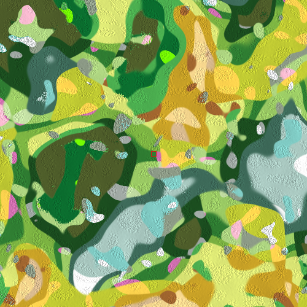
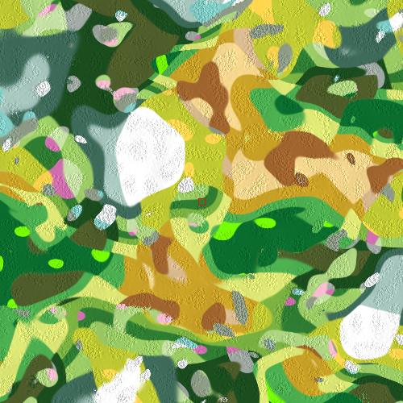
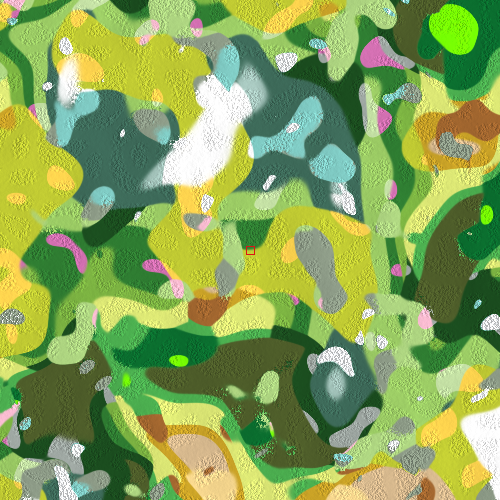

# Forest Drift — Biomes Phase 0: Implementation Record

**Date:** 2026-11-12
**Plan:** [`../feature-plan/02-technical-plan.md`](../feature-plan/02-technical-plan.md) (revision 3) · decisions in [`../feature-plan/01-questions-and-decisions.md`](../feature-plan/01-questions-and-decisions.md)
**Status:** Phase 0 complete. Not committed.

Phase 0 builds the biome foundation: the climate, the classification of all 26 biomes, the shared cache, the save format, and two debug views. **Nothing a player sees changes yet**, except through the developer debug views. Ground, grass, trees, plants and weather start reading biomes in Phases 1–5.

## What was built

| Area               | Files                                                                                                                                                                                               |
| ------------------ | --------------------------------------------------------------------------------------------------------------------------------------------------------------------------------------------------- |
| Biome module (new) | `src/lib/game/biomes/BiomeTypes.ts`, `biomeDefinitions.ts`, `ClimateSampler.ts`, `BiomeClassifier.ts`, `BiomeField.ts`, `biomeDebugColor.ts`                                                        |
| Tests (new)        | `src/lib/game/biomes/__tests__/` (definitions, classifier, climate, field, world-scale), `src/lib/game/world/__tests__/biomeSchema.spec.ts`, `src/lib/game/net/__tests__/worldTransfer.spec.ts`     |
| Save format v10    | `world/WorldTypes.ts` (`environment.biomes`, `ONLINE_COMPATIBLE_SCHEMA_VERSIONS`), `WorldMigrationManager.ts` (9 → 10, biomes off), `WorldValidation.ts` (clamped, unknown keys dropped)            |
| New worlds         | `src/routes/+page.svelte` (biomes on), `world/__tests__/worldFixtures.ts`                                                                                                                           |
| Online             | `net/worldTransfer.ts` (schema 9 and 10 worlds both open)                                                                                                                                           |
| Terrain            | `TerrainHeightSampler.ts` (`sampleBaseWithWeights`; `sampleMacroElevation` and `sampleMountainRegionMask` made public), `TerrainSettings.ts`, `TerrainChunk.ts`, `TerrainManager.ts` (debug views)  |
| Scene              | `ThreeScene.ts`: builds the `BiomeField`, applies and saves `environment.biomes`, invalidates it on seed, shape and topology changes                                                                |
| Settings           | `settings/settingsCatalog.ts`: Rendering → Debug view gains **Biome map** and **Climate**. The old "Biome colours / mask" are renamed **Landform colours / mask**, which is what they always showed |
| Determinism        | `world/determinismReport.ts` + golden: new `biomes` section. Existing sections unchanged. `tests/determinism.e2e.ts` compares it in all three engines                                               |

## How it works (short)

1. **Climate.** Temperature and moisture are single-octave seeded simplex fields, domain-warped and remapped to be **equal-area**, so each value is equally common. A box's width in `biomeDefinitions.ts` is therefore its share of the world. A third field (rarity) picks variant patches.
2. **Landform classes.** Each point is a blend of **lowland**, **upland** (raised plateaus, from the terrain's macro elevation) and **mountain** (only where a real range rises).
3. **Classification.** The base biomes tile each class's temperature × moisture square with feathered boxes that sum to exactly 1. The swamp then takes warm, very wet, low lowland, and each variant takes the high-rarity share of its parent. Border sharpness narrows the blends.
4. **Cache.** `BiomeField` classifies a world-aligned 8 m lattice in 64 m tiles (LRU, 512 tiles). Lookups interpolate bilinearly, so values agree across chunks, the same seamlessness argument as terrain heights.
5. **Cross-engine safety.** Climate values are rounded to 1/4096 and class weights to 1/1024 before scoring, so last-bit maths differences between browsers can't flip a biome.

## Measured results (16 seeds, 60 km × 60 km each)

| Target                                  | Locked decision | Result                                                                      |
| --------------------------------------- | --------------- | --------------------------------------------------------------------------- |
| Temperate share                         | 40% ± 5 (Q14)   | **40.2%**                                                                   |
| Cold share                              | 20% ± 5         | **18.8%**                                                                   |
| Warm/dry share                          | 22% ± 5         | **22.3%**                                                                   |
| Tropical share                          | 12% ± 5         | **11.2%**                                                                   |
| Swamp share                             | 6% ± 5          | **7.6%**                                                                    |
| Typical biome size                      | 600–900 m (Q10) | **683 m between changes on a straight walk ≈ 870 m across** (chord ≈ π/4·D) |
| Every biome within 10 km of spawn       | ≥ 90% of seeds  | **All 26 on every seed**                                                    |
| Snow never next to desert/jungle        | Q13             | **None** at any point or within 96 m (8 seeds, 40 km squares)               |
| Spawn in a gentle temperate biome       | Q21             | **40 of 40 seeds**                                                          |
| Biome fingerprints match across engines | Plan §17        | **Chromium, WebKit and Firefox all match the golden**                       |

**Cost** (Node, M-series Mac): seeding a world's biomes (including the spawn search) ≤ 0.6 ms; building one 64 m tile 0.39 ms; a cached lookup ~200 ns. In Phase 0 nothing reads the cache during normal play. Only the two debug views use it.

## Biome maps

Top-down 16 km × 16 km, centred on spawn (red square), 32 m per pixel, coloured with the Biome map debug palette and lightly hill-shaded:

| `soft-lowlands-431` (Main World seed) | `peaceful-world`                  | `wild-creek-109`                  |
| ------------------------------------- | --------------------------------- | --------------------------------- |
|   |  |  |

Main World itself keeps biomes **off** (Q8). The first map shows what its seed would look like with them on.

Debug palette: Forest `#2f7d32` · Flower Forest `#d16fb0` · Birch Forest `#9ccc65` · Old Growth Birch `#c5e1a5` · Dark Forest `#1b4d1f` · Silverwood `#9fa8a3` · Sunlit Wood `#7cb342` · Taiga `#3e6b5a` · Snowy Taiga `#a9c8c0` · Jungle `#0b6e2f` · Sparse Jungle `#4caf50` · Bamboo Jungle `#76ff03` · Meadow `#aed581` · Cherry Grove `#f8bbd0` · Grove `#80cbc4` · Snowy Slopes `#eceff1` · Windswept Hills `#8d9b87` · Plains `#c0ca33` · Sunflower Plains `#ffd54f` · Snowy Plains `#ffffff` · Desert `#f4d58d` · Savanna `#c9a227` · Savanna Plateau `#a1662f` · Swamp `#4e5d2a` · Shrub Savanna `#d7b98e` · Tropical Dry Grassland `#dce775`.

## Changes from the plan

Recorded in the technical plan, [§0](../feature-plan/02-technical-plan.md#0-changes-made-while-building-phase-0):

1. Online worlds published at schema 9 would have stopped opening after the v10 bump. They're now explicitly compatible.
2. Upland biomes follow macro-elevation plateaus, not the terrain's highlands landform, which scattered them as 300–400 m spots. The first maps from this phase showed that "leopard spot" pattern. The maps above are after the fix.
3. Altitude cooling starts at 6 m, because real base terrain is rarely above 15 m.

## How to see it

Run the game, open a world, then **Settings → Rendering → Terrain debug → Debug view → Biome map** (or **Climate**). In a world created before this change biomes are off, but the debug views still preview the layout its seed would get.

## Verification

- `npx vitest run`: **262 files, 2,970 tests pass**. 40 of those are the new biome tests, plus the schema and transfer tests.
- `npm run check`: 0 errors, 0 warnings. `npm run check:server`: clean. ESLint: clean on all changed files.
- `npx playwright test tests/determinism.e2e.ts` in `chromium`, `webkit-online`, `firefox-online`: **pass**.
- In the browser: created a world, switched to Biome map and Climate. Colours appeared under the player (spawn: Flower Forest), with no console or server errors. The frame rate stayed at 120 FPS with the Biome map on while the pane was visible.

### Known e2e failures that pre-date this work

`tests/worldPersistence.e2e.ts` has two failures in Chromium that aren't caused by biomes:

- _"a saved world contains its definition…"_ expects a fixed list of save keys that's missing `rules`, which was added to saves before this work.
- _"authored buildings are rebuilt…"_: reopening a world with 300 walls took **28.7 s** in headless Chromium, over the helper's 20 s limit, with no page errors. Biome work on load measures ≤ 0.6 ms.

`tests/weather.e2e.ts` also fails `prettier --check` and wasn't touched here.

## Next: Phase 1 (ground and grass)

Per the plan: biome ground palettes and the `aGround` shader layer (snow, sand, mud, litter), grass profiles per biome, the biome-name card with its accessibility work, the Biomes settings group and the "Biome size" choice at world creation. The Phase 0 cost numbers above suggest per-vertex lookups add about 0.5 ms per terrain chunk, inside the §13 budget.
