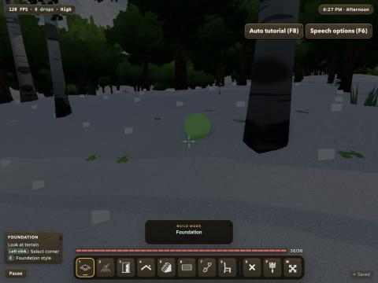
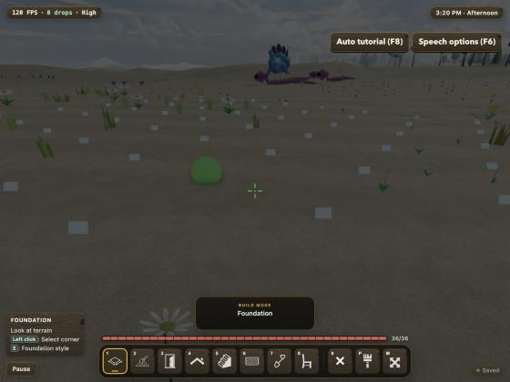
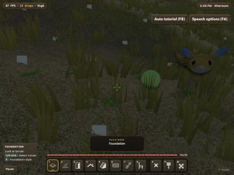
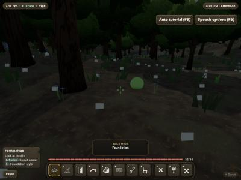
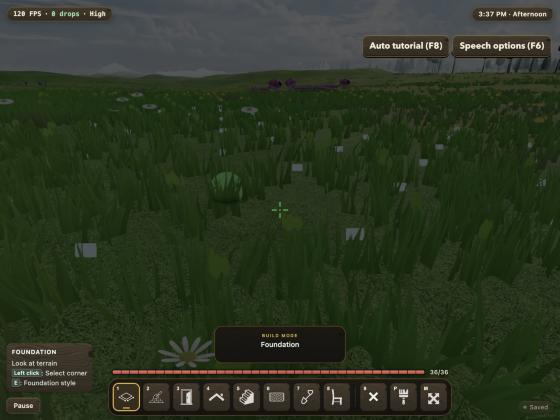
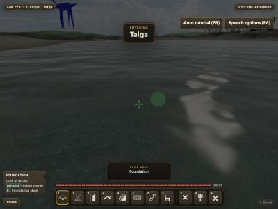

# Forest Drift — Biomes Phase 1: Implementation Record

**Date:** 2026-11-12
**Plan:** [`../feature-plan/02-technical-plan.md`](../feature-plan/02-technical-plan.md) (revision 4) · Phase 0: [`../phase-0/implementation.md`](../phase-0/implementation.md)
**Status:** Phase 1 complete. Not committed.

Phase 1 is the first change players can see: **biome ground and grass**, the **biome-name card**, the **Biomes settings**, and the **Biome size** choice for new worlds. Trees, flowers, weather and fog still look as they did before; they change in Phases 2–5.

## What players get

- **Ground per biome:**
  - snowfields in Snowy Plains, Snowy Taiga, Grove and Snowy Slopes;
  - sand in the desert;
  - red-tan earth and gravel in the savanna family and Windswept Hills;
  - leaf, needle and loam litter in the forests;
  - dark mud in the swamp.

  Each biome also gets its own grass palette, from cool forest green to savanna gold to Silverwood's grey-green.

- **Grass per biome:** dense meadow, tall golden savanna grass, lush jungle and swamp growth, sparse tufts poking through snow, almost none in the desert. Grass thins wherever the ground is bare.
- **"Entering Snowy Taiga":** a brief card when you've spent ~3 s in a new biome, at most once per 20 s. Screen readers hear "Entered Snowy Taiga" once. The card fades without sliding when reduced motion is on, and Graphics → **Show biome names** turns it off. The pause menu always shows "You're in …".
- **Settings → World → Biomes:**
  - **Turn biomes on/off…** asks for confirmation first, and says the land, rivers and buildings won't move.
  - **Biome size**, **Warmer/colder**, **Wetter/drier**, **Rare biome share** and **Border sharpness**, which regenerate the ground progressively, nearest first.
  - All of it is locked in online worlds, like the rest of the land.
- **New World → Biome size:** Small, Normal (default) or Large.

| Snowy Plains          | Desert (before the final brightness tweak) | Savanna          | Swamp          |
| --------------------- | ------------------------------------------ | ---------------- | -------------- |
|  |                             |  |  |

| The same desert spot with biomes off | The biome-name card       |
| ------------------------------------ | ------------------------- |
|       |  |

The screenshots are from the dev build in the browser pane, with the "Click to explore" overlay hidden. Trees, flowers and creatures are still the pre-biome ones.

## How it works

| Piece                                 | File                                                                                                                    |
| ------------------------------------- | ----------------------------------------------------------------------------------------------------------------------- |
| Ground and grass profiles for all 26  | `src/lib/game/biomes/biomeSurfaceProfiles.ts` (Plains = today's exact countryside constants)                            |
| Blending + ground cover + grass       | `src/lib/game/biomes/BiomeSurface.ts`                                                                                   |
| Terrain chunks: colour + `aGround`    | `terrain/TerrainChunk.ts`, `TerrainManager.ts` (`TerrainBiomeHooks`)                                                    |
| Per-pixel snow / sand / soil / litter | `materials/shader/surfaceShader.ts` (`GROUND`, layered like `SHORE`)                                                    |
| Grass                                 | `vegetation/grass/GrassManager.ts`, `grassPlacement.ts`                                                                 |
| Biome card                            | `biomes/BiomeTracker.ts`, `components/BiomeIndicator.svelte`, `ThreeScene.ts`, `WorldSession.ts`, `routes/+page.svelte` |
| Settings and confirmation             | `settings/settingsCatalog.ts`, `GameSettingsHost.ts`, `components/ConfirmBiomesDialog.svelte`, `SettingsMenu.svelte`    |
| Size at creation                      | `components/WorldsScreen.svelte`                                                                                        |
| Show biome names                      | `graphics/GraphicsTypes.ts`, `GraphicsSettingsStore.ts`                                                                 |

- **Biomes off = unchanged.** Every integration checks once per chunk whether the world's biomes are on, and takes the pre-biome code path when they're off. A unit test builds a terrain chunk both ways and compares the colour buffers exactly.
- **Ground cover** has four layers (snow, sand, soil, litter). Each biome sets base amounts, and world-space noise breaks them into patches. Cover is kept off steep rock and beaches. The vertex colour carries the average, which is the flat-materials look and the distant view, and the shader paints per-pixel detail on top.
- **Grass tufts take the biome's grass colour, never the ground colour**, so there's no white grass in snowfields.

## Performance

Measured in Node on one 96 m terrain chunk (49 × 49 vertices), 40 chunks per run:

| Build                                  | Time    | vs biomes off |
| -------------------------------------- | ------- | ------------- |
| Biomes off (today)                     | 11.1 ms | —             |
| Biomes on, lattice cached              | 12.6 ms | **+13%**      |
| Biomes on, every tile new (worst case) | 13.1 ms | **+17%**      |

Normal streaming sits between the two, because neighbouring chunks share tiles. Trees and plants are unchanged in this phase, so terrain plus vegetation together stays within the Q32 budget (+15%). Getting here took two changes:

- Single-biome points read their profile directly instead of blending 26 biomes.
- The biome lattice went from 8 m to 16 m. Borders are 60–90 m wide, so nothing visible is lost. Without these changes the worst case was +35%.

In the browser, frame rate held at 120 FPS in the desert and snowfields with the pane visible.

## Verification

- `npx vitest run`: **264 files, 2,992 tests pass**. New: `BiomeSurface.spec.ts` (including exact chunk parity with biomes off), `BiomeTracker.spec.ts`, and Biomes settings tests in `settingsCatalog.spec.ts`.
- `npm run check`: 0 errors, 0 warnings. ESLint: clean on all changed files.
- `tests/biomes.e2e.ts` (new, Chromium): card and live region at spawn, pause-menu line, toggle cancelled with Escape and then confirmed, Biome size in New World, Show biome names stored. **3/3 pass.**
- Wider Chromium e2e run (biomes, determinism, procedural materials, grass performance, terrain editor, worlds, UI theme, default world): **25 of 28 pass.** None of the three failures comes from this phase:
  - `terrainEditor.e2e.ts` "shovel edits local buffers…" (mesh 2.469 vs sampled 2.094) and `uiTheme.e2e.ts` "fullscreen menus…" (pause backdrop `rgba(0,0,0,0)` instead of `0.8`) fail **identically with new worlds' biomes forced off**.
  - `proceduralMaterials.e2e.ts` "Main World renders…" waits on `/` for a `play-default-world` button that only exists on the Worlds screen.
- In the browser: turned biomes off and on live at the same spot (green countryside ↔ desert sand), visited snow, desert, savanna, swamp and taiga, and saw the card. No console errors.

## Not in this phase

Trees per biome (Phase 2–3), signature plants (Phase 4), local snow/rain/dry weather, fog and water tint (Phase 5), generator version 4 for online worlds (Phase 6). Snow on buildings stays weather-only (Q25).
