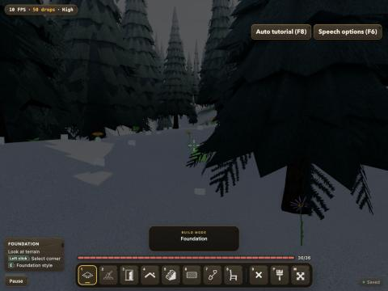
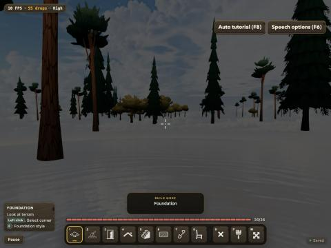
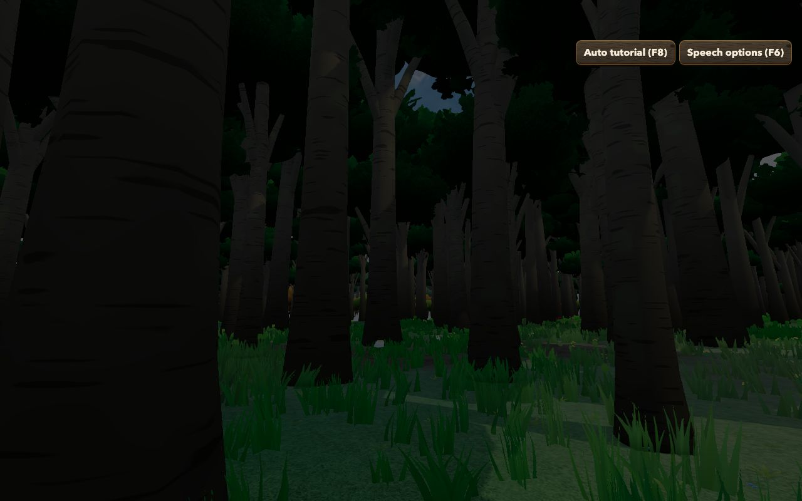
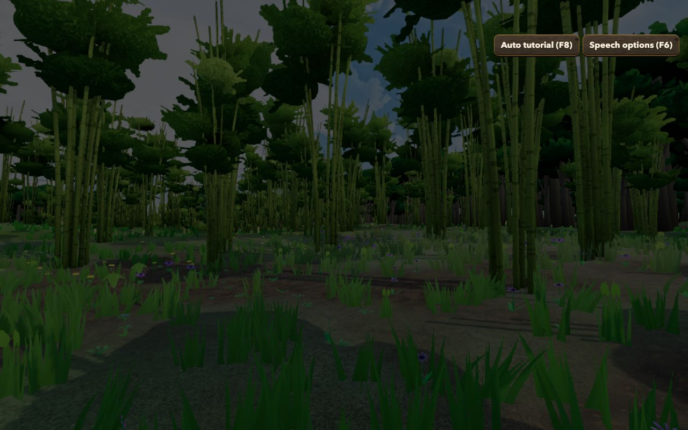
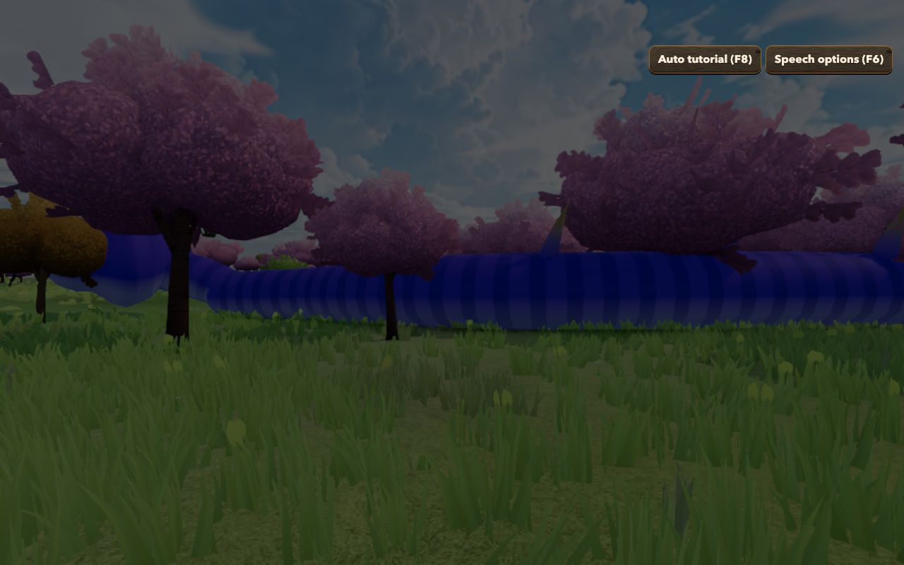
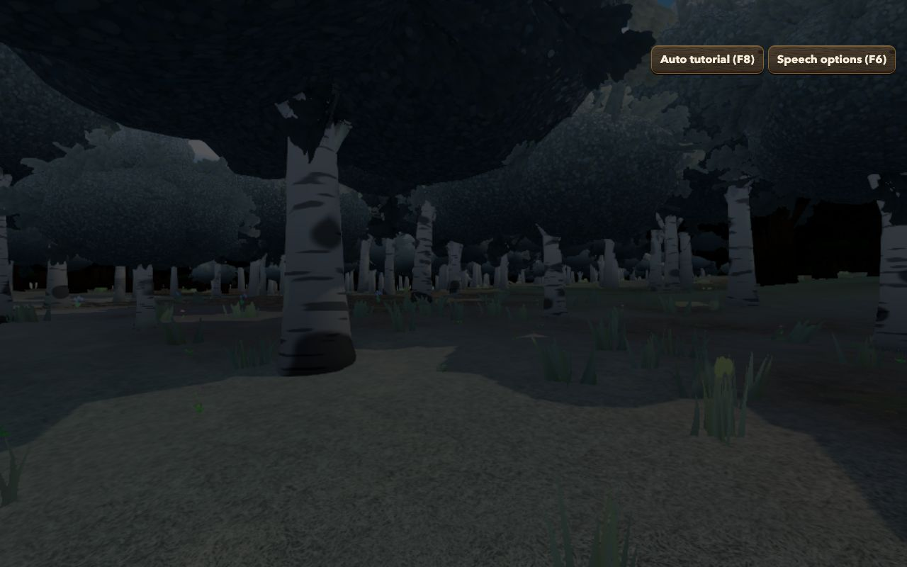
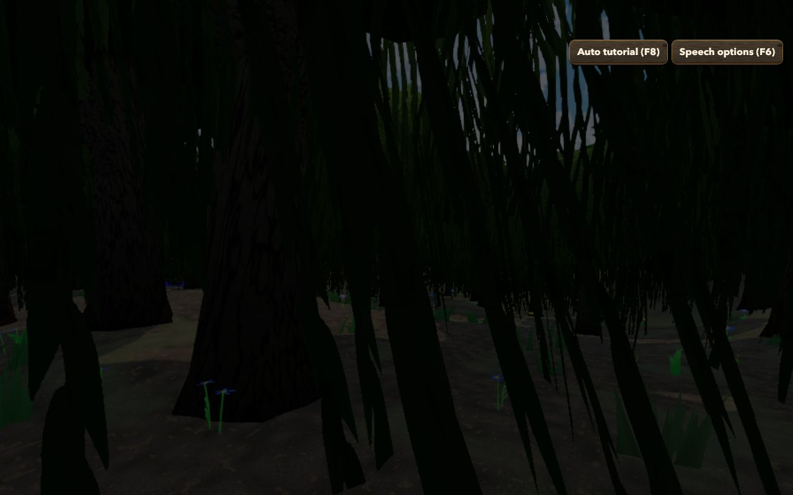
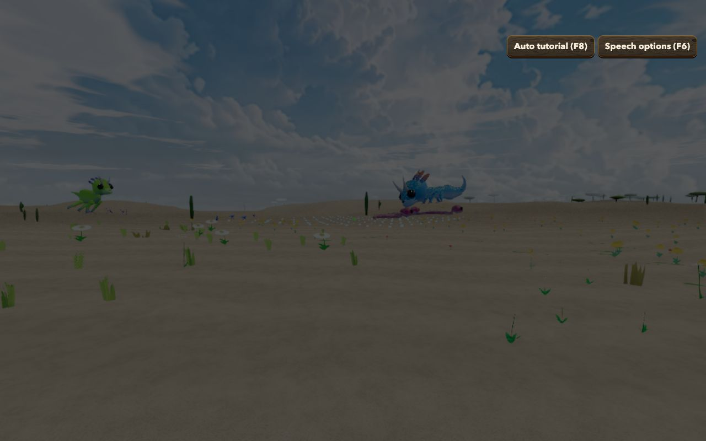

# Forest Drift — Biomes Phases 2 and 3: Implementation Record

**Date:** 2026-11-12
**Plan:** [`../feature-plan/02-technical-plan.md`](../feature-plan/02-technical-plan.md) (revision 5) · earlier: [Phase 0](../phase-0/implementation.md), [Phase 1](../phase-1/implementation.md)
**Status:** Phases 2 and 3 complete. Not committed.

Forests now follow the biomes. **Phase 2** gives each biome its own forest density and mix of today's trees, plus three tinted variants. **Phase 3** adds nine new tree species, two of them built from new shapes.

## What players get

| Biome                          | Trees                                                                 | Forest density   |
| ------------------------------ | --------------------------------------------------------------------- | ---------------- |
| Plains, Sunflower Plains       | lone oaks, birches, ornamentals                                       | 0–12%            |
| Forest / Flower Forest         | oak and birch / oak, ornamental, birch                                | 55–85% / 35–60%  |
| Birch / Old Growth Birch       | silver birch / **old-growth birch** (taller, 7.5–10 m trunks)         | 50–80% / 60–85%  |
| Dark Forest                    | **dark broadleaf** (wide, dense, near-black crowns), oak              | 85–100%          |
| Silverwood                     | **Silverwood tree** (pale bark, silvery crown)                        | 70–95%           |
| Sunlit Wood                    | oak, birch, ornamental, open and patchy                               | 40–65%           |
| Taiga                          | spruce, pine, Scots pine                                              | 60–90%           |
| Snowy Taiga, Grove             | **snow-dusted spruce and pine** (pale, frosted tiers)                 | 50–80% / 45–75%  |
| Snowy Plains, Snowy Slopes     | the odd snow-dusted spruce                                            | 0–6%             |
| Windswept Hills                | Scots pine, **wind-bronzed oak**, spruce                              | 5–25%            |
| Jungle / Sparse Jungle         | **jungle giant** (9–13 m pale trunks, broad crown) / with ornamentals | 85–100% / 35–60% |
| Bamboo Jungle                  | **bamboo** (stands of jointed culms), jungle giants                   | 80–100%          |
| Meadow / Cherry Grove          | lone trees / **cherry blossom**                                       | 0–10% / 25–50%   |
| Savanna, Savanna Plateau       | **acacia** (flat umbrella crown)                                      | 5–25%            |
| Shrub Savanna, Tropical Dry G. | scattered acacia and **cactus** / acacia                              | 0–8%             |
| Desert                         | **cactus** (ribbed columns with arms)                                 | 1–5%             |
| Swamp                          | **swamp tree** (dark, heavy, trailing curtains), willow               | 40–70%           |

Today's forest mask still decides where inside each band a spot falls (groves, thinner edges), and its clearings still cut glades, even in dense biomes. Stand maps still group trees into groves of one kind.

### In game

| Snowy Taiga (frosted spruce)        | Windswept Hills          | Jungle          | Bamboo Jungle          |
| ----------------------------------- | ------------------------ | --------------- | ---------------------- |
|  |  |  |  |

| Cherry Grove          | Silverwood          | Swamp          | Desert (cacti)         |
| --------------------- | ------------------- | -------------- | ---------------------- |
|  |  |  |  |

Also captured: `dark-forest.jpg`, `old-growth-birch.jpg`, `savanna-acacia.jpg` (creatures happened to be in front of the camera). The first two shots are from the dev build; the rest were taken in headless Chromium with the game's "click to explore" backdrop, which dims the whole frame.

## How it works

| Piece                                   | File                                                                    |
| --------------------------------------- | ----------------------------------------------------------------------- |
| Per-biome forest band + species weights | `src/lib/game/biomes/biomeTreeProfiles.ts`                              |
| Blended density and species             | `src/lib/game/biomes/BiomeTrees.ts`                                     |
| Variation everywhere (no threshold)     | `VegetationRegionSampler.getForestVariation`                            |
| Placement uses the biome band           | `TreePlacementGenerator.ts` (`biomes` option)                           |
| Species from the biome                  | `TreeSpeciesSelector.setBiomeSource`                                    |
| 3 tint variants + 9 new species         | `vegetation/trees/treeSpecies.ts`, `TreeSpeciesTypes.ts` (ids appended) |
| Bamboo and cactus shapes                | `treePrototypeGenerator.ts`: `stalks` and `columnar` crown kinds        |
| Wiring                                  | `TreeManager.ts`, `ThreeScene.ts` (biome changes also regenerate trees) |

- **Biomes off = unchanged.** With biomes off, placement takes the old path. A test builds 3,600 cells with and without a biomes source and compares every tree, and the `trees` determinism fingerprint is unchanged. Species added for biomes never grow in a world without them.
- **Tree identity is still the cell** (`cellX:cellZ`), so cut trees stay cut when a world's biomes are switched on.
- **New species are appended** to `TREE_SPECIES_IDS` (chunks store species by index). Prototypes build lazily, so a species costs nothing until it grows nearby.
- **Bamboo (`stalks`):** 8–12 culms leaning out from a small clump, with darker joint bands and 5–7 leaf clumps across the stand. Those clumps are ordinary crown clusters, so shading, the far hull LOD and leaf cards all work unchanged. The far LOD keeps three culms.
- **Cactus (`columnar`):** a ribbed main column and 0–3 arms that reach out and turn up, with rounded caps. There are no leaf cards and no wind sway. Ribs need enough sides, so the far LODs drop them.
- **Acacia, cherry, Silverwood, dark broadleaf and jungle giant** are new parameter sets on the existing rounded-crown builder. The acacia's umbrella is a wide, very squashed crown on a forked, branching trunk. **Swamp tree** reuses the willow's trailing curtains with a heavier trunk and darker palette.
- **Collision:** bamboo and cactus define a trunk that matches the clump or column. It's used only as the collider and isn't drawn.

## Performance

- **Tree count:** across 6 seeds and 155,000 sampled cells, **32.7%** of cells grow a tree with biomes, against **36.4%** without. The densest 36-cell blocks are about as dense as today's densest forest.
- **Per-species triangle budgets** are enforced by the existing prototype tests at every LOD, and they now cover all 20 species. Bamboo LOD0 ≤ 14,500, cactus ≤ 2,400, and the others are in line with oak and birch. To stay within budget, cherry and Silverwood use 4–6 crown clusters, and the jungle giant's crown is capped at 9 m wide (bounds test < 10 m).
- **Headless Chromium is slow in dense biome forests.** The confirm-toggle e2e takes about 95 s, mostly opening menus over a software-rendered forest at spawn, so its limit is now 180 s. Frame time on a real GPU hasn't been benchmarked for these biomes yet (the existing tree-performance harness uses the Main World, which has biomes off). That's part of Phase 6.

## Verification

- `npx vitest run`: **265 files, 2,999 tests pass**. New: `BiomeTrees.spec.ts` (profiles, bands, species, exact parity with biomes off, cell identity). The prototype tests now cover all 20 species. The leaf-card tests skip species with no cards (cactus) after checking they really have none.
- `npm run check`: 0 errors. ESLint: clean. Prettier: clean except the existing `tests/weather.e2e.ts`.
- **Determinism:** a new `biomeTrees` fingerprint (tree cells in a biome world) matches the golden in **Chromium, WebKit and Firefox**. The terrain, water, trees and biomes fingerprints are unchanged.
- `tests/biomes.e2e.ts`: 3/3 pass.

## Changes from the plan

- **Tint variants are separate species ids**, not a per-instance tint, as the plan's §21 assumption 3 proposed.
- **Acacia uses the existing rounded-crown builder.** It doesn't need its own "umbrella" kind: a wide, squashed crown on a branching trunk reads correctly.
- **No buttress trunk option.** Jungle giants use the existing root flare on a much thicker, taller trunk.
