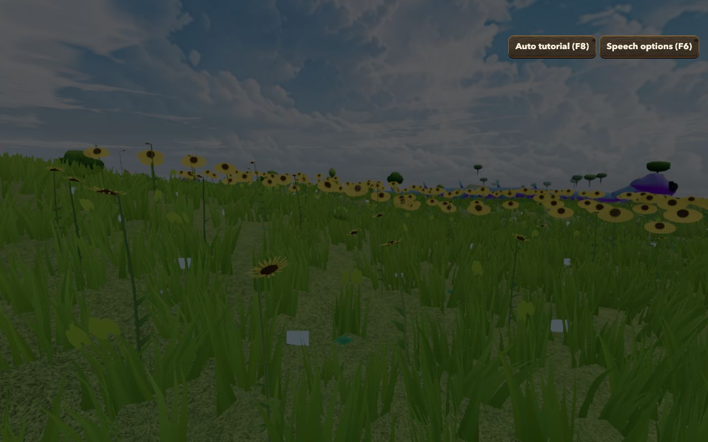
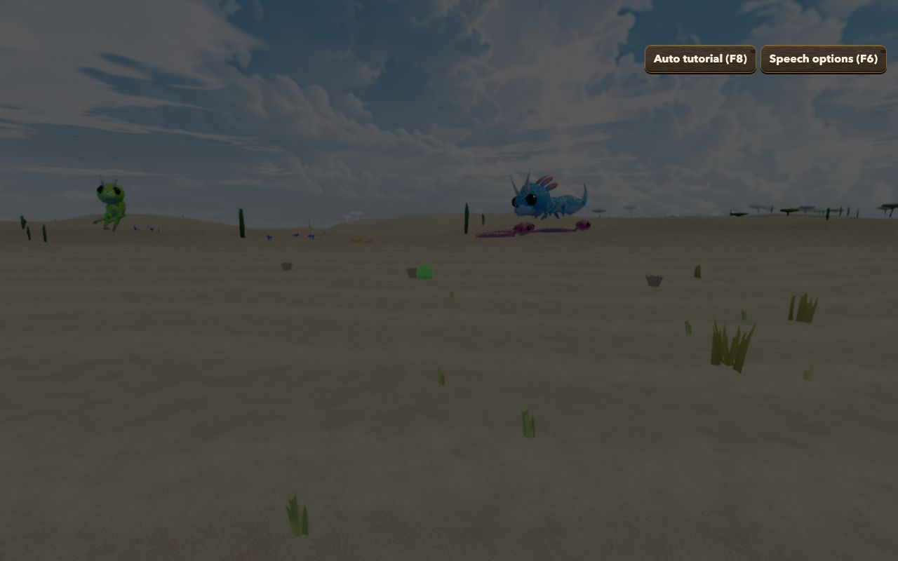
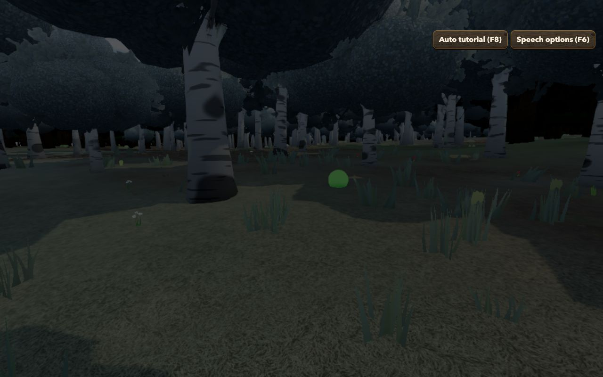
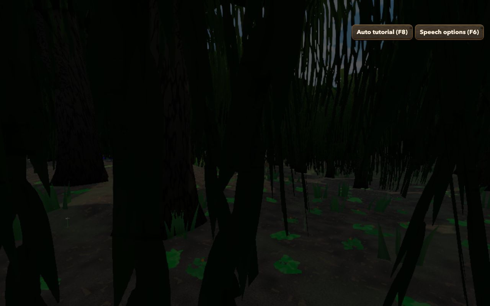

# Forest Drift — Biomes Phase 4: Implementation Record

**Date:** 2026-11-12
**Plan:** [`../feature-plan/02-technical-plan.md`](../feature-plan/02-technical-plan.md) (revision 6) · earlier: [Phase 0](../phase-0/implementation.md), [Phase 1](../phase-1/implementation.md), [Phases 2–3](../phase-2-3/implementation.md)
**Status:** Phase 4 complete. Not committed.

Flowers and ground plants now follow the biomes, and five **signature plants** mark the biomes they belong to.

## What players get

- **Sunflower Plains** are fields of sunflowers, tall golden heads with dark centres.
- **Swamps** have cattail reeds among broadleaf and clover.
- **Deserts** have dry tufts, succulents and leafless dead shrubs, sparse enough that the sand shows. Shrub Savanna and the savannas get dead shrubs too.
- **Forests** have ferns: always in Dark Forest, Jungle and Bamboo Jungle, often in Old Growth Birch and Taiga, and sometimes in Forest.
- **Silverwood** has small pale, nodding white bells on its dim floor, and its flowers are limited to bell, cup and orb shapes.
- **Flower Forest, Meadow and Sunlit Wood** carry more flower species and denser cover. **Snowfields** are almost bare: a few low tufts, often no flowers at all.
- **Plant families follow climate:** a desert pool is succulents and dry tufts, a jungle's is ferns and broadleaf, and the cold biomes keep only low tufts and rosettes.

| Sunflower Plains          | Desert                 | Silverwood                     | Swamp                |
| ------------------------- | ---------------------- | ------------------------------ | -------------------- |
|  |  |  |  |

Also captured: `meadow.jpg`, `flower-forest.jpg`, `dark-forest-ferns.jpg`, `snowy-plains.jpg`. They were taken in headless Chromium behind the game's dimmed "click to explore" backdrop.

## How it works

| Piece                              | File                                                           |
| ---------------------------------- | -------------------------------------------------------------- |
| Per-biome plant profile            | `src/lib/game/biomes/biomePlantProfiles.ts`                    |
| Region plan, density, forest shade | `src/lib/game/biomes/BiomePlants.ts`                           |
| Signature species                  | `src/lib/game/vegetation/plants/plantSignatureSpecies.ts`      |
| Regions draw from biome pools      | `vegetation/plants/plantEcology.ts` (`RegionPlantPlan`)        |
| Per-point biome density            | `plantPlacement.ts` (`ENV_DENSITY` channel), `PlantManager.ts` |
| Wiring                             | `ThreeScene.ts` (one `BiomeTrees` + `BiomePlants` shared)      |

- **Per region (192 m):** the biome at the region's centre scales how many flower and ground-plant species it draws, can restrict which families its pool contains, and adds signature plants by chance (Sunflower Plains and swamps always get theirs). With biomes, pool seeds are salted by biome, so a desert pool differs from a forest's in the same area. Without biomes, seeds and counts are exactly the old ones.
- **Per point:** a blended plant-density factor (snowfield 0.05–0.15, desert 0.25, jungle 1.2, meadow 1.3) multiplies how strongly plants claim the ground. It's blended, so borders fade instead of stepping at region edges. Forest shade for plant habitats now comes from the biome forests trees grow in.
- **Signature plants** are ordinary generated species of the right family (radial flower, spike flower, fern, ground tuft, bell flower) with their look, size and habitat pinned and fixed seeds. Prototypes, cards, LOD and wind all work unchanged.
- **Flower cover** (which thins grass under flowers) and the **distant meadow tint** on terrain also scale with biome density, so a desert never gets a flower-coloured haze.
- **Biomes off = unchanged.** The new environment channel is exactly 1 without biomes, so the product is identical, and region species match the old seeds exactly (tested).

## Performance

- Two extra values per 8 m environment node (25 nodes per 32 m plant chunk): negligible.
- Every signature plant fits the existing plant triangle budget (≤ 200 per prototype). The reed was trimmed from 388 triangles to 2 stems × 8 florets.
- Biomes with density above 1 (meadow 1.3, jungle 1.2, Flower Forest 1.3) grow somewhat more plants than today's meadow at the same quality. That stays inside each quality preset's existing visible-instance cap and adaptive step-down. **Not yet measured on a GPU in those biomes**; that's in Phase 6's performance pass, along with the dense forests.

## Verification

- `npx vitest run`: **266 files, 3,012 tests pass**. New: `BiomePlants.spec.ts`, 13 tests covering:
  - each signature species is valid and builds valid prototypes;
  - profiles use the right family kinds;
  - **exact pre-biome species with biomes off**;
  - desert families;
  - sunflowers and reeds in every region of their biome;
  - meadow vs snowfield flower counts;
  - cache rebuild when the biome layout changes;
  - blended density.

  The existing placement tests now fill the new channel with 1.

- `npm run check`: 0 errors. ESLint clean. Prettier clean except the existing `tests/weather.e2e.ts`.

## Not in this phase

Local snow/rain/dry weather, per-biome fog and tint, and swamp water tint (Phase 5). Generator version 4, online publishing and the GPU performance pass (Phase 6).
