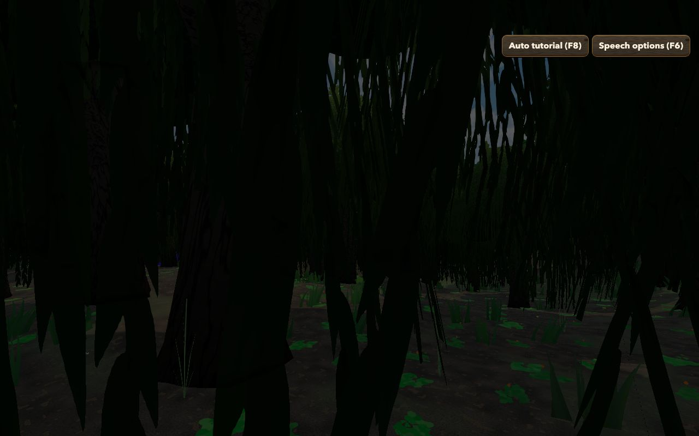
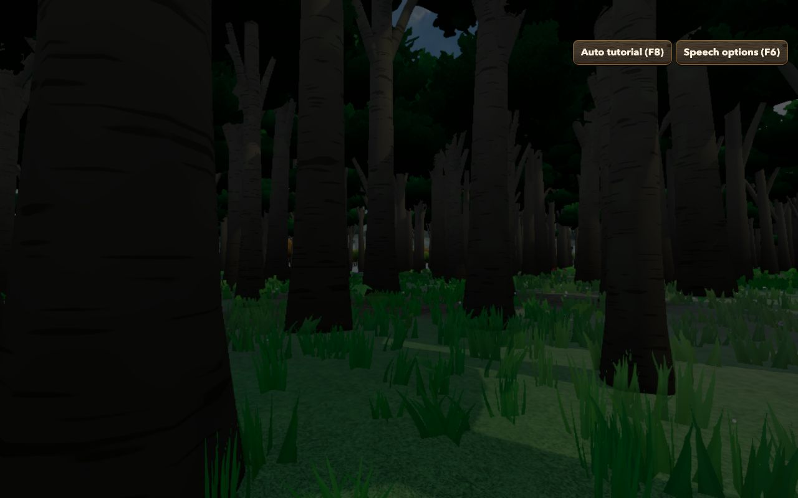
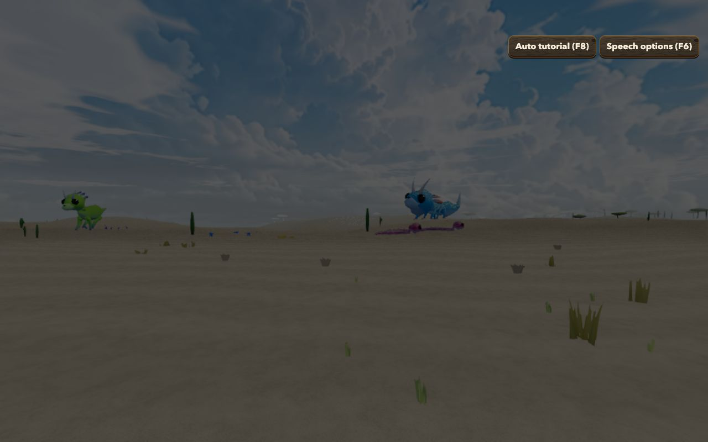
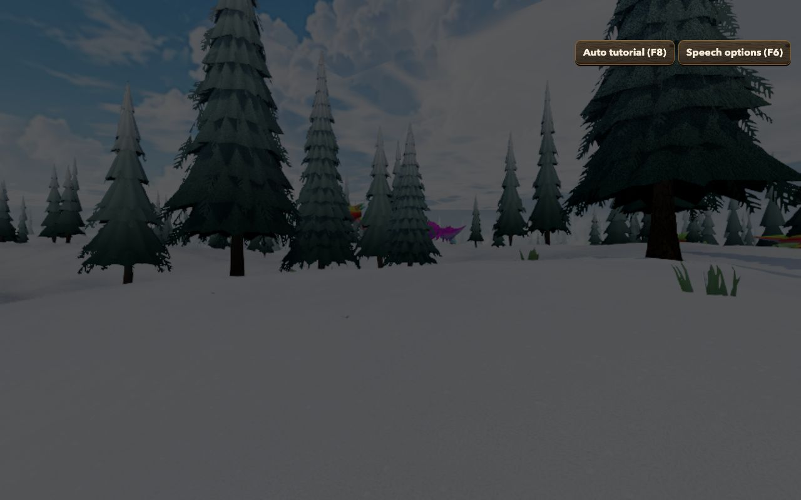
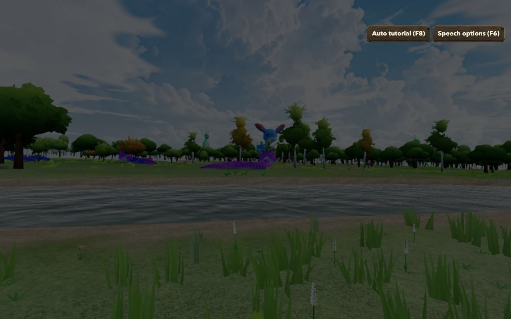

# Forest Drift — Biomes Phase 5: Implementation Record

**Date:** 2026-11-12
**Plan:** [`../feature-plan/02-technical-plan.md`](../feature-plan/02-technical-plan.md) (revision 7) · earlier: [Phase 0](../phase-0/implementation.md), [1](../phase-1/implementation.md), [2–3](../phase-2-3/implementation.md), [4](../phase-4/implementation.md)
**Status:** Phase 5 complete. Not committed.

The weather and the air now follow the biome you're standing in.

## What players get

- **Snow where it's cold, rain where it's mild.** The world still has one weather schedule, shared by everyone online and saved once. Each player sees it fall as the local climate dictates: a rainy spell is snow in the Snowy Taiga and on the peaks, and a "snow" day is rain in the jungle. At the boundary there's a short mix of both.
- **Nothing falls in the desert.** A storm over the desert is a dry one: clouds, wind and lightning, but no rain, no wet ground and no rain sound. Savannas get about half the rain, and jungles and swamps more (×1.3).
- **Per-biome air.** Humid haze in the jungles, low grey-green mist in swamps and Silverwood, warm dust over deserts and savannas, a cold blue cast over snowfields, a pink warmth in Cherry Grove. Temperate biomes keep today's clear air. The tint is capped at 30% and keeps the day/night brightness, and fog thickens at most 1.7×, so the day cycle and the weather always lead.
- **Water colour.** Swamp water is darker and greener, water in cold biomes bluer, and forest pools slightly greener.
- **Gradual changes.** Crossing a border changes the air and weather over about 4 seconds.
- **Forced weather is shown as chosen everywhere** (owner or debug "Change weather"). Only the schedule is localised. This was assumption E14 in the plan.

| Swamp mist          | Jungle haze          | Desert dust          | Snowy Plains              | Plains (neutral)        |
| ------------------- | -------------------- | -------------------- | ------------------------- | ----------------------- |
|  |  |  |  |  |

These were taken headless, behind the game's dimmed "click to explore" backdrop. The local climate read at each spot during capture:

| Spot         | Precipitation ×    | Fog tint | Fog density | Temperature             |
| ------------ | ------------------ | -------- | ----------- | ----------------------- |
| Swamp        | 1.20               | 0.20     | 1.46        | 0.61                    |
| Jungle       | 1.32               | 0.22     | 1.46        | 0.78                    |
| Desert       | 0.01 (easing to 0) | 0.25     | 1.25        | 0.84                    |
| Snowy Plains | 0.89               | 0.18     | 1.15        | 0.07, so snow, not rain |
| Plains       | 1.00               | 0        | 1.00        | 0.43                    |

## How it works

| Piece                                   | File                                                                           |
| --------------------------------------- | ------------------------------------------------------------------------------ |
| Per-biome precipitation, fog, water     | `src/lib/game/biomes/biomeAtmosphereProfiles.ts`                               |
| Climate at the camera, eased            | `src/lib/game/biomes/LocalClimate.ts`                                          |
| Shared weather → local weather          | `src/lib/game/weather/localWeather.ts` (pure)                                  |
| Applied once, before everything uses it | `WeatherSystem.ts` (`setLocalClimate`, `local`)                                |
| Fog and horizon tint                    | `src/lib/game/biomes/biomeAtmosphere.ts` (pure), `ThreeScene.applySkySettings` |
| Water tint                              | `hydrology/WaterRenderer.ts` (`aTint`), `WaterMaterial.ts`                     |

- `WeatherSystem.update` localises the scheduled weather **once**. Precipitation particles, rain and wind sound, wetness, snow cover on surfaces, adaptive density and the sky look all read that one localised value, so they can't disagree.
- **Rain or snow** comes from the climate temperature (with the elevation lapse and mountain cooling): all snow at ≤ 0.12, all rain at ≥ 0.22, blended between.
- **Online:** the shared weather state and protocol are unchanged. Every client localises it from its own position, and biomes are deterministic, so players standing together see the same weather.
- **Biomes off = unchanged.** The local climate reports inactive, so `local === current`, the sky look gets no tint, and water tints are exactly white. All three are tested.

## Performance

Per frame: one biome lookup at the camera plus a few multiply-adds. The sky look is re-applied only while the air is still moving (above a 0.004 threshold), which stops a few seconds after crossing a border. Water tint is computed once per vertex when a river or lake mesh is built.

## Verification

- `npx vitest run`: **267 files, 3,023 tests pass**. New: `LocalClimate.spec.ts`, 11 tests covering:
  - rain/snow by temperature, desert none, swamp more, clouds/wind/lightning kept;
  - inactive while biomes are off;
  - snaps then eases, the same at 20 and 144 FPS;
  - change reporting;
  - swamp water tint;
  - neutral air leaves the look untouched;
  - swamp fog within caps;
  - `WeatherSystem` integration: localised schedule, forced weather shown as chosen.
- `npm run check`: 0 errors. Prettier clean except the existing `tests/weather.e2e.ts`.
- E2E (Chromium): `biomes.e2e.ts` 3/3 and `determinism.e2e.ts` pass.

### Pre-existing failures (not from this phase)

- **`tests/weather.e2e.ts`** times out in `chooseWeather`. Searching settings for "weather" now opens the Audio section, whose "Ambience & weather volume" slider matches first, instead of Weather, so the transition field never appears. This file and the settings-section ordering are part of the uncommitted key-mapping work, not this phase.
- **ESLint** reports one `no-useless-assignment` in `src/lib/game/weather/__tests__/weather.spec.ts`. That file is also uncommitted work from outside this feature.

## Not in this phase

Phase 6: generator version 4 and online publishing of biome worlds, the GPU performance pass in dense forests and lush biomes, ambient biome sound (Q27: later), README and in-game help.
