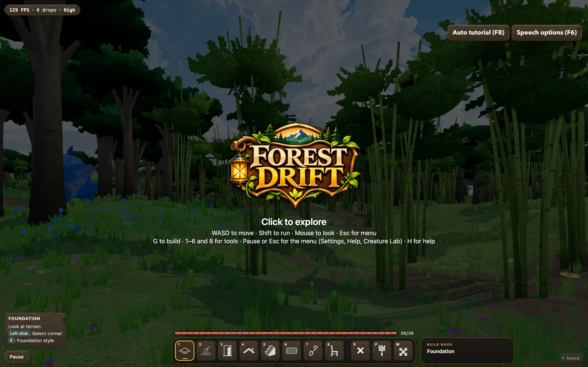

# Forest Drift — Biomes Phase 6: Implementation Record

**Date:** 2026-11-13
**Plan:** [`../feature-plan/02-technical-plan.md`](../feature-plan/02-technical-plan.md) (revision 8) · earlier: [Phase 0](../phase-0/implementation.md), [1](../phase-1/implementation.md), [2–3](../phase-2-3/implementation.md), [4](../phase-4/implementation.md), [5](../phase-5/implementation.md)
**Status:** Phase 6 complete; all phases built. Not committed.

## What changed

- **Generator version 4** (`src/lib/game/net/protocol.ts`). The Worker relabels a world published at version 1–3 to 4 only when its stored base world has biomes off (`server/src/generatorMigration.ts`: `migrateGenerator`, `baseHasBiomes`). `WorldRoom.loadManifest()` applies this when the room first serves or starts, so the first snapshot is already relabelled.
- **Kill switch** (plan §18, `src/lib/game/biomes/biomeKillSwitch.ts`). `?biomes=off` turns biomes off for one session. `BIOMES_AVAILABLE = false` turns them off for everyone. `BiomeField.isEnabled()` checks it, so every system takes the pre-biome path, and the saved setting is never written.
- **Fewer tree draw calls in dense biomes.** Species can now share one prototype from a given LOD (`sharedVariantsFromLod`). Jungle giant and dark broadleaf share from LOD2, and bamboo from LOD1, since bamboo stands look alike once you're a few metres away. This is render-only: placement, saves and the determinism golden don't change. Pre-biome species still share only at LOD3, so old worlds look exactly as before.
- **GPU benchmark**: `tests/biomePerformance.e2e.ts`, opt-in with `BIOME_BENCH=1`. The numbers are in `biome-performance.json`.
- **Docs and help**: [`docs/biomes.md`](../../../../biomes.md) (player guide, the 26 biomes, settings, kill switch, adding a biome), a README "Biomes" section, and a "Wander between biomes" item in Help & Credits.

## GPU pass

Chromium on Metal, 1512×945 @2×, vsync off, ground level, clear midday, 3 s per scene.

| Scene (high)                  | ms          | Draw calls    | Draw calls vs baseline |
| ----------------------------- | ----------- | ------------- | ---------------------- |
| Baseline forest, biomes off   | 6.19        | 477           | —                      |
| Jungle                        | 7.25        | 477           | 0%                     |
| Bamboo Jungle                 | 7.46        | 527 (was 579) | +10.5% (was +21%)      |
| Dark Forest                   | 7.36        | 516 (was 528) | +8% (was +11%)         |
| Silverwood                    | 6.76        | 439           | −8%                    |
| Cherry Grove                  | 5.92        | 497           | +4%                    |
| Swamp                         | 6.46        | 464           | −3%                    |
| Snowy Taiga                   | 6.04        | 480           | +1%                    |
| Desert, GROUND on / off       | 4.70 / 4.55 | 217 / 221     | GROUND layer +3%       |
| Snowy Plains, GROUND on / off | 5.67 / 5.55 | 467 / 471     | GROUND layer +2%       |

At low, every biome takes 2.9–3.8 ms, against 2.87 ms for the baseline, and draws no more calls than the baseline (118).

### Against the §13.1 budgets

- **Ground shader layer: met.** It costs +2–3%; the budget is ≤ 10%.
- **Draw calls: met in every biome except Bamboo Jungle, which is just over.** Bamboo Jungle is at +10.5% against ≤ 10%. What's left is the jungle giants at LOD1 and the ornamental trees mixed in. Sharing the giants' designs at LOD1 would cost visible variety in the trees nearest the player. Ornamental trees are a pre-biome species, so sharing them would change old worlds. I left both alone.
- **Frame time.** The densest biomes cost 1.1–1.3 ms more per frame than the baseline at high, and 0.2–0.5 ms more at low. They hold 2.5–3.7× as many visible trees and about 1.5–2× the triangles. That's the cost of the denser forests the biomes were designed to have, not the per-frame biome lookups, which Phase 1 measured separately. Every scene stays above 130 FPS at high.

## Breakdown that found the cause

A temporary diagnostic (removed afterwards) hid trees, plants and grass in turn and counted batches per species and LOD. Bamboo Jungle had 102 visible tree batches against the baseline's 50. Most were jungle giants and bamboo at LOD2, one per variant per chunk. Grass and plants added nothing measurable. Dark Forest's extra draw calls came mostly from outside the vegetation, from what else was in view at that spot.

## Verification

- `npx vitest run`: **269 files, 3,030 tests pass**. New tests:
  - `biomeKillSwitch.spec.ts`: off for the session, saved setting untouched.
  - `sharedVariants.spec.ts`: which species share from which LOD, with pre-biome species unchanged.
  - `server/tests/generatorMigration.spec.ts`, rewritten for version 4.
- `npm run check` and `npm run check:server`: 0 errors. ESLint is clean on everything changed in this phase. Prettier is clean.
- E2E, **21/21 pass**:
  - `determinism.e2e.ts` in Chromium, WebKit and Firefox;
  - `multiplayer.e2e.ts` in all three engines, including the relabel checks (1–3 become 4 when biomes are off, and stay at 3 when biomes are on);
  - `biomes.e2e.ts` in Chromium.

  These ran before the shared-prototype change, which is render-only and doesn't touch anything they check.

- One benchmark run failed: at one biome spot, streaming didn't finish within 2 minutes. There were no page errors, and every run before and after passed. The wait now reports which system is still queued, in case it happens again.

### Pre-existing (not from this phase)

ESLint still reports two errors in files outside this phase: a missing `#each` key in `HelpCredits.svelte` (line 37, unchanged here) and `no-useless-assignment` in `weather.spec.ts`.

## Not done

- Ambient biome sound (Q27: later).
- Bamboo Jungle's last 0.5% over the draw-call budget (see above).
