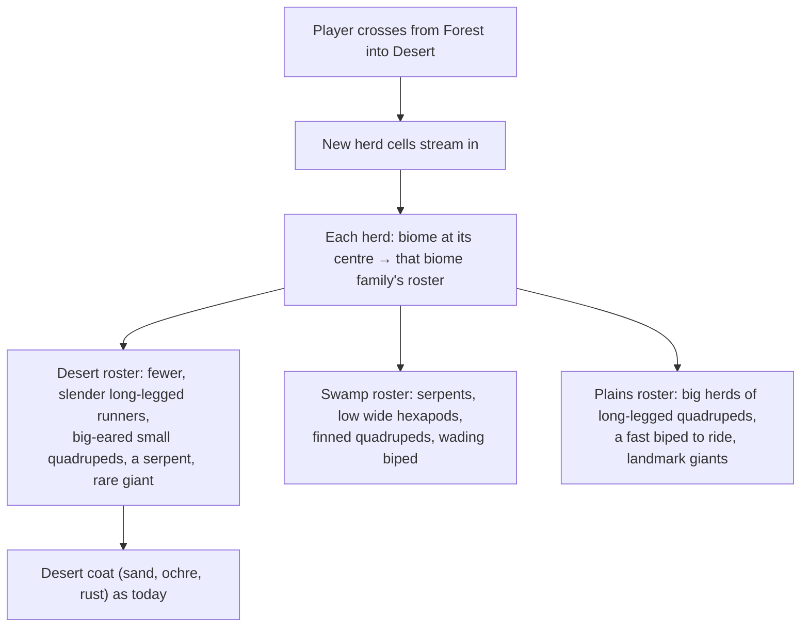
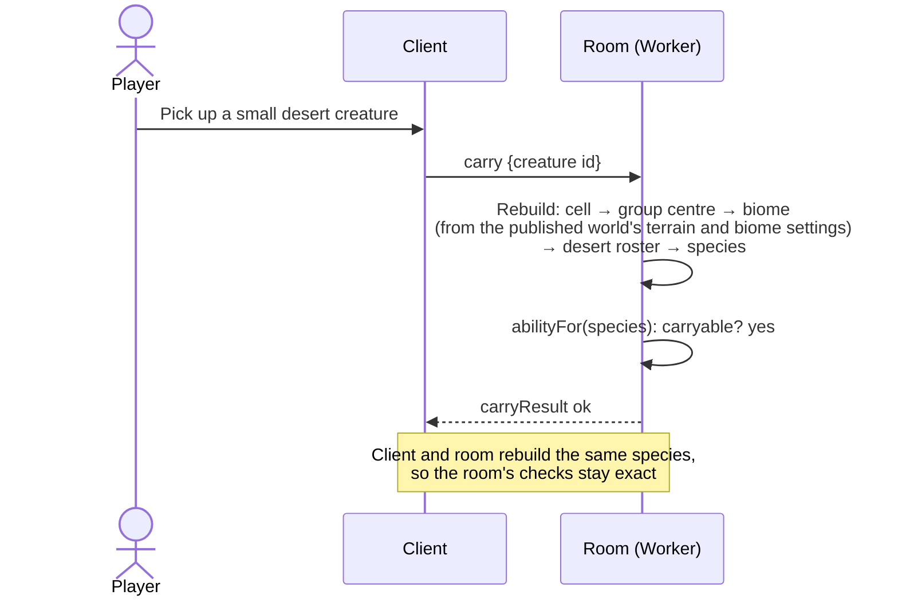
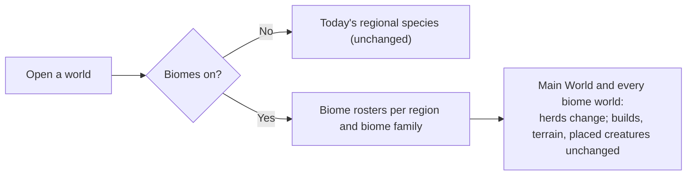

# Forest Drift — Biome-Specific Species: Brief

**Feature cycle:** 2026-11-13
**Status:** **Decisions locked (2026-11-13)**: you accepted every recommended default ([`01-questions-and-decisions.md`](01-questions-and-decisions.md)). No implementation code until you approve the plan.
**Related:** [`01-questions-and-decisions.md`](01-questions-and-decisions.md) · [`02-technical-plan.md`](02-technical-plan.md) · builds on [Biomes](../../../11-12/Biomes-and-Enviroments/feature-plan/02-technical-plan.md) and [Biome-specific creatures](../../../11-12/Biomes-Specfic-Creatures/feature-plan/02-technical-plan.md)

Paths are relative to `pages/Forest-Drift/`.

---

## 1. The idea in one paragraph

Creatures already wear their biome's colours and coat. But the **same animals** live everywhere: each 512 m region has six species, chosen without knowing the land. A desert and a snowfield in one region share the same species, just in different colours. This feature makes the **animals themselves** belong to the biome:

- **Which species live there:** body plans and sizes. Serpents in swamps, long-legged runners on plains, stocky quadrupeds in the snow, bipeds in the jungle.
- **What they look like:** fins in wet places, big ears in the desert, thick round bodies in the cold.
- **How they behave:** large herds on open grass, solitary animals in dense jungle.
- **How many there are:** fewer in deserts and on snow, more in jungles and plains.

It stays deterministic and shared online, and carrying and riding keep working everywhere.

## 2. The user problem

| Today                                                                                                                                                | Why it's a problem                                                                                                                             |
| ---------------------------------------------------------------------------------------------------------------------------------------------------- | ---------------------------------------------------------------------------------------------------------------------------------------------- |
| `regionSpecies` picks six species per 512 m region from a fixed body-plan list (quadruped ×2, hexapod, biped, serpentine), with no idea of the land. | Biomes are 450 m–1.5 km across, so a region often spans two or three of them. The same species appear in the desert and in the snow next door. |
| Colours follow the biome (the creature cycle), but anatomy, size, behaviour and numbers don't.                                                       | A sand-coloured long-necked giant in the desert and a white one in the snowfield are visibly the same animal, recoloured. It feels thin.       |
| Density is the same everywhere.                                                                                                                      | Deserts and snowfields feel as busy as forests, and the jungle no busier than the plains.                                                      |

## 3. Goals

1. **Every biome family has its own animals** [Q2, Q3]: different body plans, sizes, features and behaviour, recognisably suited to the place.
2. **Abilities everywhere** [Q6]: every herd area still has something to carry, and wherever riding is promised, something to ride.
3. **Online stays exact** [Q8]: the multiplayer room knows which species a creature is from its id. It works out the biome itself from the published world, so carry and ride checks stay authoritative.
4. **Old worlds behave as decided** [Q10, Q11]: biomes-off worlds keep today's species. Biome worlds, the Main World included, get the new animals.
5. **No performance cost that matters** [Q17]: same draw calls and the same creature caps. The room's extra work only happens when someone carries, rides or shoots.

## 4. Non-goals (v1)

- New body plans or animation styles: flying, swimming, burrowing. The four existing plans only.
- Food chains, predators, migration or seasonal behaviour.
- Creature sounds.
- Changing carry or ride rules (size limits, speeds, pellets).
- Hand-designed species. Everything stays procedural, from the seed.

## 5. Expected user flow

### 5.1 Exploring

### 5.2 Carrying and riding, online

### 5.3 Opening a world

## 6. What "done" looks like for the player

- Walking from forest into desert, snow, jungle or swamp, you meet different animals, not recoloured ones. They differ in shape, size, numbers and how they move in groups.
- In every biome you can still find something small to pick up, and something to ride where the plan says riding is available.
- Online, everyone sees the same animals, and carrying and riding work exactly as before.

## 7. Delivery shape (proposed, see Q16)

| Phase | What                                                                                                                                     |
| ----- | ---------------------------------------------------------------------------------------------------------------------------------------- |
| 0     | Biome family rosters: body-plan weights, size bands, anatomy and behaviour leanings, density; pure roster function; Lab preview; tests.  |
| 1     | In the world and online: population and resolver use rosters; room computes biomes; generator version 5 and relabel; determinism golden. |
| 2     | Tuning and release: screenshots per biome, performance, docs.                                                                            |

## 8. Key risks (details in the technical plan)

- **Room and clients must agree** on every creature's species. The room gains the terrain and biome code (about 7 KB gzipped), and a new generator version keeps mismatched builds apart [Q8, Q9].
- **Abilities.** If a biome roster lacked carryable or rideable animals, a feature would vanish in that place. The guarantees in Q6 are enforced by tests.
- **Visual sameness.** Rosters still come from the same procedural generator. The leanings must be strong enough to read, or the change won't be noticed.
