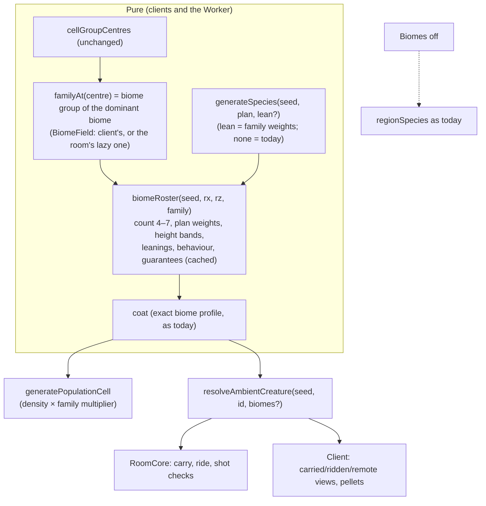
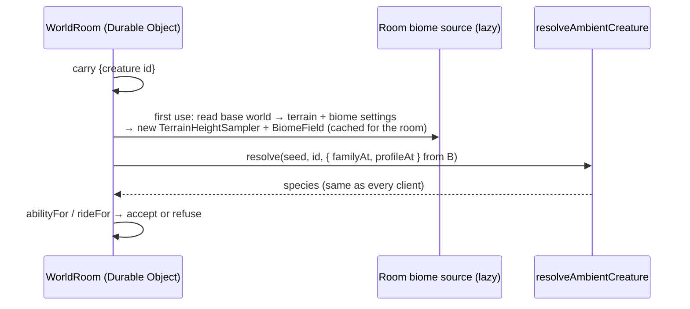

# Forest Drift — Biome-Specific Species: Technical Plan

**Feature cycle:** 2026-11-13
**Status:** **Revision 4: Phases 0–1 built (2026-11-13).** Decisions are locked in [`01-questions-and-decisions.md`](01-questions-and-decisions.md). Phase records: [Phase 0](../phase-0/implementation.md), [Phase 1](../phase-1/implementation.md). §0 lists changes made while building.
**Related:** [`00-brief.md`](00-brief.md) · [`01-questions-and-decisions.md`](01-questions-and-decisions.md) · [`docs/creature-system.md`](../../../../creature-system.md) · [`docs/biomes.md`](../../../../biomes.md)

Paths are relative to `pages/Forest-Drift/`.

---

## 0. Changes made while building

**Phase 0 (2026-11-13):**

1. **Roster keys include the biome for the four overriding biomes** (desert, snowy plains, snowy slopes, bamboo jungle), so each gets its own roster.
2. **`weightedPick` lives in `CreatureForm.ts`**, avoiding a circular import with `SpeciesGenerator.ts`. Leaning reuses each pick's single random draw; species without a lean take the original code path.
3. **A new roster costs about 0.09 ms**, inside the 0.5 ms budget.

**Phase 1 (2026-11-13):**

4. **`slotSpecies`** in `CreaturePopulationSystem.ts` is the one rule for a slot's species, group size and density. The population, both resolvers and the determinism report all use it.
5. **The height bands and `stature()` moved to `creatures/regionBands.ts`**, avoiding a circular import between the population and rosters.
6. **The Worker grew by about 54 KiB raw (15 KiB gzipped), not 30 KB.** The roster code and species leanings add to the terrain and biome code. Accepted; the first carry in a room costs about 7.5 ms.
7. **The pellet-flight e2e now picks open ground to fire from.** With rosters, its small creature can stand on a hillside that stops the pellet within a few metres.

## 1. Summary

- **Biome family rosters** [Q2, Q3]. `biomeRoster(worldSeed, regionX, regionZ, family)` builds a region's species for one of six biome families. Each roster has a family's own body-plan weights, height bands, anatomy and behaviour leanings, and a species count of 4–7 [Q4]. It's pure and cached, like today's `regionSpecies`.
- **A herd uses the roster of the family at its group centre.** It still wears the coat of its exact biome (last cycle). Density is scaled per family [Q15].
- **Guarantees** [Q6]. Every roster has a carryable small quadruped (≤ 0.9 m) and at least one rideable biped, enforced by construction and tested.
- **Leanings** are optional weights passed into `generateSpecies` (strategy, style, traits). Without them, `generateSpecies` is byte-identical to today, so biomes-off worlds keep today's species exactly [Q10].
- **Online** [Q8, Q9]. The Worker bundles the terrain and biome code (about 7 KB gzipped) and builds a `BiomeField` per room, lazily, from the published world's settings, so `resolveAmbientCreature` gives the room and every client the same species. `GENERATOR_VERSION` becomes 5, and biomes-off worlds published at 1–4 are relabelled.

## 2. Existing system

| Area               | File                                                                                                                                                       | Today                                                                                                                                                                 |
| ------------------ | ---------------------------------------------------------------------------------------------------------------------------------------------------------- | --------------------------------------------------------------------------------------------------------------------------------------------------------------------- |
| Regional species   | `creatures/CreaturePopulationSystem.ts`                                                                                                                    | `regionSpecies(seed, rx, rz)`: 6 height bands, plans drawn from [quadruped, quadruped, hexapod, biped, serpentine], band 0 forced quadruped, `showcaseRegion` colours |
| Cells and groups   | same: `cellSpeciesOrder`, `cellGroupCentres`, `generatePopulationCell`, `POPULATION_PRESENCE = 0.5`                                                        | 4 slots per 64 m cell; each slot picks a band; presence by density                                                                                                    |
| Species generation | `creatures/SpeciesGenerator.ts`, `CreatureForm.ts`                                                                                                         | Strategy (longleg, round, longbody, crownhead), style (elegant, chunky, cute, slender, heavy) and traits drawn from named streams                                     |
| Coats              | `creatures/biome/CreatureBiomeCoat.ts`                                                                                                                     | `coatedRegionSpecies` per region and profile; lightness steps over the region's species                                                                               |
| Identity from id   | `creatures/carryableCreatureRef.ts`                                                                                                                        | `resolveAmbientCreature(seed, id, profileAt?)`; the room passes no `profileAt`                                                                                        |
| Abilities          | `creatures/creatureAbilities.ts`, `creatures/creatureRiding.ts`                                                                                            | Carry: quadruped ≤ 0.9 m; ride: any biped                                                                                                                             |
| Room               | `net/RoomCore.ts` (carry, ride, shot checks via `resolveAmbientCreature`), `server/src/WorldRoom.ts` (`readBaseText`, `loadManifest`)                      | No terrain or biome code; reads the published base world JSON                                                                                                         |
| Biomes             | `biomes/BiomeField.ts`, `biomes/BiomeTypes.ts` (5 groups), `creatures/biome/creatureBiomeProfiles.ts` (6 coat families), `terrain/TerrainHeightSampler.ts` | Pure; measured 18.8 KB minified, 7 KB gzipped, ~7.5 ms to load and classify a first point                                                                             |
| Versioning         | `net/protocol.ts` (`GENERATOR_VERSION = 4`), `server/src/generatorMigration.ts`                                                                            | Relabel 1–3 → 4 for biomes-off worlds                                                                                                                                 |
| Determinism        | `world/determinismReport.ts` (`biomeCreatures`), golden, `tests/determinism.e2e.ts`                                                                        | Groups, profiles, colours                                                                                                                                             |

## 3. Architecture and data flow



### 3.1 The room learns biomes



- **Biome settings and seed come from the published base world**, the same source as `baseHasBiomes`. Terrain is the base terrain: biomes ignore terrain edits and water, so no hydrology is needed.
- **Built on first use and kept for the room's lifetime.** The tile cache is capped as in the client (`BiomeField` LRU).

## 4. Rosters

### 4.1 Families [Q3]

The six families are the creature-coat families from last cycle (`family` in `creatures/biome/creatureBiomeProfiles.ts`): temperate forest, open temperate, cold, tropical, warm-dry and wet. They split the biome system's `temperate` group (`BiomeTypes.ts`, five groups) into forest and open land. A biome's family is looked up from its coat profile. Small per-biome tweaks are a table of overrides: Bamboo Jungle biped ×1.5, Snowy Slopes with no giants, Swamp serpents ×1.5, Savanna Plateau with fewer small hexapods.

### 4.2 Building a roster

1. **Count** [Q4]. Family count: desert and snow 4, open land and cold forest 5, temperate forest and wet 6, jungle 7. The seeded stream is `fauna-roster-v1:<rx>:<rz>:<family>`.
2. **Height bands** [Q5]. Each family has a list of the bands it allows, from today's six, smallest to giant. Giants (bands 4–5) are allowed only for open land and jungle, and rarely in the desert. A roster takes `count` bands, always including band 0.
3. **Body plans** [Q1]. Per-family weights replace the uniform draw, for example wet: serpent 3, hexapod 2, quadruped 2, biped 1.
4. **Guarantees** [Q6]. Band 0 is a quadruped sized under 0.9 m (carryable). If no biped was drawn, the most suitable band (1 or 2, rideable sizes) becomes a biped.
5. **Leanings** [Q13]. `generateSpecies(seed, plan, lean)` reweights the strategy, style and dominant-trait picks.
6. **Behaviour** [Q14]. Group size, fear, wander radius and speed are multiplied per family, after `stature()`.
7. **Names** [Q7]. The first name word comes from the family's word list, drawn from the roster stream, not the identity stream.
8. **Coats** follow as today: `coatedRegionSpecies(roster, profile, …)`, with the region key extended by the family, so lightness steps separate a roster's own species.

### 4.3 Herds and density [Q15]

`generatePopulationCell` computes each slot's centre (unchanged), then:

- the family at the centre, which gives the roster and the species for that slot;
- presence limited by `density × POPULATION_PRESENCE × familyDensity`.

`cellSpeciesOrder` chooses a band index modulo the roster's count, so the cell stream stays the same length and seeded the same way.

## 5. Proposed family profiles [Q13, Q14, Q15]

| Family                                                                  | Count          | Bands (0 small … 5 giant) | Body plans (weights)                       | Leanings                                                                 | Behaviour                                 | Density                        |
| ----------------------------------------------------------------------- | -------------- | ------------------------- | ------------------------------------------ | ------------------------------------------------------------------------ | ----------------------------------------- | ------------------------------ |
| Temperate forest (Forest, Birch, Dark, Silverwood, Sunlit, Flower)      | 6              | 0–3                       | quadruped 3, hexapod 2, biped 1, serpent 1 | Round and crown-headed; chunky or cute; antlers/horns, big eyes          | Groups ×0.8, curious                      | ×1.0                           |
| Open temperate (Plains, Meadow, Sunflower, Cherry)                      | 5              | 0–5                       | quadruped 4, biped 2, hexapod 1            | Long-legged; elegant; long necks, very long legs                         | Herds ×1.5, skittish, wide wander         | ×1.3                           |
| Cold (Taiga, Snowy Taiga, Snowy Plains, Grove, Snowy Slopes, Windswept) | 4–5            | 0–3                       | quadruped 4, biped 1, hexapod 1            | Round; heavy or chunky; round belly, short neck, broad shoulders         | Pairs and small groups, wide wander, slow | ×0.55 (snow), ×0.85 (taiga)    |
| Tropical (Jungle, Sparse Jungle, Bamboo)                                | 7              | 0–5                       | biped 3, quadruped 2, hexapod 2, serpent 1 | Crown-headed or long-bodied; cute or elegant; crests, long tails, frills | Small groups, curious                     | ×1.3                           |
| Warm-dry (Desert, Savanna, Plateau, Shrub, Dry Grassland)               | 4 (desert) – 5 | 0–3 (+ rare 4)            | quadruped 3, hexapod 2, serpent 1, biped 1 | Long-legged; slender; huge ears, long legs, small heads                  | Small groups, very skittish, wide wander  | ×0.55 (desert), ×1.0 (savanna) |
| Wet (Swamp)                                                             | 6              | 0–3                       | serpent 3, hexapod 2, quadruped 2, biped 1 | Long-bodied; slender; dorsal fins, frills, snouts                        | Calm, slow, small groups                  | ×0.85                          |

These are proposals for review in Q13–Q15. Values get tuned in the Lab with a per-family gallery.

## 6. New and changed files

**New:**

| File                                                               | Purpose                                                                           |
| ------------------------------------------------------------------ | --------------------------------------------------------------------------------- |
| `creatures/biome/biomeRosters.ts`                                  | Family profiles (count, bands, plan weights, leanings, behaviour, density, names) |
| `creatures/biome/BiomeRoster.ts`                                   | `biomeRoster`, guarantees, cache                                                  |
| `creatures/biome/__tests__/BiomeRoster.spec.ts`                    | Guarantees, leanings, counts, determinism, parity                                 |
| `server/src/roomBiomes.ts`                                         | Lazy per-room `BiomeField` from the base world                                    |
| `server/tests/roomBiomes.spec.ts`                                  | The room resolves biome-world ids like the client                                 |
| `tests/biomeSpecies.e2e.ts`                                        | Carry and ride online in a biome world; screenshots per family                    |
| `docs/2026/11-13/Biome-Specific-Species/phase-*/implementation.md` | Phase records                                                                     |

**Changed:**

| File                                                             | Change                                                              |
| ---------------------------------------------------------------- | ------------------------------------------------------------------- |
| `creatures/SpeciesGenerator.ts`, `CreatureForm.ts`               | Optional `lean`; none = identical draws                             |
| `creatures/CreaturePopulationSystem.ts`                          | Roster per family at the centre; family density; biomes off = today |
| `creatures/CreatureTypes.ts`                                     | `CreatureWorldAccess.familyAt?`                                     |
| `creatures/carryableCreatureRef.ts`                              | Resolver takes `{ profileAt, familyAt }`                            |
| `ThreeScene.ts`                                                  | Provide `familyAt`; regenerate on biome change (as for coats)       |
| `net/RoomCore.ts`, `server/src/WorldRoom.ts`                     | Pass the room's biome source to the resolver                        |
| `net/protocol.ts`, `server/src/generatorMigration.ts`            | `GENERATOR_VERSION = 5`; relabel 1–4 → 5 for biomes-off worlds      |
| `world/determinismReport.ts` + golden                            | `biomeSpecies` section                                              |
| `creatures/CreatureLab.ts`, `components/CreatureLabModal.svelte` | "Biome roster" gallery per family                                   |
| `docs/creature-system.md`, `docs/biomes.md`                      | Docs                                                                |

## 7. Data model

**Saves: none.** Ambient creatures stay regenerated, and placed creatures save full recipes [Q12]. Runtime-only additions:

```ts
type BiomeFamily = 'temperateForest' | 'openTemperate' | 'cold' | 'tropical' | 'warmDry' | 'wet';
interface SpeciesLean {
	strategy?: Partial<Record<'longleg' | 'round' | 'longbody' | 'crownhead', number>>;
	style?: Partial<Record<CreatureStyle, number>>;
	traits?: Partial<Record<string, number>>; // dominant/secondary trait weights
}
// CreatureWorldAccess gains: familyAt?(x: number, z: number): BiomeFamily | undefined
```

## 8. API and protocol

- **Protocol 8 is unchanged.** `GENERATOR_VERSION` goes 4 → 5 [Q9]: clients and rooms must agree on creature identity in biome worlds.
- **Deploy order:** the Worker first (accepts 5, relabels biomes-off worlds), then the site.
- **Published biome worlds at 4** keep version 4. They're refused for new clients until republished: the room can't relabel them, because their creatures change. Say if you'd rather relabel them anyway (Q9 custom). Nobody uses existing worlds, so the default is to accept the refusal.

## 9. Authentication and authorization

No change. Biomes and species are computed from public world data. The room's checks stay authoritative, and are stronger: it checks the real species in biome worlds.

## 10. Security and privacy

- **Worker input.** The room's biome source reads the base world it already stores. Malformed settings fall back to biomes off, so nothing becomes carryable.
- **Worker cost.** Biome tiles are capped per room (LRU), and only carry, ride and shot messages trigger lookups. Messages are already rate-limited.
- **No new data** is collected or sent, and there are no new dependencies.

## 11. Edge cases

| #   | Case                                       | Behaviour                                                                                                                                                                                               |
| --- | ------------------------------------------ | ------------------------------------------------------------------------------------------------------------------------------------------------------------------------------------------------------- |
| E1  | Herd centre on a family border             | The dominant biome's family, for the whole herd (same rule as coats).                                                                                                                                   |
| E2  | Biome settings changed while playing       | Rosters and coats regenerate; carried and ridden creatures keep their species until put down.                                                                                                           |
| E3  | `?biomes=off` or the kill switch           | Today's species. Online, the room follows the published world, not the URL, so a client with biomes forced off in a biome world must not be allowed to join (the version check plus the biome setting). |
| E4  | Roster too small for its guarantees        | The guarantees take priority over plan weights; a test runs every family and many seeds.                                                                                                                |
| E5  | Room cold start on first carry             | About 7.5 ms one-off (measured in Node), inside the 15 ms cold budget; later checks use the cached field.                                                                                               |
| E6  | Very old published biomes-off worlds (1–3) | Relabelled to 5, as with 4.                                                                                                                                                                             |
| E7  | Giants in a family that doesn't allow them | Never generated; the existing landmark caps and `selectVisibleCreatures` tiers adapt to fewer giants.                                                                                                   |

## 12. Performance [Q17]

| Metric                               | Budget                                        | How measured                             |
| ------------------------------------ | --------------------------------------------- | ---------------------------------------- |
| Live creatures, draw calls, programs | Unchanged                                     | `creatureSurfacePerformance` release A/B |
| Compile time per creature            | ≤ +10%                                        | Lab benchmark                            |
| Roster function                      | ≤ 0.5 ms per new roster (cached)              | Unit timing                              |
| Worker bundle                        | ≤ +30 KB                                      | `wrangler deploy --dry-run`              |
| Room carry check                     | ≤ 15 ms cold (first in a room), ≤ 0.5 ms warm | Server unit timing                       |

## 13. Accessibility

No new UI for players. Names stay readable (two words). Rosters keep species distinct by size, body plan and lightness. The Lab gallery is keyboard-reachable, like the existing panels.

## 14. Tests

| Level  | Test                                                                                                                                                                        |
| ------ | --------------------------------------------------------------------------------------------------------------------------------------------------------------------------- |
| Unit   | Every family × 200 seeds: a carryable quadruped (≤ 0.9 m) and a rideable biped; counts per family; giants only where allowed; leanings shift strategy and trait frequencies |
| Unit   | Parity: `generateSpecies` without `lean` is byte-identical; biomes-off population is deep-equal to today's                                                                  |
| Unit   | Resolver with biome sources equals the population for every spawn in a block of cells; the room source built from a base world equals the client's                          |
| Server | Generator 5; relabel 1–4 → 5 only when biomes are off; the room refuses a giant carry and accepts a small one in a biome world                                              |
| Golden | `biomeSpecies` (roster plans, heights, names per family for a fixed region set) in Chromium, WebKit and Firefox                                                             |
| E2E    | Biome world online: carry and ride accepted; screenshots of each family's roster; existing creature and multiplayer suites                                                  |

## 15. Rollback

Rosters live behind `CREATURE_ROSTERS_AVAILABLE` and `?creatureRosters=off`, which fall back to today's `regionSpecies` (colours stay). Online, the room must match the clients, so a rollback is a site and Worker release together, with generator 6 if needed, the same pattern as before. Nothing is saved, so a plain revert is otherwise safe.

## 16. Definition of done

- [ ] Six family rosters with the profiles in §5 (or your answers), cached and deterministic.
- [ ] Carryable and rideable guarantees hold for every family (tested).
- [ ] Biomes-off worlds unchanged (parity tests).
- [ ] The room resolves biome-world creatures exactly like clients; generator 5 with relabel; Worker and site deployed in order.
- [ ] `biomeSpecies` golden passes in 3 engines; creature, multiplayer and determinism suites pass.
- [ ] Lab roster gallery; screenshots per family reviewed by you.
- [ ] Docs and phase records written.

## 17. Assumptions (to confirm)

1. The six families are the creature-coat families (`creatureBiomeProfiles.ts`), not the biome system's five groups, which have one temperate group.
2. The room may read terrain and biome settings from the published base world. It already reads `environment.biomes` there for the relabel.
3. Coats keep using the exact biome, not the family, so Forest and Dark Forest creatures share a roster but not colours.
