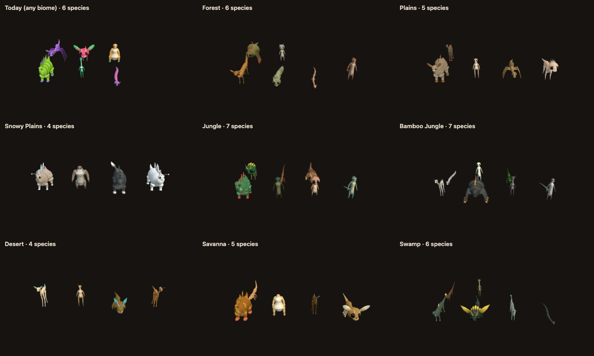

# Forest Drift — Biome-Specific Species Phase 0: Implementation Record

**Date:** 2026-11-13
**Plan:** [`../feature-plan/02-technical-plan.md`](../feature-plan/02-technical-plan.md) (revision 3) · decisions: [`../feature-plan/01-questions-and-decisions.md`](../feature-plan/01-questions-and-decisions.md)
**Status:** Phase 0 complete. Not committed. The world doesn't use rosters until Phase 1.

Phase 0 builds the biome families' animals and shows them in the Creature Lab.

## What you can see now

In the Creature Lab (`/creatures/?dev`), **Biome coat → Gallery: biome roster** shows one region's animals for the picked biome's family, in that biome's coat. With Classic or Neutral it shows today's six regional species.

The same region in eight biomes. The gallery scales every animal to the same height, so this compares shape and body plan, not size:

- **Snowy Plains:** four stocky, round, heavy animals; no giants.
- **Desert:** four slender, long-legged, big-eared runners.
- **Swamp:** long-bodied, finned animals and serpents.
- **Jungle and Bamboo Jungle:** seven species, with crests, bipeds and long tails. Bamboo leans further toward bipeds.
- **Plains and Savanna:** long-legged and long-necked herds, with giants allowed.
- **Forest:** round and crown-headed, horned, chunky or cute.

## How it works

| Piece                                   | File                                                                                                                                  |
| --------------------------------------- | ------------------------------------------------------------------------------------------------------------------------------------- |
| Family profiles and per-biome overrides | `src/lib/game/creatures/biome/biomeRosters.ts`                                                                                        |
| Roster function, guarantees, cache      | `src/lib/game/creatures/biome/BiomeRoster.ts` (`biomeRoster`, `rosterEntryCarryable`)                                                 |
| Species leanings                        | `SpeciesGenerator.ts` (`generateSpecies(seed, plan, lean?)`), `CreatureForm.ts` (`deriveSpeciesForm(species, lean?)`, `weightedPick`) |
| Lean type                               | `CreatureTypes.ts` (`SpeciesLean`)                                                                                                    |
| Lab gallery                             | `CreatureLab.showRoster`, `CreatureLabModal.svelte`                                                                                   |

- **Families.** The six families are the creature-coat families. A biome maps to a roster key: its family, or family plus biome where the biome overrides it (Q3). The overrides:
  - Desert: 4 species, density ×0.55, a 25% chance of one giant;
  - Snowy Plains and Snowy Slopes: 4 species, density ×0.55;
  - Bamboo Jungle: biped weight 4.5.
- **Building a roster.**
  - **Bands.** Band 0 always, then the family's bands shuffled and repeated as needed, sorted smallest first.
  - **Body plans.** Band 0 is a quadruped; the other bands are drawn from the family's weights.
  - **Riding.** If no biped was drawn, the smallest band from 1 to 3 becomes one.
  - **Species.** Each is generated with the family's lean and sized within its band.
  - **Behaviour.** Group sizes follow the old band rules, then the family's herd, fear, wander and speed multipliers apply. Variation is tightened, as for regional species.
- **Leanings without breaking old species.** A lean replaces a uniform pick (silhouette strategy, style, dominant and secondary traits, first name word) with a weighted pick that uses the same single random draw. Without a lean the original code path runs, so existing species, and biomes-off worlds, are unchanged. The creature fingerprint snapshots prove it.
- **Cache.** An LRU of 128 rosters. A new roster takes about 0.09 ms (budget 0.5 ms).

## Changes from the plan

- **Roster keys** carry the biome for the four overriding biomes, so those biomes get their own roster rather than a tweaked family one. That's simpler, and gives more variety.
- **`weightedPick` lives in `CreatureForm.ts`**, which `SpeciesGenerator.ts` already imports, avoiding a circular import.
- **Family density** is a roster property, read per biome by `rosterDensity` (used from Phase 1).

## Verification

- `npx vitest run`: **275 files, 3,069 tests pass**. New: `biome/__tests__/BiomeRoster.spec.ts` (6 tests) covers:
  - every biome in a family, and none with biomes off;
  - **carryable and rideable in every roster key across 60 regions**, checked with the room's own `abilityFor` and `rideFor` rules on real individuals;
  - counts per family;
  - giants only on open land and in the jungle, rare in the desert, never in forest, snow or swamp;
  - leanings measurably shift serpents, long legs, round bodies, bipeds and fins;
  - family name words;
  - plains herds larger than snow herds;
  - determinism and caching;
  - `generateSpecies` without a lean deep-equal to today.
- All existing creature tests pass unchanged, including the fingerprint snapshots, which shows species made without a lean are unchanged.
- `npm run check`: 0 errors. ESLint and Prettier clean on the changed files.
- E2E (Chromium): `creatures.e2e.ts` and `creatureBiomes.e2e.ts`, **6/6 pass**.

## Next: Phase 1

- Population and resolver use rosters at the herd's centre family, with family density.
- The room builds a lazy `BiomeField` from the published world, so it resolves the same species as clients.
- `GENERATOR_VERSION` 5, and the Worker relabels biomes-off worlds.
- A `biomeSpecies` golden in three engines.
- Online carry and ride e2e in a biome world.
