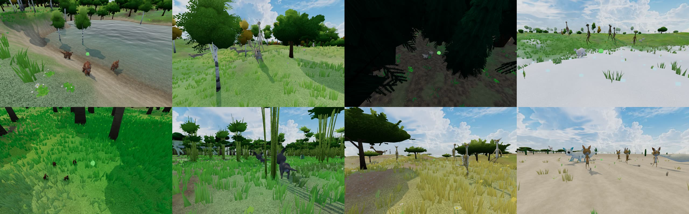

# Forest Drift — Biome-Specific Species Phase 1: Implementation Record

**Date:** 2026-11-13
**Plan:** [`../feature-plan/02-technical-plan.md`](../feature-plan/02-technical-plan.md) (revision 4) · earlier: [Phase 0](../phase-0/implementation.md)
**Status:** Phase 1 complete. Not committed, not deployed. **The Worker must be deployed before the site** (generator 5).

Herds in biome worlds now come from their biome family's roster, the multiplayer room agrees on every creature, and the generator version is 5.

One herd per family, in the world (top: forest, plains, taiga, snowy plains; bottom: jungle, bamboo jungle, savanna, desert). The names show each family's words: Bark, Gale, Frost, Snow, Liana, Canopy, Thorn and Sand. The swamp herd (Marsh Ribbon) was found too, but every camera spot was inside the canopy.

## What players get

- **Each herd belongs to its biome.** A herd's species comes from the roster of the family at its group centre, and it wears the coat of its exact biome, as before.
- **Fewer herds in deserts and on snowfields, more in jungles and on open land** (Q15), on top of the world's density setting. Live-creature caps don't change.
- **Biomes-off worlds keep today's regional species exactly** (Q10).
- **Online, carrying and riding stay exact.** The room works out the published world's biomes itself, so it rebuilds the same animal from a creature id as every player. A giant can never pass as a small creature.
- **Generator version 5.** Biomes-off worlds published at 1–4 are relabelled and keep opening. Biome worlds published at 4 keep 4: their creatures are different animals now, so new clients are refused until the world is republished (Q9).

## How it works

| Piece                                                 | File                                                                                            |
| ----------------------------------------------------- | ----------------------------------------------------------------------------------------------- |
| One rule for a slot's species, group size and density | `creatures/CreaturePopulationSystem.ts` (`slotSpecies`, `HerdBiomeSources`)                     |
| Population                                            | `generatePopulationCell` (via `slotSpecies`, family density)                                    |
| Resolver                                              | `creatures/carryableCreatureRef.ts` (`resolveAmbientCreature(seed, id, sources)`)               |
| Room biome source                                     | `creatures/biome/roomBiomeSources.ts`, `RoomCore` (`creatureBiomes`), `server/src/WorldRoom.ts` |
| Client wiring and switch                              | `ThreeScene.creatureRosterAt`, `?creatureRosters=off` (`creatureCoatSwitches.ts`)               |
| Height bands and `stature()`                          | `creatures/regionBands.ts`, moved out of the population module to avoid a circular import       |
| Generator 5 and relabel                               | `net/protocol.ts`, `server/src/generatorMigration.ts`                                           |
| Determinism                                           | `world/determinismReport.ts`: `biomeCreatures` through `slotSpecies`, new `biomeSpecies`        |

- **`slotSpecies` is the single rule** shared by the population, the client resolver, the room's resolver and the determinism report, so they can't drift apart.
  - **With a roster source:** it takes the roster for the family at the herd's centre. A per-cell seeded order picks each slot's species, so a cell's four slots differ. Giants (band 4 and up) herd alone, and the family density applies.
  - **Without one:** it uses today's regional species.
  - **Coats** apply on top in both cases.
- **The room** builds a `BiomeField` once per room, on the first creature check, from the stored base world's terrain and biome settings. Biomes read the pre-water base terrain only. Unreadable or biomes-off worlds give nothing, so the room uses today's species. The room passes rosters only; colours don't affect abilities.
- **The cell's random stream is unchanged.** Rosters use their own per-cell stream.

## Changes from the plan

- **`slotSpecies`** was added as the one shared rule, beyond the plan.
- **`regionBands.ts`** was split out to avoid a circular import between the population and rosters.
- **The Worker grew more than budgeted:** from 251.8 KiB to 306.2 KiB raw, against a budget of ≤ +30 KB; gzipped, 65.7 KiB to 80.9 KiB. My Phase 0 estimate (18.8 KB) covered only the terrain and biome classifier. The roster code, species leanings and biome definitions add the rest. It's still small next to Cloudflare's Worker size limit, and the first carry in a room costs about 7.5 ms. I accepted this rather than splitting the bundle.
- **`?creatureRosters=off`** is a local, development-only switch. Online, the room follows the published world, so a client with it on would disagree about creature identity.

## Verification

- `npx vitest run`: **276 files, 3,075 tests pass**. New: `biome/__tests__/biomeSpeciesInWorld.spec.ts` (5 tests) covers:
  - the room's biome lookup built from a published world equals the client's at 400 points;
  - biomes-off and unreadable worlds give the room nothing;
  - more than 100 herds in a biome world come from their centre family's roster;
  - the client resolver equals the population exactly, and the room resolver gives the same species, proportions, carry and ride;
  - biomes-off herds are deep-equal to today's;
  - desert below 0.75× and jungle above 1.1× forest herd counts.
- `server/tests/generatorMigration.spec.ts`: generator 5; 1–4 relabel when biomes are off; biome worlds at 3 or 4 unchanged.
- Determinism golden: `biomeCreatures` now goes through `slotSpecies` (regenerated), and `biomeSpecies` is new (212 roster species per seed). The terrain, hydrology, tree and biome sections are unchanged.
- `npm run check`, `npm run check:server`: 0 errors. ESLint is clean on the changed files, apart from the old `CreatureGrounding.ts:1065` error. Prettier clean.
- E2E (Chromium):
  - `determinism.e2e.ts` and `multiplayer.e2e.ts` in Chromium, WebKit and Firefox: **18/18 pass**. The `biomeSpecies` golden matches in all three engines, and the relabel and refusal rules hold against a real Worker.
  - `creatures.e2e.ts`, `creatureBiomes.e2e.ts` and `creatureRiding.e2e.ts` pass. The riding test's carry-onto-mount step is still occasionally flaky (crosshair), as before.
  - `rangedWeaponsMultiplayer.e2e.ts`: **3/3 pass** after a test fix. The pellet-flight test failed every time after Phase 1. The same test on the previous commit gets the same frame rate (about 5 fps) and passes, so rendering wasn't the cause. The small creature it carries is now a roster species standing on a hillside, and the ground rises 9 m over the pellet's 30 m path, so the pellet hit the slope at once. The test now fires from the nearest spot with open ground ahead.

## Deploy order (when you say)

1. `cd pages/Forest-Drift/server && npm run deploy` (Worker: accepts 5, relabels biomes-off worlds).
2. Push to main (Vercel builds the site at generator 5).
