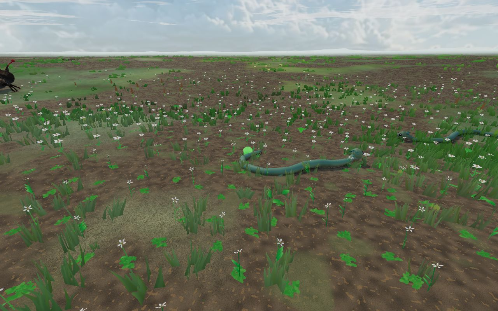

# Forest Drift — Biome-Specific Species Phase 2: Implementation Record

**Date:** 2026-11-16
**Plan:** [`../feature-plan/02-technical-plan.md`](../feature-plan/02-technical-plan.md) (revision 5) · earlier: [Phase 0](../phase-0/implementation.md), [Phase 1](../phase-1/implementation.md)
**Status:** Phase 2 complete. Not committed. No code that ships changed (tests, a benchmark and docs only), so nothing needs deploying.

Phase 2 checks the room in a biome world, measures cost, reviews the tuning and writes the docs. Phase 1 was deployed in order: the Worker (version `be6c016f`), then the site (commit `1617deec` pushed; I didn't check the Vercel build).

## The swamp

The Phase 1 grid had no swamp herd, because every camera spot was inside the canopy. Here it is with the trees hidden for the shot: Marsh Ribbon serpents, with a six-legged animal at the left edge.

## The room in a biome world

New `net/__tests__/RoomCoreBiomeCreatures.spec.ts` (5 tests) runs a `RoomCore` with the same `roomBiomeSources` the Worker uses, on a published biome world:

- it grants carries of small roster animals and rides on roster bipeds;
- it refuses big roster animals, **including ones that are small under today's regional species**. A room without the biome lookup would wrongly grant those, and a test shows it;
- it builds the biome lookup once, on the first creature check.

| Room check            | Budget   | Measured (warm process) |
| --------------------- | -------- | ----------------------- |
| First check in a room | ≤ 15 ms  | 0.7–0.8 ms              |
| Later checks          | ≤ 0.5 ms | 0.03 ms                 |

Phase 1 measured about 7.5 ms cold in a fresh Node process. That figure includes loading and compiling the code; this one doesn't.

## Cost

Measured on Apple M4 with Metal, in the release biome world near spawn: `tests/creatureSurfacePerformance.e2e.ts`, "species release A/B", opt-in with `CREATURE_BENCH=1`. Raw numbers: [`species-release-performance.json`](species-release-performance.json).

| Rosters    | Live | Frame   | p95    | CPU     | Draw calls | Logical | Species | Shadow casters |
| ---------- | ---- | ------- | ------ | ------- | ---------- | ------- | ------- | -------------- |
| On         | 40   | 4.85 ms | 7.6 ms | 4.66 ms | 447        | 1,963   | 40      | 33             |
| Off        | 40   | 4.77 ms | 9.2 ms | 4.63 ms | 411        | 1,108   | 24      | 21             |
| On (again) | 40   | 4.84 ms | 8.7 ms | 4.66 ms | 447        | 1,963   | 40      | 33             |

- **Frame and CPU time are unchanged** (within 0.1 ms), and live creatures stay at the cap of 40.
- **Draw calls rose 9% (411 → 447)**, against a budget of "unchanged". The cause is shadows: 12 more of the 40 live creatures are close enough to cast them, and there are 3 cascades (12 × 3 = 36). There's one program and one draw per creature, as before.
- **The logical population near spawn is 1.8× today's.** Spawn is on open land, where Q14 and Q15 together give herds ×1.5 and density ×1.3.

## Tuning review

Animals per area, relative to today's regional species (unit count over 1,200 cells):

| Family                    | Herds | Animals | Mean herd |
| ------------------------- | ----- | ------- | --------- |
| Today (biomes off)        | 1.00× | 1.00×   | 3.0       |
| Open land (plains)        | 1.34× | 2.18×   | 4.9       |
| Temperate forest          | 1.07× | 1.05×   | 3.0       |
| Wet (swamp)               | 0.91× | 0.94×   | 3.1       |
| Tropical (jungle, bamboo) | 1.29× | 0.96×   | 2.3       |
| Cold (taiga)              | 0.91× | 0.74×   | 2.5       |
| Warm-dry (savanna)        | 1.01× | 0.73×   | 2.2       |
| Snowfields, desert        | 0.60× | 0.52×   | 2.6       |

This matches the decisions: big herds on open land, more but smaller groups in the jungle, sparse deserts and snowfields. I kept the agreed values. If open land feels crowded in play, the one change I'd make is its density from ×1.3 to ×1.0, which would give about 1.7× today's animals there.

The screenshots (Phase 1's [grid](../phase-1/herds.jpg) and the swamp above) show each family's shape: stocky snow animals, long-legged plains and savanna herds, big-eared desert runners, crested jungle bipeds, and serpents in the swamp.

## Docs

- [`docs/creature-system.md`](../../../../creature-system.md): a new "Biome species" section (families, guarantees, leanings, `slotSpecies`, the room, switches, cost and population). The coat section no longer says the room is biome-free.
- [`docs/biomes.md`](../../../../biomes.md): what players see per family, the online behaviour, the generator 4 republish rule, and the code pointers.

## Verification

- `npx vitest run`: **277 files, 3,080 tests pass** (5 new).
- `npm run check`: 0 errors. ESLint and Prettier clean on the changed files.
- GPU benchmark: the species A/B above, run twice with the same result.

## Definition of done

Everything in the plan's §16 is done. The one item that needs you: **review the screenshots per family** (Phase 1 grid, swamp above).
