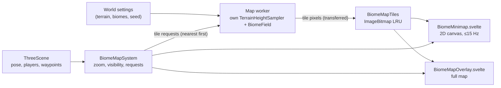

# Forest Drift — Biome Minimap: Technical Plan

**Feature cycle:** 2026-11-16
**Status:** **Revision 4: Phases 0–1 built (2026-11-16).** Decisions are locked in [`01-questions-and-decisions.md`](01-questions-and-decisions.md): the full map has pan, zoom and a pointer readout only (Q11), and both maps get a grid and coordinates (Q2). Phase records: [Phase 0](../phase-0/implementation.md), [Phase 1](../phase-1/implementation.md). §0 lists changes made while building.
**Related:** [`00-brief.md`](00-brief.md) · [`01-questions-and-decisions.md`](01-questions-and-decisions.md) · [`docs/biomes.md`](../../../../biomes.md)

Paths are relative to `pages/Forest-Drift/`.

---

## 0. Changes made while building

**Phase 0 (2026-11-16):**

1. **Water is drawn as shapes** (river lines, lake outlines) from the hydrology system's rivers and lakes, not sampled per pixel. It's cheaper, and rivers stay visible below a pixel wide.
2. **Tiles arrive twice**, land then water, and the worker draws all requested land before any water. Water far out (level 5–6) needs up to ~170 hydrology regions built, about 1.4 s per tile the first time.
3. **The palette was tuned against a test** of neighbouring biomes in three worlds, with colour-blind simulation.
4. **`BiomeField.lastBaseElevation()`** instead of `classifyPointWithHeight`.
5. **Tile positions snap to whole pixels** (no seams).
6. **The map e2e runs in WebKit and Firefox from Phase 0** (`webkit-map`, `firefox-map` projects).

**Phase 1 (2026-11-16):**

7. **Zoom keys are `'` (in) and `/` (out)**, not `PageUp`/`PageDown`: those are already Build level keys while walking. The full-map key moves to Phase 2.
8. **The minimap picks the coarsest tile level at least as sharp as the screen** (drawn at 0.5–2×), not "no finer than the screen" (1–2×).
9. **Preferences have their own store** (`biomeMapPreferences.ts`), with a "not chosen yet" state for Q6.
10. **The tutorial buttons and day clock step aside** while the minimap is shown (`--fd-map-inset`).

## 1. Summary

- **A map tile worker** draws 128 × 128 px tiles of biome colour and hill shading (and water, if Phase 0 shows it's cheap) at seven power-of-two resolutions, from 2 to 128 m per pixel. It runs its own copy of the terrain and biome code, built from the world's settings, so it never touches the game's biome cache or main thread [Q16].
- **The main thread** keeps finished tiles as `ImageBitmap`s in a small LRU, and draws the minimap on one 2D canvas: at most nine `drawImage` calls, only when something changed, at most 15 times a second. Players, waypoints and your arrow are drawn on top [Q2].
- **Zoom** is six steps (250 m to 8 km across), each using the nearest tile resolution. A coarser tile is shown scaled up while a sharper one is drawn, so the map is never blank [Q4].
- **Toggle**: a setting and a key. Off means no canvas, no worker and no per-frame work beyond one boolean check [Q6, Q7].
- **Full map** [Q1, Q11]: an overlay with pan and zoom on the same tiles, and the biome name, distance, direction and coordinates under the pointer.
- **Grid and coordinates** [Q2]: faint grid lines whose spacing follows the zoom, on both maps; your coordinates under the minimap.
- **No network, no saves, no protocol changes.** Biomes are deterministic, so every player computes the same map locally.

## 2. Existing system

| Area                 | File                                                                     | Today                                                                                                                                                                 |
| -------------------- | ------------------------------------------------------------------------ | --------------------------------------------------------------------------------------------------------------------------------------------------------------------- |
| Biome lookup         | `game/biomes/BiomeField.ts`                                              | A 16 m lattice in 64 m tiles, an LRU of 512 tiles (~2 km² round the player). `classifyPoint` classifies one point directly: **2.6 µs** in Node (measured 2026-11-16). |
| Biome definitions    | `game/biomes/biomeDefinitions.ts`, `BiomeTypes.ts`, `biomeDebugColor.ts` | 26 biomes with names and debug colours; a "biome map" debug terrain view.                                                                                             |
| Current biome on HUD | `game/biomes/BiomeTracker.ts`, `components/BiomeIndicator.svelte`        | Announces the biome you enter.                                                                                                                                        |
| Terrain              | `game/terrain/TerrainHeightSampler.ts`                                   | `sampleBase` (pre-water height) is what biomes read.                                                                                                                  |
| Water                | `game/hydrology/HydrologySystem.ts`                                      | `sampleWater(x, z)`: rivers and lakes. Cost in a worker not yet measured.                                                                                             |
| The room's biomes    | `game/creatures/biome/roomBiomeSources.ts`                               | Builds a `BiomeField` from a world's settings: the same recipe the map worker needs.                                                                                  |
| Workers              | `materials/MaterialMapSource.ts`, `music/midi/MidiWorkerClient.ts`       | Vite module workers (`new Worker(new URL(…), { type: 'module' })`).                                                                                                   |
| HUD                  | `routes/+page.svelte`, `hud/LocatorBar.ts`                               | FPS counter top-left, online status top-centre, day clock top-right; the locator bar knows other players' and waypoints' positions.                                   |
| Waypoints            | `game/waypoints/WaypointSystem.ts`                                       | Fixed and dynamic waypoints, private or public; "Add here" in the pause menu.                                                                                         |
| Keys and settings    | `game/input/keyActions.ts`, `game/settings/settingsCatalog.ts`           | Rebindable actions with contexts; `;`, `'`, `` ` ``, `PageUp` and `PageDown` are free while walking. Graphics settings such as "Show biome names".                    |

## 3. Architecture and data flow



- **`BiomeMapSystem`** (no DOM, no Three.js) holds the state: visible, zoom, size, which tiles are wanted, and the worker client. The scene feeds it your position and heading each frame (two numbers). It decides when a redraw is due.
- **The worker** is created when the map is first shown and terminated when it's turned off or the world closes.
- **The world's identity** for tiles is the biome field's generation (seed, terrain and biome settings). When it changes, the worker is re-initialised and every cached tile is dropped.

## 4. Map tiles

### 4.1 Levels and tiles [Q4]

| Level | Metres per pixel | One 128-px tile covers | Used for (minimap 180 px across) |
| ----- | ---------------- | ---------------------- | -------------------------------- |
| 0     | 2                | 256 m                  | 250 m across                     |
| 1     | 4                | 512 m                  | 500 m                            |
| 2     | 8                | 1 km                   | 1 km                             |
| 3     | 16               | 2 km                   | 2 km                             |
| 4     | 32               | 4 km                   | 4 km                             |
| 5     | 64               | 8 km                   | 8 km                             |
| 6     | 128              | 16 km                  | full map only (16 km)            |

A zoom step uses the finest level whose pixels are no smaller than the screen's, scaled by at most 2×. Tile `(level, tx, tz)` covers `[tx, tx+1) × 128 × mpp` metres in x and z, world-aligned, so tiles never shift as you move.

### 4.2 One pixel

1. **Biome weights at the pixel centre.** Levels 0–2 read the worker's own `BiomeField` lattice, so borders match the game's exactly. Levels 3–6 call `classifyPoint` directly, since a lattice cache would be no help that far apart.
2. **Colour** = the map palette blended by weight [Q9], giving soft borders like the ground.
3. **Hill shading**: a light from the north-west on the base-height gradient between neighbouring pixels (the tile carries a one-pixel border). Strength is scaled by level, so mountains read at every zoom. The base height comes from the same pass that classifies, through a small `BiomeField` addition (`classifyPointWithHeight`), so it isn't sampled twice.
4. **Water** (if Phase 0 allows): `HydrologySystem.sampleWater` in the worker, blending river and lake water over the colour. If building hydrology in the worker costs more than the budget, water is left out and the plan's §0 records why [Q2].
5. **Biomes off** [Q8]: shading (and water) over a neutral land colour.

### 4.3 Order, cancelling and fallbacks

- Requests are **nearest first**: tiles under the minimap, then the parent level's tiles (a quick coarse picture), then a prefetch ring biased in your direction of travel.
- Tiles that leave the wanted set before they start are **cancelled**.
- While a tile is missing, the **parent (or grandparent) tile is drawn scaled up**, so the map is never blank.
- **One worker**, one tile at a time. A tile takes about 20–60 ms (§12), and a full minimap fills in under half a second from cold.

### 4.4 Cache [Q13]

- Main thread: an LRU of `ImageBitmap`s, 120 tiles at most (64 KB each, about 7.7 MB). Bitmaps are closed when evicted.
- The worker keeps nothing but its biome lattice LRU (its own, separate from the game's).
- Memory only; nothing goes to storage.

## 5. The minimap [Q2, Q5, Q6, Q7, Q10, Q14]

- **`BiomeMinimap.svelte`**: a round, top-right canvas at the chosen size (140, 180 or 240 CSS px), sized for the device pixel ratio. The day clock moves below it.
- **Drawing** is a clip circle, up to nine tile `drawImage` calls, then other players (dots in their colours), waypoints (pins) and a north marker. Your arrow is a CSS-rotated element, so turning never redraws the canvas.
- **Redraws** happen only when you've moved half a pixel or more at the current zoom, a tile arrived, the zoom changed, or players or waypoints moved (checked at 10 Hz). At most 15 a second.
- **Under the map**: the current biome name (from `BiomeTracker`), the zoom ("1 km") and your coordinates ("x 1 240 · z −3 450", rounded to metres).
- **Grid** [Q2]: faint world-aligned lines drawn on the canvas after the tiles, spaced at a quarter of the map's width rounded to 100 m, 250 m, 500 m, 1 km or 2 km. A "Map grid" setting turns it off (on by default).
- **Controls**:
  - actions `map.toggle` (`;`), `map.zoomIn` (`PageUp`), `map.zoomOut` (`PageDown`) and `map.open` (`'`), in the walking, flying and riding contexts, all rebindable;
  - on touch, tap the map to open the full map, and use the `+`/`−` buttons beside it.
- **Settings** (graphics, per browser):
  - "Show biome map" (on by default in biome worlds; it remembers your choice);
  - "Biome map size" (Small, Medium, Large);
  - "Map grid" (on by default);
  - the last zoom is remembered.
- **Hidden** while menus, the Lab or the mini-build editor are open, and while the camera is in a cut-scene or tutorial step that hides the HUD.

## 6. The full map [Q11, Q12, Q14, Q15]

- **`BiomeMapOverlay.svelte`** opens with `'`, from the pause menu, or by tapping the minimap. It frees the mouse and pauses single-player games; online, you stand still and the world carries on.
- **Pan and zoom**: drag, mouse wheel, pinch, arrow keys and `+`/`−`. Seven levels, centred on you at first. "Centre on me" button.
- **Under the pointer**: the biome name, the distance and direction from you, and the coordinates. The main thread calls `classifyPoint` once per pointer move (2.6 µs).
- **Grid and coordinates** [Q2]: the same grid, with its lines labelled at the edges (metres from the world origin), and the pointer's coordinates in the readout.
- **Shown, not editable**: you, other players and waypoints, as on the minimap. There is no legend, "find nearest" or setting waypoints from the map (Q11); those can be added later on the same tiles.
- **Close** with `Esc`, `'` or the close button.

## 7. New and changed files

| File                                                      | Change                                                                                  |
| --------------------------------------------------------- | --------------------------------------------------------------------------------------- |
| `game/map/biomeMapPalette.ts`                             | New: the map palette (26 biomes + neutral), colour-blind checked                        |
| `game/map/biomeMapTiles.ts`                               | New: levels, tile maths, pixel drawing (pure, unit-tested; shared by worker and tests)  |
| `game/map/biomeMap.worker.ts`                             | New: builds terrain + biome field (+ hydrology) from settings; draws tiles              |
| `game/map/BiomeMapClient.ts`                              | New: worker client, request queue and cancelling, `ImageBitmap` LRU                     |
| `game/map/BiomeMapSystem.ts`                              | New: visibility, zoom, wanted tiles, redraw decisions                                   |
| `components/BiomeMinimap.svelte`                          | New: the corner minimap                                                                 |
| `components/BiomeMapOverlay.svelte`                       | New: the full map                                                                       |
| `game/biomes/BiomeField.ts`                               | `classifyPointWithHeight` (returns the base height it already computes)                 |
| `game/ThreeScene.ts`                                      | Owns `BiomeMapSystem`; feeds pose, players and waypoints; pause/resume for the full map |
| `game/input/keyActions.ts`                                | Four actions                                                                            |
| `game/settings/settingsCatalog.ts`, graphics settings     | "Show biome map", "Biome map size", remembered zoom                                     |
| `routes/+page.svelte`                                     | Mounts both components; moves the day clock                                             |
| `components/PauseMenu.svelte`                             | "Map" button                                                                            |
| `components/TouchControls.svelte`                         | Room for the minimap and its buttons                                                    |
| `docs/biomes.md`, `docs/2026/11-16/Biome-Minimap/phase-*` | Docs and phase records                                                                  |

## 8. Data model

```ts
interface BiomeMapSettings {
	show: boolean | null; // null: not chosen yet (on in biome worlds) [Q6]
	size: 'small' | 'medium' | 'large';
	zoom: number; // 0..5 (the minimap's steps)
}
type TileKey = `${generation}:${level}:${tx}:${tz}`;
// Worker messages
type ToWorker =
	| {
			t: 'init';
			generation: number;
			seed: string;
			terrain: TerrainSettings;
			biomes: BiomeSettings;
			water: boolean;
	  }
	| { t: 'tile'; key: TileKey; level: number; tx: number; tz: number }
	| { t: 'cancel'; key: TileKey };
type FromWorker = { t: 'tile'; key: TileKey; pixels: ArrayBuffer; ms: number };
```

Nothing is added to world saves or the network.

## 9. API and protocol

None: no server or protocol changes, and no Worker (Cloudflare) deploy.

## 10. Authentication, security and privacy

- The map reveals nothing a player couldn't compute from the world they've already loaded.
- Other players' dots use the positions the locator bar already receives.
- No storage beyond the existing graphics settings [Q13].

## 11. Edge cases

| #   | Case                                                 | Behaviour                                                                                                           |
| --- | ---------------------------------------------------- | ------------------------------------------------------------------------------------------------------------------- |
| E1  | Biome or terrain settings change while playing       | The generation changes; the worker re-initialises, the caches clear, and the map redraws (parents first).           |
| E2  | Flying fast at the closest zoom (49 m/s, 2 m/px)     | A tile is 256 m wide, so about 5 s to cross one; the prefetch ring stays ahead. Parents fill any gap.               |
| E3  | Teleports (respawn, joining online, waypoints)       | Wanted tiles change at once; the old requests are cancelled.                                                        |
| E4  | Very large coordinates (biome spawn offsets ~−47 km) | Tile maths uses world metres in floats; tile indices fit comfortably. Tested at ±200 km.                            |
| E5  | Workers unavailable or failing                       | The minimap shows "Map unavailable" and the game is unaffected. No main-thread fallback (it would cost frame time). |
| E6  | Biomes kill switch or `?biomes=off`                  | Treated as biomes off [Q8].                                                                                         |
| E7  | Online world with biomes the client can't see yet    | The map follows the client's own biome field, which matches the room (generator 5).                                 |
| E8  | Terraforming with the shovel                         | Not shown: biomes and the map read the pre-edit base terrain.                                                       |
| E9  | Small screens and touch                              | The minimap shrinks to Small below 700 px wide and sits clear of the touch controls.                                |
| E10 | Tab hidden                                           | No redraws (requestAnimationFrame stops); the worker finishes its current tile and waits.                           |

## 12. Performance [Q16]

| Metric                        | Budget                                                             | How measured                                     |
| ----------------------------- | ------------------------------------------------------------------ | ------------------------------------------------ |
| Main thread, minimap on       | ≤ 0.1 ms per frame on average, ≤ 0.5 ms at most                    | Performance marks round the redraw, 60 s flights |
| Frame time, minimap on vs off | No measurable difference                                           | GPU A/B benchmark, as for creatures              |
| Worker: one 128-px tile       | ≤ 60 ms (levels 3–6), ≤ 40 ms (levels 0–2)                         | Worker timing, logged per tile                   |
| Minimap from cold             | Coarse picture ≤ 150 ms, sharp ≤ 0.6 s                             | e2e timing                                       |
| Memory                        | ≤ 8 MB of tiles                                                    | LRU size                                         |
| Off                           | No worker, no canvas, no per-frame work                            | e2e check                                        |
| Bundle                        | The worker is its own chunk; the main bundle grows ≤ 15 KB gzipped | Build output                                     |

**Estimate.** A tile has 16,384 pixels. At 2.6 µs to classify, plus shading from the same pass, levels 3–6 come to about 45 ms. Levels 0–2 interpolate a cached lattice (about 0.5 µs), about 15 ms. Water is the unknown; Phase 0 measures it.

## 13. Accessibility [Q15]

- **Colour.** Neighbouring biomes differ in lightness as well as hue. The palette is checked under deuteranopia and protanopia simulations (the Lab already has the filters), and every colour's name shows under the pointer.
- **Keyboard only.** Arrow keys pan the full map, `+`/`−` zoom, `Tab` reaches the zoom, "centre on me" and close buttons, and `Esc` closes.
- **Screen readers.** The minimap is decorative (`aria-hidden`); the current biome is already announced. The full map's pointer readout goes to a polite live region, throttled to one update a second.
- **Reduced motion.** No animated panning; jumps are instant.

## 14. Tests [Q18]

| Level  | Test                                                                                                                                                                                           |
| ------ | ---------------------------------------------------------------------------------------------------------------------------------------------------------------------------------------------- |
| Unit   | Tile maths (levels, keys, world ↔ tile ↔ screen) at ±200 km; zoom steps; redraw decisions; LRU and bitmap closing                                                                              |
| Unit   | Pixel drawing: a tile's dominant biome equals `BiomeField.dominantAt` at 200 sample pixels per level; shading direction                                                                        |
| Unit   | Palette: 26 distinct colours, neighbour lightness gaps, colour-blind simulation differences above a threshold                                                                                  |
| Worker | Runs in Vitest's worker pool: init, tile, cancel, re-init on a new generation                                                                                                                  |
| E2E    | Toggle (key, setting, remembered), zoom, size; full map open/close, pan, zoom, pointer readout, grid and coordinates; biomes-off world; touch (tap, buttons, pinch). Chromium, WebKit, Firefox |
| E2E    | Off costs nothing: no worker created, no canvas                                                                                                                                                |
| Perf   | Main-thread time per frame during a scripted flight; worker tile times per level; minimap on/off frame A/B                                                                                     |

## 15. Rollback

- A build constant, `BIOME_MAP_AVAILABLE`, and `?biomeMap=off` hide every trace (settings rows, keys, buttons).
- Nothing is saved but three graphics settings, which are ignored if the feature is off.
- A plain revert is safe.

## 16. Definition of done

- [ ] Corner minimap with biome colours, shading (and water if cheap), you, other players and waypoints.
- [ ] Six zoom steps by key, button and touch; toggle by key and setting, remembered; off costs nothing.
- [ ] Full map with pan, zoom and the pointer readout (name, distance, direction, coordinates).
- [ ] Grid and coordinates on both maps, with a setting to hide the grid.
- [ ] Budgets in §12 met and measured; numbers in the phase records.
- [ ] Tests in §14 pass in three browsers.
- [ ] Screenshots per phase reviewed by you.
- [ ] Docs and phase records written.

## 17. Assumptions (to confirm)

1. The map worker can build the same `BiomeField` as the client from the world's settings, as the multiplayer room does (`roomBiomeSources`). It reads the pre-water base terrain, so it doesn't need the hydrology system for biomes.
2. Water on the map needs `HydrologySystem` in the worker. Its cost there is unknown until Phase 0.
3. Other players' positions and the visible waypoints can be read from what the locator bar already uses, with no new network messages.
4. `;`, `'`, `PageUp` and `PageDown` are free in the walking, flying and riding contexts (checked in `keyActions.ts` on 2026-11-16).
