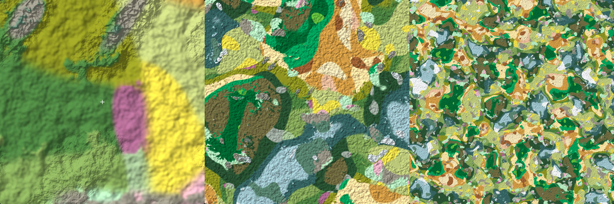
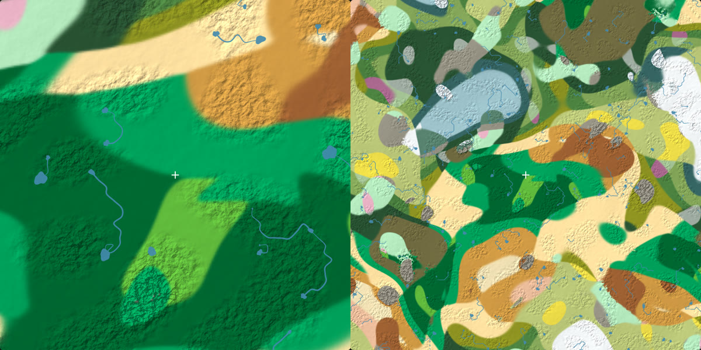

# Forest Drift — Biome Minimap Phase 0: Implementation Record

**Date:** 2026-11-16
**Plan:** [`../feature-plan/02-technical-plan.md`](../feature-plan/02-technical-plan.md) (revision 3) · decisions: [`../feature-plan/01-questions-and-decisions.md`](../feature-plan/01-questions-and-decisions.md)
**Status:** Phase 0 complete. Not committed. Nothing in the game uses it yet; the minimap arrives in Phase 1.

Phase 0 builds the map tiles: a background worker that draws biome colour, hill shading, rivers and lakes, a main-thread tile cache, and a developer preview at `/biome-map/?dev`.

## What you can see

The Main World at three zoom levels: 2 m, 16 m and 64 m per pixel (a 1.5 km, 12 km and 49 km wide preview). The minimap will show a 180 px window of these, 250 m to 8 km across.

A new world with rivers and lakes (the Main World has no water: it predates hydrology), at 4 and 16 m per pixel:

To try it: open `/biome-map/?dev`. Drag to pan, scroll or use the buttons to zoom. `&seed=anything` previews a new world with that seed, and the checkboxes turn biomes and water off.

## How it works

| Piece                                                     | File                                                      |
| --------------------------------------------------------- | --------------------------------------------------------- |
| Map palette (26 biomes, neutral land, water)              | `game/map/biomeMapPalette.ts`                             |
| Levels, tile maths, land and water drawing (pure)         | `game/map/biomeMapTiles.ts`                               |
| The world as the map sees it (terrain, biomes, hydrology) | `game/map/mapWorld.ts` (`MapWorld`, `mapWorldSettingsOf`) |
| Worker and its messages                                   | `game/map/biomeMap.worker.ts`, `biomeMapProtocol.ts`      |
| Main-thread client: requests, cancelling, bitmap LRU      | `game/map/BiomeMapClient.ts`                              |
| Painting a view, with coarser tiles filling gaps          | `game/map/mapView.ts` (`wantedTiles`, `paintView`)        |
| Base height from the last classification                  | `BiomeField.lastBaseElevation()`                          |
| Developer preview                                         | `routes/biome-map/+page.svelte`                           |

- **Tiles** are 128 × 128 px at seven levels, 2 to 128 m per pixel, world-aligned. North is up: screen up is world −Z, where the camera faces at yaw 0.
- **Land.**
  - **Colour.** Levels 0–2 read the worker's own copy of the game's 16 m biome lattice, so borders are exactly the game's. Further out, each pixel is classified directly, which a lattice cache couldn't help with. Colours blend by biome weight, so borders are soft like the ground.
  - **Shading.** Hill shading is lit from the north-west, using the base height the classification already computed, so heights aren't sampled twice.
- **Water** is drawn as shapes, not sampled per pixel. Rivers are lines along their samples, at least about a pixel wide so they show at every zoom. Lakes follow their real shoreline shape. The hydrology regions a tile can reach are built first.
- **Land first.** The worker draws land for every requested tile before any water. A tile arrives twice: land at once, then with water. Water can need many hydrology regions built, so a whole view of land beats water on one tile.
- **The client** asks for the tiles a view needs, nearest first, and cancels any it stops needing. It keeps up to 120 finished tiles as `ImageBitmap`s (about 7.7 MB) and closes the ones it evicts. A new world (seed or settings) drops everything.
- **Gaps.** While a sharper tile is missing, the view draws the matching quarter (or sixteenth) of a coarser cached tile scaled up. The next coarser level is requested first, since one tile covers four.

## Costs

Measured 2026-11-16 on Apple M4, Chromium unless noted:

| Measurement                           | Budget         | Result                                                      |
| ------------------------------------- | -------------- | ----------------------------------------------------------- |
| Land, levels 0–2 (lattice)            | ≤ 40 ms / tile | **20–32 ms** (WebKit 11–14 ms, Firefox 15–18 ms)            |
| Land, levels 3–6 (direct)             | ≤ 60 ms / tile | **28–33 ms** (WebKit about 20 ms, Firefox 27–28 ms)         |
| Water, levels 0–3                     | —              | **0–30 ms** / tile once regions are built                   |
| Water, level 4 (4 km tiles)           | —              | **36–110 ms** / tile, mostly building regions               |
| Water, level 5 (8 km tiles), cold     | —              | **≈ 1.4 s** / tile: one tile reaches ~170 hydrology regions |
| Classifying a biome point (Node)      | —              | 2.6 µs; a water sample 1.4 µs once its region is built      |
| A 1.5 km preview (36 tiles) from cold | —              | 1.8 s, all in the worker                                    |
| Memory                                | ≤ 8 MB         | 120 tiles × 64 KB ≈ 7.7 MB at most                          |

- **Everything above runs in the worker.** The main thread only turns tiles into bitmaps and draws them. Its per-frame cost will be measured in Phase 1, in the game.
- **Water far out is slow the first time** (level 5 and beyond), but the land is already on screen. For the minimap's farthest step (8 km across, mostly level 4–5 tiles) water fills in over a few seconds the first time. Built regions are kept, so it's only slow once per area. **Proposal:** keep water at every level, since land-first ordering hides the wait. If it feels slow in Phase 1, draw water at levels 5–6 only where regions are already built.

## Changes from the plan

- **Water is drawn as shapes, not sampled per pixel.** It's cheaper, and rivers stay visible when they're thinner than a pixel.
- **Tiles arrive twice** (land, then water), and the worker always finishes land first.
- **The palette was tuned by a test.** The test finds which biomes actually border each other in three worlds (about 50 pairs). It requires every pair to differ by at least 0.06 in OKLab, and by 0.035 under deuteranopia and protanopia simulation. Its first run failed 13 pairs (meadow and plains, jungle and swamp, savanna and dry grassland, and others); five rounds of changes fixed them all.
- **`BiomeField.lastBaseElevation()`** replaces the planned `classifyPointWithHeight`. It's a smaller change that gives the same saving.
- **Tile positions snap to whole pixels**, after a first version showed hairline seams between tiles.
- **WebKit and Firefox** run the e2e test now, not only in Phase 3, through two new projects (`webkit-map`, `firefox-map`).

## Verification

- `npx vitest run`: **281 files, 3,098 tests pass**. New in `game/map/__tests__/` (15 tests):
  - **tile maths**, at ±200 km and at the biome spawn offset;
  - **pixels agree with the game's biome lookup**: 200 pixels per level, identical at levels 0–2, over 95% further out (border pixels classified directly);
  - **drawing**: shading direction, neutral land, blended borders, a 1 m river visible at 2 m/px, lakes in shape, real rivers and lakes in a world with water;
  - **palette distinctness** for neighbours, with colour-blind simulation;
  - **the client**: requests, cancels, land-then-water, LRU, a world change, late tiles;
  - **the view**: coarser tiles first, borrowed quarters, gaps.
- E2E `tests/biomeMap.e2e.ts` (2 tests) in **Chromium, WebKit and Firefox: 6/6 pass**. It covers the Main World at near and far zoom, water in a new world, and biomes-off land, with no console errors.
- `npm run check`: 0 errors. ESLint and Prettier clean on the new and changed files.

## Next: Phase 1

The corner minimap in the game:

- toggle (`;`), zoom (`PageUp`/`PageDown`) and size settings;
- your arrow, other players and waypoints;
- a grid and coordinates, the current biome's name, touch buttons;
- per-frame main-thread cost measured on a flight.
