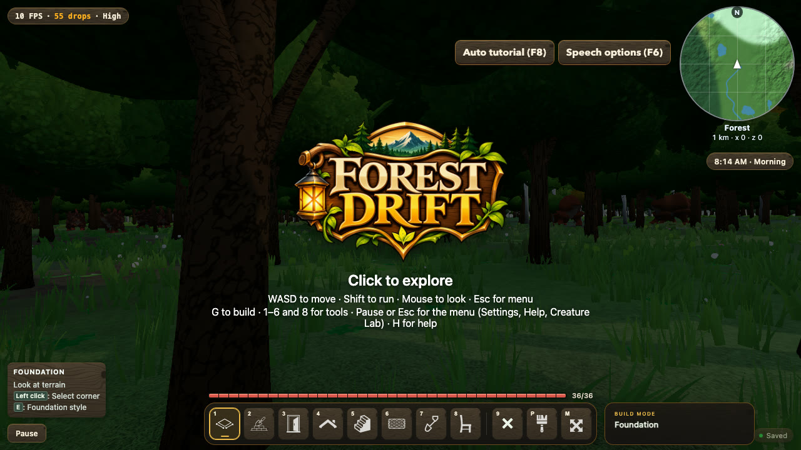
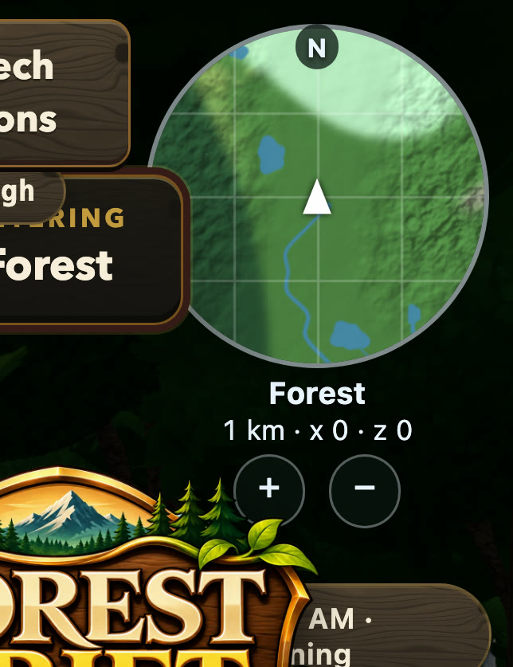

# Forest Drift — Biome Minimap Phase 1: Implementation Record

**Date:** 2026-11-16
**Plan:** [`../feature-plan/02-technical-plan.md`](../feature-plan/02-technical-plan.md) (revision 4) · earlier: [Phase 0](../phase-0/implementation.md)
**Status:** Phase 1 complete. Not committed. Site only: no server deploy needed.

The biome minimap is in the game: a round map in the top-right corner, coloured by biome, that you can zoom and turn off.

## What players get

- **A round minimap, top-right**, north up, with:
  - biome colours, hill shading, rivers and lakes;
  - your arrow (it turns as you do), other players online as dots in their colours, and active waypoints as diamonds. Ones off the map sit on its rim;
  - a faint grid at round spacings (50 m to 2 km);
  - underneath: the current biome's name, the zoom ("1 km") and your coordinates ("x 1 240 · z −3 450").
- **Zoom:** six steps, 250 m to 8 km across. Default 1 km.
- **Keys** (rebindable, and listed in the Controls guide):
  - `;` shows or hides the map, with a toast ("Biome map off · ; to show");
  - `'` zooms in, `/` zooms out.
- **Settings → Graphics:** "Show biome map", "Biome map size" (Small 140, Medium 180, Large 240 px) and "Map grid".
- **Remembered** per browser: whether it's shown, its size, zoom and grid.
- **On by default in biome worlds** (Q6). In a world with biomes off it stays hidden until you turn it on. Then it's a terrain map with the note "Biomes are off in this world" (Q8).
- **Touch:** `+` and `−` buttons under the map (on screens without a hover pointer). Below 700 px wide the map is always Small.
- **Out of the way:** the day clock moves under the map, and the tutorial buttons move to its left. It's hidden during screenshots and in the mini-build editor.

On a phone (iPhone 13 size):

## How it works

| Piece                                              | File                                                                                                      |
| -------------------------------------------------- | --------------------------------------------------------------------------------------------------------- |
| Minimap state, painting, zoom maths, grid, markers | `game/map/BiomeMapSystem.ts`                                                                              |
| Remembered settings                                | `game/map/biomeMapPreferences.ts` (`forest-drift.biome-map.v1`)                                           |
| The frame (canvas, arrow, caption, touch buttons)  | `components/BiomeMinimap.svelte`                                                                          |
| Scene wiring                                       | `ThreeScene` (`biomeMap`, `toggleBiomeMap`, `zoomBiomeMap`, `setBiomeMapElements`, stats `biomeMap`)      |
| Other players                                      | `MultiplayerSession.mapPlayers` (the positions the locator bar already uses)                              |
| Keys, settings, guide                              | `keyActions.ts` (`map.toggle`, `map.zoomIn`, `map.zoomOut`), `settingsCatalog.ts`, `ControlsGuide.svelte` |
| Mounting, key handling, HUD layout                 | `routes/+page.svelte`, `TutorialOverlay.svelte` (`--fd-map-inset`)                                        |

- **The scene paints the canvas directly**, as the locator bar does, so moving never re-renders a Svelte component. The component only lays out the frame and hands its elements to the scene.
- **Paints happen only when something changed**: you moved half a pixel, a tile arrived, the zoom changed, or markers are present (read 10 times a second). At most 15 a second. Turning only rotates the arrow element; the canvas isn't redrawn. Labels update 4 times a second.
- **The world is checked once a second.** If its terrain, biome or water settings changed, the worker restarts with the new ones and the tiles are dropped.
- **Hidden means gone:** the component unmounts, the scene detaches, and the worker and every tile are freed. The only per-frame cost left is one check.
- **Tile level:** the coarsest level that is at least as sharp as the screen. Tiles are drawn at 0.5–1× (up to 2× at 250 m on a large map), so the map is never blurrier than the screen.

## Costs

The main thread's time in the minimap per frame, on a scripted 20 s flight at 40 m/s (`tests/biomeMinimap.e2e.ts`):

| Browser             | Frames | Average      | Most                    | Paints     |
| ------------------- | ------ | ------------ | ----------------------- | ---------- |
| Chromium (headless) | 106    | **0.065 ms** | 0.2 ms                  | 104        |
| WebKit              | 1,188  | **0.012 ms** | 1 ms (timer resolution) | 183 (≈9/s) |
| Firefox             | 1,153  | **0.032 ms** | 1 ms (timer resolution) | 186 (≈9/s) |

The budget was 0.1 ms on average and 0.5 ms at most. Every average is well under it. WebKit and Firefox round `performance.now()` to a millisecond, so their "most" is a single tick, not a measured 1 ms. Chromium's finer timer shows a worst frame of 0.2 ms. All drawing of tiles stays in the worker.

## Changes from the plan

- **Zoom keys are `'` and `/`, not `PageUp`/`PageDown` (Q7).** `PageUp` and `PageDown` are already alternative keys for Build level up and down while walking, so the key-conflict tests failed. `;`, `'` and `/` are free whenever you're walking, flying or riding, and sit together on the keyboard. **You confirmed these** (2026-11-16).
- **Tiles can be drawn downscaled (0.5–1×)**, not only enlarged (1–2×), so the map stays sharp.
- **Preferences live in their own small store**, not the graphics settings object, since they carry a "not chosen yet" state.
- **The full-map key (`'` in the plan) is now zoom-in**, so Phase 2 needs a different key for the full map; I'll propose one then.

## Verification

- `npx vitest run`: **282 files, 3,105 tests pass**. New: `game/map/__tests__/BiomeMapSystem.spec.ts` (7 tests) covers:
  - zoom maths at every size;
  - grid spacing and coordinate formatting;
  - preferences (following the world until chosen, reload, corrupt store);
  - the worker existing only while shown;
  - repaint throttling (none standing still, about 15 a second moving);
  - the arrow turning without a repaint, and a changed world re-initialising.

  The key-conflict tests caught the `PageUp` clash.

- E2E `tests/biomeMinimap.e2e.ts` (3 tests) in **Chromium, WebKit and Firefox: 9/9 pass**. It covers:
  - shown by default; the biome name and coordinates;
  - `'` and `/` zoom;
  - `;` hides it and stops the worker; remembered after a reload;
  - the Large size;
  - a biomes-off world (hidden until chosen, then a terrain map with the note);
  - the flight cost.
- Also passing: `biomeMap.e2e.ts` and `biomes.e2e.ts`.
- **Not caused by this phase:** two tests in `tutorials.e2e.ts` fail ("text tutorial stays local…" times out on a key press; "auto mode politely explains…" sees the retry message instead of the expected one). They fail the same way on the previous commit (`f93229f8`, before the minimap), checked in a separate worktree.
- **Not checked yet:** other players' dots in a real online session. The markers come from the same positions as the locator bar, but no e2e test covers them online (planned for Phase 3).
- `npm run check`: 0 errors. ESLint and Prettier clean on the changed files.

## Next: Phase 2

The full-screen map:

- pan and zoom (out to 16 km);
- the biome name, distance, direction and coordinates under the pointer;
- grid labels;
- pausing when playing alone;
- tapping the minimap to open it on touch;
- a key to open it (to be chosen, since `'` now zooms).
