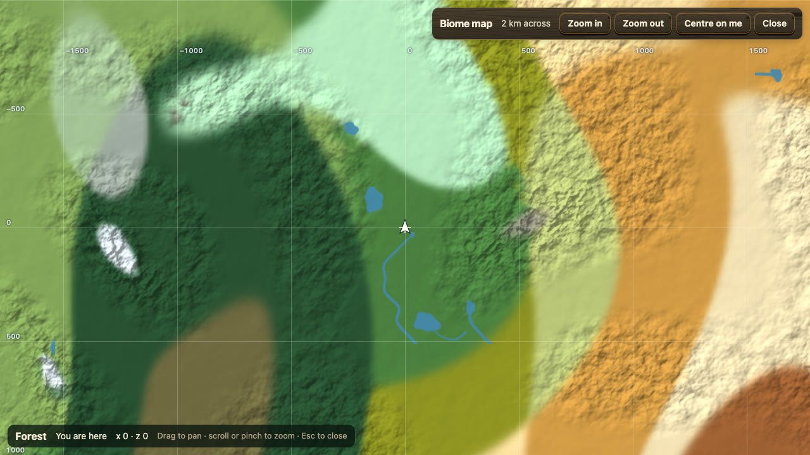
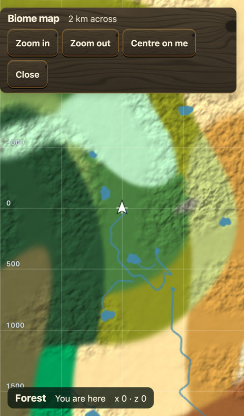

# Forest Drift — Biome Minimap Phase 2: Implementation Record

**Date:** 2026-11-16
**Plan:** [`../feature-plan/02-technical-plan.md`](../feature-plan/02-technical-plan.md) (revision 5) · earlier: [Phase 0](../phase-0/implementation.md), [Phase 1](../phase-1/implementation.md)
**Status:** Phase 2 complete. Not committed. Site only: no server deploy needed.

The full-screen biome map: pan and zoom out to 16 km, and point anywhere to read its biome, distance, direction and coordinates.

## What players get

- **Opening it:**
  - `` ` `` (backquote, rebindable);
  - **Map** in the pause menu;
  - tapping or clicking the minimap whenever the mouse isn't captured.
- **Closing it:** `Esc`, `` ` `` again, or **Close**.
- **Pausing (Q12):** it pauses the game when you're playing alone, through the same rule as the settings and the Creature Lab. Online the world carries on, and you stand still.
- **Pan:** drag with the mouse or a finger, or use the arrow keys.
- **Zoom** in six steps, 500 m to 16 km across the screen's shorter side:
  - scroll (it zooms about the pointer), pinch, `+`/`−`, or the **Zoom in** and **Zoom out** buttons;
  - it opens one step further out than the minimap (a 1 km minimap opens a 2 km map), centred on you;
  - **Centre on me** (or `C`) brings you back.
- **The readout** at the bottom describes what's under the pointer, or the centre crosshair when you use keys or touch:
  - its biome ("Snowy Taiga");
  - its distance and direction from you ("2.4 km north-east", or "You are here");
  - its coordinates.

  Screen readers hear it through a polite live region, at most once a second.

- **Grid lines** are labelled in metres along the top and left edges (Q2). The map also shows you as an arrow, other players and waypoints.
- **No legend, "find nearest" or waypoint setting** (Q11, as you chose). They could be added on the same tiles later.

On a phone the buttons wrap, and the hint text is hidden on touch screens:

## How it works

| Piece                                        | File                                                                                                                     |
| -------------------------------------------- | ------------------------------------------------------------------------------------------------------------------------ |
| The full map (drawing, input, readout)       | `components/BiomeMapOverlay.svelte`                                                                                      |
| View maths, directions, distances, host type | `game/map/BiomeMapSystem.ts` (`fullMapViewport`, `compassDirection`, `formatDistance`, `FullMapHost`)                    |
| Shared tile worker                           | `BiomeMapSystem.openFull` / `closeFull`                                                                                  |
| Scene                                        | `ThreeScene` (`openFullBiomeMap`, `closeFullBiomeMap`, `biomeNameAt`, `mapPose`, `mapMarkers`)                           |
| Page, pause menu, minimap tap, key           | `routes/+page.svelte`, `PauseMenu.svelte` (`onOpenMap`), `BiomeMinimap.svelte` (`onOpen`), `map.open` in `keyActions.ts` |

- **One worker for both maps.** The full map borrows the minimap's tile client, so tiles are shared. The worker runs while either map is open: open the full map with the minimap off and it starts, then stops when you close it.
- **Repaints only when something changed:** you panned or zoomed, a tile arrived, or markers moved (checked 10 times a second).
- **Tiles: about 40 to fill a screen.** The full map lets tiles stretch up to 2.5× before choosing a finer level, which keeps a full screen to about 40 tiles. The tile cache holds 120.
- **Only the tiles on screen.** Views now request just the tiles their width and height need; before, they requested a square the size of the longer side.
- **The pointer readout** classifies one point on the main thread (`classifyPoint`, about 3 µs) without touching the game's biome cache. It only does so when the pointer moves to a different metre.
- **Dialog keys** (arrows, `+`, `−`, `C`) are read from `event.key`, as other dialogs do. The project's "no raw key codes" test enforces that.

## Changes from the plan

- **The open key is `` ` ``.** The plan's `'` now zooms the minimap (Phase 1). `` ` `` is free whenever you're walking, flying or riding. **You confirmed it** (2026-11-16); it's rebindable either way.
- **The full map's closest zoom is 500 m, not 250 m.** A whole screen of 250 m would stretch the finest (2 m) tiles about 6×. At 500 m on a 1080 px tall screen they stretch about 4.3×. That looks soft rather than pixelated, because biome borders are soft anyway (they come from a 16 m grid). The minimap still goes to 250 m.
- **Grid labels sit just below the header**, so the header doesn't cover them.

## Verification

- `npx vitest run`: **282 files, 3,108 tests pass**. New in `BiomeMapSystem.spec.ts`:
  - full-map tile counts at three screen sizes and every zoom (70 tiles at most);
  - compass directions and distances;
  - the shared worker's lifecycle.
- E2E `tests/biomeMinimap.e2e.ts` (now 4 tests) and `biomeMap.e2e.ts` in **Chromium, WebKit and Firefox: 18/18 pass**. The new full-map test covers:
  - opening with `` ` ``; pausing alone and resuming after;
  - the readout's biome and "You are here", then "east" when pointing right;
  - drag panning;
  - zoom by button, wheel and `-`;
  - `Esc` closing it;
  - the pause-menu **Map** button and clicking the minimap;
  - the worker starting for the full map with the minimap off, and stopping on close.
- A phone run (iPhone 13 size): tapping the minimap opens the full map.
- `npm run check`: 0 errors. ESLint and Prettier clean on the changed files.
- **Not checked:** pinch zoom on a real touch screen. It's written and was reviewed in code, but Playwright can't easily simulate two fingers. Other players on the full map in a real online session (planned for Phase 3, with the minimap's).

## Next: Phase 3

Polish and the release pass:

- an online test with two players on both maps;
- a performance pass on a slower machine profile, and checking water far out;
- accessibility checks (keyboard only, screen reader text, colour-blind views of the minimap);
- docs (`docs/biomes.md`, the controls) and the final record.
