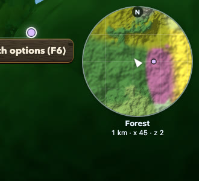
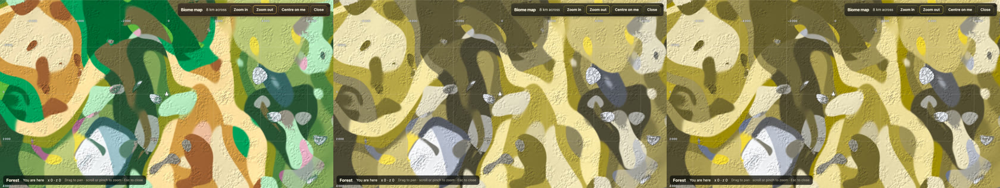

# Forest Drift — Biome Minimap Phase 3: Implementation Record

**Date:** 2026-11-16
**Plan:** [`../feature-plan/02-technical-plan.md`](../feature-plan/02-technical-plan.md) (revision 6) · earlier: [Phase 0](../phase-0/implementation.md), [Phase 1](../phase-1/implementation.md), [Phase 2](../phase-2/implementation.md)
**Status:** Phase 3 complete, so the biome minimap is complete. Not committed. Site only: no server deploy needed.

Phase 3 is the release pass:

- online play with two players;
- costs on a slower machine;
- accessibility;
- the player docs.

No game code changed in this phase.

## Online

A new test in `tests/waypointsMultiplayer.e2e.ts` publishes the Main World and joins it with two players (a real room server). The visitor stands 150 m east of the owner, and the test checks:

- each player's maps show the other player within 10 m of where they are;
- the owner opens the full map: their input stops, but the room's clock keeps running (Q12).

The owner's minimap, with the visitor's dot 150 m to the east:

## Costs on a slower machine

Chromium with its CPU throttled 4× (`Emulation.setCPUThrottlingRate`), on a 12 s flight in a world with water. Raw numbers: [`map-performance.json`](map-performance.json). Benchmark: `tests/biomeMapPerformance.e2e.ts` (opt-in, `MAP_BENCH=1`).

| Measurement (4× slower CPU)                 | Minimap off | Minimap on       |
| ------------------------------------------- | ----------- | ---------------- |
| Median frame                                | 27.8 ms     | 26.7 ms          |
| 95th percentile frame                       | 41 ms       | 36.5 ms          |
| Minimap main-thread time, average per frame | —           | **0.05 ms**      |
| Minimap main-thread time, worst frame       | —           | 0.9 ms           |
| Repaints                                    | —           | 79 in 440 frames |

- **The minimap makes no measurable difference to frame time,** even on a slow machine: the on/off difference is within run-to-run noise.
- **Its average is well inside the 0.1 ms budget.** Its worst frame (0.9 ms at 4× slower) is about 0.23 ms at full speed, inside the 0.5 ms budget.
- **The farthest zoom (8 km), from cold, at 4× slower:** the first tiles show in **0.3 s**, and the whole minimap with rivers and lakes is in after **1.2 s**. Water tiles at that zoom took 113 ms (level 4) and 282 ms (level 5) each.
- **Caveat:** Chromium's throttling slows the page's main thread. It may not slow the map worker as much, so these worker timings are optimistic for a truly slower machine. Phase 0's unthrottled measurements in three engines (11–33 ms per land tile) are the better guide for the worker.

## Accessibility

- **Keyboard only** (new e2e test, **Chromium, WebKit and Firefox**):
  - the full map opens with focus on the map;
  - arrow keys move the centre crosshair, and the readout follows it;
  - Tab reaches **Zoom in**, **Zoom out**, **Centre on me** and **Close** (Option+Tab in Safari, as Safari works by default);
  - Enter presses them, and Esc closes the map.
- **Screen readers:**
  - the full map is a modal dialog named "Biome map";
  - the map area announces its keys ("Arrow keys pan, plus and minus zoom, C centres on you, Escape closes.");
  - the readout goes to a polite live region, at most once a second;
  - the minimap is decorative, since the biome card already announces where you are.
- **Colour blindness:** the full map at 8 km under deuteranopia and protanopia simulation (left to right: normal, deuteranopia, protanopia). Neighbouring biomes stay distinct by lightness, which the palette test from Phase 0 enforces for every pair that borders another:

- **Reduced motion:** nothing on either map animates; panning and zooming jump.

## Docs

- [`docs/biomes.md`](../../../../biomes.md):
  - a player section, "The biome map": what it shows, its keys, the full map, settings, touch;
  - a developer section: the worker, client, painting, palette, preview page and plan link.
- The Controls guide lists `;`, `'`, `/` and `` ` `` (Phases 1–2). The keys appear on the Controls screen, where they can be rebound.

## Definition of done (plan §16)

All met:

- **The corner minimap** shows biome colours, shading, water, you, other players and waypoints.
- **Six zoom steps,** by key, button and touch.
- **Toggle** by key and setting, remembered; off costs nothing.
- **The full map** has pan, zoom and the pointer readout.
- **A grid and coordinates** on both maps, with a setting to hide the grid.
- **Budgets met and measured**, with numbers in the Phase 0–3 records.
- **Tests pass in three browsers.**
- **Docs and phase records** are written.
- **Your review of the screenshots:** the Phase 1–3 records have them.

## Verification

- `npx vitest run`: **282 files, 3,108 tests pass**. `npm run check`: 0 errors. ESLint and Prettier clean on the changed files.
- `tests/biomeMinimap.e2e.ts` (5 tests) and `tests/biomeMap.e2e.ts` (2 tests) in **Chromium, WebKit and Firefox: 21/21 pass**.
- `tests/waypointsMultiplayer.e2e.ts`, including the new online test (Chromium): **2/2 pass**.
- **Still not checked:** pinch zoom on a real touch screen. It's in the code, but Playwright can't simulate two fingers easily.
