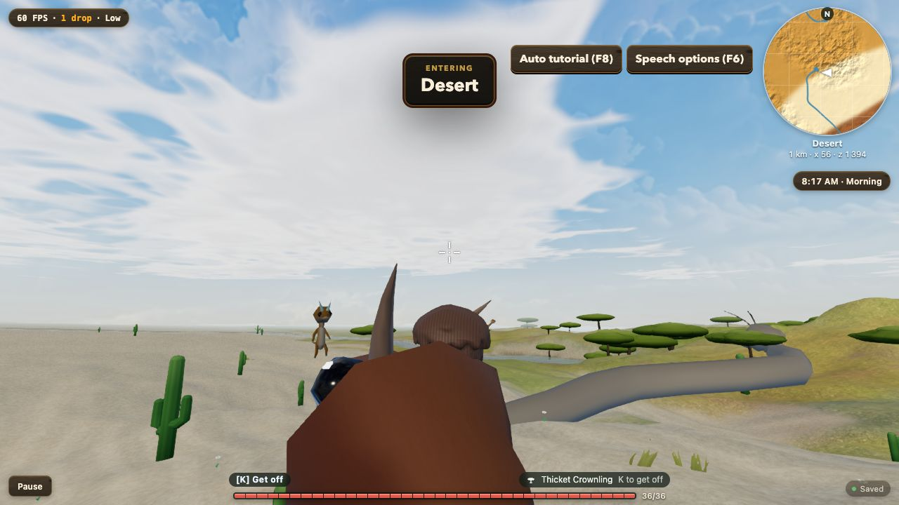
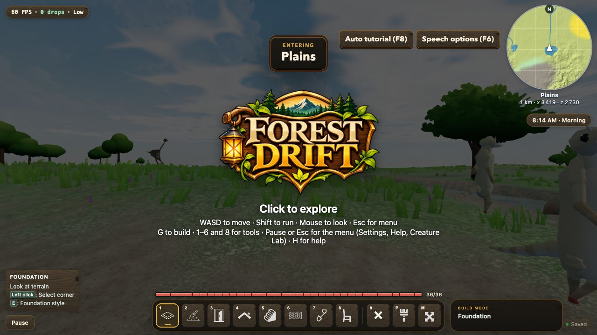

# Forest Drift — Fast Travel Phase 0: Implementation Record

**Date:** 2026-11-16
**Plan:** [`../feature-plan/02-technical-plan.md`](../feature-plan/02-technical-plan.md) (revision 2)
**Status:** Phase 0 complete. Not committed. Site only: no server deploy needed.

Phase 0 is the jump itself, for a player on their own. Nothing in the game's interface calls it yet; the full map's pin and **Travel here** button come in Phase 1. These scene methods do the work:

- `ThreeScene.fastTravel(x, z)`
- `goBackFromTravel()`
- `canFastTravel()`
- `fastTravelLanding(x, z)`
- `fastTravelOrigin()`

## What a trip does

- **Lands safely:**
  - your feet go on the highest surface at the spot (Q9);
  - out of deep water, it walks rings outward to the nearest dry ground, up to 196 m;
  - walls push you out, as when respawning.
- **Ground on the first frame:** in every one of the 20 frames after a trip, your feet stay within 0.2 m of the surface. No fall, no sinking.
- **Keeps** your view, the building tool and flight:
  - walking, you arrive standing;
  - flying, you arrive 2 m up and still flying (Q10).
- **Furniture:** sitting ends first (Q11).
- **Counts as a teleport,** so others will snap rather than slide (Phase 2).
- **Carried and ridden creatures come along (Q4):**
  - **Carrying** needed nothing new.
  - **Riding:** `CreatureRuntimeManager.relocateRide` moves the mount to the landing and restarts its footing; the eye follows its seat. A second and a half later you're still riding the same creature, under 4 m from it, though the herd it came from has unloaded.
- **Go back** returns to exactly where the trip started: position, height, view and flight. Pressing it again returns to where the trip landed. It's forgotten when you load another world.
- **The biome there counts at once.** The minimap's name and the "Entering…" card are right on arrival, not after the usual 3 s hold.

Riding a Thicket Crownling into a desert 3.4 km away; the card and the minimap name the new biome straight away:

Pinning the middle of a lake lands you on its shore (the lake is just north of your arrow on the minimap):

## The cut's cost

Chromium with the Mac's GPU (`FOREST_DRIFT_GPU=1`), low graphics, ten trips of 1–5 km. Raw numbers: [`travel-performance.json`](travel-performance.json).

| Measurement                                      | Cold (nothing prepared) | Prepared (pin dropped first) | Budget      |
| ------------------------------------------------ | ----------------------- | ---------------------------- | ----------- |
| The jump itself (main thread)                    | 36–56 ms                | 14–44 ms                     |             |
| Longest frame around the trip                    | 50–67 ms                | 33–83 ms                     | ≤ 120 ms    |
| Feet on the ground                               | Every frame             | Every frame                  | First frame |
| Terrain and trees fully streamed in after a trip | 1.3–1.7 s               | 1.3–1.7 s                    | ≤ 3 s       |

Normal frames here are 17 ms, so the longest frame around a trip is about 2–5 frames' worth: a short hitch at the moment of the cut.

**How it got there.** The first version reused respawning's priming as it was, and missed two budgets:

| Version                                  | The jump   | Full view loaded |
| ---------------------------------------- | ---------- | ---------------- |
| First: prime 5 chunks, trees in the jump | 120–167 ms | about 7.5 s      |
| Prime only the chunks near the feet      | 77–121 ms  | about 7.5 s      |
| Plus faster terrain streaming afterwards | 36–56 ms   | 1.3–1.7 s        |

- **Where the time went:**
  - building the water for the destination's area took 36–75 ms;
  - each terrain chunk took about 15–25 ms;
  - updating the trees took up to 28 ms.
- **The fixes:**
  - **Fewer chunks at once** (`primeNear`): only the chunk underfoot, plus neighbours within 24 m of the landing, are built in the jump.
  - **Faster streaming afterwards** (`boostGeneration`): terrain may use 7 ms a frame instead of 2 ms, for up to 5 s or until the view is full. Frames stayed at 17 ms throughout (95th percentile 17–19 ms).
  - **Trees** now update on the next frame, as they do every frame.
- **Prepared trips:** the map in Phase 1 will work out the landing as soon as you drop the pin, which builds the water there before you press **Travel here**.

**Still to measure (Phase 3):** the same on a 4× slower CPU (budget ≤ 250 ms), where the 7 ms streaming boost may cost frames.

## Files

| Piece                                              | File                                                                                          |
| -------------------------------------------------- | --------------------------------------------------------------------------------------------- |
| Rules: permission, landing search, Go back memory  | `src/lib/game/travel/FastTravel.ts` (+ `__tests__/FastTravel.spec.ts`)                        |
| The jump                                           | `ThreeScene.ts` (`fastTravel`, `goBackFromTravel`, `travelJump`, `landingWater`)              |
| Building only the nearby terrain; faster streaming | `TerrainManager.ts` (`primeNear`, `boostGeneration`)                                          |
| Riding along                                       | `CreatureRuntimeManager.relocateRide`, `FirstPersonController.moveWithMount`, `seatedOnMount` |
| Biome on arrival                                   | `BiomeTracker.arrive` (+ two tests)                                                           |
| End-to-end tests and measurements                  | `tests/fastTravel.e2e.ts`; shared creature steps moved to `tests/creatureHelpers.ts`          |

## Verification

- `npx vitest run --project server`: **283 files, 3,123 tests pass**. New:
  - 13 for `FastTravel`: permissions, landings at ±200 km, notes, memory;
  - 2 for the biome tracker.
- `npm run check`: 0 errors. ESLint and Prettier clean on the changed files.
- `tests/fastTravel.e2e.ts` (Chromium, GPU): **3/3 pass**:
  - ten trips with feet on the ground;
  - view kept and every trip counted as a teleport;
  - Go back, twice;
  - the minimap names the new biome within 1.5 s;
  - flying;
  - a lake pin landing on the shore;
  - carrying and riding across 3 km.
- `tests/biomeMinimap.e2e.ts`: 5/5 pass. `tests/creatureRiding.e2e.ts`: 2/3. The failing test, "carry a small creature onto a mount… keep it when getting off", **fails the same way without these changes** (checked by stashing them): at its last step, K doesn't put the creature down. It's an existing problem, not caused by fast travel.
- **Not yet:** WebKit and Firefox. The map flow in Phase 1 adds the fast travel e2e to the `webkit-map` and `firefox-map` projects.

## Next: Phase 1

The full map: click or tap to drop a pin (preparing the landing), the readout for the pin (with "Lands on the shore"), **Travel here**, **Go back** on the map and in the pause menu, `Enter` and `T` from the keyboard, and the disabled reasons.
