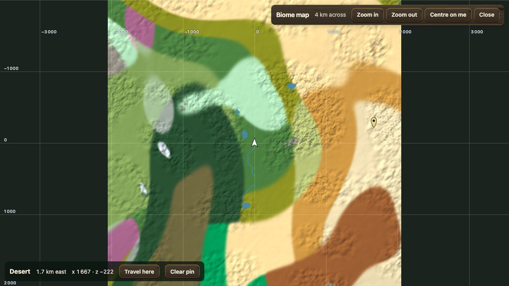
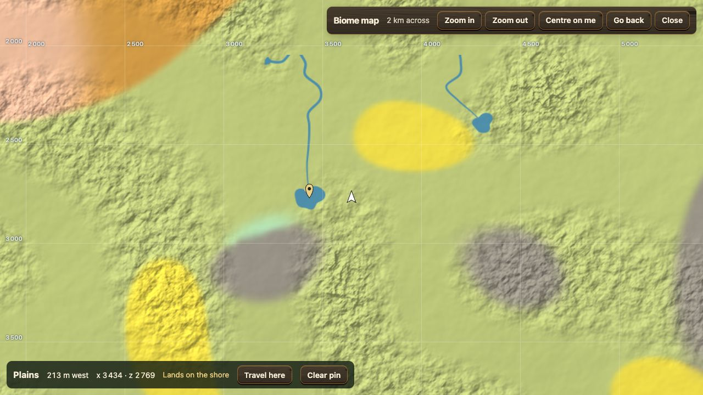
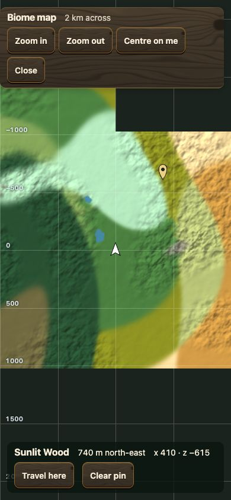

# Forest Drift — Fast Travel Phase 1: Implementation Record

**Date:** 2026-11-16
**Plan:** [`../feature-plan/02-technical-plan.md`](../feature-plan/02-technical-plan.md) (revision 3) · earlier: [Phase 0](../phase-0/implementation.md)
**Status:** Phase 1 complete. Not committed. Site only: no server deploy needed.

Players can now fast travel from the full map when playing alone. Online play is Phase 2: until then, travelling in an online world works but isn't checked by the room.

## What players get

- **Drop a pin:** click or tap a place on the full map. Dragging still pans; a press that moves more than 6 px is a drag. From the keyboard, `Enter` pins the crosshair.
- **The readout describes the pin:**
  - its biome, distance, direction and coordinates;
  - "Lands on the shore" when it would land somewhere else;
  - screen readers hear "Pinned: Desert, 1.7 km east" at once.
- **Travel here** (or `T`) jumps there and closes the map. **Clear pin** removes the pin; so does `Esc`, before it closes the map.
- **Go back** appears after a trip, in the map's header and in the pause menu.
- **When travel isn't possible**, the button is greyed out and its label says why, for example "Travelling…" or "You're knocked out".
- **Help:** the Controls guide and [`docs/biomes.md`](../../../../biomes.md) describe it.

Pinning a desert 1.7 km east (the land beyond 2 km is still arriving):

A pin in a lake: the readout warns that you'll land on the shore. **Go back** is in the header after an earlier trip:

On a phone, the pin's buttons wrap under the readout:

## How it works

| Piece                                    | File                                                                                              |
| ---------------------------------------- | ------------------------------------------------------------------------------------------------- |
| Pin, readout, Travel here, Go back, keys | `components/BiomeMapOverlay.svelte`                                                               |
| What the map needs from the scene        | `FullMapTravel` in `game/map/BiomeMapSystem.ts` (`permission`, `landing`, `go`, `back`, `origin`) |
| Page wiring and the pause menu's Go back | `routes/+page.svelte`, `components/PauseMenu.svelte` (`onGoBack`)                                 |
| Release switch                           | `FAST_TRAVEL_AVAILABLE` and `?fastTravel=off` in `game/travel/FastTravel.ts`                      |

- **Preparing the trip when the pin drops.** The pin calls `landing(x, z)`, which works out where you'll land and builds the water data there (36–75 ms on a click). The trip itself is then the "prepared" case from Phase 0: about 14–44 ms.
- **Esc order.** The map listens for `Esc` before the page does. With a pin, `Esc` clears it and stops there; without one, the page closes the map as before.
- **Enter only on the map itself.** With focus on a button, `Enter` presses that button as usual.
- **Permission** is checked ten times a second along with the markers, so the button's state stays current.

## Verification

- `npx vitest run --project server`: **283 files, 3,124 tests pass**, including a new test for the release switch. `npm run check`: 0 errors. ESLint and Prettier clean on the changed files.
- New `tests/fastTravelMap.e2e.ts`, 4 tests:
  1. **Mouse:**
     - a click pins and the readout describes the pin, staying put when the mouse moves;
     - `Esc` clears the pin and keeps the map open;
     - the disabled "Travelling…" label;
     - Travel here lands within 2 m of the pin;
     - Go back from the pause menu and from the map, each exact.
  2. **Lake:** a pin in a lake says "Lands on the shore" and lands on dry ground.
  3. **Keyboard:**
     - `Enter` pins the crosshair;
     - `Esc` clears the pin, then closes the map;
     - `T` travels.
  4. **Touch (phone size):** a tap pins; the buttons fit the screen; Travel here works.
- **Chromium, WebKit and Firefox:** all pass. In Chromium the 4 new tests and the 5 existing minimap tests pass (9/9). In WebKit and Firefox the map, minimap and fast travel tests give 21 passed and 1 skipped: the touch test is skipped in Firefox, where Playwright can't emulate touch.
- **The keyboard test first failed in WebKit and Firefox:** it read the readout one frame before it updated to the pin. It now waits for the pin's announcement; the game was right.
- **Not checked:** a real touch screen. Taps were emulated, as for the minimap.

## Next: Phase 2

Online play:

- **The owner's rule:** "Fast travel for others" in Settings → Rules.
- **Protocol 9:** the room checks each trip (`travel` and `travelResult` messages) and tells the other players (`travelled`).
- **A two-player test:** others see the traveller snap to the new spot, and rides arrive with their riders.
- **Deploy order:** the server first, then the site.
