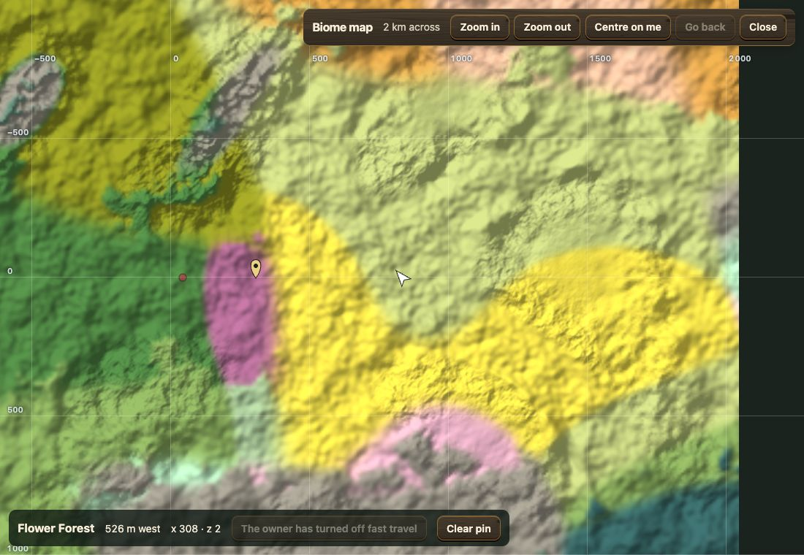

# Forest Drift — Fast Travel Phase 2: Implementation Record

**Date:** 2026-11-16
**Plan:** [`../feature-plan/02-technical-plan.md`](../feature-plan/02-technical-plan.md) (revision 4) · earlier: [Phase 0](../phase-0/implementation.md), [Phase 1](../phase-1/implementation.md)
**Status:** Phase 2 complete. Not committed. **Needs a server deploy before the site** (protocol 8 → 9).

Fast travel now works properly online: the room checks every trip and tells the other players, and the world's owner can switch it off for everyone else.

## What players get

- **Visitors and editors** travel exactly as when playing alone. The room answers first, which takes one round trip; the button says "Travelling…" meanwhile.
- **The owner's switch:** Settings → Rules → **Fast travel for others**. It's on by default and saved with the world. The owner can always travel. While it's off, other players' map buttons say "The owner has turned off fast travel":

- **Other players** see the traveller jump straight to the new place, with no slide across the map. The shimmer at both ends comes in Phase 3.
- **Rides and carried creatures** arrive with their rider or carrier, on the other players' screens too.

## How it works

| Piece                                                                           | File                                                                                   |
| ------------------------------------------------------------------------------- | -------------------------------------------------------------------------------------- |
| Messages: `travel`, `travelResult`, `travelled`; `rules.fastTravel`; protocol 9 | `game/net/protocol.ts`                                                                 |
| The room's check and broadcast                                                  | `RoomCore.handleTravel`                                                                |
| Asking the room, with a 2 s timeout; hearing others' trips                      | `NetSession.sendTravel`, `MultiplayerSession.requestTravel`, `showTravel` context hook |
| The scene: ask, then jump; the rule; the permission                             | `ThreeScene.travel`, `setFastTravelRule`, `canFastTravel` (online part)                |
| Settings                                                                        | `settingsCatalog.ts` (`rules.fastTravel`), `GameSettingsHost.rules`                    |

- **The room's checks**, in order:
  1. **The owner's rule:** the owner is exempt.
  2. **The player:** not knocked out, has sent a pose, and the trip starts within 30 m of their last pose.
  3. **The points:** both ends are inside the world.
  4. **Spam guard:** at most one trip a second (this isn't a cooldown).

  If all pass, it answers the traveller and sends `travelled` to everyone else. A refused trip tells no one.

- **The client then rechecks** before jumping, in case something changed while the room answered (knocked out, climbing off).
- **Honest limit (as planned):** a modified client could skip the request and send a teleport-flagged pose anyway. The room has to accept those, because respawns and rejoins use the same flag. The rule stops the real game, and the room stops the message to others.

## A bug found and fixed: overshooting on arrival

The two-player test caught a traveller drawn **33 m past the landing**, sliding back over two frames. The jump itself was a clean snap; the overshoot came after it:

1. `RemoteMotion` estimates each player's speed from the poses on either side.
2. Across the jump, that comes to thousands of metres a second.
3. In the gap before the next pose, it carried the avatar on at that speed.

Now speed is never measured across a teleport (`RemoteMotion.tangent`). The same bug would have hit a player who respawned while moving. A new unit test reproduces it: it fails without the fix and passes with it.

## Verification

- **Unit tests:** `npx vitest run --project server` passes, **3,133 tests**. New:
  - `RoomCoreTravel.spec.ts` (8 tests):
    - a granted trip is sent to others and not echoed back;
    - the owner's rule, with the owner exempt;
    - on by default;
    - trips starting away from the player, before any pose, or off the world are refused;
    - refused while knocked out;
    - one trip a second, and repeated message ids are ignored;
    - parsing of the new messages and the rule.
  - `RemoteMotion.spec.ts`: no overshoot after a moving teleport.
- `npm run check`: 0 errors. ESLint and Prettier clean on the changed files.
- **`tests/fastTravelMultiplayer.e2e.ts`**, 2 tests against a real room server (`wrangler dev`): **Chromium, WebKit and Firefox, 6/6 pass.**
  1. **A visitor travels from the map.** The owner hears the trip (who, from where, to where). On every frame, the owner draws the visitor either at the start or at the landing, never in between. The owner switches fast travel off; the visitor's button says so, and the room refuses the visitor even past the client's own check. The owner can still travel.
  2. **The owner rides a creature 2.3 km.** Two seconds later they're still riding the same creature, the visitor still sees them riding it, and the visitor draws them at the new spot.
- **Earlier tests rerun in Chromium:** Phase 0's `fastTravel.e2e.ts`, Phase 1's `fastTravelMap.e2e.ts`, `multiplayer.e2e.ts` and `waypointsMultiplayer.e2e.ts`: **14/14 pass**.
- **The Worker builds** (`wrangler deploy --dry-run`). **Not deployed.**

## Deploying

Protocol 9 changes the messages, so:

1. Deploy the Worker first (`npm run deploy` in `server/`).
2. Then push the site.

Until the site updates, open tabs on the old build are asked to refresh, as with every protocol change. Published worlds keep their rules; `fastTravel` is simply absent (on) until the owner changes it.

## Next: Phase 3

- **The shimmer:** a pooled particle effect at both ends of a trip, for others and at your own landing.
- **Performance on a 4× slower CPU,** including the terrain streaming boost.
- **Accessibility and docs:** the multiplayer guide gains the shimmer.
- **The final record.**
