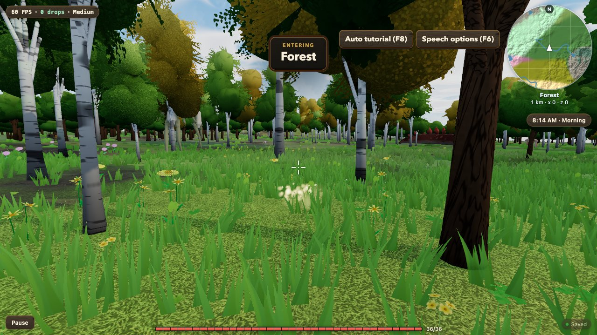
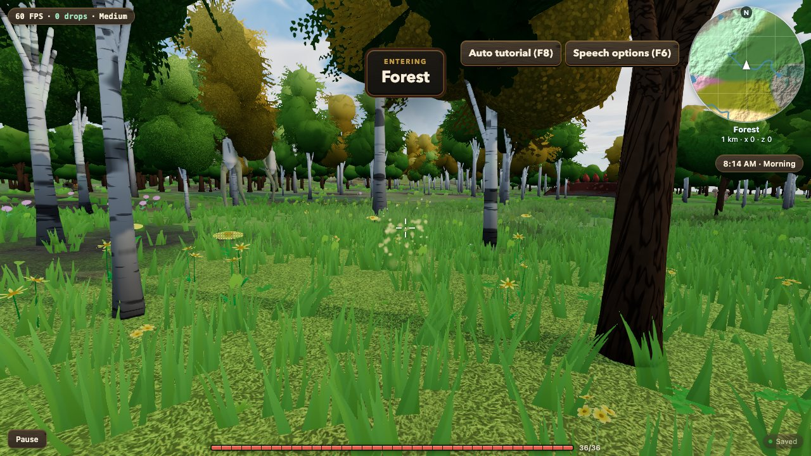
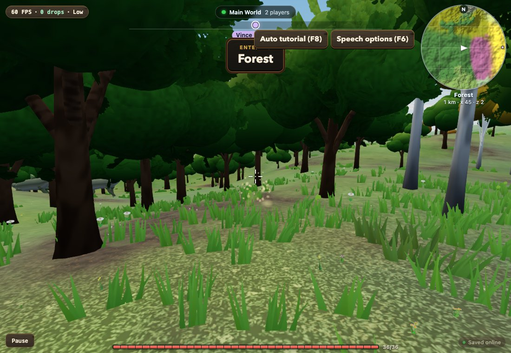

# Forest Drift — Fast Travel Phase 3: Implementation Record

**Date:** 2026-11-16
**Plan:** [`../feature-plan/02-technical-plan.md`](../feature-plan/02-technical-plan.md) (revision 5) · earlier: [Phase 0](../phase-0/implementation.md), [Phase 1](../phase-1/implementation.md), [Phase 2](../phase-2/implementation.md)
**Status:** Phase 3 complete, so fast travel is complete. Not committed. **Phase 2's server deploy is still needed before the site** (protocol 9).

Phase 3 is the release pass:

- the shimmer at both ends of a trip;
- costs on a slower machine;
- the last docs.

## The shimmer (Q7)

Warm motes rise round the traveller's feet, to about head height, with a few soft glow puffs. They show where someone vanishes and where they appear, and fade within about a second and a half.

- **Who sees it:** other players see it at both ends of a trip, and you see it round your own feet as you arrive.
- **Range:** trips more than 300 m from you aren't drawn.
- **Settings:** it follows the particle quality setting, and is off with particles off.
- **Reduced motion:** a single soft glow instead of rising motes.

Seen from 6 m: the start of the shimmer, then the motes rising half a second later.

Online, the owner's view as the visitor leaves from 8 m away (the motes below the crosshair):

- **The first version was too small to see.** Its motes were 13 cm and faded within a second; from 8 m nothing showed in the screenshot. They're now 24 cm, last up to 1.5 s and rise higher, with some large soft puffs for the glow.
- **On bright grass,** additive light reads as cream rather than gold. It's still a clear, gentle cue.

**Files:**

- `particles/effects/travelShimmer.ts`: the two effects (`travel-shimmer`, `travel-glow`) and `TravelShimmer.play`.
- `ThreeScene`: plays it for others' trips (`showRemoteTravel`) and for your own landing (`travel`).

## Costs on a slower machine

Chromium with the Mac's GPU, medium graphics, ten trips of 1–5 km at full speed and with the CPU throttled 4×. Raw numbers: [`travel-performance.json`](travel-performance.json). Benchmark: `tests/fastTravelPerformance.e2e.ts` (opt-in, `TRAVEL_BENCH=1`).

| Measurement                       | Full speed               | 4× slower CPU          | Budget              |
| --------------------------------- | ------------------------ | ---------------------- | ------------------- |
| The jump, from the map (prepared) | 13–45 ms                 | 72–132 ms              |                     |
| Longest frame around a map trip   | 50–83 ms                 | 183–233 ms             | ≤ 120 ms / ≤ 250 ms |
| The jump, cold (nothing prepared) | 26–53 ms                 | 48–302 ms              |                     |
| Longest frame, cold               | 67–100 ms                | 167–300 ms             |                     |
| Land fully loaded again           | 1.6–2.1 s                | 8.7–16.8 s             | ≤ 3 s (full speed)  |
| Frames while the land refills     | median 16.7, p95 16.8 ms | median 16.7, p95 33 ms |                     |
| Standing still, for comparison    | 16.7 ms                  | 16.7 ms                |                     |

- **Trips from the map meet both budgets.** Go back is a prepared trip too, because the water data you were standing in is never thrown away.
- **Cold trips can go over the budget** on a slow machine (up to 300 ms) on the first visit to an area. Players can't make a cold trip: the map always prepares the landing when the pin drops. Only code calling `fastTravel` directly skips that.
- **The fix that got here:** at first, the 4× runs took up to 312 ms even when prepared. Two changes:
  - **A cap on neighbour chunks:** the jump now builds the chunk underfoot, then neighbouring chunks only while it has taken under 30 ms.
  - **Preparing the chunk underfoot:** dropping a pin now also builds the water for that chunk, which can lie in the next region.
- **Refilling the land:** on a slow machine, terrain still takes 9–17 s to fill the whole view. Near land comes first, and frames stay smooth meanwhile (p95 33 ms). At full speed it's under the 3 s budget.

## Docs

- [`docs/biomes.md`](../../../../biomes.md): fast travel for players, and a developer section (the jump, the cap, preparation, the room and the shimmer).
- [`docs/multiplayer-player-guide.md`](../../../../multiplayer-player-guide.md): "Fast travel online", now with the shimmer.
- The Controls guide explains pins, Travel here, Go back and `Esc` (Phase 1).

## Definition of done (plan §13)

All met:

- **On the map:** pin and Travel here, with keyboard and touch; Go back on the map and in the pause menu.
- **Landing:** dry, on a surface and out of walls, with ground on the first frame.
- **Creatures:** carried and ridden ones arrive with you.
- **Online:**
  - the owner's switch;
  - the room-checked travel message;
  - others see a snap and a shimmer.
- **Budgets:** met for every trip a player can make, and measured. Cold trips on a slow machine can exceed them.
- **Tests:** pass in three browsers.
- **Docs:** written, with phase records and screenshots.

## Verification

- `npx vitest run --project server`: **3,137 tests pass**, 4 of them new for the shimmer:
  - a ring of motes that's gone within two seconds;
  - reduced motion: a few still glow particles;
  - nothing out of range, at bad positions, or with particles off;
  - fewer motes on low quality.
- `npm run check`: 0 errors. ESLint and Prettier clean on the changed files.
- **Fast travel e2e, all files:**
  - **Chromium:** 10/10 pass, including a new test (a shimmer on arrival; a glow with reduced motion) and the online test's check that the owner saw the visitor's shimmer.
  - **WebKit and Firefox:** 11 pass and 1 skip; the touch test is skipped in Firefox, which Playwright can't emulate touch on.
- **Not checked:** a real touch screen, and a real slow machine. Chromium's throttling slows the main thread, which is what the jump uses.

## Deploying fast travel

1. Deploy the Worker: `npm run deploy` in `server/`, for protocol 9 from Phase 2.
2. Push the site.
