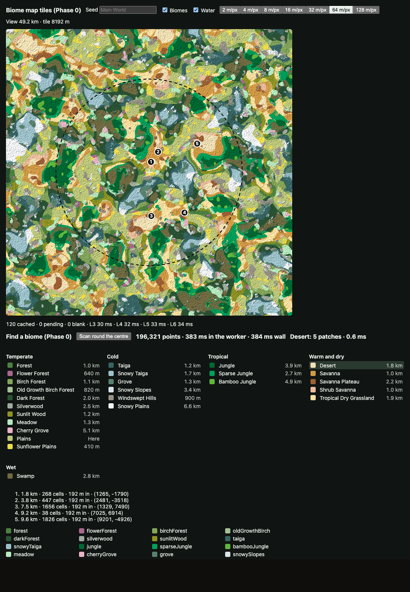
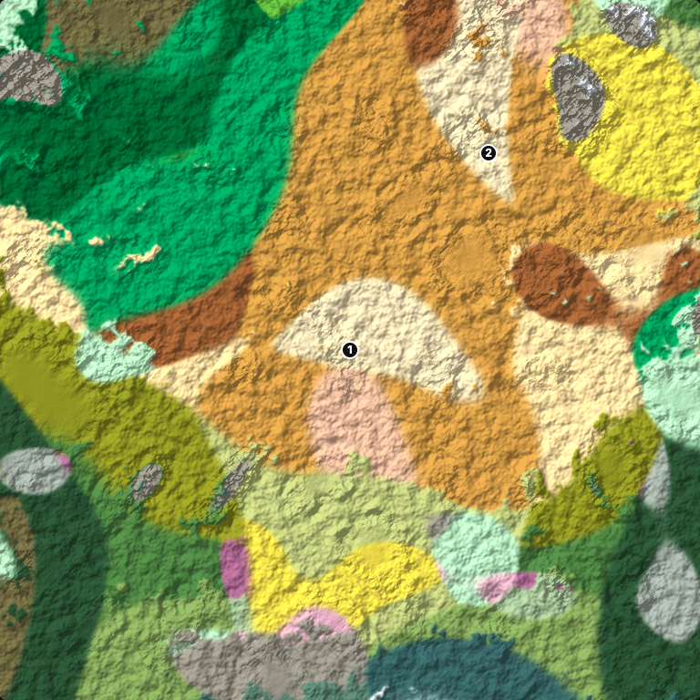

# Forest Drift — Find a Biome Phase 0: Implementation Record

**Date:** 2026-11-16
**Plan:** [`../feature-plan/02-technical-plan.md`](../feature-plan/02-technical-plan.md) (revision 2)
**Status:** Phase 0 complete. Not committed. No server deploy is needed for this feature.

Phase 0 is the search, in the map's background worker:

- a scan of every biome within 16 km;
- each biome's nearest pin, well inside its patch;
- up to five separate patches per biome;
- numbers in three browsers.

Nothing in the game changes yet. The Biomes list on the full map is Phase 1.

## What it does

When asked, the map worker classifies a 64 m grid round a point, out to 16 km: 196,321 points. It works outward ring by ring, in slices of about 8 ms. Then it finds each biome's nearest pin, so the list's distances in Phase 1 are where Find will put the pin.

**Find** answers from the finished grid, with no new sampling:

1. It groups the biome's cells into separate patches.
2. It skips the patch you're standing in (Q10).
3. It picks a spot in each patch at least 3 cells (192 m) from any other biome, nearest you. That's at least 128 m from the true border (Q6).
4. It returns the five nearest, at least 1 km apart (Q4).

On the dev preview page (`/biome-map/?dev`), **Scan round the centre** runs it; the list shows each biome's distance, and picking one draws its pins (1 = nearest). The dashed circle is the 16 km range.

Desert's nearest pin, close up (8 m per pixel): well inside the sand, not on its edge.

## Changes from the plan (revision 2)

1. **The list's distance is to the nearest pin,** not to the nearest cell of that biome, so the list and Find always agree. It costs about 1 ms a biome at the end of the scan.
2. **The pin aims 3 cells in, not 2.** The border lies somewhere in the last 64 m, so 2 cells could leave the pin only 64 m in; 3 guarantees 128 m.
3. **Specks are passed over.** The first run pinned Desert's 4th patch on a single 64 m cell at a border between two other biomes. Patches under about 190 m across are now used only when a biome has nothing bigger.
4. **Land tiles go first.** A land tile waits at most one scan slice; scan slices take turns with water tiles.
5. **No early end:** Find needs the whole grid, so the scan always runs to 16 km.
6. **Faster scheduling in the worker:** `setTimeout(0)` waits at least 4 ms once nested, which added about 200 ms over a scan's 50 slices. The worker now yields through a `MessageChannel`. This also speeds up map tiles slightly.
7. **Groups are already in code** (`BiomeDefinition.group`); `biomeGroups.ts` only adds the list's labels and order.

## Numbers

Raw numbers: [`scan-chromium.json`](scan-chromium.json), [`scan-webkit.json`](scan-webkit.json), [`scan-firefox.json`](scan-firefox.json). Test: `tests/findBiomeSearch.e2e.ts`, on the Main World round its spawn.

Three scans round the spawn in each browser at full speed, then three fresh views of tiles (12 km across) with and without a scan running:

| Measurement                                   | Chromium                               | WebKit         | Firefox        | Budget         |
| --------------------------------------------- | -------------------------------------- | -------------- | -------------- | -------------- |
| Scan, time in the worker                      | 402–405 ms                             | 274–278 ms     | 378–379 ms     | ≤ 0.8 s        |
| Scan, start to finish (map idle)              | 402–406 ms                             | 274–279 ms     | 378–381 ms     |                |
| Per point                                     | 2.1 µs                                 | 1.4 µs         | 1.9 µs         |                |
| Find, in the worker (Node, all 26 biomes)     | at most 1.0 ms                         |                |                | ≤ 30 ms        |
| A fresh view's land, no scan                  | 2,046–2,079 ms                         | 1,332–1,349 ms | 1,826–1,855 ms |                |
| A fresh view's land, scan running             | 2,043–2,079 ms                         | 1,349–1,365 ms | 1,822–1,846 ms | ≤ ~10 ms later |
| Scan finished, when started with a fresh view | 2.43–2.46 s                            | 1.60–1.62 s    | 2.20–2.21 s    |                |
| Grid memory                                   | 245 KB, freed when the scan is dropped |                |                | ≤ 300 KB       |

Before the `MessageChannel` change, a scan took about 590–660 ms from start to finish in Chromium and Firefox for the same ~390 ms of work.

- **The same answer in every browser:** all 26 distances and all five Desert pins are identical in Chromium, WebKit and Firefox, and match Node.
- **Tiles alongside:** a fresh view's land takes as long with a scan running as without (the differences are within run-to-run noise).
- **A scan while tiles load** finishes after the view's land, about 2–3 s after the view moved, because land goes first. In Phase 1, the list shows "…" meanwhile.
- **Slower machines:** Chromium's CPU throttling doesn't reach workers (a "4× slower" scan took 403 ms, the same as full speed), so this couldn't be measured. Scaling from full speed, a machine 4× slower would take about 1–1.6 s. That's over the 0.8 s budget, but it happens in the background while the list shows "…".

### Does a 64 m grid miss anything?

`biomeScanAccuracy.spec.ts` (opt-in, `FIND_BIOME_ACCURACY=1`) samples 8 km round four worlds' spawns at 32 m and checks every patch at least about 160 m across has a 64 m point in it.

| World      | Patches at 32 m | At least ~160 m across | Missed at 64 m |
| ---------- | --------------- | ---------------------- | -------------- |
| Main World | 1,392           | 271                    | 0              |
| `forest`   | 729             | 286                    | 0              |
| `alpine`   | 695             | 290                    | 0              |
| `drift-42` | 660             | 283                    | 0              |

The 64 m grid misses only specks (177–436 per world), which Find passes over anyway.

### Assumptions (plan §12)

1. **`classifyPoint` costs about the same in the browsers as in Node:** yes, and faster in WebKit: 1.4–2.1 µs a point in the browsers, 2.6–2.9 µs in Node.
2. **64 m cells find every patch that matters:** yes, see the table above.
3. **The map stays responsive while a scan runs:** yes; land tiles go first and arrive no later.

## Files

**New:**

- `game/map/biomeSearch.ts`: `BiomeScan` (the grid, slices, `nearest`, `patches`).
- `game/map/biomeGroups.ts`: `BIOME_LIST_GROUPS`, the list's five groups.
- Tests:
  - `__tests__/biomeSearch.spec.ts`: 10 tests on made-up layouts;
  - `__tests__/biomeMapWorker.spec.ts`: 2 tests, the real worker module in Node;
  - `__tests__/biomeScanAccuracy.spec.ts`: opt-in;
  - `tests/findBiomeSearch.e2e.ts`: three browsers.

**Changed:**

- `biomeMapProtocol.ts`: `scan`, `find` and `cancelScan` to the worker; `scanned` and `found` from it.
- `biomeMap.worker.ts`: scan slices, finds, land first, `MessageChannel` scheduling.
- `mapWorld.ts`: `MapWorld.classify`.
- `BiomeMapClient.ts`: `scan` (reused within 250 m, Q9), `scanResult`, `find`, `cancelScan`, `onScan`; 3 new tests.
- `routes/biome-map/+page.svelte`: the dev preview's Find a biome panel.
- `playwright.config.ts`: the WebKit and Firefox map projects run `findBiome*.e2e.ts`.

## Verification

- `npx vitest run --project server`: **3,152 tests pass** (4 skipped: the opt-in accuracy check). New:
  - `biomeSearch.spec.ts` (10): the nearest pin per biome; nothing reported until done; the same grid in slices as in one go; the spot well inside, on the near side; thin patches; specks passed over unless nothing bigger; five at most, nearest first, 1 km apart; leaving out the patch you're in; nothing beyond 16 km; the same 200 km from the origin.
  - `biomeMapWorker.spec.ts` (2): the real worker on the Main World: land tiles arrive before the scan ends; the result equals a scan in one go; every biome's pins classify as that biome; cancelling and a new world drop the scan.
  - `BiomeMapClient.spec.ts` (3 new): reuse within 250 m; null when replaced, cancelled or the world changes; finds answered by id.
- `npm run check`: 0 errors. ESLint and Prettier clean on the changed files.
- **E2E** (`findBiomeSearch.e2e.ts`, `biomeMap.e2e.ts`, `biomeMinimap.e2e.ts`, `fastTravelMap.e2e.ts`):
  - **WebKit and Firefox:** all pass.
  - **Chromium:** all pass with the GPU (`FOREST_DRIFT_GPU=1`), one at a time. Run without the GPU and two at a time, two minimap tests timed out on slow software rendering; they don't touch the scan.
- **Not checked:** a real slow machine (see above), and nothing in the game yet: Phase 1 adds the list.
