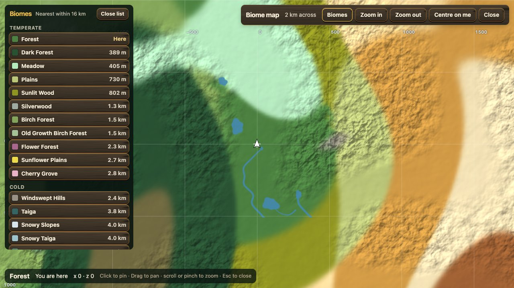
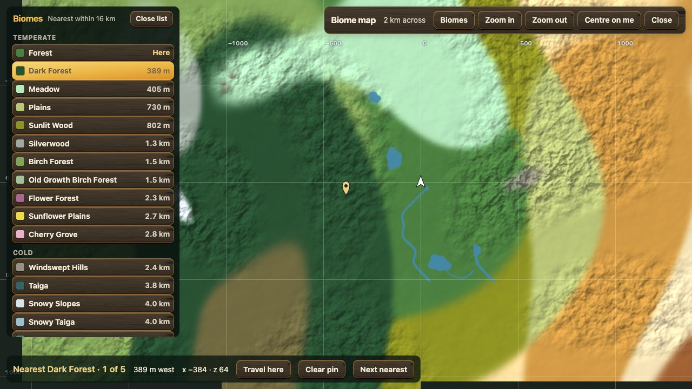
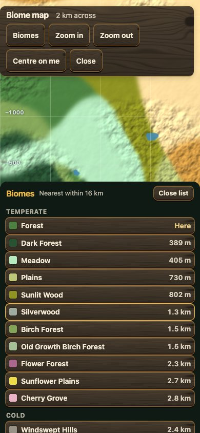
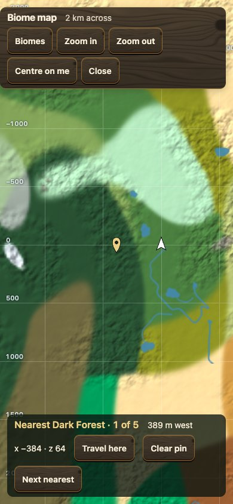

# Forest Drift — Find a Biome Phase 1: Implementation Record

**Date:** 2026-11-17
**Plan:** [`../feature-plan/02-technical-plan.md`](../feature-plan/02-technical-plan.md) (revision 2) · earlier: [Phase 0](../phase-0/implementation.md)
**Status:** Phase 1 complete. Not committed. No server deploy is needed.

Phase 1 puts Find a biome in the game: the **Biomes** list on the full map, picking, **Next nearest**, the keys and screen-reader text.

## What players get

**Biomes** (or `B`) on the full map opens the list on the left:

- all 26 biomes in five groups, each with its map colour and the distance to its nearest patch;
- the biome you're in at the top of its group, marked **Here**;
- the others nearest first, then any with none in range, greyed out as **None within 16 km**.

The distances come from the scan in the map worker, about 0.3–0.4 s. The rows show "…" until it's done. Reopened after you've moved more than 250 m, the old distances stay up, dimmed, with "Updating…" until the new scan is done.

**Picking a biome:**

- the map centres on its nearest patch and drops the pin well inside it;
- the footer says **Nearest Dark Forest · 1 of 5**, how far and which way, and offers **Travel here**, **Clear pin** and **Next nearest**;
- screen readers hear "Nearest Dark Forest: 389 m west".

- **Next nearest** (or `N`) moves the pin to the next patch out, at least 1 km away: **Dark Forest · 2 of 5**. After the last one, the footer says **No more Dark Forest within 16 km**.
- **None in range:** picking a biome with none within 16 km says so, for example **No Snowy Slopes within 16 km**.
- **The biome you're in:** picking it pins its nearest _other_ patch, or says **No other Forest within 16 km**.
- **Your own pin:** clicking the map to drop a pin yourself ends the Find, as does **Clear pin**.

**On a phone** (or any window under 900 px wide), the list is a sheet from the bottom, up to 58% of the screen. Picking closes it, so the pin and its buttons show.

 

**Keys:**

| Key                | What it does                                                                             |
| ------------------ | ---------------------------------------------------------------------------------------- |
| `B`                | Opens or closes the list. Opening it focuses the first row.                              |
| `↑` `↓`, Home, End | Move between rows (the map doesn't pan while the list has focus).                        |
| `Enter`            | Picks the focused row.                                                                   |
| `N`                | Next nearest.                                                                            |
| `Esc`              | Closes the list (focus returns to **Biomes**), then clears the pin, then closes the map. |

**Hidden:** in a world with biomes off, and with `?findBiome=off`.

## Changes from the plan

1. **The sheet layout starts at 900 px,** not only on phones: below that the header's buttons would overlap a side panel.
2. **The footer's title replaces the biome name** while a Find is showing ("Nearest Dark Forest · 1 of 5" rather than "Dark Forest" twice).
3. **Without fast travel** (`?fastTravel=off`), picking centres the map on the patch and the readout describes it, with no pin.
4. **Picking before the scan is done** (E2) needs nothing special: the worker answers `find` once the scan finishes, and the row says "Searching…" meanwhile.
5. **The scan stops when the full map closes** (`BiomeMapSystem.closeFull` cancels it), even if the minimap keeps the worker running.

## Files

**New:**

- `game/map/findBiome.ts`: the switch (`?findBiome=off`), the rows' order and words, and the footer's text.
- `game/map/__tests__/findBiome.spec.ts` (5 tests).
- `tests/findBiome.e2e.ts` (5 tests).

**Changed:**

- `components/BiomeMapOverlay.svelte`: the Biomes button and list, picking, Next nearest, the keys, the `Esc` order, the announcements.
- `game/map/BiomeMapSystem.ts`: `closeFull` cancels the scan; its test checks this.
- `ThreeScene.ts`: reads `?findBiome=off`.
- `components/ControlsGuide.svelte`: the full map's entry describes Biomes, `B` and `N`.

## Verification

- `npx vitest run --project server`: **3,157 tests pass** (4 skipped: the opt-in accuracy check). New: `findBiome.spec.ts` (5: groups, row order, "…" while scanning, wording, the switch), and `BiomeMapSystem.spec.ts` now checks closing the full map cancels the scan.
  - One run had `CreatureRide.spec.ts` fail while the browser tests ran alongside; it passes three times out of three on its own and doesn't touch the map.
- `npm run check`: 0 errors. ESLint and Prettier clean on the changed files.
- **`findBiome.e2e.ts`, Chromium, WebKit and Firefox: 14 pass, 1 skipped** (touch in Firefox, which Playwright can't emulate):
  - the list, its distances, one Here, nearest first in each group, row names for screen readers;
  - picking: the title, the pin in that biome, Travel here, and arriving there;
  - Next nearest: 1 km apart, then "No more";
  - reopening after the trip: a fresh scan, and that biome is now Here;
  - keys: `B`, arrows, Home, End, `Enter`, `N`, the `Esc` order, focus back on Biomes, the scan kept on reopening;
  - focus stays on the same row when the list re-sorts;
  - the biome you're in pins another patch;
  - hidden with biomes off and with `?findBiome=off`;
  - on a phone: the sheet's size, picking closes it, the buttons fit.
- **The other map tests** (`fastTravelMap.e2e.ts`, `biomeMinimap.e2e.ts`), three browsers: all pass. One minimap test expected Tab to reach Zoom in first; Biomes now comes first, so it checks that too.
- **Not checked:**
  - **None in range:** the "None within 16 km" message on a real world. The test world has every biome within 16 km, so that branch only ran in unit tests.
  - **Focus without the fix:** I didn't confirm that focus was actually lost before the fix. The test now guards it.
  - **Real devices:** a real phone and screen reader. Phase 2 is the release pass.
