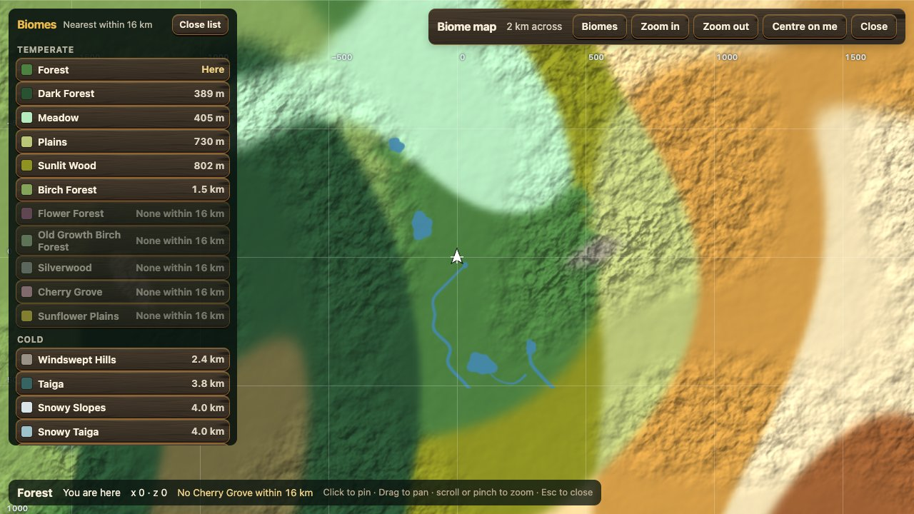

# Forest Drift — Find a Biome Phase 2: Implementation Record

**Date:** 2026-11-17
**Plan:** [`../feature-plan/02-technical-plan.md`](../feature-plan/02-technical-plan.md) (revision 2) · earlier: [Phase 0](../phase-0/implementation.md), [Phase 1](../phase-1/implementation.md)
**Status:** Phase 2 complete, so Find a biome is complete. Not committed. **No server deploy is needed:** nothing in the room or the protocol changed.

Phase 2 is the release pass:

- "None within 16 km" in a real world;
- the list's cost in the game, including on a slower CPU;
- online;
- the docs;
- every related test in three browsers.

## "None within 16 km" in a real world

With default settings, every biome lies within 16 km of the spawn: I checked 14 worlds and none was missing a biome. It happens when a world's settings change:

- **Rare biome share at 0** turns the six variants off, so they're nowhere.
- A strong warmer, colder, wetter or drier setting can also push a biome out of range.

The test now sets rare biome share to 0. The six variants show as **None within 16 km**: greyed out, at the end of their groups, still focusable. Picking one says **No Cherry Grove within 16 km**, and screen readers hear the same.

- **A possible follow-up:** in that world, "Off in this world" would be clearer than "None within 16 km" for the variants. It's not done; the current wording is accurate.

## Cost in the game

Chromium with the Mac's GPU, medium graphics, the full map open. Three rounds at each speed: each travels 3 km first, so the list scans somewhere new, then compares 1.5 s of idle frames with the frames from pressing `B` until the distances are in. Raw numbers: [`list-performance.json`](list-performance.json). Benchmark: `tests/findBiomePerformance.e2e.ts` (opt-in, `FIND_BIOME_BENCH=1`).

| Measurement                         | Full speed               | 4× slower CPU                  |
| ----------------------------------- | ------------------------ | ------------------------------ |
| Frames, map open and idle           | median 16.7, max 16.8 ms | median 16.7, p95 and max 33 ms |
| Frames from `B` until distances     | median 16.7, max 16.8 ms | median 16.7, max 33 ms (once)  |
| From `B` until every distance shows | 0.78–0.80 s              | 0.44–0.92 s                    |

- **No cost on the main thread:** frames while the list fills are no slower than idle frames, at either speed.
- **Time to distances** includes loading the new place's map tiles first, since land tiles go before the scan.
- **The slow-CPU times are not a slow machine:** Chromium's throttling doesn't slow the map worker, where the scan runs. Phase 0 estimated a 4× slower machine at about 1–1.6 s; the rows show "…" meanwhile.

## Online

A new test in `fastTravelMultiplayer.e2e.ts` runs against a local room server, with an owner and a visitor:

- both scan the same point and get identical distances and identical Desert pins;
- the visitor uses the list and pins a biome while the world keeps going;
- the owner sees no pin, since nothing is sent.

It passes in Chromium, WebKit and Firefox. Nothing about Find a biome touches the network.

## Docs

- [`docs/biomes.md`](../../../../biomes.md): **Find a biome** for players (the list, picking, Next nearest, keys, phones, the 250 m rule) and a developer section (the scan, patches, the client, the switch, the accuracy check).
- [`docs/multiplayer-player-guide.md`](../../../../multiplayer-player-guide.md): it works the same online, and your pin is your own.
- The Controls guide's full-map entry describes Biomes, `B` and `N` (Phase 1).

## Definition of done (plan §11)

All met:

- **The list:** colours, groups, distances, **Here** and **None within 16 km**.
- **Picking:** a pin well inside the nearest patch, ready for **Travel here**; **Next nearest** up to five.
- **Controls:** `B`, `N`, arrows, `Enter`, the `Esc` order, screen-reader names and announcements, and touch.
- **Budgets:** met and measured at full speed. The worker on a slower machine couldn't be measured.
- **Tests:** pass in three browsers.
- **Docs:** written, with phase records and screenshots.

## Verification

- `npx vitest run --project server`: **3,157 tests pass** (4 skipped: the opt-in accuracy check).
- `npm run check`: 0 errors. ESLint and Prettier clean on the changed files.
- **The release pass, three browsers, one test at a time with the GPU: 62 pass, 2 skipped.** The skips are the touch tests in Firefox, which Playwright can't emulate touch in.

  | File                           | Chromium | WebKit | Firefox    |
  | ------------------------------ | -------- | ------ | ---------- |
  | `findBiome.e2e.ts`             | 5        | 5      | 4 + 1 skip |
  | `findBiomeSearch.e2e.ts`       | 1        | 1      | 1          |
  | `biomeMap.e2e.ts`              | 2        | 2      | 2          |
  | `biomeMinimap.e2e.ts`          | 5        | 5      | 5          |
  | `fastTravelMap.e2e.ts`         | 4        | 4      | 3 + 1 skip |
  | `fastTravel.e2e.ts`            | 4        | —      | —          |
  | `fastTravelMultiplayer.e2e.ts` | 3        | 3      | 3          |

- **New this phase:**
  - the "none in range" test runs on a world with variants off, where before it skipped that part;
  - the online test in `fastTravelMultiplayer.e2e.ts`;
  - the opt-in benchmark `findBiomePerformance.e2e.ts`.
- **Not checked:**
  - **Real devices:** a real phone, a real screen reader (VoiceOver or NVDA), and a real slow machine. The names, announcements and focus order are checked in tests.
  - **The live site:** this isn't pushed yet.

## Releasing

No server deploy. Push the site.
