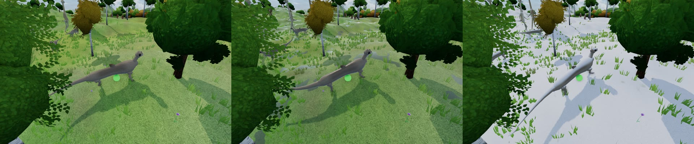
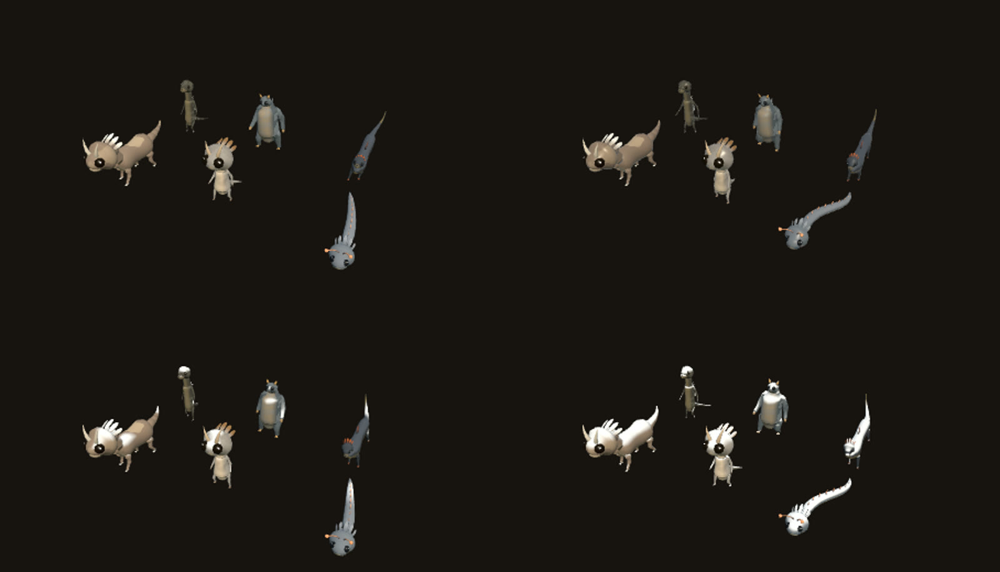

# Forest Drift — Weather on Coats: Implementation Record

**Date:** 2026-11-16
**Origin:** Q12 of the biome-creatures cycle ([decisions](../../11-12/Biomes-Specfic-Creatures/feature-plan/01-questions-and-decisions.md)), deferred as "later, not in v1".
**Status:** Built. Not committed, not deployed. Client only: no Worker deploy needed, and nothing saved or sent online changes.

Creatures now react to the weather around them. In rain their coats darken, turn glossy and catch a faint sheen of sky. When it snows, snow settles on their backs, heads and the tops of their tails.

## What players see

In the world, on open land: dry, wet and in snow (snow cover forced to 0.8, wetness to 1).

A taiga region in the Creature Lab, from above: dry, rain, light snow and heavy snow. Light snow dusts heads and backs first; heavy snow covers every upward surface.

- **Snow** settles on whatever faces up (backs, heads, tail tops) in patches that are fixed to the body, so they move with the animal rather than sliding over it. Fur holds the most snow, hide and skin less, scales and chitin least. It never covers more than 92%, so the coat still shows.
- **Rain** darkens coats (fur by up to 32%, other coats 20%), roughly halves their roughness, flattens the fur texture a little and adds a faint sky reflection at grazing angles.
- **Eyes, noses, horns and other hard parts stay as they are.**
- **Under a roof creatures stay dry**, using the same building exposure map as the terrain.
- **It follows the weather where you are:** the same wetness and snow cover that soak and dust the ground. Snow builds up and wet coats dry at the ground's pace.

## How it works

| Piece                       | File                                                                              |
| --------------------------- | --------------------------------------------------------------------------------- |
| Weather layer in the shader | `creatures/CreatureMaterial.ts` (`WEATHER_APPLY`, hook key `creature-surface-v4`) |
| Shared weather uniforms     | `materials/shader/weatherSurface.ts` (`WEATHER_SURFACE_UNIFORMS`), unchanged      |
| Switch                      | `?creatureWeather=off`, `CREATURE_WEATHER_AVAILABLE` (`creatureCoatSwitches.ts`)  |
| Lab preview                 | `CreatureLab.setWeatherPreview`, Weather select in the Biome coat panel           |

- The creature material shares the terrain's weather uniform objects, so the game's existing weather update drives both and nothing new runs per frame.
- The layer runs after the coat normal and roughness are final and before lighting. The whole block is skipped while it's dry and snow-free (a uniform branch).
- Snow patches come from the existing noise volume at the creature's bind-space position, scaled by its body size. The upward test uses the smooth normal from before the coat bump.
- The vertex shader passes the skinned world position, for the building exposure lookup.
- `?creatureWeather=off` sets one uniform to 0 for everyone in that session. It needs no recompile and touches nothing else.

## Choices I made

Q12 was left open, so these are my calls. Each is a constant in `WEATHER_APPLY` and easy to change:

- **Both snow and wet, not wet only** (Q12's option A), since local weather already has both.
- **No per-creature build-up.** Coats follow the ground's snow cover and wetness, so a creature that walks out from under a roof is snowy at once. Tracking each animal's own cover would need per-creature state; that didn't seem worth it.
- **Weather is the player's local weather.** Creatures far away in another biome get the same snow as the ground near you, the same limitation the terrain already has.

## Cost

Measured on Apple M4 with Metal: `tests/creatureSurfacePerformance.e2e.ts`, "weather on coats GPU A/B", opt-in with `CREATURE_BENCH=1`. Raw numbers: [`weather-coats-performance.json`](weather-coats-performance.json).

| Scene                              | Dry        | Rain       | Snow       |
| ---------------------------------- | ---------- | ---------- | ---------- |
| Full-screen close-ups (five coats) | 1.9–2.1 ms | 1.9–2.0 ms | 1.3–2.0 ms |
| Lab, 100 creatures: frame          | 2.3 ms     | 1.6 ms     | 1.6 ms     |
| Programs / draw calls (100)        | 1 / 99     | 1 / 99     | 1 / 99     |

The differences are within the benchmark's noise (a second dry run measured 1.5 ms for 100 creatures). One rain and one snow close-up median read 0.4–0.5 ms right after the weather changed; I'm treating those as sampling outliers, not a speed-up. There's still one shader program and one draw per creature.

## Verification

- `npx vitest run`: **278 files, 3,083 tests pass**. New: `creatures/biome/__tests__/creatureWeather.spec.ts` (3 tests) covers:
  - the layer sits after the coat normal and roughness and before lighting;
  - the skinned world position is passed on;
  - the material shares the terrain's weather uniforms by reference;
  - `?creatureWeather=off` sets the scale to 0.
- E2E (Chromium): `creatures.e2e.ts` and `creatureBiomes.e2e.ts`, **6/6 pass**. The Lab and world screenshot runs logged no console errors.
- `npm run check`: 0 errors. ESLint and Prettier clean on the changed files.
- Not run: WebKit and Firefox. The new GLSL uses only functions the creature and weather shaders already use in those engines.
