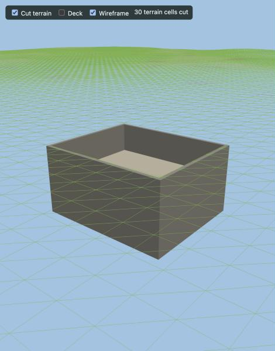
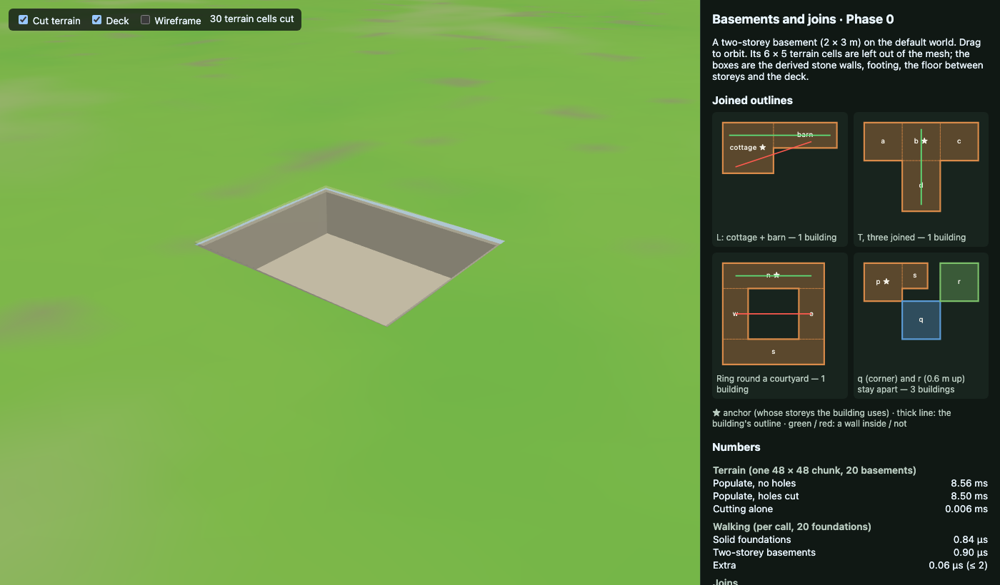

# Forest Drift — Basements and Joined Foundations Phase 0: Implementation Record

**Date:** 2026-11-18
**Plan:** [`../feature-plan/02-technical-plan.md`](../feature-plan/02-technical-plan.md) (revision 2)
**Status:** Phase 0 complete. Not committed. No server deploy.

Phase 0 is the groundwork:

- the save fields;
- the basement maths;
- terrain cut away under basements;
- walking and collision below a foundation's top;
- the join maths;
- numbers in three browsers.

No one can build a basement or join foundations in the game yet. That's Phases 1 and 2. A world can only have a basement if one is written into its save by hand.

## What it does

**Save fields** (`FoundationTypes.ts`, `SlabTypes.ts`, `basementTypes.ts`, `WorldValidation.ts`):

- `FoundationDefinition` gains `basement?: { storeys, storeyHeight }` and `joinId?`.
- `SlabDefinition` gains `role?: 'deck' | 'basement-floor'`.
- Validation accepts them and rejects bad values: 1–3 storeys, each 2.5–4.5 m, a joinId of at most 128 characters, known roles only.

**Basement maths** (`basementMath.ts`, pure). Everything about a basement comes from its one field:

- its levels (−1 to −3), their names and heights;
- the deck and the floors between storeys, as slab plans covering the footprint;
- the footing's bottom;
- the interior and the ring of stone walls;
- the walls as collision rects.

**Terrain holes** (`terrain/terrainHoles.ts`, `TerrainChunk`, `TerrainManager`):

- A basement footprint lies on the terrain vertex grid, so its cells are left out of the chunk's index buffer after every populate. Nothing is drawn or discarded per fragment, and raycasts fall through the hole.
- `FoundationManager` publishes the basement footprints whenever they change, before the terrain-edit handler. So the chunks an edit rebuilds are already cut, and chunks already built are only re-cut, with no vertex recomputed.

**Walking** (`WorldSurfaceSampler`, `FoundationManager`, `ThreeScene`):

- **Interior** (inside the 0.3 m stone walls): the basement's lowest floor replaces the terrain and the foundation top as unconditional ground. The deck and the floors between storeys are ordinary slabs, so they hold a player above them and not one below. Stair holes in them drop a player through, as in any floor.
- **Ring** (on top of the stone walls): stays solid foundation top. Walking up to a house from lower ground steps onto it exactly as onto a solid foundation.
- **Containment:** a player whose current position is in the interior, with feet below the deck, meets the four stone walls as collision. Anyone else never meets them. So a player in the basement can't walk out onto the ring (which would lift them through the deck), and a player outside isn't stopped from stepping up.
- **Camera:** the camera keeps itself above `getGroundY`, which is the basement floor inside a basement, so it doesn't pop up through the deck.

**Join maths** (`foundationJoinMath.ts`, pure):

- shared edges;
- buildings by union-find over foundations with the same `joinId` that share an edge at the same height;
- the anchor and how `joinId` is chosen when placing, merging and separating;
- frame offsets;
- the outline of a building, with holes for a courtyard;
- inside tests for points, walls (segments) and slabs (polygons).

**Dev preview** (`/basements/?dev`):

- a two-storey basement on the default world's terrain, with the derived parts drawn as plain boxes;
- toggles for the cut, the deck and wireframe;
- four join examples drawn from the maths;
- the numbers.

## Changes from the plan

1. **The world format stays at v10 until Phase 1.**
   - The fields are optional and nothing writes them yet.
   - Bumping now would make this build publish v11 worlds the live rooms refuse, with nothing new in them.
   - Phase 1, the first build that can write a basement, bumps the version. Phase 3 sets which versions rooms accept (§7).
2. **Walking is simpler than §4.4 described.** The plan had the deck count as unconditional ground for anyone above its underside. That's not needed:
   - in the interior the deck is just a slab, and the lowest floor is the ground;
   - the ring keeps the old snap-up;
   - the stone walls only exist for a player already inside.

   This gives the same behaviour with no player-height test in the sampler. Deck holes work through the existing slab openings.

3. **The whole footprint is cut,** not "inside and not on its border". The cells inside the footprint are exactly the ones under the deck and walls; the terrain just outside runs up to the footprint's edge.
4. **The footing isn't written into `bottomY`.** `bottomY` is re-grounded locally and never travels online as a patch. So `basementFootingBottomY` derives the deeper bottom, and Phase 1 draws from it.
5. **`basementRegionAt` allocates nothing.** It runs for every foundation on every walking query. With the same slabs in both cases, the basement code itself costs 0.05–0.3 µs a query (below).

## Numbers

Raw numbers: [`bench-chromium.json`](bench-chromium.json), [`bench-webkit.json`](bench-webkit.json), [`bench-firefox.json`](bench-firefox.json).

- **Test:** `tests/basementsPhase0.e2e.ts`, three fresh runs per engine on the dev page.
- **Node:** `basementBench.spec.ts` checks the same budgets.
- **Setup:** one 48 × 48 terrain chunk with 20 two-storey basements cut out of it (400 cells). Walking is measured at points all over it, with 20 foundations, half the queries from the deck and half from the basement.
- **Timers:** WebKit's and Firefox's timers are only 1 ms fine. So populates are timed five at a time and cuts 200 at a time.

| Measurement                                | Chromium         | WebKit           | Firefox          | Node      | Budget           |
| ------------------------------------------ | ---------------- | ---------------- | ---------------- | --------- | ---------------- |
| Populate a chunk, no holes                 | 8.3–8.4 ms       | 4.8 ms           | 6.4 ms           | 8.7 ms    |                  |
| Populate a chunk, 400 cells cut            | 8.3–8.4 ms       | 4.8 ms           | 6.2–6.4 ms       | 8.7 ms    |                  |
| Cutting the index buffer alone             | 0.005 ms         | 0.005 ms         | 0.005 ms         | 0.006 ms  | ≤ 0.5 ms a chunk |
| Walking query, 20 solid foundations        | 0.84–0.85 µs     | 0.80–0.85 µs     | 2.25–2.30 µs     | —         |                  |
| Walking query, 20 two-storey basements     | 0.90–0.91 µs     | 0.90 µs          | 2.55–2.60 µs     | —         |                  |
| Extra per walking query                    | 0.05–0.07 µs     | 0.05–0.10 µs     | 0.30 µs          | —         | ≤ 2 µs           |
| Grouping 200 foundations into 25 buildings | ≤ 0.1 ms (timer) | < 1 ms (timer)   | < 1 ms (timer)   | 0.09 ms   | ≤ 2 ms           |
| Outline of a U of 8 foundations            | 8.7–9.7 µs       | 10.7–12.0 µs     | 9.3 µs           | 14–21 µs  |                  |
| Slab-inside test (8-corner slab, U of 8)   | 2.3–2.5 µs       | 2.7–5.3 µs       | 5.3 µs           | 3.5–11 µs |                  |
| Wall-inside test                           | 0.3–0.4 µs       | ≤ 1.3 µs (timer) | ≤ 1.3 µs (timer) | 0.5 µs    |                  |

- **Terrain:** cutting is about 0.005 ms a chunk, a thousandth of populating one. With holes, a chunk rebuild costs what it did.
- **Walking:** the comparison has the same deck and basement-floor slabs in both cases, so it isolates the basement checks. Slabs cost what they always did. Without that, a first run showed about 1.2–1.8 µs "extra", nearly all of it the 40 slabs.
- **Joins:** everything runs in microseconds, so the tools in Phase 2 can test every frame.

## Plan assumptions (§13), checked

1. **One vertex grid for every terrain chunk: confirmed.** There are no terrain levels of detail; every chunk has the world's one resolution, and its vertices are the foundation grid. The cut is exact (`terrainHoles.spec.ts`).
2. **Flush tops with no seam:** not checked yet. Terrain UVs are world-space; building materials are checked in Phase 2, where seams are drawn.
3. **Other ground users:**
   - creatures never enter foundation footprints at all (their `blocked` test refuses any point with a foundation top);
   - projectiles and weather use the surface sampler, so they're basement-aware already;
   - the camera now uses `getGroundY`.
   - **Phase 1 item:** stair footings (`StairManager.sampleTerrainHeight`) sample raw terrain, so a basement stair must use `getGroundY`.
4. **Stairs cutting the deck:** Phase 1, when decks exist.
5. **The same-foundation sweep:** Phase 2.
6. **Keys:** Phase 1.

## Tests

| File                                                  | What                                                                                                                                                                                                                                                                              |
| ----------------------------------------------------- | --------------------------------------------------------------------------------------------------------------------------------------------------------------------------------------------------------------------------------------------------------------------------------- |
| `building/__tests__/basementMath.spec.ts` (18)        | Validation; depths; levels −1 to −3 and nothing else; wall tops meet the storey above; names; world heights; the footing; deck and floor plans for 1–3 storeys, math-CCW and valid; interior and ring; the walls keep a player in, never one on the deck.                         |
| `building/__tests__/foundationJoinMath.spec.ts` (26)  | Shared edges (full, partial, corner, gap, overlap); same height; buildings (stale members, a deleted anchor, a split chain, any order); anchor and `joinId` choice; frames; inside tests on an L and a ring; outlines of L, T, U, a ring with a hole, corner-touching squares.    |
| `terrain/__tests__/terrainHoles.spec.ts` (10)         | Exact cells cut; same order and winding; holes across chunk edges and far from the origin; overlapping holes; buffer reuse; a real chunk cut after populate, restored, raycasts falling through; nothing redone when unchanged; under 0.5 ms.                                     |
| `building/__tests__/WorldSurfaceSampler.spec.ts` (+9) | On the deck from above; on the basement's floors from below; through the deck's stair hole; a removed basement floor; up onto the rim from lower ground; the camera's ground; containment; a solid foundation unchanged; holes published before the terrain edit, only on change. |
| `building/__tests__/basementBench.spec.ts`            | The §9 budgets in Node.                                                                                                                                                                                                                                                           |
| `tests/basementsPhase0.e2e.ts`                        | Chromium, WebKit, Firefox: 30 cells cut, restored and cut again; the join examples group the same; budgets on the median of three runs; no page errors.                                                                                                                           |

Also run:

- the full unit suite: 3,221 passed, 4 skipped;
- `svelte-check`: 0 errors;
- ESLint and Prettier on the changed files;
- `cornerWalls.e2e.ts` and `earthFoundation.e2e.ts` in Chromium, both passing (building on foundations, walking, reload).

## Files

| File                                                                                         | Change                                                                                                                   |
| -------------------------------------------------------------------------------------------- | ------------------------------------------------------------------------------------------------------------------------ |
| `src/lib/game/building/basementTypes.ts`                                                     | New: the basement type, limits, sizes, validation.                                                                       |
| `src/lib/game/building/basementMath.ts`                                                      | New: the basement maths.                                                                                                 |
| `src/lib/game/building/foundationJoinMath.ts`                                                | New: the join maths.                                                                                                     |
| `src/lib/game/terrain/terrainHoles.ts`                                                       | New: holes and the cut index buffer.                                                                                     |
| `src/lib/game/terrain/TerrainChunk.ts`, `TerrainManager.ts`                                  | Cut after populate; `holes`, `notifyHolesChanged`, `getHoledCellCount`.                                                  |
| `src/lib/game/building/FoundationManager.ts`                                                 | `getSolidTopYAt`, `getBasementFloorAt`, `getBasementContainmentRects`, `getBasementHoleRects`, `setTerrainHolesHandler`. |
| `src/lib/game/building/WorldSurfaceSampler.ts`                                               | `getGroundY`; the interior's ground and the solid top.                                                                   |
| `src/lib/game/ThreeScene.ts`                                                                 | Holes to the terrain, containment walls, the camera's ground.                                                            |
| `FoundationTypes.ts`, `SlabTypes.ts`, `world/WorldValidation.ts`                             | The new fields and their validation.                                                                                     |
| `src/lib/game/building/basementBench.ts`, `BasementPreviewScene.ts`, `src/routes/basements/` | The measurements and the dev page.                                                                                       |
| `playwright.config.ts`                                                                       | The basements e2e also runs in WebKit and Firefox (`*-map` projects).                                                    |

## Next: Phase 1

Basements in the game:

- the Foundation tool's `E` choice and `F`;
- the stone walls, footing and deck drawn properly, with the foundation box replaced;
- the deck and floor slabs created and removed with the basement;
- levels −1 to −3 in `BuildingLevelManager` and the floor selector;
- stairs down, including footings on the basement floor;
- undo, save and load;
- world format v11.
