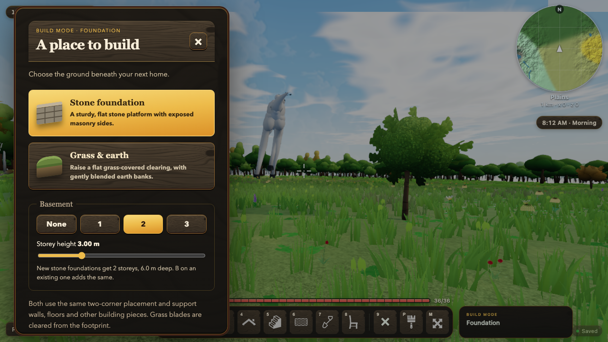
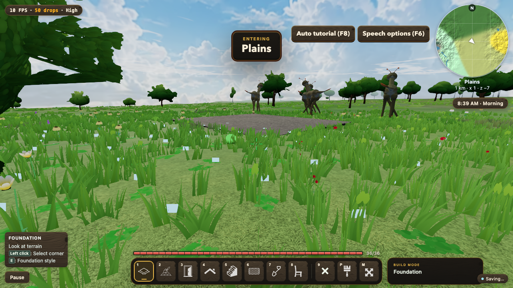
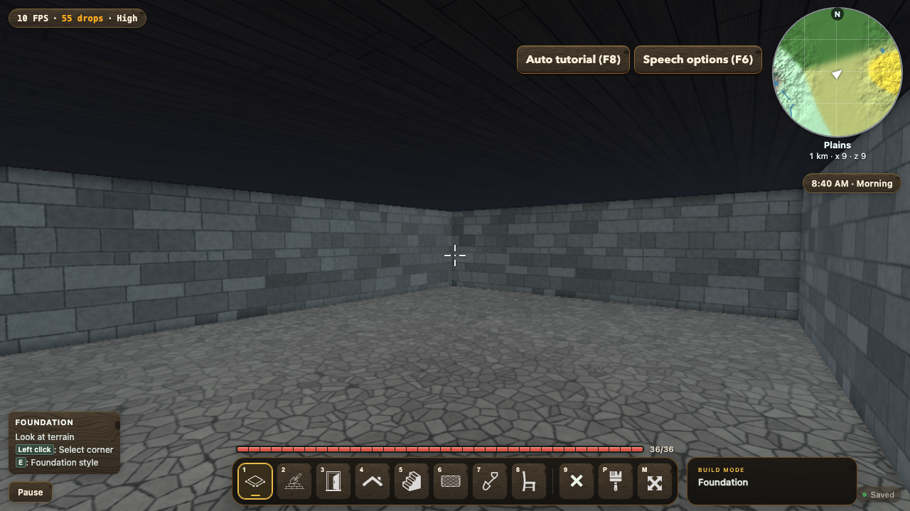
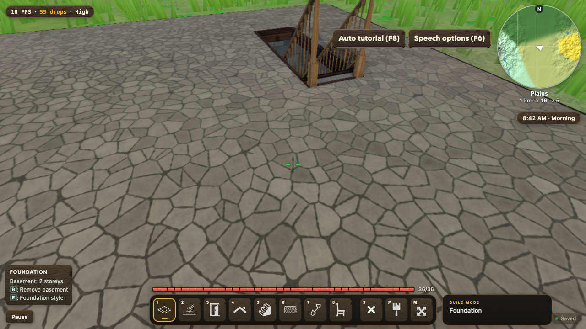

# Forest Drift — Basements and Joined Foundations Phase 1: Implementation Record

**Date:** 2026-11-18
**Plan:** [`../feature-plan/02-technical-plan.md`](../feature-plan/02-technical-plan.md) (revision 2) · [Phase 0](../phase-0/implementation.md)
**Status:** Phase 1 complete. Not committed. No server deploy; online is checked in Phase 3.

Phase 1 is basements in the game:

- placing a stone foundation with one, two or three basement storeys;
- adding a basement to a foundation later, or removing an empty one, with `B`;
- the stone walls, footing and floors;
- walking in and down;
- the storeys in the floor selector;
- stairs up through the floors;
- undo, save and load;
- world format v11.

## What players get

- **Foundation tool, `E`:** a new **Basement** section with storeys (None, 1, 2, 3) and the storey height (2.5–4.5 m, default 3 m). The note under it says what a new foundation will get.

  

- **Placing:** with storeys chosen, the preview reaches down to the footing, and the HUD says "Basement: 2 storeys of 3 m". It's refused where water over the footprint is higher than the lowest floor ("Too close to water for a basement"). Earth pads never get one.
- **`B` on an existing stone foundation:**
  - adds a basement with the panel's storeys (at least one), shown as "B: Add basement (2 storeys, 6 m)";
  - on one that has a basement, "B: Remove basement" removes it, but only while it's empty: "Empty the basement first (1 piece)" counts walls, floors, stairs, roofs, floor detailing, skirting, fences, furniture and Mini Builds down there;
  - the result shows beside the crosshair, and each is one undo step (`-`, then `=` to redo).
- **From outside**, a house with a basement looks like any other. The floor over the basement (the deck) uses the foundation's own stone top, and the foundation's timber frame trims it.

  

- **Inside:**
  - stone walls on four sides, a flagstone floor at the bottom, and the floor between storeys above;
  - every build tool works there;
  - `[` from the Ground Floor goes to **Basement**, then **Lower Basement** and, with three storeys, **Deep Basement**, and stops there.

  

- **Stairs** built on a basement storey up to the one above cut a framed hole in its floor, as stairs between upper floors do. Standing over the hole, you drop onto the stair.

  

## How it works

| Piece                   | Where                                                                       | What                                                                                                                                                                                                                                                                                                                                                                     |
| ----------------------- | --------------------------------------------------------------------------- | ------------------------------------------------------------------------------------------------------------------------------------------------------------------------------------------------------------------------------------------------------------------------------------------------------------------------------------------------------------------------ |
| Adding and removing     | `BuildingManager.addBasement` / `removeBasement` / `countBasementOccupants` | Sets or clears `basement` with the new `FoundationManager.updateFoundation` (mesh, frame and terrain holes rebuilt in place, everything built on it untouched), and creates or removes the deck and basement-floor slabs from `basementSlabPlans`. Refuses earth pads, a second basement, a world grid that doesn't fit, or a slab already at a basement floor's height. |
| The deck                | `BuildingManager.removeSlab`, `SlabManager`, `RemoveTool`, `PaintTool`      | Can't be removed alone (Remove shows "Floor over the basement · Goes with the basement"). Drawn and painted as the foundation top (`slabMaterialKind`). Basement slabs get no overhang timber: their edges rest on the stone walls.                                                                                                                                      |
| Drawing                 | `FoundationMesh`                                                            | A basement foundation's own mesh is an invisible deck-height block (like an earth pad's proxy), so every tool that aims at a foundation's top still hits it, just under the deck. The footing and four walls are child meshes with the foundation's stone; `setSupportDepth` deepens only the footing.                                                                   |
| Storeys                 | `BuildingLevelManager`, `levelDisplayName`                                  | Levels −1 … −n are made from the foundation's basement every time they're asked for: never stored, never from `defaultStoreyHeight`, gone with the basement (the current storey is clamped back up). Level discovery ignores everything below the top.                                                                                                                   |
| Keeping a player inside | `FoundationManager.containInBasement`, `ThreeScene`                         | A clamp to the interior (see changes below). The camera still keeps out of the walls' rects.                                                                                                                                                                                                                                                                             |
| The Foundation tool     | `FoundationTool` (`FoundationBasementHooks`), `FoundationCustomizeModal`    | Aiming at an existing foundation (nearer than the terrain behind it) shows its basement and the `B` hint. Placement adds the basement after the foundation, in the same click.                                                                                                                                                                                           |
| Stairs                  | `StairTool`                                                                 | Matches basement storeys when naming where a stair leads. No approach flight out of a basement storey.                                                                                                                                                                                                                                                                   |
| Undo                    | `BuildUndoManager`                                                          | A `basement` action, undone and redone by its own closures, like a shovel stroke. An undo that can no longer happen (someone built down there since) stays on the stack.                                                                                                                                                                                                 |
| World format            | `WorldTypes`, `WorldMigrationManager`                                       | v11. 10 → 11 changes nothing but the version. Online worlds at 9, 10 and 11 open (Phase 3 decides whether rooms keep taking v10 clients).                                                                                                                                                                                                                                |

## Changes from the plan

1. **`B`, not `F`.** `F` toggles flight on foot, and walking overlaps every tool, so `F` would have done both. `B` is only used by other tools' snapping, and the Foundation tool doesn't snap. The plan's docs are updated.
   - For Phase 2: `L` is the global graphics-quality key, so joining needs a different key too.
2. **A player is kept in by a clamp, not by wall collision.** The first game test walked straight through a basement wall. At the headless browser's 10 fps, one step is up to 0.6 m (1.2 m running), longer than a 0.3 m wall plus the player's radius, so collision pushed the player out the far side. Once on the rim, the player was lifted onto the deck.
   - Now a player whose current position is in a basement, with feet below the deck, has their next position clamped to the interior, a player's radius from the stone. No step length gets through.
   - Ordinary walls have the same tunnelling at very low frame rates; it matters more here, so only basements get the clamp.
3. **The deck looks like the foundation's top, not a wooden floor.** The first screenshots showed basement houses with dark plank tops, unlike their neighbours. A house with a basement now looks the same as one without (brief §5).
4. **Basements need a stone foundation.** An earth pad is drawn by the terrain, and a deck would replace its grass with stone. "Basements need a stone foundation" says so.
5. **Every basement storey is unrestricted for walls.** The plan had only the lowest one count as ground. `upperWallSupport` already treats any base at or below the foundation top as ground, and the floors between storeys hold walls anyway, so nothing was changed.
6. **Stair footings need no change.** Phase 0 flagged them, but a stair inside a basement always has terrain above it, so its footing comes out as zero, which is correct. Sampling the basement floor instead would wrongly put a 3 m footing under a stair on a basement floor.
7. **Basement storeys aren't stored.** They're made from the foundation's `basement` each time, so saves and online rows carry nothing new for them, and removing a basement can't leave stale storeys behind.
8. **Placing a foundation with a basement isn't an undo step,** because placing a foundation never was. Adding or removing one with `B` is.

## Tests

| File                                             | What                                                                                                                                                                                                                                                                                                                                                                                                                                                                          |
| ------------------------------------------------ | ----------------------------------------------------------------------------------------------------------------------------------------------------------------------------------------------------------------------------------------------------------------------------------------------------------------------------------------------------------------------------------------------------------------------------------------------------------------------------- |
| `building/__tests__/basements.spec.ts` (16)      | Adding (deck, floors, holes); refusals (earth, invalid, second, a floor in the way); the deck can't be removed alone, basement floors can; a basement stair cuts the deck; removing an empty basement; refusing with 2 pieces, and with pieces the caller counts; storeys −1 to −3 (names, limits, never stored, gone with the basement); level discovery; the mesh (invisible proxy, five stone parts, footing depth); undo and redo, and an undo that can no longer happen. |
| `building/__tests__/basementMath.spec.ts` (+1)   | `basementOccupantCount`: the basement's own slabs, Ground Floor pieces and approach stairs don't count; one of each kind below does.                                                                                                                                                                                                                                                                                                                                          |
| `building/__tests__/WorldSurfaceSampler.spec.ts` | Containment is now the clamp: a 5 m step past a wall is held a radius inside; on the deck, outside or on the rim nothing changes.                                                                                                                                                                                                                                                                                                                                             |
| `world/__tests__/basementSchema.spec.ts` (4)     | v11; 10 → 11 changes only the version; a basement, joinId and deck role validate and survive; bad ones are refused.                                                                                                                                                                                                                                                                                                                                                           |
| `tests/basements.e2e.ts` (Chromium)              | `E` → two storeys → place a foundation with the tool → deck and floor slabs, 30 terrain cells cut → walk in from outside onto the deck → stand on the lowest floor → walk 2.5 s into a wall and stay inside → floor selector to Lower Basement and back → a stair cuts the deck, standing over the hole drops onto it → `B` refused with the stair, removes once it's gone → undo, redo, undo → save, reload, all of it back.                                                 |

Also run:

- the full unit suite: 3,241 passed, 4 skipped;
- `svelte-check`: 0 errors;
- ESLint and Prettier on the changed files;
- in Chromium, the existing `cornerWalls`, `earthFoundation` and Phase 0 `basementsPhase0` e2e tests pass, as do 5 of the 7 `worldPersistence` tests.
  - **Two `worldPersistence` tests fail, and failed before this feature.** They fail the same way at `413f9d56`, the commit before Basements and Joined Foundations began:
    - "a saved world contains its definition…" expects a list of save keys that lacks `rules`;
    - "authored buildings are rebuilt…" doesn't get through opening its world (a click times out there; the loading screen stays up here).
  - They're left for a separate fix.

## Known limitations

- **Stairs at a basement's edge** can overlap the 0.3 m stone walls, as a stair can overlap a player's own walls.
- **Changing a basement's storeys** means removing it and adding it again.
- **Online:** basements sync through the same rows as everything else, but this isn't tested until Phase 3. Until Phase 3 decides, a v10 client in the same room would draw a basement as solid stone.
- **WebKit and Firefox** run the game test in Phase 3, with touch.

## Files

| File                                                                                    | Change                                                                                                                                    |
| --------------------------------------------------------------------------------------- | ----------------------------------------------------------------------------------------------------------------------------------------- |
| `building/BuildingManager.ts`                                                           | `addBasement`, `removeBasement`, `countBasementOccupants`; deck protection.                                                               |
| `building/FoundationManager.ts`                                                         | `updateFoundation`, `containInBasement`, `getAllBasementWallRects`; stone materials for a basement under an earth pad loaded from a save. |
| `building/FoundationMesh.ts`                                                            | The proxy, footing and walls.                                                                                                             |
| `building/BuildingLevelManager.ts`, `BuildingLevelTypes.ts`                             | Basement storeys and names.                                                                                                               |
| `building/FoundationTool.ts`, `components/FoundationCustomizeModal.svelte`              | Basements when placing, `B`, the `E` panel.                                                                                               |
| `building/SlabManager.ts`, `PaintTool.ts`, `RemoveTool.ts`                              | The deck's look, paint and Remove label; no overhang timber on basement slabs.                                                            |
| `building/StairTool.ts`, `BuildUndoManager.ts`, `basementMath.ts`, `FoundationTypes.ts` | Stairs, undo, occupant count, panel settings.                                                                                             |
| `input/keyActions.ts`                                                                   | `foundation.basement` on `B`.                                                                                                             |
| `hydrology/foundationWater.ts`                                                          | `basementBelowWater`.                                                                                                                     |
| `world/WorldTypes.ts`, `WorldMigrationManager.ts`                                       | v11.                                                                                                                                      |
| `ThreeScene.ts`                                                                         | Wiring: storeys, hooks, containment, camera.                                                                                              |

## Next: Phase 2

Joining:

- lining up and joining when placing;
- the join key (not `L`) and `R` to raise;
- shared storeys;
- every tool across the join;
- the clean seam;
- joined basements;
- removing.
