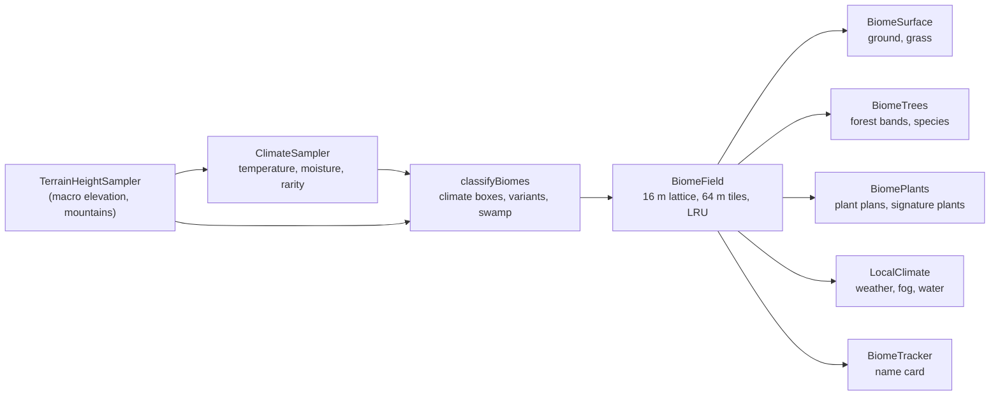

# Biomes

New worlds are divided into **26 biomes**: forests, taiga, jungles, meadows, mountains, plains, deserts, savannas and swamps. Each one has its own ground, grass, trees, plants, weather and air. The decisions behind them are in [`2026/11-12/Biomes-and-Enviroments/feature-plan/`](2026/11-12/Biomes-and-Enviroments/feature-plan/), and each phase has an implementation record next to it.

## For players

- **Where you are.** When you enter a biome, its name appears at the top of the screen for a few seconds. The pause menu always says which biome you're in. To hide the name card, turn off **Settings → Graphics → Show biome names**.
- **Spawn is gentle.** A new world always starts in a temperate biome, such as a forest or plains. Cold, hot, dry and wet biomes lie further out. In testing, every seed had all 26 within 10 km of spawn.
- **Weather follows the climate.** A world still has one weather schedule, shared by everyone online, but what falls depends on where you stand. It snows where it's cold and rains where it's mild. Nothing falls in the desert, savannas get about half the rain, and jungles and swamps get more. Clouds, wind and lightning are the same everywhere. A weather that the owner or the debug menu forces shows as chosen everywhere.
- **Air and water.** Jungles are hazy, swamps and Silverwood misty, deserts dusty, snowfields cool blue and Cherry Grove faintly pink. Swamp water is darker and greener, and cold water bluer. Crossing a border changes the air and weather over about 4 seconds.

### Settings (World → Biomes)

| Setting                  | What it does                                                                                                   |
| ------------------------ | -------------------------------------------------------------------------------------------------------------- |
| Turn biomes off/on…      | Asks first. Off brings back the world as it was before biomes: the same terrain, forests and plants as before. |
| Biome size               | Small (≈450 m), Normal (≈750 m) or Large (≈1.5 km) across. Also offered when you create a world.               |
| Warmer (+) or colder (−) | Shifts the whole world's climate. Up to ±0.3.                                                                  |
| Wetter (+) or drier (−)  | Shifts the whole world's moisture. Up to ±0.3.                                                                 |
| Rare biome share         | How much of a parent biome its variant takes, for example Flower Forest inside Forest. 0 turns variants off.   |
| Border sharpness         | Higher gives narrower borders between biomes.                                                                  |

Changing any of these regenerates the terrain, forests and plants. Your builds stay where they are.

### Old worlds

Worlds made before biomes keep **biomes off**, so they look exactly as they did. You can turn biomes on from the same settings group. The world then changes around your builds.

### Online

A world with biomes on can be published and played online like any other. Every player computes the same biomes from the world's seed, so players standing together see the same land and the same weather. The server relabels worlds published before biomes to the current generator version only when they have biomes off. Nothing about them changes.

## The 26 biomes

| Group     | Biome                   | Where                                | What you'll notice                                |
| --------- | ----------------------- | ------------------------------------ | ------------------------------------------------- |
| Temperate | Forest                  | Mild, moderately wet lowland         | Oak and pine woods, the classic Forest Drift look |
|           | Flower Forest           | Variant inside Forest                | Flower-carpeted clearings                         |
|           | Birch Forest            | Cool, moderately wet lowland         | Pale birch stands                                 |
|           | Old Growth Birch Forest | Variant inside Birch Forest          | Tall, old birches                                 |
|           | Dark Forest             | Mild and very wet lowland            | Dense, broad canopy, shaded floor                 |
|           | Silverwood              | Variant inside Dark Forest           | Pale grey-green woods in low mist                 |
|           | Sunlit Wood             | Warm, moderately wet lowland         | Open, dappled woodland                            |
|           | Meadow                  | Mild uplands                         | Open grass and flowers                            |
|           | Cherry Grove            | Variant inside Meadow                | Pink-blossom trees                                |
|           | Plains                  | Dry lowland, cool to warm            | Open grassland                                    |
|           | Sunflower Plains        | Variant inside Plains                | Sunflower fields                                  |
| Cold      | Taiga                   | Cold, wet lowland                    | Spruce forest                                     |
|           | Snowy Taiga             | Coldest wet lowland                  | Snow-covered spruce                               |
|           | Snowy Plains            | Coldest dry lowland and cold uplands | Open snowfields                                   |
|           | Grove                   | Cold uplands and mountain shoulders  | Snowy conifer groves                              |
|           | Snowy Slopes            | Cold mountains                       | Bare snow                                         |
|           | Windswept Hills         | Exposed uplands and mid mountains    | Sparse, wind-bent trees on rock and grass         |
| Tropical  | Jungle                  | Hot, very wet lowland and uplands    | Tall broadleaf canopy, thick undergrowth, haze    |
|           | Sparse Jungle           | Warm to hot, wet                     | Open jungle edge                                  |
|           | Bamboo Jungle           | Variant inside Jungle                | Bamboo stands                                     |
| Warm, dry | Desert                  | Hot, dry lowland                     | Sand, cacti, no rain                              |
|           | Savanna                 | Warm to hot, dry                     | Umbrella trees on golden grass                    |
|           | Savanna Plateau         | Hot, dry uplands and mountains       | The same on high, flat ground                     |
|           | Shrub Savanna           | Warm and driest                      | Scrub and bare soil                               |
|           | Tropical Dry Grassland  | Warm, middling moisture              | Tall dry grasses                                  |
| Wet       | Swamp                   | Low, wet ground, mild to hot         | Dark water, reeds, mist                           |

The plan's working names "Pale Garden" and "Dappled Forest" became **Silverwood** and **Sunlit Wood** (decision Q2).

## For developers

All the biome code is in `src/lib/game/biomes/`. The README's "Biomes" section has the overview. In short:



- **Deterministic.** Everything comes from the world seed through named random streams, so every engine and every player gets the same biomes. The determinism report (`tests/determinism.e2e.ts`, golden in `src/lib/game/world/__tests__/`) checks biome weights and biome tree cells in Chromium, WebKit and Firefox.
- **Biomes off is the pre-biome code path.** Each system checks `BiomeField.isEnabled()` and, when it's false, runs exactly what it ran before biomes. Parity tests cover terrain, grass, trees, plants, weather, sky and water.
- **Adding a biome.** Append its id to the end of `BIOME_IDS` (never reorder: saved data and the golden use the indices). Add a definition in `biomeDefinitions.ts`, plus a row in each profile table: `biomeSurfaceProfiles.ts`, `biomeTreeProfiles.ts`, `biomePlantProfiles.ts` and `biomeAtmosphereProfiles.ts`. The profile tests fail until every biome has a row. If it changes placement, bump `BIOME_GENERATOR_VERSION` and regenerate the golden.
- **Debug views.** Settings → Rendering → Terrain debug → Debug view → **Biome map** or **Climate (temperature, moisture)**.
- **Saved data.** Schema 10 adds `environment.biomes` (`BiomeSettings` in `BiomeTypes.ts`). Online rooms accept schemas 9 and 10, and the generator version is 4.

### Kill switch

If biome worlds cause a crash or a performance problem after release, there are two ways to turn biomes off without touching anyone's saved worlds (plan §18):

- **For one session:** open the game with `?biomes=off` in the URL.
- **For everyone:** set `BIOMES_AVAILABLE = false` in `src/lib/game/biomes/biomeKillSwitch.ts` and deploy.

Either way, biome worlds load with biomes off at runtime. The saved setting stays on, so removing the switch brings them back. Don't fix a problem by lowering the schema version: older clients refuse worlds with a newer schema.

### Performance

`tests/biomePerformance.e2e.ts` is an opt-in GPU benchmark. It measures frame time, draw calls and triangles at ground level in the densest and most unusual biomes against today's densest forest, and does an A/B test of the terrain `GROUND` shader layer:

```bash
BIOME_BENCH=1 npx playwright test tests/biomePerformance.e2e.ts --project=chromium
```

The Phase 6 record has the latest numbers.
