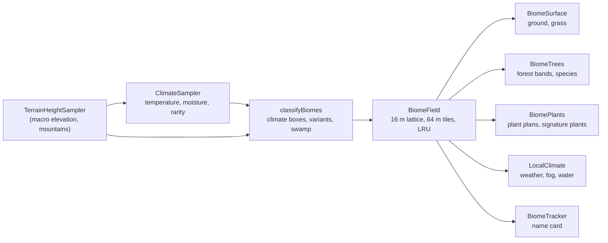

# Biomes

New worlds are divided into **26 biomes**: forests, taiga, jungles, meadows, mountains, plains, deserts, savannas and swamps. Each one has its own ground, grass, trees, plants, weather and air. The decisions behind them are in [`2026/11-12/Biomes-and-Enviroments/feature-plan/`](2026/11-12/Biomes-and-Enviroments/feature-plan/), and each phase has an implementation record next to it.

## For players

- **Where you are.** When you enter a biome, its name appears at the top of the screen for a few seconds. The pause menu always says which biome you're in. To hide the name card, turn off **Settings → Graphics → Show biome names**.
- **Spawn is gentle.** A new world always starts in a temperate biome, such as a forest or plains. Cold, hot, dry and wet biomes lie further out. In testing, every seed had all 26 within 10 km of spawn.
- **Weather follows the climate.** A world still has one weather schedule, shared by everyone online, but what falls depends on where you stand. It snows where it's cold and rains where it's mild. Nothing falls in the desert, savannas get about half the rain, and jungles and swamps get more. Clouds, wind and lightning are the same everywhere. A weather that the owner or the debug menu forces shows as chosen everywhere.
- **Each biome has its own animals.** Six biome families have their own species: round, horned forest animals; long-legged herds on open land, with giants; stocky, heavy animals in the cold; crested bipeds and long tails in the jungle; slender, big-eared runners in dry country; and serpents and finned animals in the swamp. Deserts and snowfields have fewer herds, jungles and open land more. Every family has something small to carry and something to ride. Species names start with a family word, like Moss, Frost, Dune or Marsh.
- **Creatures belong where they live.** Each herd wears the colours of the biome at its centre: sand, ochre and rust in the desert; slate, grey and white in the snow; deep green with scarlet and teal accents in the jungle. Each species keeps one brighter accent, and the six species of an area differ in lightness and pattern. Some blend in, like real animals. About one creature in 60 is a rare pale or dark morph. In rain their coats darken and glisten, and when it snows, snow settles on their backs and heads (not under a roof). Up close, coats have fur, hide, scale, chitin or skin texture. Worlds with biomes off use a neutral, natural palette.
- **Air and water.** Jungles are hazy, swamps and Silverwood misty, deserts dusty, snowfields cool blue and Cherry Grove faintly pink. Swamp water is darker and greener, and cold water bluer. Crossing a border changes the air and weather over about 4 seconds.

### The biome map

A round **minimap** in the top-right corner shows the land around you, coloured by biome, so the next desert or snowfield is easy to spot. It shows hill shading, rivers and lakes, your arrow, other players online and your waypoints. Under it are the biome you're in, the zoom and your coordinates. North is always up.

| Key (rebindable) | What it does                                                                    |
| ---------------- | ------------------------------------------------------------------------------- |
| `;`              | Show or hide the minimap. Hidden, it costs nothing.                             |
| `'` / `/`        | Zoom the minimap in or out: 250 m, 500 m, 1 km, 2 km, 4 km or 8 km across.      |
| `` ` ``          | Open the full map. Also **Map** in the pause menu, or tap or click the minimap. |

On the **full map**, drag (or use the arrow keys) to pan, and scroll, pinch or press `+`/`−` to zoom from 500 m to 16 km. Point at a place to see its biome, how far it is, which way it lies and its coordinates. **Centre on me** (or `C`) brings you back, and `Esc` closes it. Playing alone, the full map pauses the game; online, the world carries on and you stand still.

**Fast travel.** Click or tap a place on the full map to drop a pin (dragging still pans; from the keyboard, `Enter` pins the crosshair). The readout then describes the pin, and **Travel here** (or `T`) takes you straight there. You land on dry ground: a pin in a lake says "Lands on the shore", and that's where you arrive. You keep your view, your flight and any creature you're carrying or riding. **Go back**, on the map and in the pause menu, returns you to where you left; press it again to return. `Esc` clears the pin before it closes the map. You can't travel while knocked out.

**Settings → Graphics** has **Show biome map**, **Biome map size** (Small, Medium, Large) and **Map grid**. The map is on by default in worlds with biomes and remembers your choices. In a world with biomes off it stays hidden until you turn it on, then shows the land without biome colours. On touch screens, `+` and `−` buttons sit under the minimap.

### Settings (World → Biomes)

| Setting                  | What it does                                                                                                   |
| ------------------------ | -------------------------------------------------------------------------------------------------------------- |
| Turn biomes off/on…      | Asks first. Off brings back the world as it was before biomes: the same terrain, forests and plants as before. |
| Biome size               | Small (≈450 m), Normal (≈750 m) or Large (≈1.5 km) across. Also offered when you create a world.               |
| Warmer (+) or colder (−) | Shifts the whole world's climate. Up to ±0.3.                                                                  |
| Wetter (+) or drier (−)  | Shifts the whole world's moisture. Up to ±0.3.                                                                 |
| Rare biome share         | How much of a parent biome its variant takes, for example Flower Forest inside Forest. 0 turns variants off.   |
| Border sharpness         | Higher gives narrower borders between biomes.                                                                  |

Changing any of these regenerates the terrain, forests and plants, and herds respawn in their new colours. Your builds stay where they are, and a creature you're carrying or riding keeps its colours until you put it down.

### Old worlds

Worlds made before biomes keep **biomes off**. Their land, forests and plants look as they did, and their creatures wear the neutral natural colours. You can turn biomes on from the same settings group, and the world then changes around your builds.

The **Main World** ships with biomes on (since November 2026), with the same seed and outpost. A copy stored by an older version is replaced once, the next time it's opened.

### Online

A world with biomes on can be published and played online like any other. Every player computes the same biomes from the world's seed, so players standing together see the same land, the same weather and the same animals in the same colours. The server works out the published world's biomes too, so it agrees on which animals can be carried or ridden. The server relabels worlds published before biomes to the current generator version only when they have biomes off. Nothing about them changes. Biome worlds published before biome species (generator 4) must be republished before new players can join, because their animals are different now.

## The 26 biomes

| Group     | Biome                   | Where                                | What you'll notice                                |
| --------- | ----------------------- | ------------------------------------ | ------------------------------------------------- |
| Temperate | Forest                  | Mild, moderately wet lowland         | Oak and pine woods, the classic Forest Drift look |
|           | Flower Forest           | Variant inside Forest                | Flower-carpeted clearings                         |
|           | Birch Forest            | Cool, moderately wet lowland         | Pale birch stands                                 |
|           | Old Growth Birch Forest | Variant inside Birch Forest          | Tall, old birches                                 |
|           | Dark Forest             | Mild and very wet lowland            | Dense, broad canopy, shaded floor                 |
|           | Silverwood              | Variant inside Dark Forest           | Pale grey-green woods in low mist                 |
|           | Sunlit Wood             | Warm, moderately wet lowland         | Open, dappled woodland                            |
|           | Meadow                  | Mild uplands                         | Open grass and flowers                            |
|           | Cherry Grove            | Variant inside Meadow                | Pink-blossom trees                                |
|           | Plains                  | Dry lowland, cool to warm            | Open grassland                                    |
|           | Sunflower Plains        | Variant inside Plains                | Sunflower fields                                  |
| Cold      | Taiga                   | Cold, wet lowland                    | Spruce forest                                     |
|           | Snowy Taiga             | Coldest wet lowland                  | Snow-covered spruce                               |
|           | Snowy Plains            | Coldest dry lowland and cold uplands | Open snowfields                                   |
|           | Grove                   | Cold uplands and mountain shoulders  | Snowy conifer groves                              |
|           | Snowy Slopes            | Cold mountains                       | Bare snow                                         |
|           | Windswept Hills         | Exposed uplands and mid mountains    | Sparse, wind-bent trees on rock and grass         |
| Tropical  | Jungle                  | Hot, very wet lowland and uplands    | Tall broadleaf canopy, thick undergrowth, haze    |
|           | Sparse Jungle           | Warm to hot, wet                     | Open jungle edge                                  |
|           | Bamboo Jungle           | Variant inside Jungle                | Bamboo stands                                     |
| Warm, dry | Desert                  | Hot, dry lowland                     | Sand, cacti, no rain                              |
|           | Savanna                 | Warm to hot, dry                     | Umbrella trees on golden grass                    |
|           | Savanna Plateau         | Hot, dry uplands and mountains       | The same on high, flat ground                     |
|           | Shrub Savanna           | Warm and driest                      | Scrub and bare soil                               |
|           | Tropical Dry Grassland  | Warm, middling moisture              | Tall dry grasses                                  |
| Wet       | Swamp                   | Low, wet ground, mild to hot         | Dark water, reeds, mist                           |

The plan's working names "Pale Garden" and "Dappled Forest" became **Silverwood** and **Sunlit Wood** (decision Q2).

## For developers

All the biome code is in `src/lib/game/biomes/`. The README's "Biomes" section has the overview. In short:



- **Deterministic.** Everything comes from the world seed through named random streams, so every engine and every player gets the same biomes. The determinism report (`tests/determinism.e2e.ts`, golden in `src/lib/game/world/__tests__/`) checks biome weights and biome tree cells in Chromium, WebKit and Firefox.
- **Biomes off is the pre-biome code path.** Each system checks `BiomeField.isEnabled()` and, when it's false, runs exactly what it ran before biomes. Parity tests cover terrain, grass, trees, plants, weather, sky and water.
- **Adding a biome.** Append its id to the end of `BIOME_IDS` (never reorder: saved data and the golden use the indices). Add a definition in `biomeDefinitions.ts`, plus a row in each profile table: `biomeSurfaceProfiles.ts`, `biomeTreeProfiles.ts`, `biomePlantProfiles.ts` and `biomeAtmosphereProfiles.ts`. The profile tests fail until every biome has a row. If it changes placement, bump `BIOME_GENERATOR_VERSION` and regenerate the golden.
- **Debug views.** Settings → Rendering → Terrain debug → Debug view → **Biome map** or **Climate (temperature, moisture)**.
- **Saved data.** Schema 10 adds `environment.biomes` (`BiomeSettings` in `BiomeTypes.ts`). Online rooms accept schemas 9 and 10, and the generator version is 4.

### Creatures

Biome coats live in `src/lib/game/creatures/biome/`: 26 creature profiles plus a neutral one, and the region coat function. Coat detail lives in `src/lib/game/creatures/surface/CreatureCoatDetail.ts`. See "Biome coats and coat detail" in [`creature-system.md`](creature-system.md). `?creatureCoats=off` gives the classic regional colours and `?creatureDetail=off` drops the coat texture, each for one session. The plan and phase records are in [`2026/11-12/Biomes-Specfic-Creatures/`](2026/11-12/Biomes-Specfic-Creatures/).

Biome species live in `src/lib/game/creatures/biome/biomeRosters.ts` (family profiles) and `BiomeRoster.ts` (rosters). See "Biome species" in [`creature-system.md`](creature-system.md). `?creatureRosters=off` gives today's regional species in a local world, for comparison. The plan and phase records are in [`2026/11-13/Biome-Specific-Species/`](2026/11-13/Biome-Specific-Species/).

### Biome map

Map tiles are drawn off the main thread by a worker (`game/map/biomeMap.worker.ts`) with its own terrain, biome field and hydrology, built from the world's settings: 128-px tiles at seven levels (2–128 m per pixel), land first and water after. `BiomeMapClient` caches up to 120 tiles as `ImageBitmap`s; `BiomeMapSystem` paints the minimap from the scene (only when something changed, at most 15 times a second), and `BiomeMapOverlay.svelte` is the full map. The palette (`biomeMapPalette.ts`) is tested against real neighbouring biomes, including colour-blind simulation. A developer preview of the tiles is at `/biome-map/?dev`. Plan, decisions and phase records: [`2026/11-16/Biome-Minimap/`](2026/11-16/Biome-Minimap/).

### Fast travel

`ThreeScene.fastTravel(x, z)` jumps to the pin, and `goBackFromTravel()` returns from the last trip; the rules (permission, the dry-ground ring search, Go back memory) are in `game/travel/FastTravel.ts`. A trip builds only the terrain within 24 m of the landing at once (`TerrainManager.primeNear`) and lets terrain stream faster for a few seconds afterwards (`boostGeneration`). A ridden creature moves with its rider (`CreatureRuntimeManager.relocateRide`), and the biome tracker counts the new biome at once (`BiomeTracker.arrive`). The full map works out the landing as soon as a pin drops, which also builds the water there, so the trip itself takes about 15–45 ms. `?fastTravel=off` (or `FAST_TRAVEL_AVAILABLE`) hides it. Plan, decisions and phase records: [`2026/11-16/Fast-Travel/`](2026/11-16/Fast-Travel/).

### Kill switch

If biome worlds cause a crash or a performance problem after release, there are two ways to turn biomes off without touching anyone's saved worlds (plan §18):

- **For one session:** open the game with `?biomes=off` in the URL.
- **For everyone:** set `BIOMES_AVAILABLE = false` in `src/lib/game/biomes/biomeKillSwitch.ts` and deploy.

Either way, biome worlds load with biomes off at runtime. The saved setting stays on, so removing the switch brings them back. Don't fix a problem by lowering the schema version: older clients refuse worlds with a newer schema.

### Performance

`tests/biomePerformance.e2e.ts` is an opt-in GPU benchmark. It measures frame time, draw calls and triangles at ground level in the densest and most unusual biomes against today's densest forest, and does an A/B test of the terrain `GROUND` shader layer:

```bash
BIOME_BENCH=1 npx playwright test tests/biomePerformance.e2e.ts --project=chromium
```

The Phase 6 record has the latest numbers.
