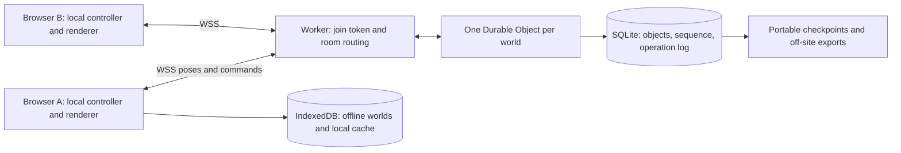

# ChatGPT Multiplayer Research — Forest Drift

Independent research and implementation plan. Checked **15 October 2026**. Repository baseline: `78f2001e`, plus the working source present during inspection.

This document was developed from the supplied requirements, game source, and external sources independently. No other agent's research, plans, conversations, or conclusions were consulted. Research only: no application, dependency, deployment, or infrastructure changes were made.

Evidence labels: **Confirmed** means inspected source or linked official documentation; **Estimate** means a calculation or engineering judgement; **Assumption** means an input that must be measured or decided. Prices exclude tax unless explicitly stated. Provider capacity is not proof of game capacity.

## 1. Decision

**Recommend a hybrid architecture using native browser WebSockets and one SQLite-backed Cloudflare Durable Object per shared world, with PartyServer as an optional thin room wrapper.** Clients retain responsive local movement and procedural rendering. The room owns admission, persistent edit ordering, permissions, object versions, door state and the shared clock. It validates and distributes player poses without running the current rendering engine on the server.

Use Cloudflare Free for development and inactive periods. Budget for Workers Paid during the first organised 20-player session and public multiplayer release: approximately **£4–£6/month before VAT**, or **£4.80–£7.20 with a 20% tax allowance**, under the model below. This deliberately avoids depending on free-tier throughput during a busy playtest. Free-plan development and zero-use months can cost £0 while retained data remains within allowances. **A paid account retains its $5 monthly minimum while idle**; hibernation does not remove the subscription. Returning to £0 requires moving back to Free, subject to account-wide eligibility, or keeping a separate Free project/account where permitted. Do not promise automatic plan switching.

**Fallback: Colyseus on an autostopping Fly Machine**, with a small persistent SQLite volume and external backups. This trades a small retained-storage cost for a portable Node server, useful if meaningful shared creature simulation or authoritative movement makes the Worker model awkward.

**Third: Colyseus on a small Hetzner VPS.** Its monthly floor and maintenance burden lose against sparse use, but predictable bandwidth and portability make it a credible growth alternative.

Ship invite-only guest sessions, smooth remote avatars, reconnect/resume, shared doors, and **live building with one active editor per foundation**. Defer simultaneous editing of one structure, competitive anti-cheat, shared ambient creature simulation, voice chat, and a seamless world distributed across servers. Support 20 in one room before release; 100 total across rooms is an easier scaling milestone than 100 visible together.

## 2. Source audit

Paths below are relative to this game's root, `pages/Forest-Drift/`. These are inspected implementation files, not inferred features.

| Area                        | Evidence and current behaviour                                                                                                                                                                                                                                                              | Multiplayer consequence                                                                                                                                                                                                 |
| --------------------------- | ------------------------------------------------------------------------------------------------------------------------------------------------------------------------------------------------------------------------------------------------------------------------------------------- | ----------------------------------------------------------------------------------------------------------------------------------------------------------------------------------------------------------------------- |
| Stack / deployment          | `package.json`: TypeScript, Svelte 5, Three.js, `idb`, `fflate`, `simplex-noise`. `vite.config.ts` configures the static adapter and relative paths; `src/routes/+page.ts` disables SSR; `src/routes/+layout.ts` enables prerendering.                                                      | Keep the website static; add a separate WSS endpoint. No existing application server needs migration.                                                                                                                   |
| Main loop                   | `src/lib/game/ThreeScene.ts`, `animate(nowMs)`: requestAnimationFrame, variable delta clamped to 0.1 s, controller, terrain, vegetation, tools, creatures, sky, graphics and particles. Early return while the developer panel or Mini Build editor is open.                                | Network lifetime must not depend on this render loop. A panel or background tab must not halt room authority or prevent durable acknowledgements.                                                                       |
| Player                      | `src/lib/game/player/FirstPersonController.ts`, `update`, `updateFlying`, `syncCamera`, `restoreState`: one camera, world position, yaw/pitch, keyboard/pointer-lock/touch input, gravity, jumping, flight and walk bob.                                                                    | Add remote avatar rendering without creating input controllers for remote players. Send logical position, excluding camera bob. Flight permissions need explicit session policy.                                        |
| Collision                   | Controller callbacks resolve supporting surfaces, ceilings, horizontal collisions and blocked movement. `building/wallCollision.ts`, `building/WorldSurfaceSampler.ts`, `miniBuild/MiniBuildCollisionCompiler.ts` provide relevant geometry/math.                                           | Current collision is local; there is no inspected headless rigid-body server. Extract shared numerical rules if stronger authority is later needed. Render-generated collision cannot simply be imported into a Worker. |
| Runtime / save boundary     | `world/WorldSerializer.ts`: `WorldRuntime`, `captureWorldContent`, `applyContentToWorld`; plain records, deep cloning and revision counters.                                                                                                                                                | Reuse persistence types and capture/export for initial publication and checkpoints. Counters reveal that something changed; they are not an operation log.                                                              |
| World contract              | `world/WorldTypes.ts`: schema version 9, seed, complete environment configuration, authored arrays, procedural overrides, `saveRevision`, and exactly one `player`.                                                                                                                         | Excellent content replication starting point. Split shared content from per-player bookmarks and runtime presence. Add distinct protocol, generator and object versions.                                                |
| Storage                     | `world/IndexedDbWorldRepository.ts`: local IndexedDB `forest-drift-worlds`, atomic world/meta writes, separate thumbnails. `world/WorldRepository.ts` includes an in-memory fallback.                                                                                                       | Existing storage is browser-local, not shared or a backup service. Preserve offline worlds; never let each client overwrite the shared whole-world record.                                                              |
| Session / autosave          | `world/WorldSession.ts` creates one scene and autosave manager. `WorldAutosaveManager.ts` polls every 500 ms, debounces structure changes 2 s / maximum 10 s, player saves every 15 s, serialises writes with generation guards.                                                            | Keep this for offline saves/local recovery. Online durable edits need operation acknowledgements; replacing only `WorldRepository` is insufficient for concurrent editing.                                              |
| Import / migration          | `world/WorldImportExport.ts`: `.forestworld` ZIP packages, manifest, checksum, validation, `fflate`. `WorldMigrationManager.ts` and `WorldValidation.ts` handle schema/limits.                                                                                                              | Reuse format for portable world export and owner publication. Checksum is corruption detection, not authentication. Reject oversized/decompression-expansion inputs.                                                    |
| Terrain / ecology           | `terrain/seededRandom.ts` provides named seeded PRNGs; `TerrainHeightSampler.ts` seeds simplex noise. `vegetation/TreePlacementGenerator.ts` and `hydrology/HydrologyRegionGenerator.ts` generate content locally. `WorldTypes.ts` records removed tree IDs.                                | Send seed, full settings and generation version, then sparse overrides. Never transmit terrain meshes or every tree.                                                                                                    |
| Structures                  | `building/WallTypes.ts`, `FoundationTypes.ts`, `BarrierTypes.ts` define serialisable records; walls use foundation-local grid coordinates. `BuildingManager.ts` owns `addWall`, `addWallPath`, slabs, roofs, stairs, openings, beams and removals. `FoundationManager.ts` owns foundations. | Reuse definitions and pure validation/math. Managers also invoke Three.js render managers, so server validation needs a data-only boundary.                                                                             |
| IDs / compound edits        | `BuildingManager.addWall()` creates `crypto.randomUUID()` locally. Stairs add related slab openings; path removal can split paths; foundation deletion has cascades.                                                                                                                        | Replay canonical IDs from the server, not calls that create new IDs on each client. Persist related changes atomically.                                                                                                 |
| Furniture / authored assets | `building/FurnitureManager.ts`, `miniBuild/MiniBuildTypes.ts`, `MiniBuildSystem.ts`, `MiniBuildInstanceManager.ts`: design recipes separate from instances and compiled geometry; Mini Build schema/compiler versioning and chunk budgets.                                                  | Publish a recipe once, reference it by stable ID/hash. Enforce source-primitive and per-chunk budgets server-side; the importer allows much larger worlds than an MVP network snapshot should.                          |
| Tools / undo                | `building/BuildToolManager.ts`, `MoveTool.ts`, `PaintTool.ts`, `BuildingRemovalManager.ts`; `BuildUndoManager.ts` has a five-placement local stack and directly calls removals.                                                                                                             | Introduce a command boundary covering all mutation paths, including paint, move, cascade deletion and undo. Online undo is a new validated inverse operation, never rewind everybody's world.                           |
| Doors                       | `building/DoorInteractionController.ts`, `toggleLookedAtDoor`, `openById`, `update`, `getCollisionRects`: local open-state set and animated hinge colliders.                                                                                                                                | Server owns a desired open Boolean and transition time. Joiners need current door states. Animate locally; do not transmit hinge angles every frame. Current world contract does not save this runtime set.             |
| Creatures                   | `creatures/CreatureRuntimeManager.ts` has logical/live maps, local time and player-window activation; `CreaturePopulationSystem.ts` seeds spawn recipes; `CreatureBehaviourSystem.ts`, `decideCreature`, reacts to one supplied player position. Ambient runtime is explicitly not saved.   | Identical seeds do not imply identical moving fauna: visibility windows, player inputs and variable time differ. Keep ambient creatures cosmetic for v1; authored creature recipes are shared content.                  |
| Music / weather             | `music/MusicModel.ts`, `MusicTimeline.ts`, `MusicTreeSequencer.ts`, `MusicPlantManager.ts`; `weather/WeatherSchedule.ts` derives weather from seed and logical time.                                                                                                                        | Share compositions and clock anchors, not particles, audio buffers or notes every frame. Browser audio activation and output latency remain local.                                                                      |

Inspection found no shared database, multiplayer transport, login/session backend or authoritative multiplayer simulator in the examined game source/dependencies. Existing `WorldRepository` comments anticipate cloud storage, but that is a seam, not an implemented backend.

### Determinism limits

Confirmed seeded generation is promising, not proof of cross-device deterministic simulation. Negotiate a generator version plus settings hash; test terrain heights, water boundaries, tree IDs and foundation transforms across Chromium, Firefox and WebKit. Local graphics quality must affect presentation/activation, not authoritative sampling or coordinate definitions. Pin compatible builds during a session. Floating-point tolerances are needed; lockstep is unsuitable for the variable-delta controller and player-reactive creatures.

## 3. Networking architectures

| Approach                          | Fit, cost and latency                                                                                                                                                                                                             | Reliability / consistency                                                                                                                                   | Decision                                                    |
| --------------------------------- | --------------------------------------------------------------------------------------------------------------------------------------------------------------------------------------------------------------------------------- | ----------------------------------------------------------------------------------------------------------------------------------------------------------- | ----------------------------------------------------------- |
| A. Fully authoritative simulation | Best for competitive movement, shared physics and creatures; server input processing at a fixed tick, snapshots, client prediction/reconciliation. Requires extracting the current camera/scene-dependent movement and collision. | Server survives browser departure; one truth, but tick overruns and server crashes affect everyone. More compute and engineering.                           | Defer until gameplay requires it.                           |
| B. Client poses with relay        | Fits existing controller immediately; cheap, responsive, no server terrain meshes. Server rate-checks and broadcasts validated positions.                                                                                         | Pose validation cannot prevent all wall clipping or cheating. A bare relay does not protect persistent edits.                                               | Use for avatar movement only.                               |
| C. P2P / browser host             | WebRTC can use unordered/unreliable data channels; low central movement compute. A 20-player full mesh has 190 peer links; a star host carries fan-out upload.                                                                    | Signalling, ICE/STUN/TURN, host migration, mobile suspension, NAT failure and reconnect are real engineering costs. Host departure must not lose buildings. | Reject as primary for reliable 20-player persistent worlds. |
| D. Hybrid authority               | Local movement/rendering, server-ordered building/doors/time. No rendering waits for a round trip.                                                                                                                                | Durable edits have one authority; movement remains trusted/cooperative. No browser is required to keep world state alive.                                   | Recommended.                                                |
| E. On-demand rooms                | Lifecycle strategy usable with A, B or D. Wake on joins, checkpoint durable state, stop scheduling when empty.                                                                                                                    | Cold start and restored state must be explicit in UI/protocol. Persistent storage can still cost money.                                                     | Required for sparse usage.                                  |

Use **WSS** initially: wide browser support and simple firewall traversal. TCP head-of-line blocking is mitigated by small messages, dropping obsolete poses before sending, bounded queues and prioritising edits. Do not queue hundreds of stale movement frames during an outage.

WebRTC NAT traversal and TURN are described in [MDN's protocol guide](https://developer.mozilla.org/en-US/docs/Web/API/WebRTC_API/Protocols). A relay fallback is a paid bandwidth path, not free magic; [Cloudflare TURN](https://developers.cloudflare.com/realtime/turn/faq/) lists $0.05/GB. WebTransport supports HTTP/3 streams/datagrams but needs compatible browsers and an appropriate endpoint; verify actual target devices before adopting it. [MDN WebTransport](https://developer.mozilla.org/en-US/docs/Web/API/WebTransport). It does not remove world-authority or persistence work.

CRDTs such as Yjs are attractive for text, annotations and independent metadata. They do not inherently prevent an opening referencing a deleted wall or a staircase losing required slab cuts. Server transactions and versions are simpler for v1 geometry.

## 4. Current platform landscape

All external links in this document were checked on 15 October 2026. Where an official page could not substantiate a number, it is deliberately not priced as fact.

| Candidate                            | Verified finding / suitability                                                                                                                                                                                                                                                                                                                                                                                                                                                                                                                                                           | Outcome                                                                                                                                                                             |
| ------------------------------------ | ---------------------------------------------------------------------------------------------------------------------------------------------------------------------------------------------------------------------------------------------------------------------------------------------------------------------------------------------------------------------------------------------------------------------------------------------------------------------------------------------------------------------------------------------------------------------------------------- | ----------------------------------------------------------------------------------------------------------------------------------------------------------------------------------- |
| Cloudflare Workers + Durable Objects | SQLite-backed rooms available on Free since April 2025. Stateful WebSockets, serialised coordination and local SQLite match building operations. One world is a compute bottleneck; scaling object count does not make one room faster. [Free launch](https://developers.cloudflare.com/changelog/post/2025-04-07-durable-objects-free-tier/), [limits](https://developers.cloudflare.com/durable-objects/platform/limits/).                                                                                                                                                             | First choice; room-specific latency/load must be measured.                                                                                                                          |
| PartyKit / PartyServer               | Official docs announce hosted PartyKit and deploy API retirement on **23 October 2026**, recommend PartyServer with Wrangler. Existing own-account Workers keep running. [Retirement notice](https://docs.partykit.io/guides/deploy-to-cloudflare/). PartyServer supplies room routing, hibernation hooks and selected broadcasts; PartySocket supplies reconnect helpers. ISC repository. [Official repository](https://github.com/cloudflare/partykit).                                                                                                                                | Use own-account PartyServer or direct DO API, not legacy hosted PartyKit. PartySocket reconnect is not durable operation replay.                                                    |
| Colyseus                             | MIT, Node/TypeScript, room state patches and reconnection, browser SDK. Cloud starts at $15/month, already about £12 before tax regardless of sporadic use. [Repository](https://github.com/colyseus/colyseus), [state](https://docs.colyseus.io/state), [reconnect](https://docs.colyseus.io/room/reconnection), [Cloud pricing](https://colyseus.io/pricing/).                                                                                                                                                                                                                         | Excellent portable fallback on cheaper on-demand compute. Do not assume stock Node rooms run unchanged in DO.                                                                       |
| Nakama                               | Apache-2.0 server with auth/storage and authoritative or relayed matches. Brings a database/server operational stack that the game currently lacks. [Official overview](https://heroiclabs.com/nakama/), [repository](https://github.com/heroiclabs/nakama), [managed billing](https://heroiclabs.com/docs/heroic-cloud/concepts/organizations/billing-support/).                                                                                                                                                                                                                        | Strong feature platform, excessive initial scope. No sufficiently verified managed quote for this workload; not costed as a cheap service.                                          |
| Photon Realtime                      | Browser-compatible Realtime should be evaluated separately from Fusion/Quantum engine-specific offers. Official Realtime price: development-only 20 CCU/60 GB free; 100 CCU launch offer $95 upfront for 12 months, 0.3 TB/month. Traffic counts both directions. [Pricing](https://www.photonengine.com/realtime/pricing), [docs](https://doc.photonengine.com/realtime/v5/troubleshooting/faq).                                                                                                                                                                                        | Viable mature relay, but persistent world authority needs another backend and upfront payment conflicts with sparse use. Do not misapply another product's free 100 CCU promotion.  |
| Playroom                             | Official JS API and Three.js templates demonstrate stack relevance. [JS API](https://docs.joinplayroom.com/api-reference/js), [templates](https://docs.joinplayroom.com/templates). The official pricing page returned no usable plan terms to this research tool. [Pricing](https://joinplayroom.com/pricing).                                                                                                                                                                                                                                                                          | Convenient prototype candidate, not a cost-verified production shortlist. Verify room caps, mode, persistence, commercial terms and current service availability before committing. |
| Rivet Actors                         | Current actor model supports sleep/wake and WebSockets. Free has 100 GB egress, $5 compute ceiling and state limits; paid Hobby starts $20 plus execution usage. Apache-2.0 self-host option according to vendor. [Current pricing](https://rivet.dev/pricing/).                                                                                                                                                                                                                                                                                                                         | Serious newer contender; free experiment plausible, but the paid cliff and execution semantics weaken the growth economics. See explicit sensitivity below.                         |
| SpacetimeDB / Maincloud              | Current v2 docs include TypeScript modules/clients; reducer/table subscriptions provide authoritative state. Free shares 2,500 TeV monthly credit across resources; Pro $25/month. The advertised call, egress and storage equivalents are alternatives, not additive free quotas. [Pricing](https://spacetimedb.com/pricing), [v2 migration](https://spacetimedb.com/docs/upgrade/), [TS SDK](https://spacetimedb.com/docs/clients/typescript/). Core licence is BSL, not unrestricted permissive OSS. [Licence](https://github.com/clockworklabs/SpacetimeDB/blob/master/LICENSE.txt). | Promising 2025–26 database-as-server approach, but larger schema/runtime migration and paid floor than needed. Review pinned licence and module terms before commercial deployment. |
| Supabase Realtime                    | Database/Auth useful if accounts become necessary. Broadcast bills one send plus each delivery; Free 2M messages/month, Pro 5M then $2.50 per million packages. [Metering](https://supabase.com/docs/guides/platform/manage-your-usage/realtime-messages), [limits](https://supabase.com/docs/guides/realtime/limits), [pricing](https://supabase.com/pricing).                                                                                                                                                                                                                          | Poor high-frequency pose bus; no existing Supabase investment to reuse. Reasonable future auth or low-rate publish feed.                                                            |
| Fly Machines                         | Native Node/WSS, request autostart, stop CPU/RAM billing while stopped; retained rootfs/volumes billed. Prefer the October 2026 pricing update over older examples. [Autostop](https://fly.io/docs/launch/autostop-autostart/), [new pricing](https://fly.io/pricing-update/).                                                                                                                                                                                                                                                                                                           | Second choice. Explicitly drain rooms before stopping; socket-aware routing and wake/reconnect require tests.                                                                       |
| Railway                              | Now has Free $1 recurring usage credit, 0.5 GB RAM/volume limits; Hobby $5 minimum includes $5 usage. Serverless sleeps after no outbound traffic; monitoring/pings can prevent this. [Plans](https://docs.railway.com/pricing/plans), [sleep](https://docs.railway.com/deployments/serverless).                                                                                                                                                                                                                                                                                         | More credible than old “trial only” advice, but small free credit and Hobby floor lose to chosen options.                                                                           |
| Render                               | Free spins down after 15 minutes without inbound activity, wakes on HTTP/new socket; 750 workspace instance-hours. March 2026 change now recognises incoming WebSocket traffic. Free is ephemeral, with cold starts and operational limitations. [Free docs](https://render.com/docs/free), [2026 change](https://render.com/changelog/free-web-services-now-remain-active-while-receiving-websocket-messages).                                                                                                                                                                          | Useful disposable networking demo; persistent production room needs a paid/storage design. Current paid price could not be extracted reliably; no invented $7 quote.                |
| Hetzner VPS                          | June 2026 adjusted EU CX23 to €5.49/month excluding IPv4; cost-optimised EU cloud includes 20 TB traffic. [Adjustment](https://docs.hetzner.com/general/infrastructure-and-availability/price-adjustment/), [cloud](https://www.hetzner.com/cloud/cost-optimized/).                                                                                                                                                                                                                                                                                                                      | Third choice. Powered-off servers remain allocated; deleting/recreating requires a separate durable restore/bootstrap path.                                                         |
| Cloudflare Containers                | Newer on-demand container route can run Node and shares a Workers Paid floor; distinct compute/storage/egress metering. [Current pricing](https://developers.cloudflare.com/workers/platform/pricing/#containers).                                                                                                                                                                                                                                                                                                                                                                       | Credible future Colyseus experiment, not necessary alongside simpler DO or Fly. Never apply DO egress economics to containers.                                                      |

Managed SDKs are proprietary service dependencies even when their client code is inspectable. Pin licences for every chosen package at implementation. PartyServer ISC and Colyseus MIT permit straightforward commercial reuse with notices; the provider service terms remain separate. No new engine or React migration is required for either shortlist framework.

## 5. Ranked shortlist and decision weights

Scores are engineering judgements on a 1–5 scale. Weighted total = sum(weight × score / 5). They are not benchmark results.

| Solution                               | Cost 30 | Code fit 20 | Experience 20 | Simplicity 15 | Scale 10 | Portability 5 |   /100 |
| -------------------------------------- | ------: | ----------: | ------------: | ------------: | -------: | ------------: | -----: |
| 1. Hybrid DO + own-account PartyServer |       5 |           4 |             4 |             4 |        4 |             3 | **86** |
| 2. Colyseus + autostop Fly             |       4 |           4 |             4 |             3 |        4 |             5 | **78** |
| 3. Colyseus + Hetzner VPS              |       2 |           4 |             4 |             3 |        4 |             5 | **65** |

All three use browser WSS, locally reconstructed seeded terrain, canonical building operations and the same portable world format. Their differences:

| Choice | State and connection lifecycle                                                                                | Persistence                                                                    | Path to 100                                                                                                                   | Main risk / effort                                                                                              |
| ------ | ------------------------------------------------------------------------------------------------------------- | ------------------------------------------------------------------------------ | ----------------------------------------------------------------------------------------------------------------------------- | --------------------------------------------------------------------------------------------------------------- |
| DO     | Worker authenticates join and routes to world ID. One DO sequences edits, relays poses and sleeps when empty. | SQLite operation log + object rows/checkpoints; owner exports/off-site backup. | Multiple rooms first; spatial subscriptions inside one room next. Extract pure simulation or migrate if CPU becomes limiting. | Medium effort: custom protocol/durable recovery; single-room CPU/memory limits and lock-in.                     |
| Fly    | Proxy wakes a Node Colyseus server. Initially one process with room discovery local to it.                    | SQLite on volume; external backups.                                            | More rooms/processes; shared presence/matchmaking only when adding hosts. One large room still needs profiling.               | Medium effort plus deployment/volume recovery. A single volume is not HA; live room migration is not automatic. |
| VPS    | Always-ready Node rooms behind TLS proxy.                                                                     | SQLite/disk plus independent backup.                                           | Resize, then add hosts and routing; same Colyseus logic.                                                                      | Medium-high operations: updates, monitoring, disk, process recovery and backup restoration.                     |

**Override the scores if gameplay requires strong anti-cheat or authoritative fauna from day one:** choose Colyseus/Fly and allocate time to extract headless simulation. Likewise, failure of the DO 20-player latency/CPU test blocks release; its theoretical connection limits do not override measured experience.

## 6. Reproducible cost model

### 6.1 Assumptions and traffic

Planning FX: **$1 = £0.80; €1 = £0.87**. These are deliberate budgeting assumptions, not a fetched spot rate. Multiply by 1.2 for a simple UK tax allowance if charged; actual invoice tax/FX may differ. Costs are incremental multiplayer costs, excluding existing static hosting/domain fees. No voice, chat moderation service, analytics subscription or paid auth is assumed.

Movement: 10 Hz while moving, 50% movement duty cycle, so 5 updates/s/player averaged. One update is assumed 64 application bytes including identifiers/sequence/pose, with 25% protocol/transport allowance: **80 effective bytes**. Measure this; unbatched small TLS frames or JSON can be worse. Standing clients send only sparse heartbeat/changed orientation; continuously connected does not mean continuously moving.

Let `T = connected room hours × 3600`, `N = players`, `f = 5`, `k = min(12, N−1)` average nearby recipients. Do not hard-hide a thirteenth nearby player: 12 is a modelling average. In a crowd send all nearby avatars, with tiered rates/LOD.

- Inbound updates: `M = N × f × T`.
- Naive movement egress GB: `M × (N−1) × 80 / 1e9`.
- Interest-managed movement egress GB: `M × k × 80 / 1e9`.
- Upstream GB: `M × 80 / 1e9`.

| Scenario                   |   N | Room hours | Inbound M updates | Naive egress GB | Nearby egress GB |
| -------------------------- | --: | ---------: | ----------------: | --------------: | ---------------: |
| No activity                |   0 |          0 |                 0 |               0 |                0 |
| Development: 2 h × 10 days |   2 |         20 |              0.72 |          0.0576 |           0.0576 |
| Small playtest             |   5 |          3 |              0.27 |          0.0864 |           0.0864 |
| Large playtest             |  20 |          4 |              1.44 |          2.1888 |           1.3824 |
| Regular: 4 h × 20 days     |  20 |         80 |              28.8 |          43.776 |           27.648 |
| Future                     |  50 |         80 |                72 |          282.24 |            69.12 |
| Future growth              | 100 |         80 |               144 |        1,140.48 |           138.24 |

50% duty is not a capacity test. At continuous movement, double these movement figures. At 100 players all-to-all: 49,500 pose deliveries/s averaged, 99,000/s continuously. Batching can reduce socket sends to roughly N × 10 snapshots/s, but not replicated payload volume. At 20 crowded players, baseline receive traffic is ~7.6 KB/s/player, ~15.2 KB/s continuously before builds/creatures. These are estimates for lightweight avatars, not full skeleton replication.

Additional base allowances: 10 MB compressed join snapshot/player/session; 1 durable building operation/player/minute of connected time, 500 bytes/operation; up to 1 GB combined world/checkpoint/log/backup data after compaction. At 100 × 80 h that is 480,000 operations/month, ~240 MB raw log before indexes/retention, with ~2.88 GB nearby build deliveries. At 20 × 80 h it is 96,000 operations. Per-operation transactions should touch only a bounded number of rows; compound actions and indexes increase writes. Retain a bounded log and compact/export older history. Add at least 10% bandwidth contingency plus measured joins. A 10 MB snapshot is a target ceiling, not the repository's save size measurement.

### 6.2 Verified billing inputs

**Cloudflare:** DO Free: 100k requests/day, 13k GB-s/day; Paid: 1M requests and 400k GB-s/month, then $0.15/M requests and $12.50/M GB-s with billing-unit rounding. Incoming WebSocket messages have a 20:1 billing ratio; outbound messages are not request-billed. Duration uses 128 MB allocation. SQLite Free: 5 GB, 5M rows read/day, 100k rows written/day; Paid: 5 GB, 25B reads and 50M writes/month, then $0.001/M reads, $1/M writes, $0.20/GB-month. [DO pricing](https://developers.cloudflare.com/durable-objects/platform/pricing/).

Workers Paid has a $5 monthly floor; routing joins should be tiny relative to its included request/CPU allocation, because movement stays on the DO socket rather than invoking an ingress Worker per pose. Workers bandwidth has no separate egress charge. [Workers pricing](https://developers.cloudflare.com/workers/platform/pricing/). For conservative duration modelling keep the room billed throughout connected hours, even if hibernation could save some time. One 80-hour room uses ~36,864 GB-s at 0.128 GB; five such rooms ~184,320, within the paid inclusion. No repeating timers when empty. A fixed room timer while populated is acceptable at these figures but prevents hibernation while it runs.

**Fly:** use current update's shared-4x/1 GB $0.0122/hour as a budgeting example, 1 GB stopped rootfs $0.15/month, 1 GB persistent volume $0.15/month, EU internet egress $0.02/GB; first 10 GB snapshots free, dedicated IPv4 $2/month if needed. Use shared IPv4 initially. [October 2026 pricing](https://fly.io/pricing-update/). Regional compute selector/actual invoice must be checked before deployment; older general docs show differing preset figures. Model is not a guarantee that this size runs authoritative 100-player AI.

**VPS:** CX23 €5.49/month excluding IPv4; model €0.50 IPv4 and 20% server backup surcharge as **provisional budget allowances**, to reconfirm in checkout. Thus `(5.49 + 0.50 + 1.098) × 0.87 = £6.17/month`. Core included disk/traffic covers the model. For truly independent off-site backups reserve another £1–£2 if existing free/local storage is unsuitable. Server specifications/availability and add-ons must be checked in the region before purchasing. [Current base price](https://docs.hetzner.com/general/infrastructure-and-availability/price-adjustment/).

### 6.3 Shortlist monthly / session estimates

Values include the small retained disk/volume allowance where applicable, exclude tax, and use nearby movement traffic. Playtest columns mean a month containing only that session, not an extra subscription per session. Baseline extras above usually fit included storage; Fly values exclude variable join egress and include its free snapshot allowance.

| Scenario               |       DO Free if eligible | DO Paid | Colyseus/Fly |               Colyseus/VPS |
| ---------------------- | ------------------------: | ------: | -----------: | -------------------------: |
| Idle retained world    |                        £0 |   £4.00 |        £0.24 | £6.17 + off-site allowance |
| Development            |                        £0 |   £4.00 |        £0.44 |          £6.17 + allowance |
| Small playtest         |                        £0 |   £4.00 |        £0.27 |          £6.17 + allowance |
| One 20-player playtest |            £0 conditional |   £4.00 |        £0.30 |          £6.17 + allowance |
| Regular 20             |            £0 conditional |   £4.12 |        £1.46 |          £6.17 + allowance |
| Regular 50             | exceeds request allowance |   £4.36 |        £2.13 |          £6.17 + allowance |
| Regular 100            | exceeds request allowance |   £4.84 |        £3.23 |          £6.17 + allowance |

These DO figures include request-unit rounding, not an unrounded marginal rate. Building operations and joins add small request overhead and may push a boundary into the next $0.15 unit. Approximate active-release budget **£4–£6 before VAT** allows for this and continuous movement: regular 20 at 10 Hz ~£4.24; regular 100 ~£5.68, before any extra room duration/storage requirements.

**Free-tier qualification is a hard limit, not a reliability promise.** With 20 players, four hours, 5 Hz averaged, inbound movement gives ~72k billable request-equivalents/day; continuous 10 Hz gives ~144k, over the advertised daily allowance. Confirm the 20:1 treatment against free-account enforcement in staging, since docs distinguish raw metrics from billing units. Without that reduction, even development can hit daily request limits. SQL index/compound-edit writes and other applications share account quotas. Budget Paid for the 20-player event rather than discovering the limit during it. Paid scale-to-zero compute is different from a £0 subscription.

Fly at 100 naive broadcasting is ~£19.27/month before tax, versus ~£3.23 nearby; continuous naive movement alone doubles egress. Add ~10% contingency to traffic and pay for a larger machine if measured CPU/RAM requires it. Five separately active room machines cost more compute and retained rootfs/volumes than five rooms in one process; storage must not silently be multiplied away. Cold-start retry and volume recovery are engineering, not priced away.

### 6.4 Other candidates: cost traps and sensitivity

- **Rivet:** Free can fit sparse sessions if configured execution stays within the $5 compute ceiling. At 0.08 vCPU/128 MiB, the listed rates imply ~$0.01081/hour: 20 h ~$0.22, 80 h ~$0.86; at 1 vCPU/512 MiB, ~80 h costs ~$9.92, exceeding Free. Managed egress reaches 138 GB at 100, exceeding Free's 100 GB; naive 50 also exceeds it. Hobby adds $20 before compute, so roughly £16.69 for 80 h at the small configuration, more for greater compute. Sleeping state and operation limits still apply. Configuration-based execution estimates are not measured CPU and are not proof that minimum resources suffice. [Rivet pricing](https://rivet.dev/pricing/).
- **Supabase:** At baseline, a broadcast source with k nearby subscribers bills `(k+1) × M` messages. Development ~1.44M, small test ~1.35M fit 2M; large test ~18.72M exceeds Free. Pro base $25 plus `ceil((18.72−5)) × $2.50` is ~$60/£48 for that session month, before other resources. Regular 20 nearby ~374.4M gives ~$950/£760; 50 ~936M gives ~$2,352.50/£1,882; 100 ~1,872M gives ~$4,692.50/£3,754. Naive regular 20 already bills ~576M. A server batching one snapshot per recipient could reduce metered messages but adds a game server and larger payloads; it is no longer the simple broadcast design. Throughput limits can disqualify it before price. [Message meter](https://supabase.com/docs/guides/platform/manage-your-usage/realtime-messages).
- **Photon:** Dev 20 CCU can fit a one-off test's traffic allowance but cannot stand in for a public launch. The 100 CCU offer is **£76 upfront**, ~£6.33/month amortised, even in zero-play months. Add a durable authority/storage service. Naive 100's >1 TB/month exceeds the included 300 GB and triggers region-specific overage; nearby traffic is much safer. [Realtime pricing](https://www.photonengine.com/realtime/pricing).
- **Railway:** At assumed 0.5 GB resident RAM and 0.1 average vCPU during 80 h, compute is approximately `(5+2) × 80/720 = $0.78`, plus $0.15 disk and nearby egress. Regular 20 ~$2.31 resource usage; 50 ~$4.38; 100 ~$7.84. On Hobby bills are roughly £4, £4, £6.27 respectively because $5 is the minimum, not an additional fee on top of the first $5. Free's $1 credit plausibly covers low-use development but not regular 20. Free resource limits and outbound pings may prevent the desired deployment/sleep pattern. [Rates](https://docs.railway.com/pricing/plans).
- **SpacetimeDB:** Free's ~12.5 GB egress equivalent alone falls below regular 20 nearby traffic, and actual compute/storage consume the same credit. A dev session might fit; public use needs energy accounting. Pro floor £20 before tax already exceeds target; do not turn advertised resource equivalents into independent allowances. [Pricing](https://spacetimedb.com/pricing).
- **Managed Colyseus:** $15/£12 minimum is viable inside the pre-tax active budget but needlessly pays for inactive development. Current published starting plan is not a verified 100-player capacity guarantee. [Pricing](https://colyseus.io/pricing/).
- **Render / Playroom / managed Nakama:** current complete workload prices were not verified. They are not presented as £0 or discarded on invented fees. Their technical and evidence limitations above prevent outranking the costed options.

## 7. Recommended runtime and persistence



The Worker participates in handshake/routing; established socket messages terminate on the DO, without a fresh Worker fetch for each update. Server imports only protocol types, pure validators and logical reducers. Keep geometry, DOM, WebGL, audio and input in the browser.

Use `weur` creation hint for UK-centred rooms and measure RTT. A hint is not a London-location or globally local-state guarantee. A world has one authority location; global edge entry cannot eliminate its state latency. [Data location](https://developers.cloudflare.com/durable-objects/reference/data-location/).

### State classes

1. **World manifest:** world ID, seed, all generation settings, generator/build compatibility hashes, protocol version, schema version, clock policy and content revision.
2. **Durable content:** foundations, walls/paths/slabs/stairs/roofs/openings, materials, furniture, barriers, Mini Build recipes and instances, removed-tree IDs, authored creature recipes and music.
3. **Ephemeral shared state:** presence, latest poses, door target states, leases. Decide separately whether door states survive an empty session; proposed v1 resets closed on a new room epoch and snapshots current values to late joiners.
4. **Personal local state:** graphics, audio preference, active tool/foundation/storey and bookmark. Do not save one visitor's `player` over the whole world's spawn.

The room epoch changes on recovery/restart; it distinguishes stale authority from the current process. Hibernation can discard in-memory values. Persist or attach connection identity/resume metadata using supported mechanisms, rebuild transient poses from fresh client updates, and never depend on in-memory leases surviving eviction. This is different from retaining old poses indefinitely in SQLite.

For identity, issue a cryptographically random, signed guest capability with world ID, guest ID, role, expiry and nonce; validate on join/reconnect. Invite URLs confer only specified access; editing needs an editor role. A guest ID is not a secure account login. Validate allowed origins, finite coordinates, payload sizes, rates and entity existence. For public discovery add abuse limits/expiry before launch; full account providers can wait.

### Join and reconnect

Authenticate → negotiate versions → snapshot at durable sequence S → transfer chunked/compressed content → replay operations greater than S → announce ready → start poses. Buffer the tail during snapshot transfer, with an upper bound; restart the snapshot if the tail has been compacted or the client is too slow. Use chunk checksums and an explicit maximum decoded size. Initially transmit the bounded entire authored world; stream cells plus dependencies once content requires it.

Resume supplies room epoch, last durable sequence and unacknowledged operation IDs. Server replays a bounded tail or requests a new snapshot. Retry with exponential backoff/jitter; use a bounded dedupe store so a lost ACK cannot duplicate a wall. Never replay old movement queues. Offline online-world editing pauses or creates an explicit local fork; do not automatically merge divergent whole-world saves.

Use indexed SQL object rows plus an operation log and metadata in the same transaction. ACK after commit, then broadcast canonical results. A crash after commit/before broadcast is recovered by tail replay. Checkpoints carry last sequence; compact only after a restorable checkpoint is durable. Preserve export compatibility with existing migration/validation. Take periodic portable exports to an independent location and perform a restore drill. Local IndexedDB is recovery convenience, not authoritative backup.

## 8. Building strategy

| Mode                         | Effort / cost                                                           | Consistency and experience                                                                                                                | Use                                                                |
| ---------------------------- | ----------------------------------------------------------------------- | ----------------------------------------------------------------------------------------------------------------------------------------- | ------------------------------------------------------------------ |
| Save-to-publish              | Lowest networking complexity; sends selected structure/checkpoint once. | Other players see delayed updates. Publish must compare revision and own a structure; uploading whole worlds can clobber unrelated edits. | Fallback if operation adapter is delayed; explicit isolated plots. |
| Live operations              | Moderate engineering; tiny commits relative to poses.                   | Immediate committed edits and deterministic conflict rejection.                                                                           | **v1 recommendation**, foundation lease or ownership.              |
| Same-structure collaboration | Highest engineering; traffic not necessarily expensive.                 | Needs conflicting move/paint/delete policy, dependency integrity and collaborative undo.                                                  | Defer. CRDT cannot replace structural validation.                  |

Lease one foundation to one editor, renewed while active and released/expired on disconnect. Other users can edit different foundations. Include lease epoch in commands, so stale reconnects cannot write after reassignment. For terrain fences/objects, use an owner or a small edit-region lease. These are simple collaboration constraints, not global room locking.

Proposed mutation vocabulary: `placeObject`, `moveObject`, `updateObject`, `deleteObject`, `removeProceduralTree`, `setDoorState`, `publishAsset`, plus transactional compound changes. Every durable command carries actor/session ID, operation UUID, expected object version, foundation/lease token and payload. Server assigns canonical IDs/versions and a global durable sequence. Use UUIDs for proposals or return assigned IDs; either way client application must preserve canonical IDs.

Validate grid bounds, parent references, maximum walls/vertices/openings/blocks, finite numbers, authorisation and referenced asset versions. Foundation deletion with dependent roofs, stairs and openings is one compound transaction. Return normalised records/diffs rather than asking recipients to rerun ID-generating manager commands. Preview is local; accepted geometry is rebuilt once for the affected structure. Coalesce drag positions and paint changes, commit the final edit; do not persist every mousemove.

Undo submits an inverse of that actor's accepted action with current version preconditions. If another actor changed the target, reject or require an explicit new edit; never undo a later person's work. Keep server audit entries even when client undo history is only five actions. Remote changes must bypass outbound-command hooks to avoid echo loops and must not enter local undo history.

## 9. Proposed protocol and smoothing

Illustrative message contracts, **not implementation code**:

```text
Client → server
hello { protocol, buildHash, generatorVersion, token, lastSeq?, epoch? }
pose { clientSeq, clientTime, x,y,z, yaw,pitch, movementMode }
command { opId, objectId?, expectedVersion?, leaseEpoch?, kind, payload }
lease { foundationId, action: acquire|renew|release }
resume { epoch, lastSeq, pendingOpIds[] }
ping { clientTime }

Server → client
welcome { playerId, epoch, serverTime, manifest, snapshotSeq }
snapshotChunk { snapshotId, index, count, checksum, payload }
poses { serverTime, entries[] }
commit { opId, seq, changedObjects[], removedIds[], versions[] }
reject { opId, reason, currentVersion?, canonicalObject? }
presence { joined[], left[] }
leaseState { foundationId, editorId?, leaseEpoch, expiresAt }
resyncRequired { reason }
pong { clientTime, serverTime }
```

Movement has a lossy “latest state wins” semantic despite reliable TCP transport; durable commands are ordered/idempotent. Separating the semantics is essential. JSON is acceptable for commands/prototype diagnostics. Quantised/binary pose batches can meet the model; a JSON prototype must report its larger measured costs. Quantise relative to a cell origin to retain precision far from origin; validate cell transitions and bounds.

Render local movement immediately using the existing controller. This is local authority, **not** full authoritative prediction/reconciliation. Remote avatars use timestamped buffers with ~100–150 ms interpolation delay, adaptive to jitter. Extrapolate for at most ~200 ms then freeze/fade; teleport on sufficiently large authoritative discontinuities. Use interpolated rotations and local idle/walk animation, not transmitted bone matrices.

Start at 10 Hz pose sending and snapshot flush while populated, with changed-state suppression and an idle heartbeat. Stop room timers when empty. Later authoritative motion requires fixed 20–30 Hz simulation, input sequence acknowledgements, input replay and reconciliation of a shared pure movement function. Do not implement that machinery prematurely around a server that merely relays poses.

Use spatial cells, radius hysteresis and subscriptions, independent of graphics quality. Exiting interest sends a despawn; entering supplies a current baseline. Batch recipient snapshots and prioritise nearby players; distant players can use lower rates. Buildings stream by cells/plots with references loaded before dependants. All peers must share actionable collision changes, even when a decorative mesh is culled. Weather/daylight use server time anchors every few seconds and a pause-when-empty policy; music schedules from that anchor with local output latency adjustment.

Shared ambient fauna is deferred: clients may show different cosmetic animals. Authored recipes can still be published live. If fauna becomes interactable, choose server-owned logical roots/behaviour at a low tick, send root pose/intent/seed, animate skeletons locally. Rework behaviour to consider relevant players and take spawn activation out of each client's camera window. Avoid a browser host as the permanent creature authority; temporary leases would need epoch fencing and takeover snapshots.

## 10. Phased implementation roadmap

Effort ranges are estimates for one developer familiar with this project, excluding product redesign and feedback delays. No phase below has been implemented by this research task.

| Phase                       | Changes / relevant files                                                                                                                                                                          | Proposed dependencies and tasks                                                                                                                                                                               | Acceptance and major risks                                                                                                                                                                                                                                                                 | Cost / effort                                                                                                     |
| --------------------------- | ------------------------------------------------------------------------------------------------------------------------------------------------------------------------------------------------- | ------------------------------------------------------------------------------------------------------------------------------------------------------------------------------------------------------------- | ------------------------------------------------------------------------------------------------------------------------------------------------------------------------------------------------------------------------------------------------------------------------------------------ | ----------------------------------------------------------------------------------------------------------------- |
| 1. Two-player prototype     | Add a network session beside `WorldSession`; read poses from `FirstPersonController`; add remote avatar renderer in `ThreeScene`. Keep network types outside Three.js.                            | Separate Worker/DO package, Wrangler, optionally PartyServer/PartySocket; local emulator. Handshake seed/settings/version; two browsers and simple avatars.                                                   | Both join one seed, see movement without input lag; offline start works without network. Closing either browser does not end the other's session. Risk: camera-eye vs body origin, render-loop pause.                                                                                      | Free/local £0; 3–5 days.                                                                                          |
| 2. Reliable session         | Separate lifetime from `ThreeScene.animate`; handshake/versioning, guest capability, interpolation, heartbeat, bounded queues, room epoch, snapshot/tail join.                                    | Runtime message validators; reconnect retry/jitter. Build on phase 1; diagnostics for seq/RTT/queue.                                                                                                          | Join/leave, late join, 30 s outage, tab hide, Wi-Fi change, duplicate packets/ACK loss and server restart recover. Test Chromium/Firefox/WebKit and a real mobile device. Reject bad tokens/builds. Risk: false saved status and background throttling.                                    | £0 dev; reserve Paid £4–£6 for shared tests; 5–8 days.                                                            |
| 3. Shared building          | Add command boundary to building tools/managers, Mini Build/Furniture/Barrier paths, undo and foundation cascade; split personal `player` from shared content. Adapt `DoorInteractionController`. | Pure server reducers/validators, SQLite objects/log/dedupe/lease data; client application of canonical IDs. Use `WorldTypes`, serializer, migration and export. Audit every mutation producer.                | Two foundations edited concurrently converge; same-foundation lease conflicts are clear. Move/paint/delete/undo, stairs with slab openings and deleted foundations preserve references. Kill server after commit before ACK: no loss/duplicate on resume. Export/restore preserves hashes. | £0 development if quotas permit; £4–£6 active; 10–20 days.                                                        |
| 4. Release gate: 20 players | Spatial subscriptions, batched poses, CPU-bounded mesh rebuild queues; reuse `graphics/frameStats.ts` and current Playwright/Vitest structure.                                                    | Purpose-built scripted socket load plus 20 rendered browsers/devices where practical; real friends' session on Paid. Metrics dashboards/budget alerts. Dependency: reliable content protocol from phases 2–3. | Four-hour 20-player soak, including all 20 moving, building and mass reconnects. No acknowledged edit lost, no unbounded memory, no blocking rebuild bursts; report achieved rates and costs. Risk: headless sockets miss GPU/main-thread overload.                                        | ~£4–£6 month + tax, existing static hosting; 5–8 days.                                                            |
| 5. Growth                   | 50 then 100 across rooms before 100 in one room; fine-tune interest/LOD, stream content, profile DO handlers. If necessary migrate pure reducers/protocol to Colyseus/Fly.                        | More hosts/room directory only when justified. Authoritative fauna/movement is a separate scope. Run targeted larger-room tests before raising limits.                                                        | Repeat soak and fault tests at each capacity; one world with all players at spawn must work at the selected crowd update rate. Version-compatible rolling clients or explicit room drain on deployments.                                                                                   | Baseline CF ~£4.36/£4.84, full movement ~£4.84/£5.68, before extras/tax; 5–15 days for scaling, simulation extra. |

Total initial estimate: roughly **23–41 developer days** through the 20-player release gate, with compound building edits the largest uncertainty. A save-to-publish interim can reduce phase 3, but does not remove durable admission/reconnect needs. New packages/services are proposals only; none installed or provisioned.

## 11. Performance, reliability and operations

Release targets are engineering goals to validate against a recorded single-player baseline on specified reference devices:

- UK session RTT p95 below 100 ms, interpolation adding roughly 100–150 ms to remote display. Target warm join below 5 s for a ≤10 MB snapshot; show progress for cold starts/large worlds. Record cold-start p95 separately rather than hiding it.
- 60 FPS on a selected desktop and 30 FPS on a selected supported mobile profile; multiplayer median frame-time regression under 10%. Average networking/remote avatar CPU target <2 ms/frame on the desktop, with a bounded per-frame apply budget. Record p95/p99 spikes during building and joins.
- Typical player traffic target <20 KB/s downstream for 20 nearby lightweight avatars; establish separate budgets for snapshots, large asset publication and fauna.
- Accepted ordinary building changes visible p95 within 300 ms under UK network conditions. Durable ACK only after commit; availability degradation is surfaced as pending/rejected edits, not a misleading “saved”.
- Four-hour soak at 20, all-movement burst and mass reconnect, plus simulated 100–200 ms RTT/jitter and packet loss. The baseline 50% duty model is for billing, not the maximum-load test.
- Unit tests for reducers, permissions, lease epochs, deduplication, version conflicts and cascade atomicity; integration tests for SQL/restart recovery; existing terrain/serializer/building tests provide regression coverage. Browser tests verify full rendered flow and local offline save/load.

Cloudflare reduces process administration but does not eliminate service outages, deployment disconnects or bugs. Do not assert a contractual uptime SLA for a Free hobby setup. Keep last compatible client protocol available for a transition, drain/invite reconnects on breaking releases, and retain data migrations separate from client builds. Single-room commands should be short and bounded; no procedural mesh generation in handlers.

Fly/VPS recovery should restart the process, restore from durable data and force a new room epoch. A filesystem snapshot is not cross-region live failover. Prefer planned maintenance with reconnect to a complicated HA cluster until real usage pays for it. Test backup restoration before relying on it.

Track connections/room, incoming rate, actual bytes, handler p95 time, frame times, operation acceptance latency, reconnects, rejected edits, snapshot size, SQL rows/storage and monthly estimated bill. Sample diagnostics; never log raw tokens. Rate-limit per actor/world, expire abandoned rooms according to owner policy, bound imports and cap stored history. Budget alerts are useful; do not claim they guarantee a hard spending cap.

### Scaling distinction

**100 across five independent 20-player rooms:** no cross-room avatar traffic; roughly five times the 20-player compute/persistence rate, not a 100-person all-to-all fan-out. One DO/world naturally supports this isolation. If rooms are replicas of the _same_ editable world, they are not independent: they require one shared content authority or explicit forks, and cross-room commits must be accounted for.

**100 in the same world, spread geographically:** one content authority plus cell subscriptions can bound per-player visibility traffic. Do not shard merely because terrain is infinite; unloaded terrain remains a seed recipe.

**100 together at spawn:** interest radius alone provides no reduction. Use visible-avatar LOD, batched snapshots and rate tiers for less relevant actors, then benchmark CPU and GPU with that crowd. If one authority becomes saturated, increasing room count does not fix it. Simulation regions, handoff and distributed transactions are substantial future work, not a “flip autoscale” promise.

Migration protection: keep portable JSON definitions and operation semantics, data-only reducers, explicit SQL exports and separate transport adapters. Moving DO persistence/routing is still real work, but avoids rewriting the Three.js game. Colyseus state schemas can be introduced behind the same logical model if needed.

## 12. Risks and decisions still needed

| Issue                        | Proposed default / next evidence                                                                                                                                                                       |
| ---------------------------- | ------------------------------------------------------------------------------------------------------------------------------------------------------------------------------------------------------ |
| Free vs paid idle bill       | Free for dev/inactive, Paid for organised events/public use. Confirm account-wide downgrade conditions and raw-vs-billable quota behaviour. Paid idle stays ~£4/month; no concealed £0 claim.          |
| Movement trust               | Cooperative guests, bounded pose/rate checks; no player-vs-player collision in v1. Competitive mechanics trigger authoritative movement work.                                                          |
| World edit rights            | Invite-only, owner/editor/viewer roles; one foundation lease/editor. Decide who may publish an existing local world.                                                                                   |
| Generator compatibility      | Pin session build/settings version; cross-browser sample hashes before release.                                                                                                                        |
| World size                   | Measure real exported worlds; prototype a 10 MB snapshot cap with explicit refusal/progress and later cell streaming. Existing maximum saved-world limits are too generous for assuming trivial joins. |
| Compound building validation | Enumerate all mutation entry points and dependent records. Largest implementation risk; require convergence tests before live editing.                                                                 |
| Creatures                    | Cosmetic ambient fauna may differ between clients; authored recipes shared. Confirm this gameplay trade-off before implementing interactions.                                                          |
| Time / doors                 | Pause world time while empty; synchronise current door targets, reset on new session. Persist open states later if needed.                                                                             |
| Provider guarantees          | No service accounts, quotas, current deployment eligibility, billing dashboards or contractual SLA were inspected. Recheck at provisioning, then benchmark.                                            |
| Pricing evidence gaps        | Playroom paid limits, managed Nakama quote, Render paid configuration, regional Fly checkout and VPS add-ons remain unverified. No guessed free tiers or player capacity.                              |

## 13. Next implementation steps

First author a small, separate two-browser DO experiment with matching world seed/settings, guest admission and remote avatars. Measure continuously moving 20 sockets on a Paid test month before building a large persistence system. Then establish canonical IDs, edit commands, transactions and replay across the actual building mutation paths; leave offline worlds using IndexedDB.

Cloudflare wins because the existing game already stores the right kind of compact world definitions, and persistence coordination is more urgent than a complete headless physics simulation. Its Free development path and modest active-month floor fit the usage pattern. Fly/Colyseus is the planned fallback when server simulation or measured limits justify the additional server work. The initial deliverable should be a reliable 20-player cooperative world with simple edit ownership, not an elaborate distributed game backend.
